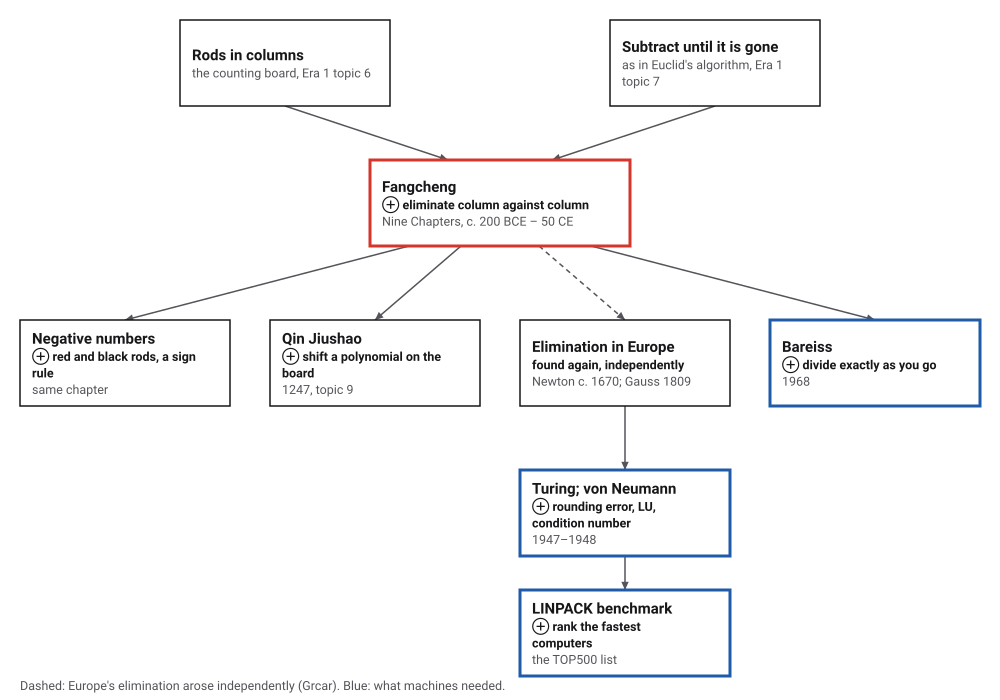
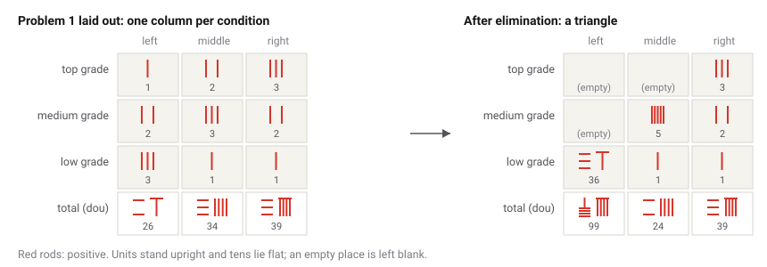
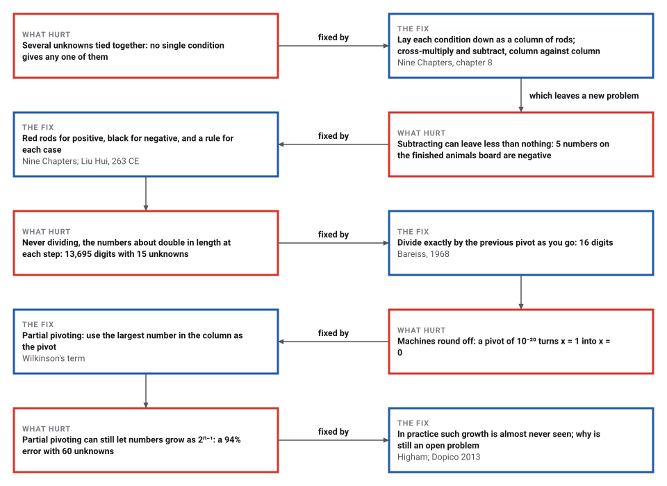
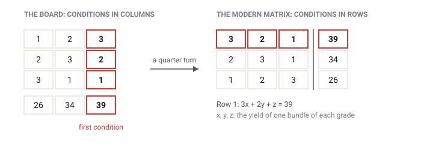

# Elimination on the Counting Board

*Era 2 · topic 1 · c. 200 BCE – 263 CE* · [Era 2 index](../README.md) · [Ptolemy's Table of Chords →](../02-ptolemys-chords/README.md) · [Interactive edition](fangcheng.html) · [Program](../../../code/era-02-algorithms-travel/01-fangcheng/)

> **Field note from the visiting historian.** The clerks here faced a knot: several unknowns tied together by several conditions. They did not untie it with words. They laid it out, column by column, and subtracted until it came apart. When subtraction left less than nothing, they changed the colour of the rods and carried on.

| | |
|---|---|
| **When** | *Nine Chapters*, c. 200 BCE – 50 CE (**disputed**); Liu Hui's commentary 263 CE |
| **Where** | Han China |
| **What hurt** | Several unknowns tied together by several conditions |
| **The fix** | One column of rods per condition; cross-multiply and subtract until the board is a triangle |
| **Cost** | (n³ − n) / 3 multiplications dividing, twice that cross-multiplying; plain numbers about double in length each step (13,695 digits at 15 unknowns) |

## How ideas combined

A new algorithm is usually an older idea combined with a new one. The counting board already held numbers in columns of rods (Era 1, topic 6), and repeated subtraction already wore a number down to nothing (topic 7). Chapter 8 of the *Nine Chapters* combined them: each condition of a problem becomes a column, and one column is subtracted from another until a place is empty. Each box names the idea that was added.

<picture>
  <source media="(prefers-color-scheme: dark)" srcset="assets/family-dark.svg">
  
</picture>
*Red: the procedure of this page. Blue: what calculating machines needed from it, two thousand years later.*

## Work the board

Each condition is one column of rods, with the first condition on the right. Press **Next step**: the middle column is multiplied by the right column's top number, then the right column is subtracted from it until its top place is empty. When the board is a triangle, the last column holds one unknown alone, and the answer is worked back up. Switch to the animals problem to see negative numbers, as black rods, and turn the board a quarter turn to see the modern matrix.

<picture>
  <source media="(prefers-color-scheme: dark)" srcset="assets/board-dark.svg">
  
</picture>
*In the interactive edition you can step through both problems on a board of rods, and turn it into the modern matrix.*

| Step | Column | Multiply by | Becomes | Then | Leaves |
|---|---|---|---|---|---|
| 1 | middle | 3 | 6 9 3 102 | subtract the right column 2 times | 0 5 1 24 |
| 2 | left | 3 | 3 6 9 78 | subtract the right column 1 time | 0 4 8 39 |
| 3 | left | 5 | 0 20 40 195 | subtract the middle column 4 times | 0 0 36 99 |

The left column ends as 0 0 36 99: 36 bundles of low grade give 99 dou. The book keeps 36 as a common divisor and works back up with whole numbers: the dividends are 333, 153 and 99, so one bundle gives **9 1/4**, **4 1/4** and **2 3/4** dou of grain for the top, medium and low grades. The whole problem took 16 multiplications, and no number on the board was ever bigger than 99.

## Era 2, algorithms travel

<picture>
  <source media="(prefers-color-scheme: dark)" srcset="assets/era-timeline-dark.svg">
  
</picture>

## Each fix leaves a new pain

<picture>
  <source media="(prefers-color-scheme: dark)" srcset="assets/chain-dark.svg">
  
</picture>
*Read it as a snake: each new problem sits directly under the fix that exposed it.*

## Black rods

Another problem of chapter 8 trades animals. Sell 2 cattle and 5 sheep and buy 13 pigs, and 1,000 cash is left. Sell 3 cattle and 3 pigs and buy 9 sheep, and the cash is exactly enough. Sell 6 sheep and 8 pigs and buy 5 cattle, and 600 is short. The method says to lay down the cattle and sheep sold as positive and the 13 pigs bought as negative; red rods were positive and black rods negative.

| Step | Column | Multiply by | Becomes | Then | Leaves |
|---|---|---|---|---|---|
| 1 | middle | 2 | 6 −18 6 0 | subtract the right column 3 times | 0 −33 45 −3000 |
| 2 | left | 2 | −10 12 16 −1200 | add the right column 5 times | 0 37 −49 3800 |
| 3 | left | −33 | 0 −1221 1617 −125400 | subtract the middle column 37 times | 0 0 −48 −14400 |

The answer is a cow **1,200**, a sheep **500** and a pig **300** cash. On the way the board made 4 subtractions of like signs, 3 of unlike signs, which add, and 1 from an empty place, where the number changes its sign; 5 numbers on the finished board are negative. Wikipedia translates the chapter's rule for subtracting as "divide by the same name, benefit by different names": take the difference of like signs, add unlike signs. A number taken from an empty place changes its sign.

> **Key idea.** Negative numbers did not arrive as a philosophy. They arrived as a bookkeeping need inside a procedure: subtracting columns sometimes leaves less than nothing, and the procedure must carry on. Martzloff notes that negative numbers never appear in the statements of the problems, only in the working.

## A book known from late copies

The *Nine Chapters on the Mathematical Art* was compiled from older material. Most historians put its origin around 200 BCE; others place it between 100 BCE and 50 CE, and Britannica gives the 1st century BCE to the 1st century CE (**disputed**). Its first explicit mention is on bronze standard measures of 179 CE. Liu Hui wrote his commentary in 263 CE (**documented**). Chapter 8 has 18 problems, with up to six equations in six unknowns.

No ancient copy survives. The earliest surviving edition is from 1213, and chapters 6 to 9, chapter 8 among them, were reconstructed from 18th-century quotations of a lost 15th-century encyclopedia. The name "Gaussian elimination" is modern: Legendre called the method "ordinary" and Gauss called it "common" elimination. Grcar argues that European elimination arose independently of China; Hart argues that *fangcheng* was a practice of rod manipulation, recorded by literati who did not perform it (**conjecture**: one author's reading).

<picture>
  <source media="(prefers-color-scheme: dark)" srcset="assets/quarter-dark.svg">
  
</picture>
*The only differences from a first-year linear algebra course: columns instead of rows, and cross-multiplying instead of dividing.*

## How big do the numbers get?

Cross-multiplying keeps every number whole, but it never divides anything out, so each step multiplies two numbers from the step before. On random systems with entries from −9 to 9, the program measured the largest number on the board, in digits, for plain cross-multiplication, for the same with each column's common factor cancelled, and for Bareiss's 1968 method, which divides exactly by the previous pivot.

| Unknowns | Plain cross-multiplying | Common factors cancelled | Bareiss (1968) | Digits in the answer |
|---|---|---|---|---|
| 3 | 4 | 3 | 3 | 2 |
| 5 | 6 | 3 | 3 | 3 |
| 7 | 62 | 12 | 8 | 8 |
| 9 | 205 | 16 | 10 | 10 |
| 11 | 518 | 18 | 12 | 12 |
| 13 | 2,704 | 24 | 14 | 13 |
| 15 | 13,695 | 25 | 16 | 16 |

<details>
<summary>Place by place, for the 15-unknown system</summary>

| After place | Plain cross-multiplying (digits) | Bareiss (digits) |
|---|---|---|
| 1 | 3 | 3 |
| 2 | 4 | 4 |
| 3 | 8 | 5 |
| 4 | 14 | 5 |
| 5 | 28 | 6 |
| 6 | 55 | 7 |
| 7 | 108 | 8 |
| 8 | 215 | 9 |
| 9 | 429 | 10 |
| 10 | 857 | 12 |
| 11 | 1,713 | 13 |
| 12 | 3,425 | 14 |
| 13 | 6,849 | 15 |
| 14 | 13,695 | 16 |
| 15 | 13,695 | 16 |

</details>

The plain board about doubles in length at every place: 4, 8, 14, 28, 55, … 13,695 digits. Bareiss's board grows by about a digit a place, ending at 16, about the size of the answer itself.

| Unknowns | Multiplications, dividing | Multiplications, cross-multiplying | n³ / 3 |
|---|---|---|---|
| 3 | 8 | 16 | 9 |
| 6 | 70 | 140 | 72 |
| 18 | 1,938 | 3,876 | 1,944 |
| 100 | 333,300 | 666,600 | 333,333 |
| 1,000 | 333,333,000 | 666,666,000 | 333,333,333 |

Elimination by division needs (n³ − n) / 3 multiplications; cross-multiplying needs exactly twice as many, because both columns are multiplied. Either way the work grows as the cube of the number of unknowns.

## Rounding, and the largest pivot

A board of rods is exact. A computer's floating-point numbers are not: they keep about 16 significant digits. Take x/10²⁰ + y = 1 and x + y = 2, where x and y are both very nearly 1. Eliminating with the tiny number 10⁻²⁰ as the pivot gives x = **0.0** and y = 1.0: subtracting 10²⁰ times one row from the other rounds away everything the 1s and 2s were saying. Swapping the rows first, so the pivot is the largest number in its column (*partial pivoting*), gives x = 1.0 and y = 1.0, both right to double precision. Exactly, x = 10²⁰ / (10²⁰ − 1), a hair above 1.

| Unknowns | Worst case: growth | Its error | Random matrix: growth | Its error |
|---|---|---|---|---|
| 20 | 2¹⁹ | 1.5e-11 | 4.5 | 6.4e-15 |
| 40 | 2³⁹ | 1.8e-06 | 7.1 | 4.7e-15 |
| 60 | 2⁵⁹ | 9.4e-01 | 7.3 | 4.1e-15 |

Partial pivoting is not a guarantee: Wilkinson showed in 1954 that the numbers can still grow. On the textbook worst case (1 on the diagonal, −1 below it, 1 in the last column) the last column doubles at every step, the numbers grow as 2ⁿ⁻¹, and with 60 unknowns the error is 94% of the answer. On random matrices the growth stays below 8 and the error near 10⁻¹⁵. Dopico quotes Higham: the growth factor "is almost invariably found to be small", and why remains an open problem.

## Eighteen equations

When the first electronic computers were being built, Gaussian elimination became the first algorithm whose rounding errors were analysed. Von Neumann and Goldstine's 1947 paper was, in Grcar's words, "the first modern paper in numerical analysis". Turing's 1948 paper "Rounding-off errors in matrix processes" named the LU factorization and introduced the condition number, and argued that earlier warnings about rounding were "far too pessimistic". Fox recalled that in 1946 four mathematicians, Turing among them, needed about two weeks to solve 18 equations with desk calculators.

> **Full circle.** Chapter 8 of the *Nine Chapters* has 18 problems. Eighteen unknowns take 1,938 multiplications by division, plus the work back up: the job that took four people about two weeks in 1946. Today the TOP500 list ranks the world's fastest computers by the LINPACK benchmark: solve one huge dense system of linear equations by LU factorization with partial pivoting, about ⅔n³ operations. The procedure laid out in rods two thousand years ago is still the yardstick for the largest machines.

## Before you read on

<details>
<summary><b>1.</b> Why multiply the middle column by 3 instead of dividing the right column by 3?</summary>

Rods can show whole numbers, not thirds. Cross-multiplying keeps every number on the board whole; the price is that the numbers grow.
</details>

<details>
<summary><b>2.</b> After two steps the middle column reads 0 5 1 24 and the left 0 4 8 39. What next?</summary>

Multiply the left column by 5, the middle column's number in the second place, giving 0 20 40 195; then subtract the middle column 4 times: 0 0 36 99.
</details>

<details>
<summary><b>3.</b> In the animals problem, the left column times 2 begins with −10. Why is the right column added, not subtracted?</summary>

The right column begins with 2. Adding it 5 times brings −10 up to 0; subtracting would drive it further below zero.
</details>

<details>
<summary><b>4.</b> How many digits does the plain board reach with 15 unknowns? And with Bareiss's method?</summary>

**13,695** digits plain, **16** with Bareiss: one about doubles at each place, the other grows by about a digit.
</details>

<details>
<summary><b>5.</b> Why did the pivot 10⁻²⁰ give x = 0?</summary>

Multiplying a row by 10²⁰ and subtracting leaves numbers near 10²⁰, and the 1s and 2s of the problem are rounded away. With the larger number as pivot, nothing big is subtracted, and nothing is lost.
</details>


## Where the evidence lives

| | Object | Where to see it | Licence |
|---|---|---|---|
| — | **The Nine Chapters, Siku Quanshu edition**. The imperial library copy of 1773, scanned by Zhejiang University Library. Chapter 8, "Rectangular Arrays", is in the volume of chapters 7–9. | [Source Library scan](https://sourcelibrary.org/book/nine-chapters-on-the-mathematical-art-vols-7-9) | Drawn placeholder. The English shown beside the scan is a machine translation. |
| — | **Counting rods**. Rod numerals were used from the Warring States period (c. 475 BCE) to the 16th century: units upright, tens lying flat, and an empty place for zero; red for positive, black for negative. | [Wikipedia: Counting rods](https://en.wikipedia.org/wiki/Counting_rods) | Drawn placeholder. |

## Every link was opened before it was listed

| Level | Link | Why |
|---|---|---|
| Start | [Illustrating The Nine Chapters on the Mathematical Art: Their Use in a College Mathematics History Classroom](https://www.maa.org/book/export/html/863323) — Joel K. Haack (University of Northern Iowa), MAA; from a 2008 Joint Mathematics Meetings talk | How a college course teaches the book; chapter 8 as "Gaussian elimination" |
| Start | [The Nine Chapters on the Mathematical Procedures](https://britannica.com/topic/The-Nine-Chapters-on-the-Mathematical-Procedures) — Encyclopaedia Britannica | Short overview: dates, rods, the chapter on simultaneous equations, negative numbers |
| Start | [Fangcheng Procedure in the Nine Chapters on the Mathematical Arts Revisited](https://retrospectjournal.com/?p=2906) — Kat Jivkova, *Retrospect Journal* (Edinburgh University student history magazine), 2021 | Walks through Problem 1 on the board, red and black rods, back substitution |
| Start | [The Linpack Benchmark](https://top500.org/project/linpack/) — TOP500 | The benchmark behind the TOP500 list: a dense linear system by LU factorization with partial pivoting, 2/3 n³ + O(n²) operations |
| Start | [Fangcheng (mathematics)](https://en.wikipedia.org/wiki/Fangcheng_(mathematics)) — Wikipedia | Problem 1's answer, the procedure for positive and negative numbers, and references |
| Start | [Counting rods](https://en.wikipedia.org/wiki/Counting_rods) — Wikipedia | How rod numerals are formed; red for positive, black for negative |
| Deeper | [Histories of Numbers](https://www.gresham.ac.uk/watch-now/numbers-cultures) — Gresham College, Karine Chemla (CNRS), 20 October 2021 | Video and transcript. How Chinese rod numerals existed only as rods laid out on a calculating surface. Background on the board, not on chapter 8 itself |
| Deeper | [The method of fang cheng, an ancient Chinese algorithm to solve simultaneous equations](https://courses.maths.ox.ac.uk/mod/resource/view.php?id=2763) — Zhuo Zhang (Exeter College), Oxford Mathematical Institute course resource, 2020 | Sets the rod array beside first-year linear-algebra row reduction and pins down the one difference: cross-multiplying instead of dividing |
| Deeper | [Nine Chapters on the Mathematical Art](https://mathshistory.st-andrews.ac.uk/HistTopics/Nine_chapters/) — MacTutor (O'Connor and Robertson) | All nine chapters, dating, and the column-reduction method of chapter 8 |
| Deeper | [The Chinese Roots of Linear Algebra](https://press.jhu.edu/books/title/10232/chinese-roots-linear-algebra) — Roger Hart, Johns Hopkins University Press, 2011 (publisher's page) | The book-length case that *fangcheng* was a rod-board practice that also yields determinant-style solutions |
| Deeper | [Use of the History of Negative Numbers in Education](https://bibnum.publimath.fr/ACF/ACF11039.pdf) — Lenka Molitorisová, Comenius University, Bratislava | Quotes the cattle, sheep and pigs problem and Liu Hui's commentary on red and black rods from Shen, Crossley and Lun (1999), p. 405 |
| Deeper | [Bareiss algorithm](https://en.wikipedia.org/wiki/Bareiss_algorithm) — Wikipedia | Fraction-free elimination with exact divisions (Bareiss, Mathematics of Computation, 1968) |
| Deeper | [The Suan shu shu and the Nine Chapters on the Mathematical Art: A Comparison](https://old.maa.org/sites/default/files/images/upload_library/46/HOMSIGMAA/2021-Megan%20Ferguson.pdf) — Megan Ferguson, Adelphi University, 2021 (MAA HOMSIGMAA) | Quotes Martzloff: negative numbers are never found in the statements of problems |
| Scholar | [How Ordinary Elimination Became Gaussian Elimination](https://arxiv.org/pdf/0907.2397) — Joseph F. Grcar, arXiv preprint | How the method was done in chapter 8, and how it came to carry Gauss's name |
| Scholar | [The Chinese Roots of Linear Algebra (review)](https://arxiv.org/pdf/1104.2282) — Joseph F. Grcar, arXiv | A review of Hart's thesis by the author of the paper above; the counting board as an ancient "spreadsheet" |
| Scholar | [Rectangular Arrays](https://academic.oup.com/book/52966/chapter/421961670) — Shen Kangshen, J. N. Crossley and A. W.-C. Lun, *The Nine Chapters on the Mathematical Art: Companion and Commentary*, OUP 1999 (chapter page) | The standard English translation of chapter 8 with Liu Hui's commentary (paywalled; abstract free) |
| Scholar | [Nine Chapters on the Mathematical Art, Vols 7–9](https://sourcelibrary.org/book/nine-chapters-on-the-mathematical-art-vols-7-9) — Source Library: *Siku Quanshu* edition (1773), scanned by Zhejiang University Library | Chinese text of chapter 8, "Rectangular Arrays", from p. 43. The English shown alongside is a machine translation, so do not cite it |
| Scholar | [Alan Turing and the origins of modern Gaussian elimination](https://arbor.revistas.csic.es/index.php/arbor/article/download/1886/2073?inline=1) — Froilán M. Dopico, Arbor 189 (764), 2013 | Turing's 1948 paper, the name LU, the condition number, partial pivoting and the growth factor |
| Scholar | [John von Neumann's Analysis of Gaussian Elimination and the Origins of Modern Numerical Analysis](https://epubs.siam.org/doi/10.1137/080734716) — Joseph F. Grcar, SIAM Review 53(4), 2011, 607–682 | Why von Neumann and Goldstine's 1947 paper is called the first modern paper in numerical analysis |
| Scholar | [The Chinese Rod Numeral Legacy and its Impact on Mathematics](https://sms.math.nus.edu.sg/smsmedley/Vol-15-2/The%20Chinese%20rod%20numeral%20legacy%20and%20its%20impact%20on%20mathematics(Lam%20Lay%20Yong).pdf) — Lam Lay Yong, presidential address, Singapore Mathematical Society, 1987 | Two sets of rod notations, alternating by place; a horizontal rod for five |

More, with certainty labels and the gaps we could not fill: [Era 2 reference catalog](https://github.com/vij658/AlgorithmEvolutionAtlas/blob/main/book/era-02-algorithms-travel/reference-catalog.md).

## The program behind every number here

[FangCheng.java](https://github.com/vij658/AlgorithmEvolutionAtlas/blob/main/code/era-02-algorithms-travel/01-fangcheng/FangCheng.java) makes **5,447 checks**: Problem 1 against its published intermediate columns, the animals problem's answer, plain and cancelled cross-multiplication and Bareiss's method against exact fractions (with every Bareiss division checked for exactness), the multiplication counts, and the rounding examples. Run it with `java FangCheng.java` (JDK 17 or newer). The heart of it:

```java
/** x - y, done the way the sign rule describes, and counted. */
static BigInteger boardSubtract(BigInteger x, BigInteger y) {
    if (y.signum() == 0) return x;
    if (x.signum() == 0) noOpponent++;                 // nothing to take from: the number changes sign
    else if (x.signum() == y.signum()) likeSigns++;    // like signs: take the difference
    else unlikeSigns++;                                // unlike signs: add
    return x.subtract(y);
}

/**
 * Fangcheng elimination. For each place k, the column k is the "pivot"; every column j to its left is multiplied by
 * the pivot's number in place k, and the pivot column is subtracted from it as many times as column j had in place
 * k, which empties that place. With reduce, each new column is divided by the common factor of its numbers.
 * trace (may be null) receives one line per step.
 */
static BigInteger[][] fangcheng(BigInteger[][] start, boolean reduce, List<String> trace) {
    BigInteger[][] b = copy(start);
    int n = b.length;
    for (BigInteger[] c : b) for (BigInteger v : c) see(v);
    for (int k = 0; k < n; k++) {
        if (b[k][k].signum() == 0) {                   // an empty pivot place: use a later column instead
            for (int j = k + 1; j < n; j++) if (b[j][k].signum() != 0) { BigInteger[] t = b[k]; b[k] = b[j]; b[j] = t; break; }
        }
        BigInteger p = b[k][k];
        for (int j = k + 1; j < n; j++) {
            BigInteger a = b[j][k];
            if (a.signum() == 0) continue;             // the place is already empty
            BigInteger[] times = new BigInteger[n + 1];
            for (int i = 0; i <= n; i++) times[i] = i < k ? BigInteger.ZERO : b[j][i].multiply(p);
            mults += n - k;                            // places below k and the total; place k is known to empty
            for (int i = k; i <= n; i++) {
                BigInteger sub = b[k][i].multiply(a);
                b[j][i] = i == k ? BigInteger.ZERO : boardSubtract(times[i], sub);
                see(b[j][i]);
            }
            mults += n - k;
            if (reduce) {
                BigInteger g = BigInteger.ZERO;
                for (BigInteger v : b[j]) g = g.gcd(v);
                if (g.compareTo(BigInteger.ONE) > 0) for (int i = 0; i <= n; i++) b[j][i] = b[j][i].divide(g);
            }
            if (trace != null)
                trace.add(String.format("column %d x %s = %s ; %s column %d %s time%s -> %s",
                        j + 1, p, col(times), a.signum() > 0 ? "subtract" : "add", k + 1, a.abs(),
                        a.abs().equals(BigInteger.ONE) ? "" : "s", col(b[j])));
        }
        if (steps != null) steps.add(biggest.toString().length());
    }
    return b;
}
```

