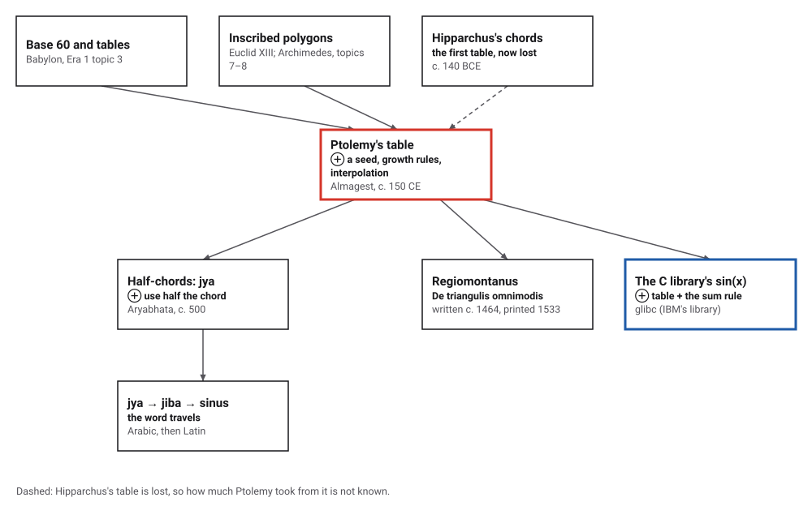
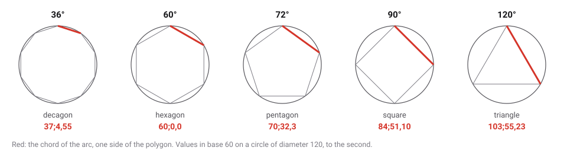
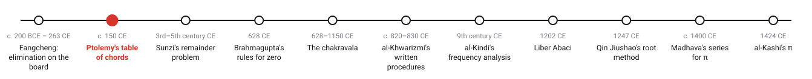
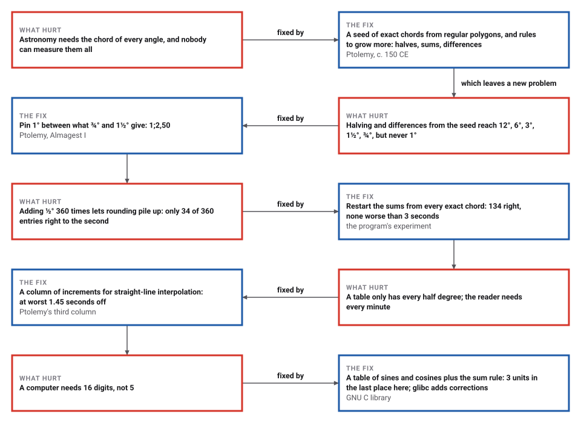
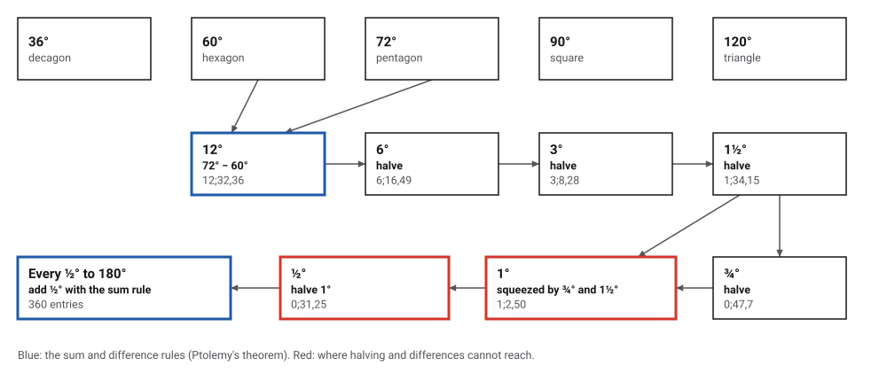

# Ptolemy's Table of Chords

*Era 2 · topic 2 · c. 150 CE* · [Era 2 index](../README.md) · [← Elimination on the Counting Board](../01-fangcheng/README.md) · [The Chinese Remainder Problem →](../03-chinese-remainder-problem/README.md) · [Interactive edition](ptolemys-chords.html) · [Program](../../../code/era-02-algorithms-travel/02-ptolemys-chords/)

> **Field note from the visiting historian.** The sky-watchers of Alexandria met the same geometry problem a thousand times a night: given an angle, how long is the chord across it? Ptolemy did not measure. He started from five chords he knew exactly and grew the rest.

| | |
|---|---|
| **When** | *Almagest*, Book I, c. 150 CE; observations 127–141 CE (**documented**) |
| **Where** | Alexandria |
| **What hurt** | Astronomy needs the chord of every angle |
| **The fix** | A seed of exact chords, rules for halves, sums and differences, and linear interpolation |
| **Cost** | 360 entries; interpolation at worst 1.45 seconds off |

## How ideas combined

A new algorithm is usually an older idea combined with a new one. Ptolemy inherited base-60 fractions and the habit of tables from Babylon (Era 1, topic 3), and the sides of regular polygons from Greek geometry (topics 7 and 8). He added a way to grow a whole table from a handful of exact values. Each box names the idea that was added.

<picture>
  <source media="(prefers-color-scheme: dark)" srcset="assets/family-dark.svg">
  
</picture>
*Red: Ptolemy's table. Blue: the same two moves, a table and the sum rule, inside a computer's sine function today.*

## Read the table, and walk Ptolemy's route

Drag the arc to read its chord from a table with an entry every half degree, interpolating with the increment column. Then press **Next step** to walk Ptolemy's route from the five seed polygons down to half a degree. The yellow segment is half the chord: Indian astronomers later tabulated half-chords instead, and the half-chord became the sine.

<picture>
  <source media="(prefers-color-scheme: dark)" srcset="assets/seeds-dark.svg">
  
</picture>
*In the interactive edition you can drag the arc, read the table with interpolation, and step through Ptolemy's route.*

On a circle of diameter 120, the chord of an arc *a* is 120 sin(*a*/2): a table of chords is a table of sines in disguise. The numbers are in base 60, with a semicolon after the whole parts: 37;4,55 means 37 + 4/60 + 55/3600 parts.

## Era 2, algorithms travel

<picture>
  <source media="(prefers-color-scheme: dark)" srcset="assets/era-timeline-dark.svg">
  
</picture>

## Each fix leaves a new pain

<picture>
  <source media="(prefers-color-scheme: dark)" srcset="assets/chain-dark.svg">
  
</picture>
*Read it as a snake: each new problem sits directly under the fix that exposed it.*

## From five polygons to half a degree

Three rules do all the work. The **supplement**: the angle in a semicircle is a right angle, so the chord of 180° − *a* is √(120² − crd²*a*). **Halving**: crd²(*a*/2) = 60 × (120 − crd(180° − *a*)). **Sums and differences**: in a quadrilateral inside a circle, the two diagonals multiplied equal the two pairs of opposite sides multiplied and added (Ptolemy's theorem); with one side a diameter, that gives the chord of *a* − *b* or *a* + *b* from the chords of *a* and *b*.

<picture>
  <source media="(prefers-color-scheme: dark)" srcset="assets/route-dark.svg">
  
</picture>

| Arc | Rule | Worked to thirds | In the table | True value |
|---|---|---|---|---|
| 36° | side of the decagon |  | 37;4,55 | 37;4,55,20 |
| 60° | side of the hexagon |  | 60;0,0 | 60;0,0,0 |
| 72° | side of the pentagon |  | 70;32,3 | 70;32,3,14 |
| 90° | side of the square |  | 84;51,10 | 84;51,10,8 |
| 120° | side of the triangle |  | 103;55,23 | 103;55,22,58 |
| 12° | difference: 72° − 60° | 12;32,36,1 | 12;32,36 | 12;32,36,18 |
| 6° | half of 12° | 6;16,49,0 | 6;16,49 | 6;16,49,8 |
| 3° | half of 6° | 3;8,28,23 | 3;8,28 | 3;8,28,27 |
| 1½° | half of 3° | 1;34,14,41 | 1;34,15 | 1;34,14,42 |
| ¾° | half of 1½° | 0;47,7,24 | 0;47,7 | 0;47,7,25 |
| 1° | squeeze between ¾° and 1½° | 1;2,49,47 to 1;2,49,52 | 1;2,50 | 1;2,49,52 |
| ½° | half of 1° |  | 0;31,25 | 0;31,24,57 |

Why squeeze? Every arc that halving, sums and differences can reach from 36°, 60°, 72°, 90° and 120° is 3° times a fraction whose bottom is a power of 2, so 1° is out of reach (it would mean trisecting an angle). The program pins it down instead: a chord grows more slowly than its arc, so crd 1° lies between ⅔ × crd 1½° = 1;2,49,47 and 4/3 × crd ¾° = 1;2,49,52. To the second both are **1;2,50**. Halving that gives **0;31,25** for half a degree, the value MacTutor reports from Ptolemy's table.

> **Key idea.** A table can be grown, not measured: a seed of exact values and a few rules that make new entries from old ones. The same pattern, a small table and an addition rule, is how a computer's sine function works today.

## A table in Book I of the Almagest

Ptolemy observed at Alexandria between 127 and 141 CE (**documented**); the *Almagest* is usually placed about 150 CE. His life dates differ even within MacTutor, about 85–165 CE in one article and about 100–170 CE in another (**disputed**). The table runs from ½° to 180° in steps of ½°, with a third column of increments for interpolating. With its chords he obtained π ≈ 3 17/120 and √3 ≈ 1.73205 (**documented**, MacTutor).

Hipparchus made the first known chord table about 140 BCE; it is lost, and the claim that he wrote twelve books of chord tables cannot be checked (**conjecture** for its contents). Whether Hipparchus already used Ptolemy's theorem is **disputed**: Toomer doubts it. Whether Ptolemy computed his own table by the methods he describes is also **disputed**: course notes from Florida State University say there is good reason to think it was not computed that way, or by him.

Indian astronomers tabulated half-chords instead. Aryabhata (about 500) called the function *jya*, and Brahmagupta reproduced the table in 628. In Arabic *jya* became *jiba*, then *jaib*, "fold", which Latin translators rendered *sinus*: the word **sine** (MacTutor).

## How good is a hand-built table?

| How the 360 entries were made | Right to the second | Worst error |
|---|---|---|
| Add ½° to the previous entry, 360 times | 34 of 360 | 9 seconds (at 94 ½°) |
| Restart the sums at every exact or derived chord | 134 of 360 | 3 seconds |

Each sum is rounded to the second, and a long chain of sums lets those roundings pile up: the plain chain gets only 34 entries exactly right. Restarting from the chords known independently (the seeds, 12°, 1½°, 1° and ½°) keeps the worst error to 3 seconds. How Ptolemy's own table was actually computed is not recorded.

| Arc | Chord | Increment per minute of arc |
|---|---|---|
| ½° | 0;31,25 | 0;1,2,50 |
| 1° | 1;2,50 | 0;1,2,50 |
| 1½° | 1;34,15 | 0;1,2,48 |
| 30° | 31;3,30 | 0;1,0,38 |
| 60° | 60;0,0 | 0;0,54,20 |
| 120° | 103;55,23 | 0;0,31,18 |
| 179½° | 119;59,56 | 0;0,0,8 |
| 180° | 120;0,0 | 0;0,0,0 |

Between entries the reader adds the increment once for each minute of arc. The program tried every minute from 0° to 180°: the worst error is **1.45 seconds**, at 168° 15′. The curve of the chord alone allows 1.03 seconds, and rounding the entries half a second more. A half-degree step makes interpolation about as accurate as the table itself.

Two by-products. A polygon of 360 sides has perimeter 360 × crd 1°, so π ≈ 360 × 1;2,50 / 120 = **3;8,30** = 377/120 = 3.141667 (true 3.141593). And the chord of 120° over the radius is √3: 103;55,23 / 60 = 1;43,55,23 = 1.7320509 (true 1.7320508).

The program also checked Ptolemy's theorem itself on 20,000 random quadrilaterals inside a circle: the largest relative gap between the two sides was 6.7e-16, rounding error.

## A table and the sum rule, inside your computer

The GNU C library computes sin(*x*) for most arguments the way Ptolemy filled his table: it looks up the sine and cosine of a nearby tabulated point, computes a short series for the small remainder, and combines them with the sum rule, sin(*x*₀ + *dx*) = sin *x*₀ cos *dx* + cos *x*₀ sin *dx*. The source comment in `s_sin.c` describes "combining the sin and cos of X ... with the values looked up from the sin/cos table".

> **Full circle.** The program built a table of 257 sines and cosines and used the sum rule on 1,000,000 random angles: the worst error was 3 units in the last place of a double. A half-degree table with Ptolemy's straight-line interpolation is off by up to 9.5e-06, five correct decimals, about what his seconds gave. The library also looks up a small correction alongside each table value, and its source states a worst case of 0.518 units.

## Before you read on

<details>
<summary><b>1.</b> Why did Ptolemy use a circle of diameter 120 rather than 1?</summary>

Base 60: with a radius of 60, the chords come out as whole parts plus sixtieths, and the hexagon's side is exactly 60.
</details>

<details>
<summary><b>2.</b> The chord of 60° is 60. What is the chord of 120°?</summary>

By the supplement rule, √(120² − 60²) = √10800 = 60√3 ≈ **103;55,23**.
</details>

<details>
<summary><b>3.</b> Why can't halving and differences reach 1°?</summary>

Starting from 36°, 60°, 72°, 90° and 120°, they only make 3° times a fraction with a power of 2 below. 1° would need a third of 3°: trisecting an angle.
</details>

<details>
<summary><b>4.</b> The table gives 1;2,50 for 1° and the increment 0;1,2,50 per minute. What is the chord of 1° 20′?</summary>

1;2,50 plus 20 increments: 1;23,47. Set the widget's arc to 1° 20′ to compare it with the true value.
</details>

<details>
<summary><b>5.</b> What is the chord of an arc in modern terms?</summary>

On a circle of diameter 120, 120 sin(a/2). Half a chord, over the radius, is the sine of half the arc.
</details>


## Where the evidence lives

| | Object | Where to see it | Licence |
|---|---|---|---|
| — | **The Almagest, Vat. gr. 1594**. A Greek manuscript of Ptolemy's *Syntaxis mathematica* in the Vatican Library, dated about 900 in its record, digitized by the Library and shown by Source Library. | [Source Library page](https://sourcelibrary.org/book/vat-gr-1594-ptolemy) | Drawn placeholder. The English on that page is an AI translation; its licence fields conflict, so no image is copied here. |
| — | **The Almagest in Latin, Vat. lat. 2054**. George of Trebizond's 15th-century Latin translation, a paper codex of 235 folios that he corrected himself: the table travelling into Latin. | [Ptolemaeus Arabus et Latinus record](https://ptolemaeus.badw.de/ms/446) | Drawn placeholder. |

## Every link was opened before it was listed

| Level | Link | Why |
|---|---|---|
| Start | [The Incredible Sine Wave and its Uses](https://www.gresham.ac.uk/watch-now/sine-wave) — Gresham College, Sarah Hart, 23 May 2022 (video and transcript) | Hipparchus's lost chord table and how later sine tables were built from half-angle and sum formulas. Context only: Ptolemy is not mentioned |
| Start | [Claudius Ptolemy](https://mathshistory.st-andrews.ac.uk/Strick/ptolemy.pdf) — Heinz Klaus Strick, trans. John O'Connor, MacTutor (2020) | The construction step by step: exact chords, halving, differences, interpolation |
| Start | [History of Mathematics: Ptolemy's Theorem](https://parabola.unsw.edu.au/sites/default/files/2024-03/vol43_no1_5.pdf) — Michael A. B. Deakin, *Parabola* 43(1), UNSW (2007) | The theorem behind the sum and difference rules, written for school students |
| Deeper | [Ancient Astronomy, Lecture 1](https://people.sc.fsu.edu/~dduke/lectures/lecture1.pdf) — Florida State University course notes (author not named on the slides; the URL is Dennis Duke's) | Ptolemy's toolkit (chords, base-60 fractions, interpolation) and why the table's authorship is doubted |
| Deeper | [Teaching and Learning the Trigonometric Functions through Their Origins: Episode 3 – Ptolemy Finds High Noon in Chords of Circles](https://old.maa.org/press/periodicals/convergence/teaching-and-learning-the-trigonometric-functions-through-their-origins-episode-3-ptolemy-finds-high) — Daniel E. Otero (Xavier University), MAA *Convergence*, December 2020 | Classroom project: use the chord table and sexagesimal arithmetic to check Ptolemy's noon shadows |
| Deeper | [Ptolemy biography](https://mathshistory.st-andrews.ac.uk/Biographies/Ptolemy/) — MacTutor (O'Connor and Robertson) | Dates, observations, the Crd function and the addition formulas |
| Deeper | [Trigonometric functions](https://mathshistory.st-andrews.ac.uk/HistTopics/Trigonometric_functions/) — MacTutor (O'Connor and Robertson) | From Hipparchus's chords to Ptolemy's polygons, half-arc rule and interpolation |
| Deeper | [Euclid's Elements, Book XIII, Proposition 10](https://mathcs.clarku.edu/~djoyce/elements/bookXIII/propXIII10.html) — David E. Joyce, Clark University | The pentagon's side squared equals the hexagon's plus the decagon's, which gives the seed chord of 72° |
| Scholar | [The Mathematics of the Heavens and the Earth (review)](https://old.maa.org/node/109370) — Rob Bradley, MAA Reviews (2011), on Glen Van Brummelen, Princeton UP 2009 | Points to the standard modern account, which has sections on Ptolemy's chord table, the chord of 1° and the interpolation table |
| Scholar | [Ptolemy's Almagest](https://press.princeton.edu/isbn/9780691002606) — G. J. Toomer (trans.), Princeton University Press, 1998 | The standard English translation, from Heiberg's Greek text (publisher's page) |
| Scholar | [Syntaxis Mathematica](https://catalog.perseus.org/catalog/urn:cts:greekLit:tlg0363.tlg001) — Perseus Catalog record | Heiberg's Greek edition (Teubner, 1898–1903) and Manitius's German translation (1912–13), with links to scans |
| Scholar | [s_sin.c (IBM Accurate Mathematical Library)](https://codebrowser.dev/glibc/glibc/sysdeps/ieee754/dbl-64/s_sin.c.html) — GNU C library source, on codebrowser.dev | `do_sin` combines a sin/cos table with the sum rule; its comment states a worst case of 0.518 units in the last place |
| Scholar | [Vat. lat. 2054](https://ptolemaeus.badw.de/ms/446) — Ptolemaeus Arabus et Latinus, Bavarian Academy of Sciences | George of Trebizond's Latin Almagest, 15th century, with images |

More, with certainty labels and the gaps we could not fill: [Era 2 reference catalog](https://github.com/vij658/AlgorithmEvolutionAtlas/blob/main/book/era-02-algorithms-travel/reference-catalog.md).

## The program behind every number here

[PtolemyChords.java](https://github.com/vij658/AlgorithmEvolutionAtlas/blob/main/code/era-02-algorithms-travel/02-ptolemys-chords/PtolemyChords.java) makes **20,018 checks**: Ptolemy's theorem on 20,000 random quadrilaterals, the seed and derived chords against the true values, the squeeze for 1°, the half-degree value 0;31,25, π = 377/120, the interpolation bound, and the table-plus-sum-rule sine on a million angles. Run it with `java PtolemyChords.java` (JDK 17 or newer). The heart of it:

```java
static double half(double cSupp) { return Math.sqrt(D / 2 * (D - cSupp)); }       // from crd(180 - a) to crd(a/2)

/** crd(a - b) from crd a, crd b and their supplements: Ptolemy's theorem with one side a diameter. */
static double difference(double ca, double cb) { return (ca * supplement(cb) - cb * supplement(ca)) / D; }

/** crd(a + b): first the supplement of the sum, then back. */
static double sum(double ca, double cb) { return supplement((supplement(ca) * supplement(cb) - ca * cb) / D); }
```

