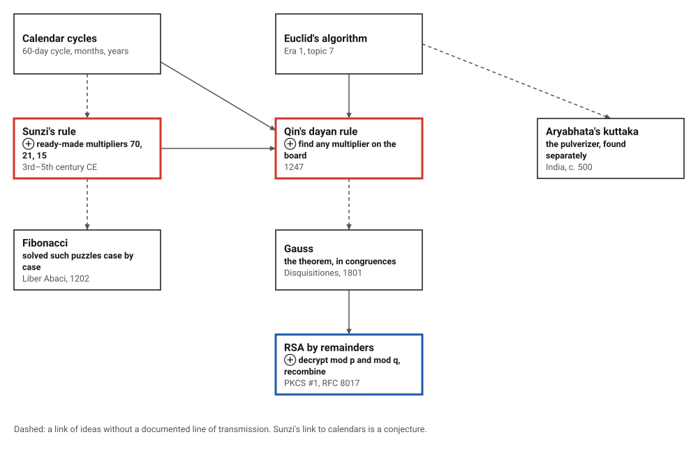
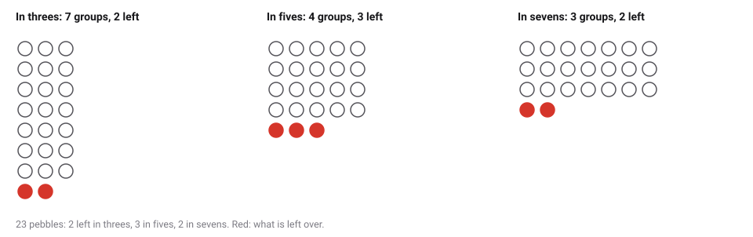
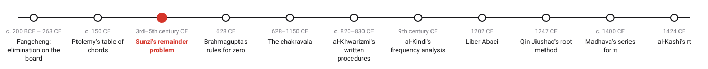
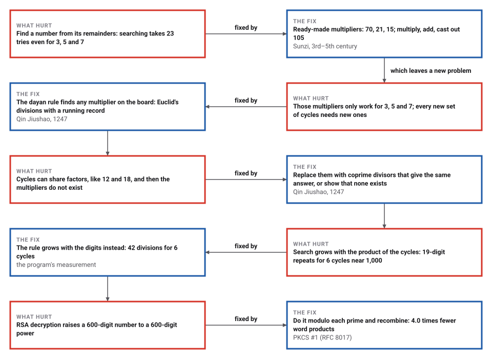

# The Chinese Remainder Problem

*Era 2 · topic 3 · 3rd–5th century CE* · [Era 2 index](../README.md) · [← Ptolemy's Table of Chords](../02-ptolemys-chords/README.md) · [Zero Becomes a Number →](../04-zero-becomes-a-number/README.md) · [Interactive edition](chinese-remainder-problem.html) · [Program](../../../code/era-02-algorithms-travel/03-chinese-remainder-problem/)

> **Field note from the visiting historian.** A short puzzle in a Chinese primer turned out to hold a whole method. The answer comes from three numbers kept ready in advance, and a later treatise shows how to make such numbers for any cycles, by a chain of divisions my hosts would call Euclid's algorithm with a memory.

| | |
|---|---|
| **When** | *Sunzi Suanjing*, 3rd–5th century CE (**disputed**); Qin Jiushao's general rule, 1247 |
| **Where** | China |
| **What hurt** | Finding a number from its remainders, when the cycles are long |
| **The fix** | Ready-made multipliers; the dayan rule computes them for any divisors |
| **Cost** | A few divisions per cycle, instead of up to the product of the cycles; 10 divisions for Qin's calendar congruence |

## How ideas combined

A new algorithm is usually an older idea combined with a new one. Sunzi's rule needs a few ready-made numbers; finding them for any divisors needs Euclid's chain of divisions (Era 1, topic 7) with a running record kept on the counting board. Each box names the idea that was added.

<picture>
  <source media="(prefers-color-scheme: dark)" srcset="assets/family-dark.svg">
  
</picture>
*Red: the two Chinese steps. Blue: the same rule inside every RSA private-key operation that follows PKCS #1.*

## Count in threes, fives and sevens

Set three remainders and three divisors. **Solve by Sunzi's rule** builds the ready-made numbers with Qin's dayan board, multiplies, adds and casts out the product; **Search instead** counts up from zero. Then count the answer off in groups and watch the leftovers.

<picture>
  <source media="(prefers-color-scheme: dark)" srcset="assets/pebbles-dark.svg">
  
</picture>
*In the interactive edition you can choose your own divisors and remainders and watch the dayan board find the multipliers.*

The problem, in MacTutor's translation: "Suppose we have an unknown number of objects. When counted in threes, 2 are left over, when counted in fives, 3 are left over, and when counted in sevens, 2 are left over. How many objects are there?" Sunzi's working: 2 x 70 + 3 x 21 + 2 x 15 = **233**; take away 210 and **23** remains. The program checked that every one of the 105 triples of remainders has its own answer below 105, so the rule never fails and never gives two answers.

> **Key idea.** Each ready-made number does one job and stays out of the others' way: 70 leaves 1 by 3 and nothing by 5 or 7; 21 leaves 1 by 5 and nothing by 3 or 7; 15 leaves 1 by 7 and nothing by 3 or 5. Multiply each by the remainder you want, and the three jobs add up without interfering.

## Era 2, algorithms travel

<picture>
  <source media="(prefers-color-scheme: dark)" srcset="assets/era-timeline-dark.svg">
  
</picture>

## Each fix leaves a new pain

<picture>
  <source media="(prefers-color-scheme: dark)" srcset="assets/chain-dark.svg">
  
</picture>
*Read it as a snake: each new problem sits directly under the fix that exposed it.*

## Finding one: the dayan board

To build a ready-made number for the divisor *m*, multiply the other divisors to get *M* and find *k* so that *M* × *k* leaves 1 by *m*. Qin Jiushao's *dayan qiuyi* rule ("finding one") does it on four places of the counting board: *M* (reduced by *m*) at the upper right, *m* at the lower right, 1 at the upper left. Divide the lower number by the upper and the upper by the lower in turn, each time adding the quotient times the left-hand number to the other left-hand place, until the upper right is 1. The upper left is *k*.

| Divisor | Other divisors multiplied | Reduced | k | Ready-made number |
|---|---|---|---|---|
| 3 | 35 | 2 | 2 | 70 |
| 5 | 21 | 1 | 1 | 21 |
| 7 | 15 | 1 | 1 | 15 |

Qin's own book has far larger numbers. One calendar problem needs *k* with 377,873 × *k* leaving 1 by 499,067. The board takes 10 divisions:

| Step | Divide | Quotient | Upper left | Upper right | Lower left | Lower right |
|---|---|---|---|---|---|---|
| 1 | lower by upper | 1 | 1 | 377,873 | 1 | 121,194 |
| 2 | upper by lower | 3 | 4 | 14,291 | 1 | 121,194 |
| 3 | lower by upper | 8 | 4 | 14,291 | 33 | 6,866 |
| 4 | upper by lower | 2 | 70 | 559 | 33 | 6,866 |
| 5 | lower by upper | 12 | 70 | 559 | 873 | 158 |
| 6 | upper by lower | 3 | 2,689 | 85 | 873 | 158 |
| 7 | lower by upper | 1 | 2,689 | 85 | 3,562 | 73 |
| 8 | upper by lower | 1 | 6,251 | 12 | 3,562 | 73 |
| 9 | lower by upper | 6 | 6,251 | 12 | 41,068 | 1 |
| 10 | upper by lower | 11 | 457,999 | 1 | 41,068 | 1 |

The upper left ends at **457,999**: 377,873 × 457,999 = 173,065,456,127 = 346,778 × 499,067 + 1. Shen Kangsheng's history prints the same answer for this problem. On 100,000 random divisors below a billion, the board gave the same answer as the modern extended Euclidean algorithm every time, in 16.6 divisions on average and never more than 30.

Two more of Qin's ideas. In his first example, three cycles of 19, 17 and 12 with remainders 1, 14 and 1 give **3,193**, repeating every 3,876. And when divisors share factors, he replaced them with coprime ones that give the same answer: 5 left by 12 and 11 left by 18 becomes a problem in 4 and 9, answer **29**, repeating every 36. The program checked this replacement against search on 5,819 systems, including those with no answer at all.

## A puzzle in a primer, a method in a treatise

The *Sunzi Suanjing* is hard to date. MacTutor lists estimates from about 250 BCE to after 280 CE and notes that, as a whole, the text "cannot be older than 473 AD"; other sources give the 3rd, 4th or 5th century (**disputed**). The book was probably compiled from older material of different dates.

Qin Jiushao (1202–1261) wrote the *Shushu jiuzhang* in 1247 (**documented**). He said he learned the method from calendar experts at the Board of Astronomy, who used it without understanding it. Chinese calendar-makers needed such congruences to find a *shangyuan*, a starting moment when the 60-day cycle, the winter solstice and the new moon coincide; Shen Kangsheng traces this to the Jingchu calendar of 237 CE. That Sunzi's own puzzle came from calendar work is a **conjecture**: no source opened here says so.

In India, Aryabhata's 5th-century work contains instances of the same theorem. In 1874 Mathiesen pointed out that Sunzi's method matches Gauss's, which is why Western books call it the *Chinese* remainder theorem (one source). Cheng Dawei set the multipliers 70, 21 and 15 to verse in 1592.

## Search against the rule

| Cycles (primes near 1,000) | Repeats every | Answer | Search: tries | Rule: divisions |
|---|---|---|---|---|
| 2 | 1,022,117 | 695,934 | 695,935 | 4 |
| 3 | 1,041,537,223 | 452,563,575 | 452,563,576 | 10 |
| 4 | 1,063,409,504,683 | 917,589,108,979 | 917,589,108,980 | 24 |
| 5 | 1,096,375,199,328,173 | 980,013,567,820,897 | 980,013,567,820,898 | 30 |
| 6 | 1,132,555,580,906,002,709 | 717,803,553,928,955,531 | 717,803,553,928,955,532 | 42 |

Searching has to walk up to the answer, which can be anywhere below the product of the cycles, so the work multiplies with every cycle added. The rule's work, a few divisions per cycle, only adds.

## Decrypting by remainders

An RSA private key works modulo *n* = *p* × *q*, a number of about 600 digits. PKCS #1, the RSA standard (RFC 8017, 2016), stores the key a second way, as *p*, *q*, *dP*, *dQ* and *qInv*, so that decryption can work modulo *p* and modulo *q* separately: `m1 = c^dP mod p`, `m2 = c^dQ mod q`, `h = (m1 − m2) × qInv mod p`, `m = m2 + q × h`. The last two steps are Sunzi's rule for two divisors.

> **Full circle.** The program made a 2048-bit key and decrypted 200 messages both ways. Plain decryption took 3,053 multiplications of 2048-bit numbers; by remainders, 3,035 multiplications of 1024-bit numbers. Counting 64-bit word products, that is 3,126,272 against 776,960: **4.0 times fewer**. A puzzle about counting things in threes, fives and sevens is inside every RSA decryption that follows the standard.

## Before you read on

<details>
<summary><b>1.</b> Why is 70 the ready-made number for 3, and not 35?</summary>

35 is divisible by 5 and 7 but leaves 2 by 3. Doubling it gives 70, which leaves 1 by 3 and is still divisible by 5 and 7.
</details>

<details>
<summary><b>2.</b> Counted in threes, 1 is left; in fives, 1; in sevens, 1. How many?</summary>

70 + 21 + 15 = 106; cast out 105: **1**. (Or notice that 1 itself leaves 1 every time.)
</details>

<details>
<summary><b>3.</b> Why cast out 105 and not some other number?</summary>

105 = 3 × 5 × 7 leaves nothing by any of the three, so taking it away does not change any remainder. Any smaller number would.
</details>

<details>
<summary><b>4.</b> The dayan board for 377,873 by 499,067 ends with 457,999 at the upper left. How can you check it without the board?</summary>

Multiply: 377,873 × 457,999 = 173,065,456,127, which is 346,778 × 499,067 + 1.
</details>

<details>
<summary><b>5.</b> Why can 1 by 4 and 2 by 6 never both hold?</summary>

Leaving 1 by 4 makes the number odd; leaving 2 by 6 makes it even. Divisors that share a factor must agree on it.
</details>


## Where the evidence lives

| | Object | Where to see it | Licence |
|---|---|---|---|
| — | **Sunzi Suanjing**. The whole book in Chinese as a Project Gutenberg e-text; the remainder problem is Volume 3, Problem 26. The catalogue lists the Tang editor Li Chunfeng (602–670). | [Project Gutenberg #24038](https://m.gutenberg.org/ebooks/24038) | Drawn placeholder. |
| — | **RFC 8017 (PKCS #1 v2.2)**. The RSA standard, November 2016. Section 5.1.2 decrypts by the remainder theorem with dP, dQ and qInv. | [RFC Editor](https://rfc-editor.org/rfc/rfc8017) | Drawn placeholder. |

## Every link was opened before it was listed

| Level | Link | Why |
|---|---|---|
| Start | [Chinese Remainder Theorem](https://legacy-www.math.harvard.edu/~knill/seminars/chinese/chinese.pdf) — Oliver Knill, Math Circle slides, Harvard, 15 April 2014 | Sunzi's problem worked visually, with a timeline to Qin Jiushao's "full algorithm" |
| Start | [Non-Western Perspectives, Part 2: Mathematics from China and Africa (Worksheet 11)](https://sites.oxy.edu/ron/math/400/19/ws/ws11.pdf) — Senior Colloquium: History of Mathematics, worksheet (Fall 2019), Occidental College site; instructor not named | Students rework Sunzi's 140 + 63 + 30 − 210 solution |
| Start | [Chinese remainder theorem](https://www.britannica.com/print/article/112749) — Encyclopaedia Britannica | Short statement of the theorem, Sun Zi and Qin Jiushao |
| Deeper | [Histories of Numbers](https://www.gresham.ac.uk/watch-now/numbers-cultures) — Gresham College, Karine Chemla (CNRS), 20 October 2021 (video and transcript) | The *Sunzi Suanjing* as the text that explains rod numerals on a calculating surface; Qin Jiushao's *Shu shu jiu zhang*. The remainder problem itself is not discussed |
| Deeper | [Chinese Remainder Theorem (中國剩餘定理), Lecture Notes Set #04, AMA1D01C](https://polyu.edu.hk/ama/profile/hwlee/AMA1D01C/lec04.pdf) — Hong Kong Polytechnic University, Dept. of Applied Mathematics (in Chinese) | The original Chinese text, why 70/21/15 work, and Qin's *dayan qiuyi* procedure with worked examples |
| Deeper | [Sun Zi](https://mathshistory.st-andrews.ac.uk/Biographies/Sun_Zi/) — MacTutor | The problem and the rule in translation, and the full argument over dating |
| Deeper | [Qin Jiushao](https://mathshistory.st-andrews.ac.uk/Biographies/Qin_Jiushao/) — MacTutor | The 1247 generalisation, non-coprime moduli, and the calendar experts |
| Deeper | [RFC 8017: PKCS #1: RSA Cryptography Specifications Version 2.2](https://rfc-editor.org/rfc/rfc8017) — K. Moriarty (ed.), B. Kaliski, J. Jonsson, A. Rusch, November 2016 | Section 3.2 (the key as p, q, dP, dQ, qInv) and 5.1.2 (decryption by remainders) |
| Scholar | [Historical development of the Chinese remainder theorem](https://link.springer.com/doi/10.1007/BF00357063) — Shen Kangsheng, *Archive for History of Exact Sciences* 38(4) (1988) 285–305 | The standard history, from calendars to Qin's *dayan* rule. A full-text PDF is on a University of Kentucky course page |
| Scholar | [Indeterminate Analysis of the First Degree outside China (Ch. 14)](https://legacy-www.math.harvard.edu/~knill/crt/lib/Libbrecht14.pdf) — Ulrich Libbrecht, *Chinese Mathematics in the Thirteenth Century* (PDF on Knill's Harvard CRT site) | Sunzi to Qin compared with India and Fibonacci, who solved congruences case by case |
| Scholar | [Multivariable Chinese remainder theorem](https://link.springer.com/doi/10.1007/s12045-015-0171-x) — B. Sury, *Resonance* 20(3) (2015) 206–216 | History in the abstract (Sunzi, calendars, Aryabhata, Qin), then generalisations |
| Scholar | [孫子剩餘定理與高斯剩餘定理](https://web.math.sinica.edu.tw/media/pdf/d353/35308.pdf) — Wang Yixun, *數學傳播* 35(3) (2011) 64–79, Academia Sinica (in Chinese) | Quotes the original problem and rule in full and compares them with Gauss's method |

More, with certainty labels and the gaps we could not fill: [Era 2 reference catalog](https://github.com/vij658/AlgorithmEvolutionAtlas/blob/main/book/era-02-algorithms-travel/reference-catalog.md).

## The program behind every number here

[ChineseRemainder.java](https://github.com/vij658/AlgorithmEvolutionAtlas/blob/main/code/era-02-algorithms-travel/03-chinese-remainder-problem/ChineseRemainder.java) makes **106,153 checks**: Sunzi's multipliers and answer, all 105 triples of remainders, the dayan rule against the extended Euclidean algorithm on 100,000 random cases, Qin's calendar congruence, divisors with shared factors against search, and RSA decryption both ways. Run it with `java ChineseRemainder.java` (JDK 17 or newer). The heart of it:

```java
/**
 * Qin Jiushao's dayan qiuyi: k with a k = 1 (mod m), for a and m coprime, a reduced below m. The board has four
 * places: upper left (starts at 1), upper right (a), lower left (starts at 0), lower right (m). trace may be null.
 */
static long dayan(long a, long m, List<String> trace) {
    long ul = 1, ur = a % m, ll = 0, lr = m;
    if (ur == 1) return 1;
    while (true) {
        long q = lr / ur;                              // the lower right divided by the upper right
        lr -= q * ur;
        ll += q * ul;
        divisions++;
        if (trace != null) trace.add(String.format("lower by upper: quotient %d ; board %d %d / %d %d", q, ul, ur, ll, lr));
        if (lr == 0) throw new IllegalArgumentException("not coprime");
        q = lr == 1 ? ur - 1 : ur / lr;                // the upper right divided by the lower right; stop at 1, not 0
        ur -= q * lr;
        ul += q * ll;
        divisions++;
        if (trace != null) trace.add(String.format("upper by lower: quotient %d ; board %d %d / %d %d", q, ul, ur, ll, lr));
        if (ur == 1) return ul % m;
    }
}
```

