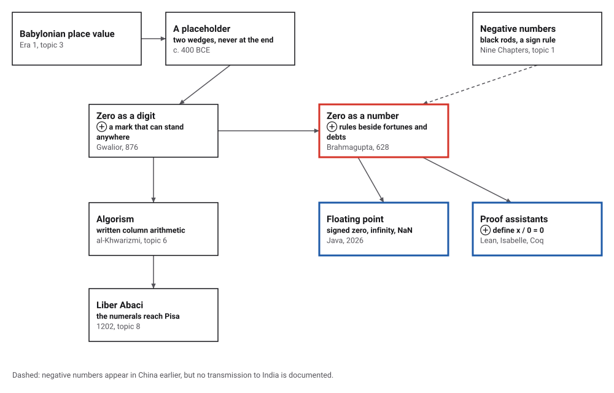
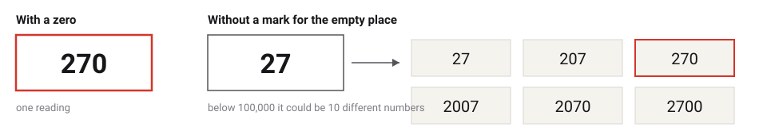
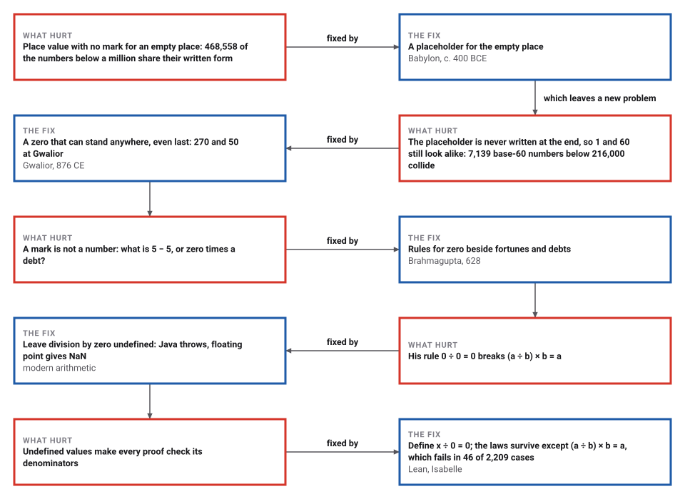

# Zero Becomes a Number

*Era 2 · topic 4 · 628 CE* · [Era 2 index](../README.md) · [← The Chinese Remainder Problem](../03-chinese-remainder-problem/README.md) · [The Chakravala and Pell's Equation →](../05-chakravala/README.md) · [Interactive edition](zero-becomes-a-number.html) · [Program](../../../code/era-02-algorithms-travel/04-zero-becomes-a-number/)

> **Field note from the visiting historian.** For more than a thousand years the Babylonians wrote place-value numbers with no mark for an empty place, and readers guessed. In India the mark became a number. Brahmagupta wrote down what zero does in every operation, next to the rules for fortunes and debts.

| | |
|---|---|
| **When** | Brahmagupta, 628 CE; the Gwalior inscription, 876 CE (earlier Southeast Asian zeros, **disputed**) |
| **Where** | India: Bhillamala (Bhinmal), Gwalior |
| **What hurt** | Place value needs a mark for an empty place, and arithmetic needs rules for it |
| **The fix** | Zero as a digit that can stand anywhere, and as a number with its own rules |
| **Cost** | Without it, 46.9% of the numbers below a million can be misread |

## How ideas combined

A new algorithm is usually an older idea combined with a new one. Place value came from Babylon (Era 1, topic 3), with a placeholder for an empty place added late. Indian numerals let the mark stand anywhere, and Brahmagupta gave it rules, next to the rules for positive and negative numbers. Each box names the idea that was added.

<picture>
  <source media="(prefers-color-scheme: dark)" srcset="assets/family-dark.svg">
  
</picture>
*Red: zero as a number. Blue: two modern answers to the question Brahmagupta answered first, what dividing by zero gives.*

## Read it without a zero

Type a number and see how it would be written with no mark for an empty place, and how many other numbers would look the same. Then try Brahmagupta's rules on fortunes, debts and zero, next to what Java and the proof assistants answer today.

<picture>
  <source media="(prefers-color-scheme: dark)" srcset="assets/readings-dark.svg">
  
</picture>
*In the interactive edition you can type any number below a million, and try Brahmagupta's rules.*

| System | Numbers | Written like another number | Share | Largest group |
|---|---|---|---|---|
| Base 10, no mark | 1 to 999,999 | 468,558 | 46.9% | 20 (all written "111") |
| Base 60, no mark | 1 to 215,999 | 10,620 | 4.9% | 3 |
| Base 60, placeholder never at the end | 1 to 215,999 | 7,139 | 3.3% | 3 |
| Any base, with a zero |  | 0 | 0% | 1 |

Without a mark, almost half the numbers below a million can be misread. Base 60 suffers less, because an empty place is rarer when each place holds 60 values, but 10,620 numbers still collide. A placeholder inside the number removes most of the problem; what is left is exactly the numbers that differ by a factor of 60, like 1 and 60, which only a final zero can tell apart.

## Era 2, algorithms travel

<picture>
  <source media="(prefers-color-scheme: dark)" srcset="assets/era-timeline-dark.svg">
  
</picture>

## Each fix leaves a new pain

<picture>
  <source media="(prefers-color-scheme: dark)" srcset="assets/chain-dark.svg">
  
</picture>
*Read it as a snake: each new problem sits directly under the fix that exposed it.*

## Fortunes, debts and zero

Brahmagupta defined zero as a number subtracted from itself, and gave it rules beside those for "fortunes" and "debts", positive and negative numbers. In MacTutor's translation: "A debt minus zero is a debt." "Zero minus zero is a zero." "A debt subtracted from zero is a fortune." "The product of zero multiplied by a debt or fortune is zero." The program implements them:

| Rule | Example: 5 and 3 |
|---|---|
| A debt minus zero | a debt of 5 |
| A fortune minus zero | a fortune of 5 |
| Zero minus zero | zero |
| Zero minus a debt | a fortune of 5 |
| Zero minus a fortune | a debt of 5 |
| Zero times a debt | zero |
| A debt times a debt | a fortune of 15 |
| A debt times a fortune | a debt of 15 |

On all 14,641 pairs of whole numbers from −60 to 60, his addition, subtraction and multiplication give exactly what modern arithmetic gives, and so does his division on the 14,520 pairs with a divisor other than zero. Two rules differ. A fortune or debt divided by zero is left as "a fraction with zero as denominator" (7/0 stays 7/0), which says little. And "zero divided by zero is zero": MacTutor calls this wrong.

> **Key idea.** A placeholder only says that a place is empty. A number has to answer every question arithmetic can ask of it: what is it plus 5, times a debt, divided by itself? Brahmagupta answered all of them, and only one answer was later taken back.

## Which zero was first?

Brahmagupta (598–670) wrote the *Brahmasphutasiddhanta* in 628 at Bhillamala, modern Bhinmal (**documented**). The Babylonians wrote place-value numbers with no mark for an empty place for over a thousand years; from about 400 BCE they used two wedges as a placeholder, but never at the end of a number (**documented**, MacTutor).

The inscription at a temple in Gwalior records a garden of 187 by 270 *hastas* and a daily gift of 50 garlands, dated 933 in an era beginning in 57 BCE, that is 876 CE. It is the earliest dated Indian zero that everyone accepts. But stone inscriptions in Southeast Asia are two centuries older: the Cambodian stele K-127 is dated in the Khmer year 604 or 605, 682–685 CE depending on the reading, and three Sumatran stones date from the 680s (**disputed**: which is oldest, and the exact year of K-127).

The Bakhshali manuscript, full of dot zeros, gave radiocarbon dates of CE 224–383, 680–779 and 885–993 for three of its folios. Oxford announced in 2017 that it was "as early as the 3rd or 4th century"; Plofker, Keller, Hayashi, Montelle and Wujastyk argue that the latest folio dates the copying, most likely the 9th to 10th century (**disputed**).

## What dividing by zero gives today

| Expression | Java's answer |
|---|---|
| 7 / 0 (whole numbers) | ArithmeticException: / by zero |
| 7.0 / 0.0 | Infinity |
| −7.0 / 0.0 | -Infinity |
| 0.0 / 0.0 | NaN |
| 0.0 == −0.0 | true |
| 1 / −0.0 | -Infinity |
| NaN == NaN | false |

Whole-number division by zero stops the program. Floating point keeps going: a non-zero number over zero is an infinity with a sign, and zero over zero is NaN, "not a number", a value so strange that it is not equal even to itself. Zero itself has a sign: 0.0 and −0.0 are equal, yet dividing 1 by each gives opposite infinities.

## Zero divided by zero is zero, again

Proof assistants, the programs that check mathematical proofs line by line, need division to give an answer for every input. Lean and Isabelle (and Coq) define *x* / 0 = 0, Hillel Wayne explains: division is not one of the axioms of a field, so it can be completed with any value at zero without contradiction, because the theorems about division all assume a non-zero denominator anyway.

> **Full circle.** The program defined *x* / 0 = 0 on 47 fractions and tested three laws on all 103,823 triples: (a/b)/c = a/(bc), (a+b)/c = a/c + b/c and a/b + c/b = (a+c)/b all hold, zero denominators included. Only (a/b) × b = a breaks, in 46 of 2,209 pairs: exactly those with b = 0 and a not 0. Brahmagupta's rejected rule, 0 ÷ 0 = 0, is the answer these systems give.

## Before you read on

<details>
<summary><b>1.</b> Without a zero, which numbers below 1,000 are written "5"?</summary>

5, 50 and 500: the digit 5 with any number of empty places after it.
</details>

<details>
<summary><b>2.</b> Why could a Babylonian placeholder in the middle of a number still not tell 1 from 60?</summary>

It was never written at the end. 1 and 60 (one sixty and an empty units place) both appear as a single 1.
</details>

<details>
<summary><b>3.</b> By Brahmagupta's rules, what is zero minus a debt of 5?</summary>

"A debt subtracted from zero is a fortune": a fortune of 5, which is 0 − (−5) = 5.
</details>

<details>
<summary><b>4.</b> Why is 0 ÷ 0 = 0 a problem if we also want (a ÷ b) × b = a?</summary>

With b = 0 that law would make (a ÷ 0) × 0 = a for every a, but anything times 0 is 0. No single value of 0 ÷ 0 can satisfy it for all a.
</details>

<details>
<summary><b>5.</b> In Java, why does 1 / −0.0 differ from 1 / 0.0?</summary>

Floating-point zero carries a sign: 1 / 0.0 is Infinity and 1 / −0.0 is -Infinity, even though 0.0 == −0.0 is true.
</details>


## Where the evidence lives

| | Object | Where to see it | Licence |
|---|---|---|---|
| — | **The Gwalior inscription, 876 CE**. A temple grant recording a garden of 187 by 270 hastas and 50 garlands a day: the earliest Indian zero dated beyond dispute. Casselman's AMS column gives a translation. | [AMS Feature Column](https://www.ams.org/publicoutreach/feature-column/fcarc-india-zero) | Drawn placeholder; photographs of the stone are linked from the Smithsonian article in the reading list. |
| — | **Brahmagupta in English, 1817**. Colebrooke's translation of Brahmagupta's and Bhaskara's arithmetic and algebra, the classic source for the rules of zero. | [Internet Archive scan](https://archive.org/details/algebrawitharith00brahuoft/page/n5/mode/2up) | Drawn placeholder. |

## Every link was opened before it was listed

| Level | Link | Why |
|---|---|---|
| Start | [Much ado about zero](https://www.gresham.ac.uk/watch-now/much-ado-about-zero) — Gresham College, Robin Wilson, 17 November 2004 (embedded video) | Mathematics of China, India and Central America over a thousand years, ending with "the elusive origins of zero" |
| Start | [Where do mathematical symbols come from?](https://www.gresham.ac.uk/sites/default/files/2021-04-27-1300_HART_Symbols-T.pdf) — Gresham College, Sarah Hart, 27 April 2021 (transcript) | Babylonian placeholder versus zero as a number in Brahmagupta (dated "around 630AD" in the talk) |
| Start | [You Can Visit the World's Oldest Zero at a Temple in India](https://www.smithsonianmag.com/smart-news/you-can-visit-the-worlds-oldest-zero-at-a-temple-in-india-2120286/) — Colin Schultz, *Smithsonian Magazine*, 16 October 2013 | Photo of the Gwalior "270" and the popular "oldest zero" story |
| Start | [The Elusive Origin of Zero](https://www.scientificamerican.com/article/the-elusive-origin-of-zero1/) — Swetz and Zain, *Scientific American* (opinion; undated on the page) | The Southeast Asian challenge to Gwalior: Sambor and the Sumatran stones |
| Deeper | [A history of Zero](https://mathshistory.st-andrews.ac.uk/HistTopics/Zero/) — MacTutor (O'Connor and Robertson) | From Babylonian wedges to Brahmagupta's rules and Gwalior |
| Deeper | [Brahmagupta](https://mathshistory.st-andrews.ac.uk/Biographies/Brahmagupta/) — MacTutor (O'Connor and Robertson) | The rules for fortunes, debts and zero, quoted in translation |
| Deeper | [All for Nought](https://www.ams.org/publicoutreach/feature-column/fcarc-india-zero) — Bill Casselman (UBC), AMS Feature Column, February 2007 | A translation of the Gwalior inscription with its numbers 933, 187, 270 and 50, and why it fixes a date for the zero |
| Deeper | [Mathematical Treasure: The Cambodian Zero](https://old.maa.org/press/periodicals/convergence/mathematical-treasure-the-cambodian-zero) — Frank J. Swetz (Penn State), MAA *Convergence*, 2015 (updated 2024) | Stele K-127, the zero two centuries older than Gwalior |
| Deeper | [1/0 = 0](https://hillelwayne.com/post/divide-by-zero/) — Hillel Wayne (2018, disclaimer added 2024) | Why Lean, Isabelle and Coq can define x/0 = 0 without contradiction |
| Scholar | [The Bakhshālī Manuscript: A Response to the Bodleian Library's Radiocarbon Dating](https://journals.library.ualberta.ca/hssa/index.php/hssa/article/view/22) — Plofker, Keller, Hayashi, Montelle and Wujastyk, *History of Science in South Asia* 5(1) (2017) 134–150 | The specialists' case against reading the earliest folio date as the date of the text |
| Scholar | [Algebra, with Arithmetic and Mensuration, from the Sanscrit of Brahmegupta and Bháscara](https://archive.org/details/algebrawitharith00brahuoft/page/n5/mode/2up) — H. T. Colebrooke (trans.), London: J. Murray, 1817, Internet Archive | The classic English translation of Brahmagupta's arithmetic and algebra, the source of his rules for zero |
| Scholar | [Carbon dating finds Bakhshali manuscript contains oldest recorded origins of the symbol 'zero'](https://www.glam.ox.ac.uk/node/218481) — University of Oxford, Gardens, Libraries and Museums, 14 September 2017 | The original announcement that started the dispute |

More, with certainty labels and the gaps we could not fill: [Era 2 reference catalog](https://github.com/vij658/AlgorithmEvolutionAtlas/blob/main/book/era-02-algorithms-travel/reference-catalog.md).

## The program behind every number here

[ZeroAsANumber.java](https://github.com/vij658/AlgorithmEvolutionAtlas/blob/main/code/era-02-algorithms-travel/04-zero-becomes-a-number/ZeroAsANumber.java) makes **133,043 checks**: the ambiguity counts, Brahmagupta's rules against modern integers on every pair from −60 to 60, Java's floating-point zeros, and three laws of fractions under x/0 = 0 on every triple of the grid. Run it with `java ZeroAsANumber.java` (JDK 17 or newer). The heart of it:

```java
/** Subtraction: "a debt minus zero is a debt", "a debt subtracted from zero is a fortune", and so on. */
static B subtract(B a, B b) {
    if (b.kind == 0) return a;                          // a debt (fortune, zero) minus zero is a debt (fortune, zero)
    if (a.kind == 0) return new B(-b.kind, b.size);     // subtracted from zero, a debt becomes a fortune and a fortune a debt
    return add(a, new B(-b.kind, b.size));
}

/** Division, as a fraction: {kind, numerator, denominator}; zero over zero is zero; n over zero stays n/0. */
static long[] divide(B a, B b) {
    if (a.kind == 0 && b.kind == 0) return new long[]{0, 0, 1};       // "zero divided by zero is zero"
    if (b.kind == 0) return new long[]{a.kind, a.size, 0};            // "a fraction with zero as denominator"
    if (a.kind == 0) return new long[]{0, 0, 1};
    long g = gcd(a.size, b.size);
    return new long[]{a.kind * b.kind, a.size / g, b.size / g};
}
```

