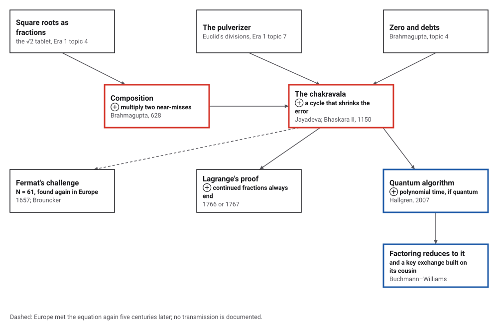
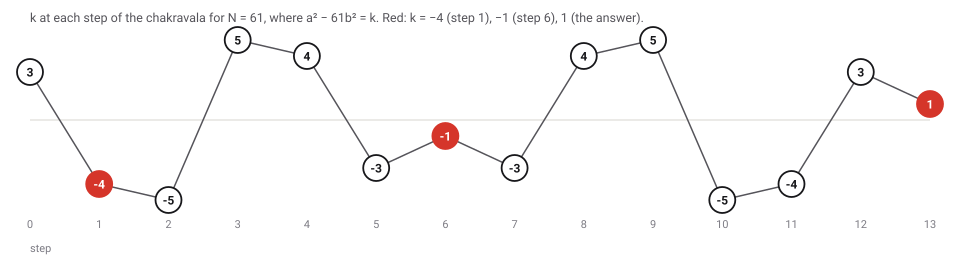
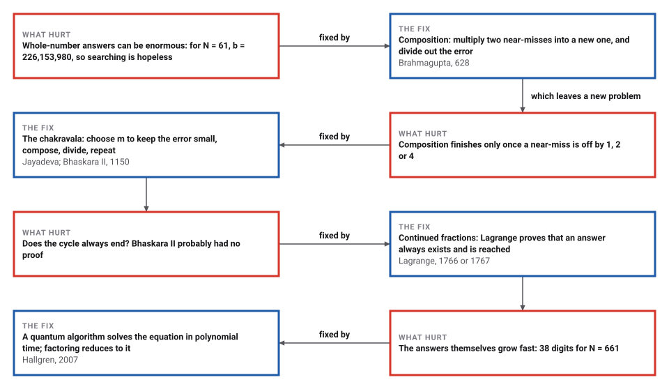

# The Chakravala and Pell's Equation

*Era 2 · topic 5 · 628–1150 CE* · [Era 2 index](../README.md) · [← Zero Becomes a Number](../04-zero-becomes-a-number/README.md) · [Algorism and Al-Jabr →](../06-algorism-and-al-jabr/README.md) · [Interactive edition](chakravala.html) · [Program](../../../code/era-02-algorithms-travel/05-chakravala/)

> **Field note from the visiting historian.** Guessing is hopeless here. Brahmagupta noticed that two near-misses can be multiplied into a new one; later mathematicians closed the loop into a cycle. Europeans met the same equation five centuries after Bhaskara II, and named it after the wrong man.

| | |
|---|---|
| **When** | Brahmagupta, 628; Jayadeva (quoted 1073); Bhaskara II, 1150 (**documented**) |
| **Where** | India: Bhillamala, Ujjain |
| **What hurt** | Whole-number answers to a² − Nb² = 1 can be enormous |
| **The fix** | Compose near-misses; cycle until the error is 1 |
| **Cost** | 7.7 steps on average for N up to 1,000, against 12.5 convergents |

## How ideas combined

A new algorithm is usually an older idea combined with a new one. A solution of a² − Nb² = 1 makes a/b a superb fraction for √N, the problem of the √2 tablet (Era 1, topic 4). The chakravala's divisibility step is the pulverizer, Euclid's divisions run backwards (topic 7), and its errors are as often debts as fortunes (topic 4). Each box names the idea that was added.

<picture>
  <source media="(prefers-color-scheme: dark)" srcset="assets/family-dark.svg">
  
</picture>
*Red: the two Indian steps. Blue: where the equation stands today, as a problem for quantum computers.*

## Run the cycle

Choose N and press **Next step**. Each row is a near-miss a² − Nb² = k. The method picks m so that k divides a + b·m with m² − N as small as possible, composes, and divides; k jumps about and comes back to 1. Tick the box to stop as soon as k is ±1, ±2 or ±4 and let Brahmagupta's compositions finish, as Dutta's account of N = 61 does.

<picture>
  <source media="(prefers-color-scheme: dark)" srcset="assets/cycle-dark.svg">
  
</picture>
*In the interactive edition you can run the chakravala for any N up to 2,000, with exact whole numbers.*

| Step | m | a | b | k |
|---|---|---|---|---|
| 0 |  | 8 | 1 | 3 |
| 1 | 7 | 39 | 5 | -4 |
| 2 | 9 | 164 | 21 | -5 |
| 3 | 6 | 453 | 58 | 5 |
| 4 | 9 | 1,523 | 195 | 4 |
| 5 | 7 | 5,639 | 722 | -3 |
| 6 | 8 | 29,718 | 3,805 | -1 |
| 7 | 8 | 469,849 | 60,158 | -3 |
| 8 | 7 | 2,319,527 | 296,985 | 4 |
| 9 | 9 | 9,747,957 | 1,248,098 | 5 |
| 10 | 6 | 26,924,344 | 3,447,309 | -5 |
| 11 | 9 | 90,520,989 | 11,590,025 | -4 |
| 12 | 7 | 335,159,612 | 42,912,791 | 3 |
| 13 | 8 | 1,766,319,049 | 226,153,980 | 1 |

For N = 61 the plain cycle takes **13 steps** to reach k = 1, and the values of k run out to −1 at step 6 and then back again in reverse order. But step 1 already gives 39² − 61 × 5² = −4, and from there Brahmagupta's compositions finish the job: halve to (39/2, 5/2, -1), square it to (1523/2, 195/2, 1), multiply again to (29718, 3805, -1), and square that: (1766319049, 226153980, 1). That is **3 compositions** after 1 step.

## Era 2, algorithms travel

<picture>
  <source media="(prefers-color-scheme: dark)" srcset="assets/era-timeline-dark.svg">
  
</picture>

## Each fix leaves a new pain

<picture>
  <source media="(prefers-color-scheme: dark)" srcset="assets/chain-dark.svg">
  
</picture>
*Read it as a snake: each new problem sits directly under the fix that exposed it.*

## Composition, then the cycle

**Composition.** If a² − Nb² = k and c² − Nd² = l, then (ac + Nbd)² − N(ad + bc)² = kl. Two near-misses multiply into a new near-miss, with the errors multiplied. Composing a near-miss with itself gives error k², which divides out, leaving an exact answer in fractions.

Brahmagupta's own example, N = 92, in two compositions: start (10, 1, 8); composed with itself (192, 20, 64); divided by 8, (24, 5/2, 1), an exact answer with a fraction; composed with itself again, **(1151, 120, 1)**: 1151² − 92 × 120² = 1. Dutta quotes his boast: "One who can solve it within a year [is truly a] mathematician." A plain search for N = 92 would need 120 tries; for N = 61, 226,153,980.

**The cycle.** From a triple (a, b, k), choose m > 0 so that k divides a + bm and |m² − N| is smallest. Compose with (m, 1, m² − N) and divide by |k|: a′ = (am + Nb)/|k|, b′ = (a + bm)/|k|, k′ = (m² − N)/k. The divisibility condition is a small pulverizer problem, and the choice of m keeps the error small. The cycle ends when k = 1.

> **Key idea.** Do not search for the answer; improve a near-miss. Composition turns any near-miss into a better one, and the cycle keeps the error small while the numbers grow, until the error is 1.

## Who closed the cycle?

Brahmagupta (598–670) gave composition in the *Brahmasphutasiddhanta* of 628 (**documented**); it works only once a near-miss with error ±1, ±2 or ±4 is known. The earliest known account of the full cycle is Jayadeva's, whose verses survive only as quotations in Udayadivakara's *Sundari* of 1073; his own date is an estimate, about 1000 or earlier (**conjecture**). Bhaskara II (1114–1185) set out a variant in his *Bijaganita* of 1150, with the examples N = 61 and N = 67. MacTutor thinks he probably had no proof that the cycle always ends (**conjecture**).

Who first solved N = 61 is **disputed** even inside MacTutor: its Brahmagupta biography credits Brahmagupta, while its Pell's equation page, Dutta and Waldschmidt credit Bhaskara II. In 1657 Fermat set N = 61 as a challenge to European mathematicians; Brouncker answered with what is essentially continued fractions; Euler named the equation after John Pell, probably confusing him with Brouncker. Lagrange's complete theory is dated 1766 or 1767 (**disputed**).

## The cycle against continued fractions

| N | Smallest answer a | b | Chakravala steps | Early stop + compositions | Continued fraction convergents |
|---|---|---|---|---|---|
| 61 | 1,766,319,049 | 226,153,980 | 13 | 1 + 3 (stop at k = -4) | 22 |
| 67 | 48,842 | 5,967 | 7 | 3 + 1 (stop at k = -2) | 10 |

Selenius counted 22 convergents for N = 61 by the European method; the program gets the same, 22. Over all 969 values of N from 2 to 1,000 that are not squares, both methods found the same smallest answer every time. The chakravala took **7.7 steps** on average (at most 55), stopping early and composing 5.5 operations, and continued fractions **12.5 convergents** (at most 78). The chakravala never needed more steps. Selenius showed that it corresponds to a "half-regular best approximating algorithm of minimal length", not to Lagrange's regular continued fraction.

The answers can be huge. Below 1,000, the largest smallest answer belongs to N = 661: a = 16421658242965910275055840472270471049, **38 digits**. A search for it would need 638,728,478,116,949,861,246,791,167,518,480,580 tries.

## A problem for quantum computers

Because the smallest answer can have far more digits than N itself, even writing it down can take a long time. In 2007 Sean Hallgren published "Polynomial-time quantum algorithms for Pell's equation and the principal ideal problem" in the *Journal of the ACM*. His abstract notes that "factoring integers reduces to finding integer solutions of Pell's equation", while the reverse reduction is not known, and that a related problem, at least as hard, is the one-way function of the Buchmann–Williams key exchange, which a quantum computer would therefore break.

> **Full circle.** An equation that Brahmagupta set as a test of mathematicians in 628, and Bhaskara II solved for N = 61 with a cycle of a few steps, is now classed with factoring: at least as hard, and one of the first problems shown to fall to a quantum computer. The cycle that took 13 steps for 61 needs 55 for the hardest N below 1,000, and the answers grow far faster than the steps.

## Before you read on

<details>
<summary><b>1.</b> Check Brahmagupta's answer for N = 92.</summary>

1151² = 1,324,801 and 92 × 120² = 1,324,800. The difference is 1.
</details>

<details>
<summary><b>2.</b> Why does a solution of a² − Nb² = 1 give a good fraction for √N?</summary>

Divide by b²: (a/b)² − N = 1/b². When b is large, (a/b)² is extremely close to N.
</details>

<details>
<summary><b>3.</b> Compose (3, 1, −1) with itself for N = 10. What do you get?</summary>

(3·3 + 10·1·1, 3·1 + 1·3, 1) = (19, 6, 1): 19² − 10 × 6² = 361 − 360 = 1.
</details>

<details>
<summary><b>4.</b> For N = 61, the first step gives k = −4. Why stop there?</summary>

Brahmagupta's compositions can finish from an error of ±4: halve the triple, compose, and square. Three compositions instead of twelve more steps.
</details>

<details>
<summary><b>5.</b> Why can't the method work when N is a square?</summary>

Then a² − Nb² = (a − √N b)(a + √N b) is a product of two whole numbers equal to 1, so b = 0: there is no real answer.
</details>


## Where the evidence lives

| | Object | Where to see it | Licence |
|---|---|---|---|
| — | **Brahmagupta and Bhaskara in English, 1817**. Colebrooke's translation of the algebra of Brahmagupta (628) and Bhaskara II (1150), including the *Bijaganita*. | [Internet Archive scan](https://archive.org/details/algebrawitharith00brahuoft/page/n5/mode/2up) | Drawn placeholder. |

## Every link was opened before it was listed

| Level | Link | Why |
|---|---|---|
| Start | [Pell's Equation and Continued Fractions](https://mathcircle.berkeley.edu/sites/default/files/archivedocs/2008_2009/lectures/0809lecturespdf/PellBMC.pdf) — Tom Rike, Berkeley Math Circle, 28 April 2009 | High-school handout with exercises, covering Brahmagupta, Bhaskara and Fermat's N = 61 challenge |
| Start | [Pell's equation](https://mathshistory.st-andrews.ac.uk/HistTopics/Pell) — MacTutor | The whole story: Brahmagupta (628), Bhaskara II (1150), Fermat, Brouncker, Euler's misnaming, Lagrange |
| Start | [Indian Mathematics – Redressing the balance, ch. 14](https://mathshistory.st-andrews.ac.uk/Projects/Pearce/chapter-14) — MacTutor (Pearce project) | A worked chakravala example, and the comparison with Lagrange |
| Start | [Chakravala method](https://en.wikipedia.org/wiki/Chakravala_method) — Wikipedia | The step rule, written as an algorithm, with the N = 61 example |
| Deeper | [Mathematics in India – From Vedic Period to Modern Times](https://nptel.ac.in/courses/111101080) — NPTEL, IIT Bombay (K. Ramasubramanian, M. D. Srinivas, M. S. Sriram) | Video course. The syllabus PDF lists lectures 11–13 on the *Brahmasphutasiddhanta* and 23–24 on the *Bijaganita* of Bhaskara II |
| Deeper | [Indian Mathematics](https://www.ms.uky.edu/~sohum/ma330/files/varadarajan.pdf) — V. S. Varadarajan, notes of two lectures at UCLA, March 2008 (copy on a University of Kentucky course site) | From Brahmagupta to Bhaskara's chakravala, and how Lagrange's theory of continued fractions shows it works |
| Deeper | [The bhāvanā in Mathematics](https://bhavana.org.in/the-bhavana-in-mathematics/) — Amartya Kumar Dutta (ISI Kolkata), *Bhāvanā* 1(1), January 2017 | Composition, Jayadeva and the chakravala, with worked boxes for N = 92 and N = 61 |
| Deeper | [Bhaskara II](https://mathshistory.st-andrews.ac.uk/Biographies/Bhaskara_II/) — MacTutor | Life (1114–1185) at Ujjain. Lists his examples (N = 8, 11, 32, 61, 67), but does not describe the cyclic method |
| Scholar | [On the Brahmagupta–Fermat–Pell equation x² − dy² = ±1](https://webusers.imj-prg.fr/%7Emichel.waldschmidt/articles/pdf/BrahmaguptaFermatPellEnVI.pdf) — Michel Waldschmidt (Sorbonne Université), slides, ICMMSIS'20 web conference, 23 July 2020 | A number theorist's tour from Brahmagupta's N = 92 and Bhaskara's N = 61 through Fermat to Lagrange |
| Scholar | [Rationale of the chakravala process of Jayadeva and Bhaskara II](https://www.ms.uky.edu/~sohum/ma330/files/Rationale-of-the-chakrav-la-process-of-Jayadeva-and-Bh-skara-II_1975_Historia-Mathematica.pdf) — Clas-Olof Selenius, *Historia Mathematica* 2 (1975), 167–184 | The method is a minimal-length semiregular continued-fraction algorithm, distinct from Lagrange's |
| Scholar | [Algebra, with Arithmetic and Mensuration, from the Sanscrit of Brahmegupta and Bháscara](https://archive.org/details/algebrawitharith00brahuoft/page/n5/mode/2up) — H. T. Colebrooke (trans.), London: J. Murray, 1817. Internet Archive (University of Toronto copy) | Colebrooke's English translation of Brahmagupta's and Bhaskara's algebra |
| Scholar | [Polynomial-time quantum algorithms for Pell's equation and the principal ideal problem](https://pure.psu.edu/en/publications/polynomial-time-quantum-algorithms-for-pells-equation-and-the-pri-2/) — Sean Hallgren, *Journal of the ACM* 54(1), 2007 (Penn State record) | "Factoring integers reduces to finding integer solutions of Pell's equation"; a quantum algorithm solves it in polynomial time and breaks the Buchmann–Williams key exchange |

More, with certainty labels and the gaps we could not fill: [Era 2 reference catalog](https://github.com/vij658/AlgorithmEvolutionAtlas/blob/main/book/era-02-algorithms-travel/reference-catalog.md).

## The program behind every number here

[Chakravala.java](https://github.com/vij658/AlgorithmEvolutionAtlas/blob/main/code/era-02-algorithms-travel/05-chakravala/Chakravala.java) makes **34,009 checks**: Brahmagupta's composition on 20,000 random cases, every chakravala triple along the way, N = 92 and N = 61 by composition, and the chakravala against continued fractions for every N up to 1,000. Run it with `java Chakravala.java` (JDK 17 or newer). The heart of it:

```java
/** Brahmagupta's composition: (a, b, k) with (c, d, l) gives (ac + Nbd, ad + bc, kl). */
static T compose(T x, T y, long N) {
    return new T(x.a.times(y.a).plus(x.b.times(y.b).times(N)), x.a.times(y.b).plus(x.b.times(y.a)), x.k.times(y.k));
}

/** With early = true, stop as soon as k is 1, 2 or 4 (either sign) and finish with Brahmagupta's compositions. */
static BigInteger[] chakravala(long N, boolean early) {
    long r = (long) Math.sqrt((double) N);
    while (r * r > N) r--;
    while ((r + 1) * (r + 1) <= N) r++;
    long a0 = (N - r * r < (r + 1) * (r + 1) - N) ? r : r + 1;   // the nearest square
    BigInteger a = big(a0), b = BigInteger.ONE, k = big(a0 * a0 - N), n = big(N);
    chakSteps = 0;
    if (trace != null) trace.add(String.format("start %s %s %s", a, b, k));
    while (!k.equals(BigInteger.ONE)) {
        long kk = k.abs().longValueExact();
        if (early && (kk == 1 || kk == 2 || kk == 4)) { stopTriple = new BigInteger[]{a, b, k}; return finish(a, b, k, N); }
        // m with |k| dividing a + b m, and m^2 - N as small as possible
        long best = -1;
        BigInteger bestGap = null;
        long lo = Math.max(1, r - 2 * kk), hi = r + 2 * kk + 1;
        for (long m = lo; m <= hi; m++) {
            if (a.add(b.multiply(big(m))).mod(big(kk)).signum() != 0) continue;
            BigInteger gap = big(m * m - N).abs();
            if (bestGap == null || gap.compareTo(bestGap) < 0) { best = m; bestGap = gap; }
        }
        BigInteger m = big(best), K = k.abs();
        BigInteger na = a.multiply(m).add(n.multiply(b)).divide(K);
        BigInteger nb = a.add(b.multiply(m)).divide(K);
        BigInteger nk = m.multiply(m).subtract(n).divide(k);
        a = na; b = nb; k = nk;
        chakSteps++;
        check(a.multiply(a).subtract(n.multiply(b).multiply(b)).equals(k), "every chakravala triple is a near-miss");
        if (trace != null) trace.add(String.format("m %d -> %s %s %s", best, a, b, k));
    }
    stopTriple = new BigInteger[]{a, b, k};
    return new BigInteger[]{a, b};
}
```

