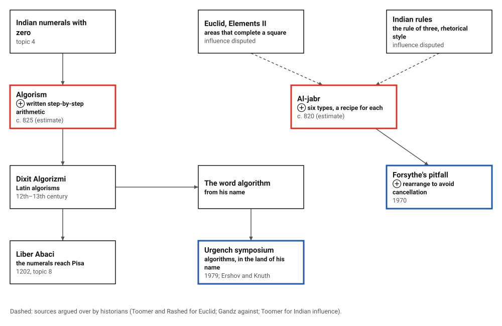
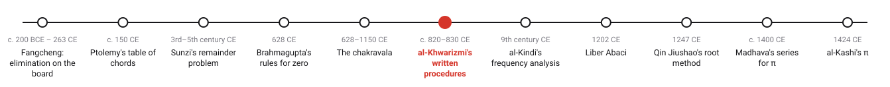
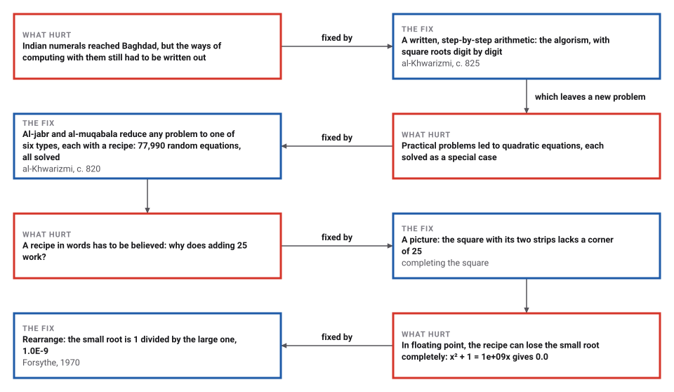

# Algorism and Al-Jabr

*Era 2 · topic 6 · c. 820–830 CE* · [Era 2 index](../README.md) · [← The Chakravala and Pell's Equation](../05-chakravala/README.md) · [Frequency Analysis →](../07-frequency-analysis/README.md) · [Interactive edition](algorism-and-al-jabr.html) · [Program](../../../code/era-02-algorithms-travel/06-algorism-and-al-jabr/)

> **Field note from the visiting historian.** In Baghdad I found the man whose name became the word for what I study. One of his books teaches the Indian way of writing numbers and computing with them; the other sorts every quadratic problem into six forms with a recipe for each. His species disagrees about whether he was original. Nobody disputes that he was copied.

| | |
|---|---|
| **When** | c. 820–830 CE (**conjecture**: no firm year); the arithmetic after the algebra |
| **Where** | Baghdad, the House of Wisdom |
| **What hurt** | Indian numerals needed written methods; quadratic problems were solved case by case |
| **The fix** | Written step-by-step arithmetic; al-jabr, al-muqabala and six recipes |
| **Cost** | Two moves and one recipe per problem; 77,990 random equations solved, every one right |

## How ideas combined

A new algorithm is usually an older idea combined with a new one. Indian numerals with a zero (topic 4) needed written methods; quadratic problems needed a general procedure. Al-Khwarizmi wrote both down, in two books, and his name became the word for what they contain. Each box names the idea that was added.

<picture>
  <source media="(prefers-color-scheme: dark)" srcset="assets/family-dark.svg">
  
</picture>
*Red: the two books. Blue: a pitfall that computers met in his recipe, and the symposium that brought algorithms back to the land of his name.*

## Restore, balance, and follow the recipe

Write an equation as squares, roots and units on each side; a negative count means a subtracted term. **Next step** applies *al-jabr* (move subtracted terms across), then *al-muqabala* (cancel like terms), then sorts the equation into one of the six types and follows its recipe in words. For type 4 the picture shows the square being completed.

<picture>
  <source media="(prefers-color-scheme: dark)" srcset="assets/square-dark.svg">
  
</picture>
*In the interactive edition you can enter any equation and watch al-jabr, al-muqabala and the recipe solve it.*

| Al-Khwarizmi's example | Type | Recipe | Answer |
|---|---|---|---|
| A square and 10 roots equal 39 | 4: squares and roots equal numbers | Halve the roots, 5 ; square it, 25 ; add the number, 64 ; take the root ; take away half the roots | 3 |
| A square and 21 equal 10 roots | 5: squares and numbers equal roots | Halve the roots, 5 ; square it, 25 ; take away the number, 4 ; its root added to or taken from half the roots | 3 or 7 |
| 3 roots and 4 equal a square | 6: roots and numbers equal squares | Halve the roots, 1 1/2 ; square it, 2 1/4 ; add the number, 6 1/4 ; take the root ; add half the roots | 4 |

A reduction from scratch: 10 roots − 1 square = 4 roots + 9. *Al-jabr* gives 10 roots = 1 square + 4 roots + 9; *al-muqabala* gives 6 roots = 1 square + 9; the recipe of type 5 (halve the roots, 3 ; square it, 9 ; take away the number, 0 ; its root added to or taken from half the roots) gives **x = 3**.

## Era 2, algorithms travel

<picture>
  <source media="(prefers-color-scheme: dark)" srcset="assets/era-timeline-dark.svg">
  
</picture>

## Each fix leaves a new pain

<picture>
  <source media="(prefers-color-scheme: dark)" srcset="assets/chain-dark.svg">
  
</picture>
*Read it as a snake: each new problem sits directly under the fix that exposed it.*

## Six types, six recipes

After restoring and balancing, and dividing by the number of squares, every linear or quadratic problem with a positive answer is one of six types: (1) squares equal roots, (2) squares equal numbers, (3) roots equal numbers, (4) squares and roots equal numbers, (5) squares and numbers equal roots, (6) roots and numbers equal squares. The first three need one division or one root. The three mixed types are solved by halving the roots and completing the square.

| Type | Random equations sorted into it |
|---|---|
| 1. squares equal roots | 4,413 |
| 2. squares equal numbers | 4,598 |
| 3. roots equal numbers | 4,428 |
| 4. squares and roots equal numbers | 21,464 |
| 5. squares and numbers equal roots | 21,484 |
| 6. roots and numbers equal squares | 21,603 |

The program wrote 100,000 random equations with terms subtracted on both sides, reduced each by *al-jabr* and *al-muqabala*, sorted it, and solved it by the recipe. 77,990 fell into the six types, and every answer matched the modern quadratic formula. Another 21,798 ended with every term on one side, which has no positive answer, and 212 cancelled away entirely. The three mixed types are about equally common, and so are the three simple ones, because the type depends only on which reduced terms are left and on which side.

> **Key idea.** Two moves turn any problem into a standard form, and a standard form has a fixed recipe. That is what made the book an algorithm, even with no symbols: the reader never has to be clever, only to follow the steps.

## Algorism: arithmetic written out

Al-Khwarizmi's second book taught the Indian place-value numerals, with nine figures and a sign for an empty place, and step-by-step written rules for each operation, for fractions and for square roots. Its Arabic original is lost. A Latin copy at Cambridge, of the 13th century, begins "Dixit Algorizmi" ("al-Khwarizmi said"), and from such copies came the word *algorism*, later *algorithm*.

Written square roots come out one digit at a time: bring down two digits, find the largest next digit that fits, subtract, repeat. The program computed 61 digits of √2 this way in **61 steps**, trying 312 candidate digits in all: 1.41421356237309504880... The Babylonian averaging of Era 1, topic 4, doubles the correct digits at each step and got there in **8 steps**, but each of its steps is a full long division.

## Two books, one name, many arguments

Al-Khwarizmi lived about 780 to about 850 and worked at the House of Wisdom in Baghdad under the caliph al-Ma'mun, to whom he dedicated the algebra (**documented**). No source gives a firm year for the algebra: estimates run from 813 to 833, often about 820 (**conjecture**). The arithmetic cites the algebra, so it came later (**documented**). Its Latin text survives in only two copies, Cambridge University Library MS Ii.6.5 (the first half only) and New York, Hispanic Society of America, HC 397/726 (**documented**); its attribution to Adelard of Bath is a **conjecture**.

Where he came from is itself argued over. His name may mean that he or his ancestors came from Khwarizm, south of the Aral Sea; Rashed reads the key source differently (**disputed**). Where his algebra came from is **disputed**: Toomer and Rashed see Book II of Euclid's *Elements* behind the geometric proofs, Gandz says the *Elements* were unknown to him, and Toomer also argues for Indian influence. How original he was is **disputed** too. Rashed calls the originality "impossible to overstress"; Toomer judged his achievements "at best mediocre, but ... uncommonly influential".

## The recipe in floating point

| Equation | Small root by the recipe | Rearranged | Recipe's error |
|---|---|---|---|
| x² + 1 = 1e+05x | 1.0000003385357559E-5 | 1.0000000001000001E-5 | 3.4e-07 of the answer |
| x² + 1 = 1e+09x | 0.0 | 1.0E-9 | 1.0e+00 of the answer |

For squares and numbers equal roots, the small root is half the roots minus a root that is almost exactly as big. Subtracting two nearly equal numbers throws away their shared digits. George Forsythe used this very example in 1970 ("Pitfalls in computation, or why a math book isn't enough"): the formula gives one root well and the other "100 percent wrong". The fix is to compute the large root by the recipe and the small one from it, since their product is the number: here, 1 divided by the large root. With 1e+09 the recipe returns **0.0** and the rearranged form 1.0E-9.

## Algorithms come home

In September 1979 the Academy of Sciences of the Uzbek SSR organized a symposium in Urgench, "Algorithms in modern mathematics and computer science". Its proceedings, edited by Andrei Ershov and Donald Knuth, appeared in 1981 as volume 122 of Springer's *Lecture Notes in Computer Science*. Urgench is the capital of the Xorazm region, the old Khwarizm, and a large statue of al-Khwarizmi stands in the city.

> **Full circle.** A Latin copyist's "Dixit Algorizmi", "al-Khwarizmi said", became the name of a whole science. Eleven and a half centuries after he wrote, computer scientists, Knuth among them, met in the land his name points to, to discuss algorithms.

## Before you read on

<details>
<summary><b>1.</b> Solve a square and 6 roots equal 16 by the recipe.</summary>

Half the roots 3; squared 9; add 16: 25; root 5; take away 3: **x = 2**. Check: 4 + 12 = 16.
</details>

<details>
<summary><b>2.</b> Why does type 5 sometimes give two answers?</summary>

x² + 21 = 10x is true for x = 3 and x = 7: half the roots, 5, plus or minus the root of 25 − 21 = 4.
</details>

<details>
<summary><b>3.</b> What does al-jabr do to 10 roots minus a square = 4 roots and 9?</summary>

It restores the subtracted square by adding it to both sides: 10 roots = a square and 4 roots and 9.
</details>

<details>
<summary><b>4.</b> Why does the recipe for x² + 1 = 10⁹x return 0 for the small root in floating point?</summary>

Half the roots is 500,000,000 and the root of its square minus 1 rounds to exactly the same number, so the subtraction leaves 0.
</details>

<details>
<summary><b>5.</b> Where does the word 'algorithm' come from?</summary>

From al-Khwarizmi's name, through Latin copies of his arithmetic that begin "Dixit Algorizmi"; 'algebra' comes from al-jabr in the title of his other book.
</details>


## Where the evidence lives

| | Object | Where to see it | Licence |
|---|---|---|---|
| — | **Cambridge University Library, MS Ii.6.5**. A 13th-century Latin copy of the arithmetic, the first half only: one of the two known copies. Fully digitized. | [Cambridge Digital Library](https://cudl.lib.cam.ac.uk/view/MS-II-00006-00005/1) | Drawn placeholder; the digitized pages are on the library's site. |
| — | **The Algebra of Mohammed ben Musa, 1831**. Frederic Rosen's edition and English translation of the algebra, with the six types and the completed squares. | [Internet Archive scan](https://archive.org/details/algebraofmohamme00khuwuoft/algebraofmohamme00khuwuoft) | Drawn placeholder. |

## Every link was opened before it was listed

| Level | Link | Why |
|---|---|---|
| Start | [Who invented algebra?](https://www.gresham.ac.uk/node/11558) — Gresham College, Robin Wilson, 5 October 2005 (video and transcript) | Islamic mathematics from 750 to 1400. Covers al-Khwarizmi at the House of Wisdom, the origin of "algebra", and x² + 10x = 39 solved by a geometric "completing the square" |
| Start | [Al-Khwarizmi's Completing the Square Activity](https://bulldog2.redlands.edu/fac/Beery/math115/m115_activ_complsq.htm) — Math 115 course page on the University of Redlands site. Activity by J. Beery, C. Dolezal, A. Sauk and L. Shuey, from *Historical Modules* (MAA, 2003) | Classroom worksheet: translate one of his problems into an equation, then complete the square by drawing it |
| Start | [Completing the Square](https://old.maa.org/node/116292) — Barnabas Hughes, MAA *Convergence* | The geometric method for x² + 10x = 39, with practice equations |
| Start | [Urgench](https://en.wikipedia.org/wiki/Urgench) — Wikipedia | Capital of the Xorazm region, with a large statue of al-Khwarizmi |
| Deeper | [Al-Khwarizmi](https://mathshistory.st-andrews.ac.uk/Biographies/Al-Khwarizmi/) — MacTutor | Life, the six equation types, completing the square, and the debate over his sources |
| Deeper | [Pitfalls in Computation, or Why a Math Book Isn't Enough](https://apps.dtic.mil/sti/pdfs/AD0699897.pdf) — George E. Forsythe, Stanford CS Technical Report 147, January 1970 (DTIC) | The quadratic formula gives one root "100 percent wrong" by catastrophic cancellation; alternative formulas avoid it |
| Scholar | [Al-Khwārizmī](https://mathshistory.st-andrews.ac.uk/DSB/Al-Khwarizmi.pdf) — G. J. Toomer, *Dictionary of Scientific Biography* (reprint hosted by MacTutor) | Dating of each work, the arithmetic's content, and the Greek–Hindu–Hebrew sources question. The OCR is garbled in places |
| Scholar | [Al-Khwarizmi resource page](https://www.jphogendijk.nl/khwarizmi.html) — Jan Hogendijk (Utrecht University address), 2022 | Editions, translations and manuscripts of every work, with links to digitized copies |
| Scholar | [The Toledan *Regule* (*Liber Alchorismi*, part II): A Twelfth-century Arithmetical Miscellany](https://sciamvs.org/files/SCIAMVS_08_141-231_Burnett_Zhao_Lampey.pdf) — Charles Burnett, Ji-Wei Zhao, Kurt Lampe, *SCIAMVS* 8 (2007), 141–231 | How the Latin algorisms grew out of his lost arithmetic. Treats *Dixit Algorizmi* as one Latin version among several |
| Scholar | [The Algebra of Mohammed ben Musa](https://archive.org/details/algebraofmohamme00khuwuoft/algebraofmohamme00khuwuoft) — Frederic Rosen (ed. and trans.), London: Oriental Translation Fund, 1831. Internet Archive (University of Toronto copy) | Rosen's edition and English translation of the algebra |
| Scholar | [Algorithms in modern mathematics and computer science: proceedings, Urgench, Uzbek SSR, September 16–22, 1979](https://ci.nii.ac.jp/ncid/BA02973768) — A. P. Ershov and D. E. Knuth (eds.), LNCS 122, Springer, 1981 (CiNii record) | The symposium on algorithms held in Urgench |

More, with certainty labels and the gaps we could not fill: [Era 2 reference catalog](https://github.com/vij658/AlgorithmEvolutionAtlas/blob/main/book/era-02-algorithms-travel/reference-catalog.md).

## The program behind every number here

[AlKhwarizmi.java](https://github.com/vij658/AlgorithmEvolutionAtlas/blob/main/code/era-02-algorithms-travel/06-algorism-and-al-jabr/AlKhwarizmi.java) makes **99,796 checks**: the three worked examples, 100,000 random equations reduced by al-jabr and al-muqabala and solved by the recipes against the quadratic formula, the digit-by-digit square root against averaging, and Forsythe's floating-point example. Run it with `java AlKhwarizmi.java` (JDK 17 or newer). The heart of it:

```java
static double[] solve(long[] left, long[] right, List<String> say) {
    long[] L = left.clone(), R = right.clone();
    // al-jabr: a subtracted term is restored, moving it to the other side
    for (int i = 0; i < 3; i++) {
        if (L[i] < 0) { R[i] -= L[i]; L[i] = 0; }
        if (R[i] < 0) { L[i] -= R[i]; R[i] = 0; }
    }
    if (say != null) say.add("al-jabr: " + side(L) + " = " + side(R));
    // al-muqabala: like terms on both sides cancel
    for (int i = 0; i < 3; i++) {
        long m = Math.min(L[i], R[i]);
        L[i] -= m; R[i] -= m;
    }
    if (say != null) say.add("al-muqabala: " + side(L) + " = " + side(R));
    // gather: s squares, r roots, n units, each on a known side
    long sq = L[0] - R[0], rt = L[1] - R[1], un = L[2] - R[2];   // sq x^2 + rt x + un = 0
    if (sq < 0 || (sq == 0 && rt < 0)) { sq = -sq; rt = -rt; un = -un; }
    Q s = Q.of(sq), b = Q.of(Math.abs(rt)), c = Q.of(Math.abs(un));
    if (sq != 0) { b = b.div(s); c = c.div(s); }
    List<Double> roots = new ArrayList<>();
    int type;
    if (sq == 0 && rt == 0) { lastType = -1; return new double[0]; }
    if (sq == 0) {                                        // roots equal numbers
        type = 2;
        if (rt * -un > 0) roots.add((double) -un / rt);
    } else if (rt == 0) {                                 // squares equal numbers
        type = 1;
        if (un < 0) roots.add(Math.sqrt(c.value()));
    } else if (un == 0) {                                 // squares equal roots
        type = 0;
        if (rt < 0) roots.add(b.value());
    } else {
        Q half = b.div(Q.of(2)), sqHalf = half.times(half);
        if (rt > 0 && un < 0) {                           // squares and roots equal numbers: x = sqrt((b/2)^2 + c) - b/2
            type = 3;
            roots.add(Math.sqrt(sqHalf.plus(c).value()) - half.value());
            if (say != null) say.add(String.format("recipe: halve the roots, %s ; square it, %s ; add the number, %s ; take the root ; take away half the roots", half, sqHalf, sqHalf.plus(c)));
        } else if (rt < 0 && un > 0) {                    // squares and numbers equal roots: x = b/2 -+ sqrt((b/2)^2 - c)
            type = 4;
            Q disc = sqHalf.minus(c);
            if (disc.sign() >= 0) {
                double r = Math.sqrt(disc.value());
                roots.add(half.value() - r);
                if (disc.sign() > 0) roots.add(half.value() + r);
            }
            if (say != null) say.add(String.format("recipe: halve the roots, %s ; square it, %s ; take away the number, %s ; its root added to or taken from half the roots", half, sqHalf, disc));
        } else if (rt < 0 && un < 0) {                    // roots and numbers equal squares: x = b/2 + sqrt((b/2)^2 + c)
            type = 5;
            roots.add(half.value() + Math.sqrt(sqHalf.plus(c).value()));
            if (say != null) say.add(String.format("recipe: halve the roots, %s ; square it, %s ; add the number, %s ; take the root ; add half the roots", half, sqHalf, sqHalf.plus(c)));
        } else {                                          // all terms on one side: no positive answer
            type = -2;
        }
    }
    lastType = type;
    Collections.sort(roots);
    return roots.stream().mapToDouble(Double::doubleValue).toArray();
}
```

