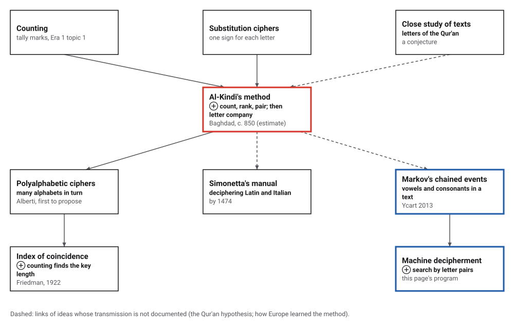
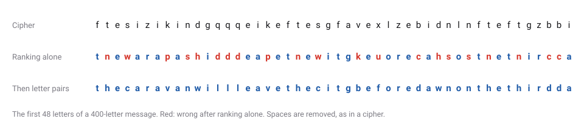
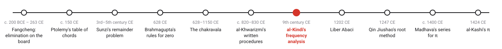
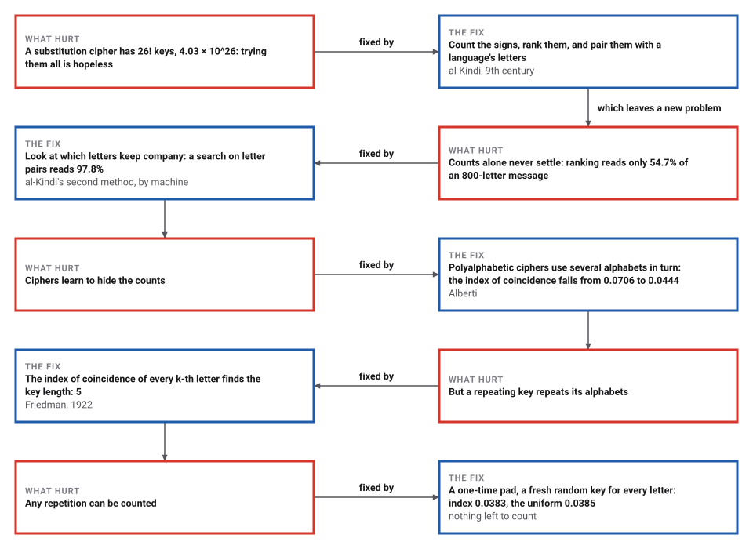

# Frequency Analysis

*Era 2 · topic 7 · 9th century CE* · [Era 2 index](../README.md) · [← Algorism and Al-Jabr](../06-algorism-and-al-jabr/README.md) · [Fibonacci's Liber Abaci →](../08-liber-abaci/README.md) · [Interactive edition](frequency-analysis.html) · [Program](../../../code/era-02-algorithms-travel/07-frequency-analysis/)

> **Field note from the visiting historian.** A philosopher in Baghdad wrote the trick down: count, rank, pair. It is the first procedure in my catalog that needs facts about a whole language, gathered in advance, as well as the message itself.

| | |
|---|---|
| **When** | Al-Kindi, c. 801–873; the treatise usually dated about 850 (**conjecture**) |
| **Where** | Baghdad, the House of Wisdom |
| **What hurt** | 26! substitution keys: far too many to try |
| **The fix** | Count and rank the signs against a language's letters; then use letter company |
| **Cost** | One pass to count; ranking plus letter pairs read 400-letter messages 19 times in 20 |

## How ideas combined

A new algorithm is usually an older idea combined with a new one. Counting is as old as tally marks (Era 1, topic 1), and substitution ciphers are older than al-Kindi. His step was to count the secret signs against the letters of a whole language, gathered in advance. Each box names the idea that was added.

<picture>
  <source media="(prefers-color-scheme: dark)" srcset="assets/family-dark.svg">
  
</picture>
*Red: al-Kindi's method. Blue: the letter-pair statistics that his second method needs, as Markov later used them and as this page's program does.*

## Break a cipher

A secret message has been enciphered with a random substitution key. **1. Rank the counts** pairs its signs with English letters by how common they are, al-Kindi's first method. **2. Letter pairs** then swaps letters while the text's letter pairs grow more like English, his second method done by machine. Shorten the message and watch the counts stop working. You can also fix letters by hand: click a cipher letter in the key, then type the plain letter.

<picture>
  <source media="(prefers-color-scheme: dark)" srcset="assets/example-dark.svg">
  
</picture>
*In the interactive edition you can break a fresh cipher, change the message length, and swap letters by hand.*

## Era 2, algorithms travel

<picture>
  <source media="(prefers-color-scheme: dark)" srcset="assets/era-timeline-dark.svg">
  
</picture>

## Each fix leaves a new pain

<picture>
  <source media="(prefers-color-scheme: dark)" srcset="assets/chain-dark.svg">
  
</picture>
*Read it as a snake: each new problem sits directly under the fix that exposed it.*

## Count, rank, pair; then look at the company

In al-Kindi's own words, in an English excerpt: "Among the expedients we use in cryptanalyzing a cryptogram if the language is already known, is to acquire a fairly long" sample of plain text, count and rank its letters, and match the ranking to the cryptogram. For short cryptograms, where the counts cannot be trusted, he adds a "qualitative" method: look at which letters occur together.

The program's reference sample is 5,944 letters of ordinary English written for it. Its letters ranked: **etaonrshidlwcumfgpbyvkxqjz**. The twelve most common, etaonrshidlw, are close to the printers' "etaoin shrdlu", which Wikipedia gives as the twelve most frequent letters of typical English; a different sample shuffles the middle of the list.

| Letters in the message | Ranking alone: letters right | Messages read (95% right) | Then letter pairs: letters right | Messages read |
|---|---|---|---|---|
| 50 | 21.2% | 0 of 20 | 42.5% | 0 of 20 |
| 100 | 44.9% | 0 of 20 | 70.7% | 0 of 20 |
| 200 | 39.9% | 0 of 20 | 86.7% | 0 of 20 |
| 400 | 48.9% | 0 of 20 | 93.6% | 19 of 20 |
| 800 | 54.7% | 0 of 20 | 97.8% | 19 of 20 |
| 1,275 | 54.7% | 0 of 20 | 100.0% | 20 of 20 |

Ranking alone never read a message, even the whole one: close letters swap places in the ranking, and every swap garbles a word. Adding letter pairs read 19 of 20 messages at 400 letters, and more as the messages grow. Al-Kindi's two methods, ranks for a first guess and letter company to correct it, are the two halves of a working attack. There are 403,291,461,126,605,635,584,000,000 keys; at a billion keys a second, trying them all would take 12,788,288,341 years.

> **Key idea.** A cipher that changes each letter into another hides the letters but not their habits. Facts about a whole language, collected in advance, can be set against the message: the first procedure in this book that needs data as well as the problem in front of it.

## A treatise found in an Istanbul archive

Abu Yusuf Ya'qub ibn Ishaq al-Kindi was born in Kufa about 801 (MacTutor's page title says 805) and died in Baghdad in 873; al-Ma'mun appointed him to the House of Wisdom (**documented**; the birth year is **disputed**). His *Risalah fi Istikhraj al-Mu'amma*, "A Manuscript on Deciphering Cryptographic Messages", is usually dated about 850, an estimate (**conjecture**). It is the earliest known description of frequency analysis; who first noticed the idea is unknown.

The treatise came back to light only recently, and the date of its rediscovery is itself **disputed**: Simon Singh says 1987, in the Süleymaniye Ottoman Archive in Istanbul; Muslim Heritage says a search by Mrayati, Alam and al-Tayyan found it in 1979 and published it in Arabic in 1987. An Arabic–English edition followed in 2002. That close study of the Qur'an first revealed Arabic letter frequencies is a suggestion (**conjecture**). Whether Europe learned the method from Arabic sources is not settled: by 1474 Cicco Simonetta had written a manual on deciphering Latin and Italian (**conjecture** for the transmission).

## The index of coincidence

In 1922 William Friedman defined the index of coincidence: the chance that two letters picked at random from a text are the same. It counts letters too, but it ignores which letter is which, so a substitution cannot change it.

| Text | Index of coincidence |
|---|---|
| The message, plain | 0.0706 |
| Substitution cipher | 0.0706 |
| Vigenère cipher, key "kindi" | 0.0444 |
| One-time pad (a random key letter for every letter) | 0.0383 |
| Uniform: every letter equally likely, 1/26 | 0.0385 |

A polyalphabetic cipher flattens the counts, which is what Alberti's idea was for. But if the key repeats, every k-th letter shares one alphabet. Guess a key length, split the text into that many columns, and take the average index of the columns:

| Guessed key length | 1 | 2 | 3 | 4 | 5 | 6 | 7 | 8 | 9 | 10 |
|---|---|---|---|---|---|---|---|---|---|---|
| Average index | 0.0444 | 0.0445 | 0.0445 | 0.0442 | 0.0716 | 0.0445 | 0.0435 | 0.0442 | 0.0444 | 0.0722 |

Lengths 5 and 10 jump back to the index of plain English: the key has **5 letters**, and each column is an ordinary substitution cipher, open to al-Kindi's method again.

## Letters that keep company

Al-Kindi's second method asks which letters follow which. A thousand years later that question became mathematics. Bernard Ycart's history of letter counting notes that "the alternation vowel-consonants was the only example that Markov ever gave of his theory of chained events": a Markov chain, the probability of each symbol given the one before.

> **Full circle.** The program's attack is exactly such a chain: it scores a decryption by the probability of each letter given the one before, learned from 5,944 letters of English, and swaps letters until the chain is happy. Al-Kindi's "qualitative" method, mechanized with Markov's chains, read the whole message for 20 keys out of 20.

## Before you read on

<details>
<summary><b>1.</b> Why can't the cipher hide which sign is most common?</summary>

Each letter always becomes the same sign, so the sign for e appears exactly as often as e does.
</details>

<details>
<summary><b>2.</b> Why does ranking alone fail even on a long message?</summary>

Letters with similar frequencies (r, s, h, i, n, o) swap places from one text to another, and every swap garbles words. Ranking gets the shape; letter pairs fix the details.
</details>

<details>
<summary><b>3.</b> A cipher sign appears as a doubled pair, like xx, many times. What might it be?</summary>

In English, common doubled letters include ll, ee, ss and oo: a hint of the kind al-Kindi's qualitative method uses.
</details>

<details>
<summary><b>4.</b> Why doesn't a substitution change the index of coincidence?</summary>

The index only asks how often two letters match. Renaming the letters does not change which positions match.
</details>

<details>
<summary><b>5.</b> What does a one-time pad leave to count?</summary>

Nothing useful: its index is 0.0383, the value for letters chosen at random.
</details>


## Where the evidence lives

| | Object | Where to see it | Licence |
|---|---|---|---|
| — | **Al-Kindi's Treatise on Cryptanalysis**. The Arabic–English edition by Mrayati, Meer Alam and at-Tayyan (KFCRIS and KACST), volume 1 of a series on the Arabic origins of cryptology; the treatise's shelfmark in the Süleymaniye library is not given in the sources opened. | [IACR Newsletter notice](https://iacr.org/newsletter/v20n3/newbooks.html) | Drawn placeholder. |

## Every link was opened before it was listed

| Level | Link | Why |
|---|---|---|
| Start | [The Black Chamber: cracking the substitution cipher](https://simonsingh.net/The_Black_Chamber/crackingsubstitution.html) — Simon Singh | Plain explanation of frequency analysis and al-Kindi's role, with the 1987 rediscovery claim |
| Start | [Arab origins of cryptology](https://muslimheritage.com/arab-origins-of-cryptology/) — Muslim Heritage, summary of a talk by Mohammed I. Al-Suwaiyel (2018) | The treatise's title and date, the 1979 manuscript search, and the later Arab cryptologists |
| Start | [Frequency analysis](https://en.wikipedia.org/wiki/Frequency_analysis) — Wikipedia | The method, al-Kindi, the Qur'an hypothesis, and the European sequel |
| Deeper | [Classical Cryptography: Shift Cipher and Substitution Cipher](https://www.cs.purdue.edu/homes/ninghui/courses/Fall05/lectures/355_Fall05_lect02.pdf) — CS 355 Introduction to Cryptography, lecture 2, Fall 2005 (Purdue computer science site) | University slides that place al-Kindi's frequency analysis against the substitution cipher |
| Deeper | [Chapter 2 quotes](https://sites.wcsu.edu/mbxml/html/section-24.html) — Charles F. Rocca Jr., *Cryptology Through History and Inquiry*, Appendix D (WCSU site) | An English excerpt of al-Kindi's own instructions, cited to vol. 1, pp. 121–123 of the book's reference [12] |
| Deeper | [Al-Kindi](https://mathshistory.st-andrews.ac.uk/Biographies/Al-Kindi/) — MacTutor | Life, the House of Wisdom, and his works on Indian numbers. Silent on cryptography |
| Deeper | [Index of coincidence](https://en.wikipedia.org/wiki/Index_of_coincidence) — Wikipedia | Invented by William F. Friedman (1922); about 0.067 for English, 1/26 for uniform text; finds the key length of a Vigenère cipher |
| Scholar | [Letter counting: A stem cell for cryptology, quantitative linguistics, and statistics](https://benjamins.com/catalog/hl.40.3.01yca) — Bernard Ycart, *Historiographia Linguistica* 40(3) (2013), 303–330 | The long history of letter counting, from cryptology to Markov. Cites the al-Kindi edition and Al-Kadi (1992) |
| Scholar | [New books: *Al-Kindi's Treatise on Cryptanalysis*](https://iacr.org/newsletter/v20n3/newbooks.html) — IACR Newsletter 20(3) | Describes the Arabic–English edition (Mrayati, Meer Alam, at-Tayyan; KFCRIS and KACST), whose Chapter 3 is the translation, with the Arabic alongside |

More, with certainty labels and the gaps we could not fill: [Era 2 reference catalog](https://github.com/vij658/AlgorithmEvolutionAtlas/blob/main/book/era-02-algorithms-travel/reference-catalog.md).

## The program behind every number here

[FrequencyAnalysis.java](https://github.com/vij658/AlgorithmEvolutionAtlas/blob/main/code/era-02-algorithms-travel/07-frequency-analysis/FrequencyAnalysis.java) makes **246 checks**: for every message length and key: the substitution keeps the index of coincidence, the true key reads the message, and the attack's accuracy; then the indexes of the Vigenère cipher and one-time pad, and the key length. Run it with `java FrequencyAnalysis.java` (JDK 17 or newer). The heart of it:

```java
/** Al-Kindi's first method: pair the cipher's ranking with the language's. Returns decrypt[cipher] = plain. */
static char[] byRanking(String cipher, char[] languageRank) {
    char[] cr = ranking(counts(cipher));
    char[] dec = new char[26];
    for (int i = 0; i < 26; i++) dec[cr[i] - 'a'] = languageRank[i];
    return dec;
}

static char[] climb(String cipher, char[] start) {
    char[] dec = start.clone();
    double best = score(apply(cipher, dec));
    boolean improved = true;
    while (improved) {
        improved = false;
        for (int i = 0; i < 26; i++) for (int j = i + 1; j < 26; j++) {
            char t = dec[i]; dec[i] = dec[j]; dec[j] = t;
            double s = score(apply(cipher, dec));
            if (s > best + 1e-9) { best = s; improved = true; }
            else { t = dec[i]; dec[i] = dec[j]; dec[j] = t; }
        }
    }
    return dec;
}
```

