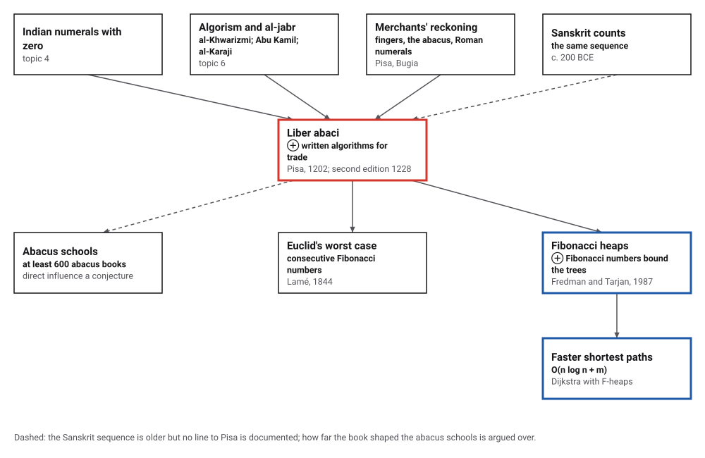
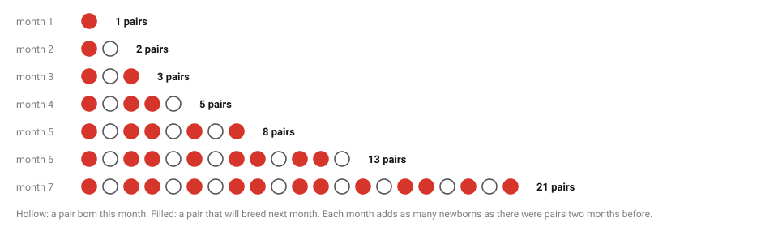
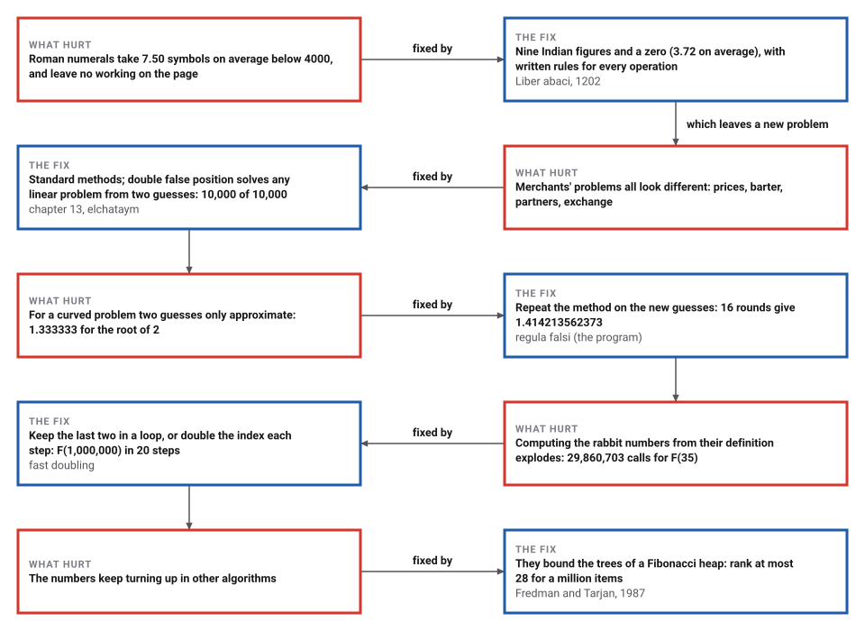

# Fibonacci's Liber Abaci

*Era 2 · topic 8 · 1202 CE* · [Era 2 index](../README.md) · [← Frequency Analysis](../07-frequency-analysis/README.md) · [Horner's Method, Nearly Six Centuries Early →](../09-qin-jiushao/README.md) · [Interactive edition](liber-abaci.html) · [Program](../../../code/era-02-algorithms-travel/08-liber-abaci/)

> **Field note from the visiting historian.** The son of a customs official, who had learned the Indian figures in North Africa, wrote the merchants a manual in fifteen chapters. His real export was the written algorithm itself, put into the hands of people who did sums for a living.

| | |
|---|---|
| **When** | 1202; the surviving text is the second edition, 1228 (**documented**) |
| **Where** | Pisa; learned at Bugia (Bejaia, Algeria) |
| **What hurt** | Roman numerals are clumsy to calculate with and leave no working to check |
| **The fix** | Indian figures with zero, and written step-by-step methods for trade |
| **Cost** | 3.72 figures per number below 4000 against 7.50 Roman symbols |

## How ideas combined

A new algorithm is usually an older idea combined with a new one. The Indian figures with zero (topic 4) and al-Khwarizmi's written methods (topic 6) reached Leonardo in North Africa; Pisa's merchants supplied the problems. *Liber abaci* put the two together in fifteen chapters. Each box names the idea that was added.

<picture>
  <source media="(prefers-color-scheme: dark)" srcset="assets/family-dark.svg">
  
</picture>
*Red: Liber abaci. Blue: a data structure of 1987 that is named after the rabbit numbers because they bound its size.*

## Breed the rabbits; multiply like a merchant

On the left, follow the rabbits month by month: a newborn pair can breed at one month old and gives birth a month later, and every month after. On the right, multiply two numbers below 4000 the way the book teaches: in Indian figures, with every partial product written down.

<picture>
  <source media="(prefers-color-scheme: dark)" srcset="assets/rabbits-dark.svg">
  
</picture>
*In the interactive edition you can breed the rabbits for a year and multiply any two numbers below 4000.*

By these rules the program counts the pairs at the end of each month as 1, 2, 3, 5, 8, 13, 21, 34, 55, 89, 144, 233. There are five pairs at the end of the fourth month, as Strick's retelling says, and each month is the sum of the two before it.

## Era 2, algorithms travel

<picture>
  <source media="(prefers-color-scheme: dark)" srcset="assets/era-timeline-dark.svg">
  
</picture>

## Each fix leaves a new pain

<picture>
  <source media="(prefers-color-scheme: dark)" srcset="assets/chain-dark.svg">
  
</picture>
*Read it as a snake: each new problem sits directly under the fix that exposed it.*

## Nine figures, a zero, and the working on the page

Chapter 1 begins: "These are the nine figures of the Indians: 9 8 7 6 5 4 3 2 1." With a zero they write any number in a few figures: from 1 to 3999, Roman numerals take **7.50 symbols** on average and up to 15 (3,888 = MMMDCCCLXXXVIII), the Indian figures 3.72. Chapters 2 to 7 teach multiplication, addition, subtraction, division and fractions, chapters 8 to 11 merchants' problems, chapter 12 many posed problems, rabbits included, chapter 13 double false position, chapter 14 roots, and chapter 15 geometry and algebra.

| Partial product |  |
|---|---|
| 1202 x 8 | 9616 |
| 1202 x 2 x 10 | 24040 |
| 1202 x 2 x 100 | 240400 |
| 1202 x 1 x 1000 | 1202000 |
| Total | **1,476,056** |

1202 × 1228, the years of the two editions, written as the book teaches: 16 digit products, each line checkable. In Roman numerals the factors are MCCII and MCCXXVIII, and the answer, 1,476,056, is beyond what standard Roman numerals can write. Devlin stresses this "audit trail": a written calculation can be checked by someone else.

> **Key idea.** The book's export was the written algorithm itself: a calculation whose every step stays on the page, so that a partner, a customs officer or a court can check it. Numerals that can be calculated with, not only recorded.

## Four ways to compute the rabbit numbers

| n | F(n) | Calls made by plain recursion |
|---|---|---|
| 10 | 55 | 177 |
| 20 | 6,765 | 21,891 |
| 30 | 832,040 | 2,692,537 |
| 35 | 9,227,465 | 29,860,703 |

Computing F(n) straight from the definition, F(n) = F(n−1) + F(n−2), calls itself 2F(n+1) − 1 times, so the work grows as fast as the rabbits. A loop that keeps the last two numbers needs n additions: F(1000), with 209 digits, takes 1,000. Fast doubling, F(2k) = F(k)(2F(k+1) − F(k)) and F(2k+1) = F(k)² + F(k+1)², halves the index each step: F(1000) in 10 steps, and F(1,000,000), a number of **208,988 digits**, in 20. Binet's formula, the nearest whole number to φⁿ/√5, is exact in double precision up to n = 70 and first goes wrong at n = 71.

| Division steps | Smallest pair a > b needing them |
|---|---|
| 14 | 987 and 610 |

Euclid's algorithm (Era 1, topic 7) is slowest on consecutive Fibonacci numbers: the program checked that the smallest pair needing k division steps is always (F(k+2), F(k+1)), as Lamé showed in 1844.

Double false position, chapter 13's *elchataym*, solved all 10,000 random linear problems exactly from two guesses: if guess g₁ misses by e₁ and g₂ by e₂, the answer is (g₁e₂ − g₂e₁)/(e₂ − e₁). For a curved problem it only approximates: x² = 2 from guesses 1 and 2 gives 1.333333. Repeating it, the method later called *regula falsi*, took 16 rounds to reach 1.414213562373.

## A book known from its second edition

Leonardo of Pisa lived about 1170 to about 1250 (MacTutor; MAA's Mathematical Treasures gives about 1180–1241, **disputed**). His father was public notary at the customs in Bugia, now Bejaia in Algeria, acting for Pisan merchants, and Leonardo learned the Indian figures there (**documented**). *Liber abaci* was published in 1202, after his return to Italy. No copy of the first edition survives; every manuscript descends from the second edition of 1228, of which about a dozen copies exist, three complete (**documented**; one MAA page prints 1212 for the second edition, probably a slip).

Pisa paid him a salary: from 1228, says Strick; MacTutor quotes a decree of 1240 (**disputed**). Whether a vernacular arithmetic of about 1290, the *Livero de l'abbecho*, copies a lost simpler book by Leonardo is **disputed** between Keith Devlin and Raffaella Franci. Abacus books "became standard in schools; at least 600 were written over the next few centuries", but how far *Liber abaci* directly inspired them is a **conjecture**. The rabbit sequence had appeared in Sanskrit writing around 200 BCE (**documented**); Sigler's English translation of 2002 is the first complete one in a modern language.

## The rabbits in a data structure

In 1987 Michael Fredman and Robert Tarjan published Fibonacci heaps in the *Journal of the ACM*: a priority queue that does every standard operation in constant amortized time except deletion, which takes O(log n). With it, Dijkstra's shortest-path algorithm runs in O(n log n + m) on a graph with n vertices and m edges. The name comes from a lemma: the smallest tree of rank k in the heap has at least F(k+2) items, so ranks stay below log base φ of n.

> **Full circle.** The program built the smallest possible tree of each rank and found exactly F(k+2) items, for every k up to 59. So a heap of a million items never has a tree of rank above **28** (log base φ of a million is 28.7). A puzzle about rabbits, posed among merchants' problems in 1202, bounds the running time of route-finding algorithms.

## Before you read on

<details>
<summary><b>1.</b> Write 1999 in Roman numerals and in Indian figures.</summary>

MCMXCIX, seven symbols, against four figures: 1999.
</details>

<details>
<summary><b>2.</b> Why does each month's rabbit count equal the sum of the two before?</summary>

This month's pairs are last month's pairs, all still alive, plus one newborn pair for every pair alive two months ago (those are old enough to breed).
</details>

<details>
<summary><b>3.</b> A guess of 10 misses by −6 and a guess of 20 misses by 14. By double false position, what is the answer?</summary>

(10 × 14 − 20 × (−6)) / (14 − (−6)) = 260 / 20 = **13**.
</details>

<details>
<summary><b>4.</b> How many calls does plain recursion make for F(30)?</summary>

2,692,537, which is 2F(31) − 1. A loop needs 29 additions.
</details>

<details>
<summary><b>5.</b> Why are consecutive Fibonacci numbers the slowest pair for Euclid's algorithm?</summary>

Each division step on (F(k+2), F(k+1)) has quotient 1 and leaves (F(k+1), F(k)): the numbers shrink as slowly as they can.
</details>


## Where the evidence lives

| | Object | Where to see it | Licence |
|---|---|---|---|
| — | **Liber abaci, 14th-century copy, Florence**. Pages from a copy in the Biblioteca Nazionale Centrale di Firenze, including the page of the nine Indian figures, shown in MAA's Mathematical Treasures. | [MAA Mathematical Treasures](https://old.maa.org/node/1734149) | Drawn placeholder; the photographs are on the MAA page. |
| — | **Scritti di Leonardo Pisano, 1857**. Boncompagni's edition of the Latin text, from a single manuscript. | [Internet Archive scan](https://archive.org/details/bub_gb_w86fLKi88pYC/page/n7/mode/2up) | Drawn placeholder. |

## Every link was opened before it was listed

| Level | Link | Why |
|---|---|---|
| Start | [Who invented algebra?](https://www.gresham.ac.uk/node/11558) — Gresham College, Robin Wilson, 5 October 2005 (video and transcript) | Islamic mathematics and its route into Europe, including through Fibonacci. Context more than detail |
| Start | [Fibonacci's Rabbits](https://mathcenter.oxford.emory.edu/site/math125/fibonacciRabbits) — Math 125 notes, Oxford College of Emory University math center site | Turns the rabbit puzzle from *Liber Abaci* (1202) into the recurrence |
| Start | [Leonardo of Pisa, also known as Fibonacci (1170–1250)](https://mathshistory.st-andrews.ac.uk/Strick/Fibonacci.pdf) — Heinz Klaus Strick, trans. David Kramer, MacTutor | Short illustrated life and a tour of the book, rabbits included |
| Start | [Fibonacci's real mathematical legacy](https://blogs.nature.com/aviewfromthebridge/2017/04/20/fibonaccis-mathematical-legacy/) — Davide Castelvecchi, *Nature* blog | Argues that the numerals, not the sequence, were the legacy, and reports the Devlin–Franci dispute |
| Deeper | [Supplement: Leonardo of Pisa (Fibonacci) and the Liber abbaci](https://faculty.etsu.edu/gardnerr/3040/Notes-Eves6/Leonardo-Fibonacci-Liber-abbaci.pdf) — MATH 3040 course notes, East Tennessee State University faculty site, based on Devlin's *The Man of Numbers* (2011) | Chapter-by-chapter contents of the book, editions, and the *Livero de l'abbecho* |
| Deeper | [Fibonacci](https://mathshistory.st-andrews.ac.uk/Biographies/Fibonacci/) — MacTutor | Life, the 1202 and 1228 editions, the 1240 decree, and the other works (1220, 1225) |
| Deeper | [Fibonacci's Liber Abaci](https://old.maa.org/node/116274) — Frank J. Swetz, MAA *Convergence* (July 2007) | Review of Sigler's translation, with the book's Arabic sources (al-Khwarizmi, Abu Kamil, al-Karaji) |
| Deeper | [Fibonacci Heaps](https://www.cs.princeton.edu/~wayne/kleinberg-tardos/pdf/FibonacciHeaps.pdf) — Kevin Wayne, lecture slides for Kleinberg and Tardos, *Algorithm Design* (updated 2017) | The lemma: a heap of rank k has at least F(k+2) elements, so rank ≤ log base φ of n |
| Deeper | [Euclidean Algorithm](https://mathworld.wolfram.com/EuclideanAlgorithm.html) — Wolfram MathWorld | Lamé's bound and the Fibonacci worst case |
| Scholar | [Review of Sigler, *Fibonacci's Liber Abaci*](https://ircps.org/wp-content/uploads/2021/04/2004-02-01_Cuomo.pdf) — Serafina Cuomo, *Aestimatio* 1 (2004), 19–27 | The manuscript tradition (12 copies, 3 complete), and why the surviving text is the 1228 edition |
| Scholar | [Il Liber abbaci di Leonardo Pisano](https://archive.org/details/bub_gb_w86fLKi88pYC/page/n7/mode/2up) — Baldassarre Boncompagni (ed.), *Scritti di Leonardo Pisano*, 1857. Internet Archive (Google Books scan of the Florence National Central Library copy) | The Latin text, edited from a single manuscript |
| Scholar | [Fibonacci's Liber Abaci: A Translation into Modern English of Leonardo Pisano's Book of Calculation](https://link.springer.com/book/9780387407371) — Laurence Sigler, Springer, 2002 (Sources and Studies in the History of Mathematics and Physical Sciences) | The only complete translation into a modern language |
| Scholar | [Mathematical Treasures: Fibonacci's Liber abaci](https://old.maa.org/node/1734149) — MAA *Convergence* | Images from a 14th-century copy in the Biblioteca Nazionale Centrale di Firenze, including the page of nine Indian figures, and a translation of the autobiographical preface |
| Scholar | [Fibonacci heaps and their uses in improved network optimization algorithms](https://collaborate.princeton.edu/en/publications/fibonacci-heaps-and-their-uses-in-improved-network-optimization-a-2/) — Michael L. Fredman and Robert E. Tarjan, Journal of the ACM 34(3), 1987, 596–615 | Constant amortized time for most heap operations; shortest paths in O(n log n + m) |

More, with certainty labels and the gaps we could not fill: [Era 2 reference catalog](https://github.com/vij658/AlgorithmEvolutionAtlas/blob/main/book/era-02-algorithms-travel/reference-catalog.md).

## The program behind every number here

[LiberAbaci.java](https://github.com/vij658/AlgorithmEvolutionAtlas/blob/main/code/era-02-algorithms-travel/08-liber-abaci/LiberAbaci.java) makes **14,093 checks**: Roman numerals read back for 1 to 3999, the rabbits pair by pair against the recurrence, plain recursion's 2F(n+1) − 1 calls, the loop against fast doubling, the Fibonacci worst case of Euclid's algorithm, double false position on 10,000 linear problems, and the Fibonacci-heap lemma. Run it with `java LiberAbaci.java` (JDK 17 or newer). The heart of it:

```java
/** Fast doubling: F(2k) = F(k)(2F(k+1) - F(k)), F(2k+1) = F(k)^2 + F(k+1)^2. Returns {F(n), F(n+1)}. */
static BigInteger[] doubling(int n) {
    if (n == 0) return new BigInteger[]{BigInteger.ZERO, BigInteger.ONE};
    BigInteger[] h = doubling(n / 2);
    doublingSteps++;
    BigInteger a = h[0], b = h[1];
    BigInteger c = a.multiply(b.shiftLeft(1).subtract(a)), d = a.multiply(a).add(b.multiply(b));
    return n % 2 == 0 ? new BigInteger[]{c, d} : new BigInteger[]{d, c.add(d)};
}
```

