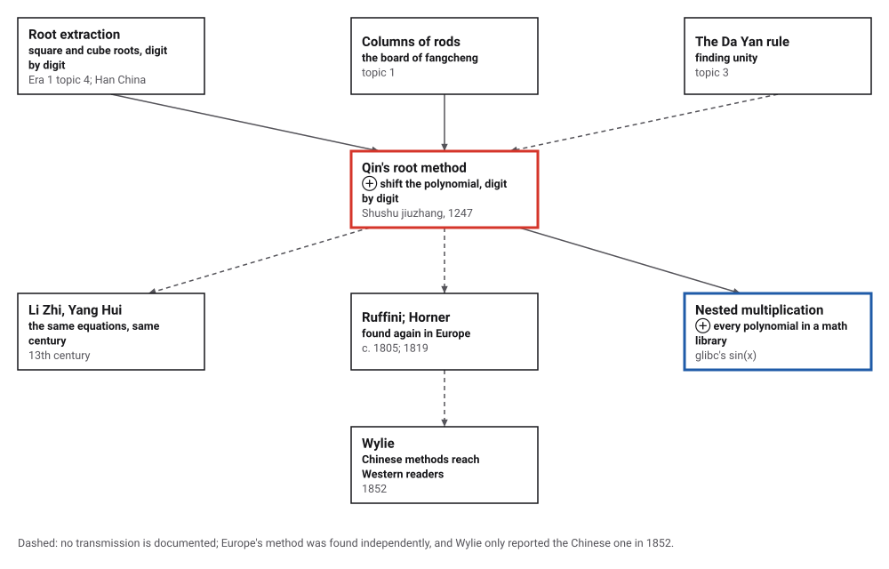
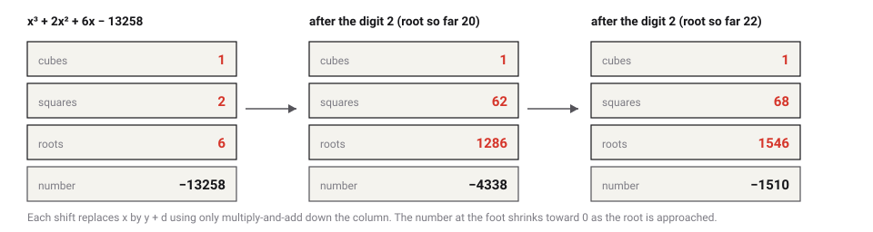
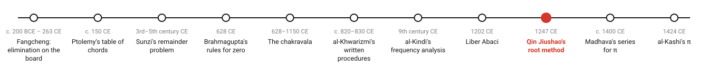
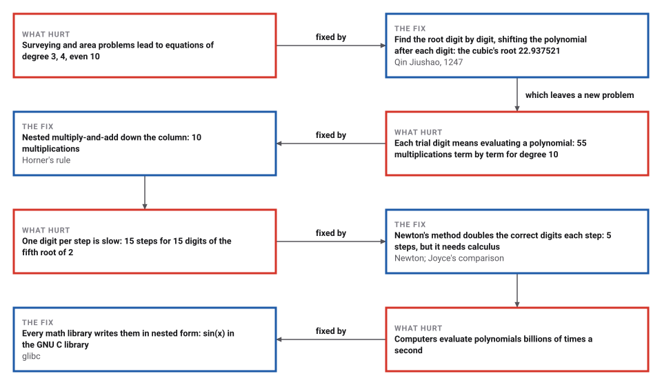

# Horner's Method, Nearly Six Centuries Early

*Era 2 · topic 9 · 1247 CE* · [Era 2 index](../README.md) · [← Fibonacci's Liber Abaci](../08-liber-abaci/README.md) · [Madhava's Series for Pi →](../10-madhava-series/README.md) · [Interactive edition](qin-jiushao.html) · [Program](../../../code/era-02-algorithms-travel/09-qin-jiushao/)

> **Field note from the visiting historian.** This official wrote his mathematics while in mourning, and he put on the counting board a procedure the West would find again centuries later. Each new digit shifts the whole polynomial, so the next digit is found the same way, and no power is ever computed directly.

| | |
|---|---|
| **When** | *Shushu jiuzhang*, 1247 (**documented**); Ruffini c. 1805 and Horner 1819 (**disputed** for Ruffini) |
| **Where** | Southern Song China |
| **What hurt** | Equations of degree 3, 4 and 10 from surveying and areas |
| **The fix** | Digit by digit, shifting the polynomial by multiply-and-add |
| **Cost** | 10 multiplications to evaluate degree 10, against 55 term by term |

## How ideas combined

A new algorithm is usually an older idea combined with a new one. Digit-by-digit square and cube roots were old (Era 1, topic 4), and the counting board already held the columns of an equation (topic 1). Qin's step was to treat any polynomial the way root extraction treats x²: find a digit, shift, repeat. Each box names the idea that was added.

<picture>
  <source media="(prefers-color-scheme: dark)" srcset="assets/family-dark.svg">
  
</picture>
*Red: Qin's method. Blue: nested multiplication, the half of it that every computer uses.*

## Find a root one digit at a time

Choose an equation and press **Next digit**. The board tries 1, 2, 3, … at the current place and keeps the largest digit that does not carry the polynomial past zero. Then it replaces x by y + that digit, updating the column of coefficients by multiply-and-add alone. The number at the foot of the column shrinks toward zero.

<picture>
  <source media="(prefers-color-scheme: dark)" srcset="assets/board-dark.svg">
  
</picture>
*In the interactive edition you can step through four equations, including the degree-10 circular-city equation.*

| Digit | Root so far | Shifted coefficients (highest power first) |
|---|---|---|
| 2 × 10 | 20 | 1 62 1286 −4338 |
| 2 × 1 | 22 | 1 68 1546 −1510 |
| 9 × 10⁻1 | 22.9 | 1 70.7 1670.83 −62.791 |
| 3 × 10⁻2 | 22.93 | 1 70.79 1675.0747 −12.602443 |

Joyce's worked cubic, x³ + 2x² + 6x − 13258 = 0: the root lies between 20 and 30, so the first digit is 2; shifting by 20 leaves 1, 62, 1286, −4338, and so on. The program carried it to **22.937521** in 162 multiply-adds; Joyce notes the root is "closer to 22.9375" than to his rounded 22.93.

## Era 2, algorithms travel

<picture>
  <source media="(prefers-color-scheme: dark)" srcset="assets/era-timeline-dark.svg">
  
</picture>

## Each fix leaves a new pain

<picture>
  <source media="(prefers-color-scheme: dark)" srcset="assets/chain-dark.svg">
  
</picture>
*Read it as a snake: each new problem sits directly under the fix that exposed it.*

## Qin's equations on the board

Two equations that the *Dictionary of Scientific Biography* lists from the *Shushu jiuzhang*. The quartic −x⁴ + 763,200x² − 40,642,560,000 = 0 has two positive roots: digit by digit from zero the program finds **240**, and searching above 300 finds **840**. The "circular city" equation, x¹⁰ + 15x⁸ + 72x⁶ − 864x⁴ − 11,664x² − 34,992 = 0, has the root **3**, found in one digit; MacTutor gives the same answer, a city 9 *li* across.

| Evaluating a polynomial of degree 10 | Multiplications |
|---|---|
| Term by term (each power from scratch) | 55 |
| Keeping each power for the next | 19 |
| Nested, as on the board (Horner's rule) | 10 |

The shift and the evaluation use the same move: multiply by the digit and add the next coefficient. Nested this way, a polynomial of degree 10 costs 10 multiplications instead of 55; the city polynomial at x = 3 comes out exactly 0. The program also built 5,000 random polynomials with a known root of up to four digits, and recovered every root digit by digit.

> **Key idea.** Make the hard problem look like the easy one again. After each digit, shifting the polynomial turns "the rest of the root" into a fresh root of a new polynomial, so the same simple step repeats until the root is found.

## Digits per step

| Method | Steps for 15 digits of the fifth root of 2 |
|---|---|
| Digit by digit (Qin) | 15 (655 multiply-adds) |
| Bisection (halve the interval) | 50 |
| Newton's method | 5 |

Joyce calls the Chinese algorithm "pretty much the same thing as the bisection algorithm, but the interval is divided into ten parts instead of into two parts". It gains one decimal digit per step, bisection about a third of one, and Newton's method, which needs the derivative, doubles the correct digits each step. All three agree: 1.14869835499703.

## Earliest surviving, not first

Qin Jiushao (1202–1261) wrote the *Shushu jiuzhang* in 1247, during the mourning period after his mother's death (**documented**). It was not printed in his lifetime; the text read today was published in 1842 from a Korean copy. MacTutor says he solved his equations by the standard Chinese method, "namely that which today is called the Ruffini-Horner method". Britannica calls the book the earliest surviving description and thinks the method was widely known earlier: his contemporaries Li Zhi and Yang Hui solved similar equations, and Wang Ling and Needham traced it to Han root extraction (**conjecture** for who devised it).

Europe found it again: Britannica dates the rediscovery about 1802, the DSB says Ruffini about 1805 and Horner in 1819 (**disputed** for Ruffini's date). Horner's paper came 572 years after Qin's book: nearly six centuries. No source opened here says the method travelled from China to Europe; Alexander Wylie described Chinese equation-solving to Western readers in 1852. The *Shushu jiuzhang* is also the oldest surviving Chinese mathematical text with a zero symbol, and it used red and black rods for positive and negative numbers.

## Nested multiplication everywhere

The GNU C library's sine function (topic 2) finishes with short polynomials, written in exactly this nested form: `xx * (cs2 + xx * (cs4 + xx * cs6))` for the cosine part and `x * xx * (sn3 + xx * sn5)` for the sine part. Each pair of parentheses is one step down Qin's column: multiply, then add the next coefficient.

> **Full circle.** A degree-10 equation about a walled city, solved on a counting board in 1247, used the same multiply-and-add that a computer uses to evaluate any polynomial: 10 multiplications for degree 10 instead of 55. Europe named it after Horner, 572 years later.

## Before you read on

<details>
<summary><b>1.</b> Evaluate 2x³ − 6x² + 2x − 1 at x = 3 by nested multiplication.</summary>

2; 2·3 − 6 = 0; 0·3 + 2 = 2; 2·3 − 1 = **5**. Three multiplications.
</details>

<details>
<summary><b>2.</b> Why does the first digit of the cubic's root have to be 2?</summary>

At x = 20 the left side x³ + 2x² + 6x is still below 13,258, and at x = 30 it is above, so the root is in the twenties. In the widget, the trials 1 and 2 keep the sign at the tens place and 3 changes it.
</details>

<details>
<summary><b>3.</b> After shifting by 20, the cubic becomes y³ + 62y² + 1286y − 4338. What is its root?</summary>

The rest of the original root: about 2.937521, whose first digit is 2.
</details>

<details>
<summary><b>4.</b> Why does the quartic need care?</summary>

It has two positive roots, 240 and 840. Counting up from zero finds the smaller; to find the larger, shift past the first.
</details>

<details>
<summary><b>5.</b> What does Newton's method need that Qin's does not?</summary>

The derivative: the slope of the polynomial at the current guess. In exchange it doubles the correct digits each step.
</details>


## Where the evidence lives

| | Object | Where to see it | Licence |
|---|---|---|---|
| — | **Ch'in Chiu-shao in the Dictionary of Scientific Biography**. Ho Peng-yoke's entry, with the quartic and the degree-10 circular-city equation, the zero symbol and the red and black rods. | [DSB entry (MacTutor)](https://mathshistory.st-andrews.ac.uk/DSB/Qin_Jiushao.pdf) | Drawn placeholder. |

## Every link was opened before it was listed

| Level | Link | Why |
|---|---|---|
| Start | [Qin Jiushao](https://mathshistory.st-andrews.ac.uk/Biographies/Qin_Jiushao/) — MacTutor | Life, the 1247 treatise, the degree-10 equation, and the remainder theorem with non-coprime moduli |
| Start | [Qin Jiushao](https://www.britannica.com/print/article/111675) — Encyclopaedia Britannica | Short biography; the earliest surviving description of the root-finding method |
| Start | [Qin Jiushao (1202–1261)](https://mathshistory.st-andrews.ac.uk/Strick/qin_jiushao.pdf) — H. K. Strick, trans. J. O'Connor, MacTutor | Illustrated article with a worked shift-the-root example (x = y + 2) and Sun Zi's 3-5-7 problem |
| Deeper | [The Chinese algorithm for solving equations](https://mathcs.clarku.edu/~djoyce/ma105/chinalg.html) — David E. Joyce, Clark University (course MA105) | Worked digit-by-digit solution of a cubic and a fifth root, with a note on how it ran on a counting board, compared with bisection and Newton's method |
| Deeper | [Equations in China: Two Millennia of Innovation, Transmission and Retransmission](https://hkumath.hku.hk/~mks/ESU8_MKSiu_Equations_RevisedDraft_Mar12_2019.pdf) — Man-Keung Siu, University of Hong Kong | Places Qin's *zengcheng kaifangfa* in the long Chinese history of equations |
| Deeper | [On the Algorithmic Significance and Analysis of the Method of DaYan Deriving One](https://arxiv.org/pdf/1610.01175) — Guangwu Xu and Bao Li, arXiv | Qin's inverse procedure restated as a 2×2 state-matrix algorithm and compared with extended Euclid |
| Scholar | [Historical development of the Chinese remainder theorem](https://link.springer.com/doi/10.1007/BF00357063) — Shen Kangsheng, *Archive for History of Exact Sciences* 38(4):285–305 (1988) | The calendar origin (*shangyuan*) and a step-by-step reading of the Dayan rule. Full text on a University of Kentucky course site |
| Scholar | [Traditional Chinese Mathematics in the 19th Century Western World](https://thjcs.site.nthu.edu.tw/p/16-1452-41351.php?Lang=en) — Wang Xiaoqin (2003), National Tsing Hua University journal site | How Wylie, Biernatzki, Cantor and Matthiessen received the Dayan rule in Europe |
| Scholar | [Ch'in Chiu-shao](https://mathshistory.st-andrews.ac.uk/DSB/Qin_Jiushao.pdf) — Ho Peng-yoke, *Dictionary of Scientific Biography* (via MacTutor) | Standard reference entry: the root-finding method, the *ta-yen ch'iu-i shu*, the zero symbol, the degree-10 equation |
| Scholar | [Chinese Mathematics in the Thirteenth Century, ch. 14](https://legacy-www.math.harvard.edu/~knill/crt/lib/Libbrecht14.pdf) — Ulrich Libbrecht (MIT Press, 1973), excerpt in [Oliver Knill's CRT library](https://legacy-www.math.harvard.edu/~knill/crt/lib.html), Harvard | The standard English study of the *Shushu jiuzhang*. This chapter surveys first-degree indeterminate analysis outside China and says the problem "finds its culminating point in the work of Ch'in Chiu-shao (1247)" |
| Scholar | [s_sin.c (IBM Accurate Mathematical Library)](https://codebrowser.dev/glibc/glibc/sysdeps/ieee754/dbl-64/s_sin.c.html) — GNU C library source, on codebrowser.dev | Polynomials written in nested (Horner) form inside do_sin |

More, with certainty labels and the gaps we could not fill: [Era 2 reference catalog](https://github.com/vij658/AlgorithmEvolutionAtlas/blob/main/book/era-02-algorithms-travel/reference-catalog.md).

## The program behind every number here

[QinJiushao.java](https://github.com/vij658/AlgorithmEvolutionAtlas/blob/main/code/era-02-algorithms-travel/09-qin-jiushao/QinJiushao.java) makes **5,007 checks**: the circular-city root, the cubic, the quartic's two roots and the fifth root of 2 digit by digit in exact decimals, 5,000 random polynomials with known roots, and the comparison with bisection and Newton's method. Run it with `java QinJiushao.java` (JDK 17 or newer). The heart of it:

```java
/** The shift x -> y + d by repeated synthetic division: returns the coefficients of p(y + d). */
static BigDecimal[] shift(BigDecimal[] c, BigDecimal d) {
    BigDecimal[] a = c.clone();
    int n = a.length - 1;
    for (int k = 0; k < n; k++)
        for (int i = 1; i <= n - k; i++) { a[i] = a[i].add(a[i - 1].multiply(d)); multAdds++; }
    return a;
}

/**
 * The digit-by-digit smallest root in (0, 10^(top+1)) of a polynomial that changes sign there: at each place, the
 * largest digit that does not carry the polynomial past its root; then shift by it.
 */
static BigDecimal digitRoot(BigDecimal[] coef, int top, int decimals) {
    BigDecimal[] c = coef.clone();
    BigDecimal root = BigDecimal.ZERO;
    int s0 = c[c.length - 1].signum();                  // the sign at the start of the interval
    for (int k = top; k >= -decimals; k--) {
        BigDecimal place = BigDecimal.ONE.scaleByPowerOfTen(k);
        int dgt = 0;
        for (int t = 1; t <= 9; t++) {                  // try 1, 2, 3, ... until the polynomial changes sign
            BigDecimal v = horner(c, place.multiply(BigDecimal.valueOf(t)));
            if (v.signum() == 0) { dgt = t; break; }
            if (v.signum() != s0) break;
            dgt = t;
        }
        if (dgt > 0) {
            BigDecimal d = place.multiply(BigDecimal.valueOf(dgt));
            c = shift(c, d);
            root = root.add(d);
            if (trace != null) trace.add(String.format("digit %d at 10^%d -> root so far %s ; shifted: %s", dgt, k, root.toPlainString(), poly(c)));
            if (c[c.length - 1].signum() == 0) break;    // the root is exact
        }
    }
    return root;
}
```

