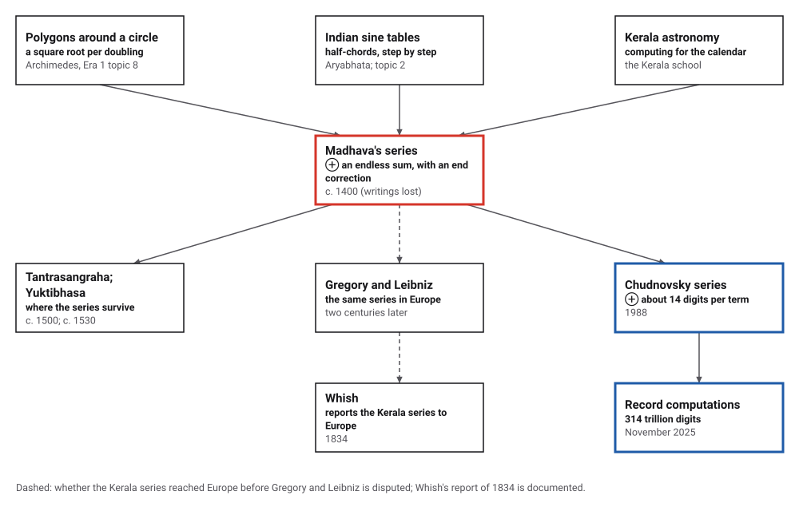
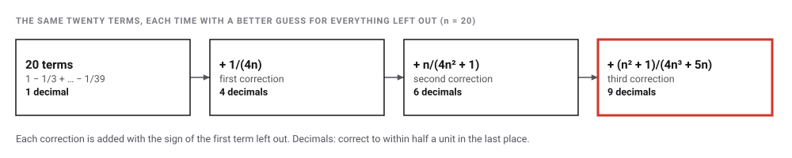
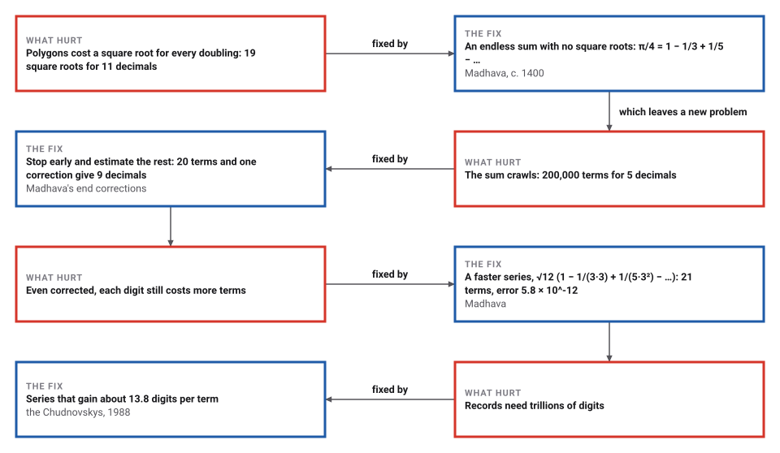

# Madhava's Series for Pi

*Era 2 · topic 10 · c. 1400 CE* · [Era 2 index](../README.md) · [← Horner's Method, Nearly Six Centuries Early](../09-qin-jiushao/README.md) · [Al-Kashi's Pi →](../11-al-kashi-pi/README.md) · [Interactive edition](madhava-series.html) · [Program](../../../code/era-02-algorithms-travel/10-madhava-series/)

> **Field note from the visiting historian.** Archimedes' polygons cost a new square root for every doubling. In Kerala I found a sum that never ends, and astronomers who stopped after a few terms and estimated the rest. It is the first time I have seen anyone compute with an infinite process and deal honestly with the part they did not compute.

| | |
|---|---|
| **When** | Madhava, c. 1350–1425 (**disputed**); his writings lost, known from texts of c. 1500 and c. 1530 |
| **Where** | Kerala, southwestern India |
| **What hurt** | Polygons need a square root for every doubling; the plain series converges too slowly |
| **The fix** | An infinite series with an end correction; a faster series with √12 |
| **Cost** | 20 terms and a correction for 9 decimals; 19 square roots by polygons for 11 |

## How ideas combined

A new algorithm is usually an older idea combined with a new one. Archimedes trapped π between polygons (Era 1, topic 8), paying a square root for every doubling. Indian astronomers had long built sine tables step by step (topic 2). In Kerala, Madhava replaced the polygons by a sum that never ends, and then found a way not to need all of it. Each box names the idea that was added.

<picture>
  <source media="(prefers-color-scheme: dark)" srcset="assets/family-dark.svg">
  
</picture>
*Red: Madhava's series. Blue: the series that compute π today.*

## Add terms, then correct for the rest

Move the slider to choose how many terms to add. The top row is the plain series, which creeps toward π. The next three rows add Madhava's three corrections for everything left out. The last row is his faster series with √12. The bold digits are the correct ones.

<picture>
  <source media="(prefers-color-scheme: dark)" srcset="assets/corrections-dark.svg">
  
</picture>
*In the interactive edition you can choose the number of terms from 1 to 60 and compare all five ways.*

## Era 2, algorithms travel

<picture>
  <source media="(prefers-color-scheme: dark)" srcset="assets/era-timeline-dark.svg">
  
</picture>

## Each fix leaves a new pain

<picture>
  <source media="(prefers-color-scheme: dark)" srcset="assets/chain-dark.svg">
  
</picture>
*Read it as a snake: each new problem sits directly under the fix that exposed it.*

## An endless sum, and an honest estimate of the rest

The series π/4 = 1 − 1/3 + 1/5 − 1/7 + … needs no square roots, only divisions. But its error after n terms is about 1/(4n), so each new decimal costs ten times as many terms:

| Correct decimals | Terms of the plain series |
|---|---|
| 1 | 20 |
| 2 | 200 |
| 3 | 2,000 |
| 4 | 20,000 |
| 5 | 200,000 |
| 6 | 2,000,000 |
| 7 | 20,000,000 |

The Kerala texts stop after n terms and add one correction R for everything left out, with the sign of the first term omitted. MacTutor gives the three forms: R = 1/(4n), R = n/(4n² + 1) and R = (n² + 1)/(4n³ + 5n). The program applied each, in exact arithmetic:

<picture>
  <source media="(prefers-color-scheme: dark)" srcset="assets/corrections-measured-dark.svg">
  
</picture>

| Terms | No correction | 1/(4n) | n/(4n² + 1) | (n² + 1)/(4n³ + 5n) | Value with the third |
|---|---|---|---|---|---|
| 5 | 0 | 2 | 3 | 4 | 3.141587301587302 |
| 10 | 0 | 3 | 5 | 6 | 3.141592705349155 |
| 20 | 1 | 4 | 6 | 9 | 3.141592654019864 |
| 50 | 1 | 5 | 8 | 11 | 3.141592653590511 |

Madhava's other series converges on its own: π = √12 (1 − 1/(3·3) + 1/(5·3²) − 1/(7·3³) + …). Each term is a third the size of the one before. With 21 terms the program gets 3.141592653595635: its first 11 decimals, **3.14159265359**, are the value MacTutor credits to Madhava, and the error is 5.8 × 10^-12.

> **Key idea.** Compute with an infinite process, then deal honestly with the part you did not compute. The end correction turns a hopeless series into a practical one, the first time in this book that someone estimates the error of stopping early.

## Square roots against terms

| Method | Work for 11 decimals |
|---|---|
| Archimedes' polygons (Era 1, topic 8) | 18 doublings, to a 1,572,864-sided polygon: 19 square roots |
| Plain series | more than 20,000,000 terms (that is only 7 decimals) |
| Plain series + third correction | 50 terms |
| √12 series | 21 terms (error 5.8 × 10^-12) |

The polygons trap π between 3.1415926535877 and 3.1415926535940 after 19 square roots, each one a long calculation by hand. The corrected series and the √12 series reach the same accuracy with a few dozen divisions.

## A mathematician known only through his students

Madhava of Sangamagrama lived about 1350 to 1425 (other estimates: about 1340–1420, **disputed**). "All the mathematical writings of Madhava have been lost" (MacTutor); his series are known from Nilakantha's *Tantrasangraha* (about 1500) and Jyesthadeva's Malayalam *Yuktibhasa* (about 1530, dated anywhere from about 1500 to 1550, **disputed**), which gives the derivations. How he found the correction terms is not recorded: Krishnachandran concludes that "the rationale presented by Kerala authors is not strong enough to convince modern mathematical scholarship" (**conjecture** for the method).

Did the series reach Europe before Gregory and Leibniz found them in the 17th century? In 2007 the University of Manchester announced "strong circumstantial evidence" that they passed through Jesuit missionaries; Kim Plofker, reviewing the later book, found it "hard to help feeling disappointed that this hypothesis ultimately came to nothing" (**disputed**). Europe learned of the Kerala series in print from Charles Whish in 1834. Whether this counts as "calculus" is a question of framing (**disputed**).

## Series still compute π

The fastest way to compute π is still to add up a series, only a far faster one. The Chudnovsky brothers published theirs in 1988; each term adds about 14 correct digits. Wikipedia lists the records computed with it, the latest 314 trillion digits on 18 November 2025, done with the program y-cruncher.

> **Full circle.** The program summed 74 terms of the Chudnovsky series and got π to 1,019 decimals, about 13.8 digits a term, checked against an arctangent formula. Madhava's √12 series gains 0.48 digits a term. The idea he wrote down around 1400, that an endless sum can be the best way to a number, is how π is still computed today.

## Before you read on

<details>
<summary><b>1.</b> Why does the plain series need ten times as many terms for each new decimal?</summary>

Its error after n terms is about 1/(4n) of π/4, so to divide the error by ten you must multiply n by ten.
</details>

<details>
<summary><b>2.</b> The sum 1 − 1/3 + 1/5 − 1/7 is too small or too big?</summary>

Too small: the next term, +1/9, is positive, so the correction must be added. That is why the correction takes the sign of the first term left out.
</details>

<details>
<summary><b>3.</b> Why does the √12 series converge so much faster?</summary>

Each term is divided by 3 more than the last, so the terms shrink geometrically, about half a decimal digit per term.
</details>

<details>
<summary><b>4.</b> How many square roots did the polygons need for 11 decimals?</summary>

19, for a polygon of 1,572,864 sides.
</details>

<details>
<summary><b>5.</b> Is it known how Madhava found his corrections?</summary>

No. The Kerala texts give a rationale, but modern scholars find it unconvincing; the derivation is reconstructed, not recorded.
</details>


## Where the evidence lives

| | Object | Where to see it | Licence |
|---|---|---|---|
| — | **Ganita-Yukti-Bhasa of Jyesthadeva**. The Malayalam text of about 1530 that gives the derivations, in K. V. Sarma's English translation with notes by Ramasubramanian, Srinivas and Sriram (Springer and Hindustan Book Agency, 2008). | [Springer](https://link.springer.com/book/9781848820722) | Drawn placeholder. |

## Every link was opened before it was listed

| Level | Link | Why |
|---|---|---|
| Start | [Madhava of Sangamagrama](https://mathshistory.st-andrews.ac.uk/Biographies/Madhava/) — MacTutor | The series, the √12 form, the correction terms, and how his lost work is known |
| Start | [Indians predated Newton 'discovery' by 250 years](https://www.manchester.ac.uk/about/news/indians-predated-newton-discovery-by-250-years/) — University of Manchester press release (13 Aug 2007) | The transmission claim in its strongest public form, including the "circumstantial evidence" wording |
| Start | [Madhava and the Uninfluential Discovery](https://3quarksdaily.com/?p=143638) — Thomas Manuel, 3 Quarks Daily (2018) | The skeptical side, quoting Plofker's review |
| Start | [Chudnovsky algorithm](https://en.wikipedia.org/wiki/Chudnovsky_algorithm) — Wikipedia | Published by the Chudnovsky brothers in 1988; about 14 digits per term; record computations up to 314 trillion digits (18 November 2025, with y-cruncher) |
| Deeper | [Mathematics in India: From Vedic Period to Modern Times](https://nptel.ac.in/courses/111101080) — NPTEL video course, IIT Bombay (K. Ramasubramanian, M. D. Srinivas, M. S. Sriram) | Lectures 30–31, "Kerala School of Astronomy and Development of Calculus", and proofs from the *Yuktibhasa* (syllabus) |
| Deeper | [The History and Historiography of the Discovery of Calculus in India](https://mathunion.org/fileadmin/IMU/ICM2022/Presentation-slides/218-Krishnamurthi%20Ramasubramanian.pdf) — K. Ramasubramanian, invited talk, ICM 2022 (slides) | The series, the end-correction, and the Kerala lineage, Madhava to Jyesthadeva |
| Deeper | [Mathematics in India (review)](https://www.dam.brown.edu/people/mumford/beyond/papers/2010a--PlofkerReview-AMS.pdf) — David Mumford, *Notices of the AMS* 57(3) (2010) | A mathematician's account of the Kerala power series and the *Yuktibhasa* proofs |
| Deeper | [Ideas of Calculus in Islam and India](https://maa.org/node/95254) — Victor J. Katz, *Mathematics Magazine* 68(3):163–174 (1995), MAA | The classic survey of the Indian power series for sine, cosine and arctangent |
| Scholar | [On Mādhava and his correction terms for the Mādhava–Leibniz series for π](https://arxiv.org/abs/2405.11134) — V. N. Krishnachandran, arXiv (2024) | The three correction terms examined critically, and reconstructions of how they were found |
| Scholar | [Ganita-Yukti-Bhāṣā (Rationales in Mathematical Astronomy) of Jyeṣṭhadeva](https://link.springer.com/book/9781848820722) — K. V. Sarma (trans.), K. Ramasubramanian, M. D. Srinivas, M. S. Sriram; Springer / Hindustan Book Agency (2008), 2 vols. | The Malayalam text (c. 1530) that gives the derivations, in English translation with notes |

More, with certainty labels and the gaps we could not fill: [Era 2 reference catalog](https://github.com/vij658/AlgorithmEvolutionAtlas/blob/main/book/era-02-algorithms-travel/reference-catalog.md).

## The program behind every number here

[MadhavaSeries.java](https://github.com/vij658/AlgorithmEvolutionAtlas/blob/main/code/era-02-algorithms-travel/10-madhava-series/MadhavaSeries.java) makes **606 checks**: the three corrections for every n from 2 to 300 (each better than the last), the √12 series against MacTutor's value, Archimedes' polygons trapping π, and the Chudnovsky series against an arctangent formula to 1,000 decimals. Run it with `java MadhavaSeries.java` (JDK 17 or newer). The heart of it:

```java
/** Correct decimals of an approximation: how many places agree with pi before the error shows. */
static int decimals(BigDecimal approx) {
    BigDecimal err = approx.subtract(PI).abs();
    if (err.signum() == 0) return 50;
    int d = 0;
    while (d < 60 && err.compareTo(new BigDecimal("0.5").movePointLeft(d + 1)) < 0) d++;
    return d;
}
```

