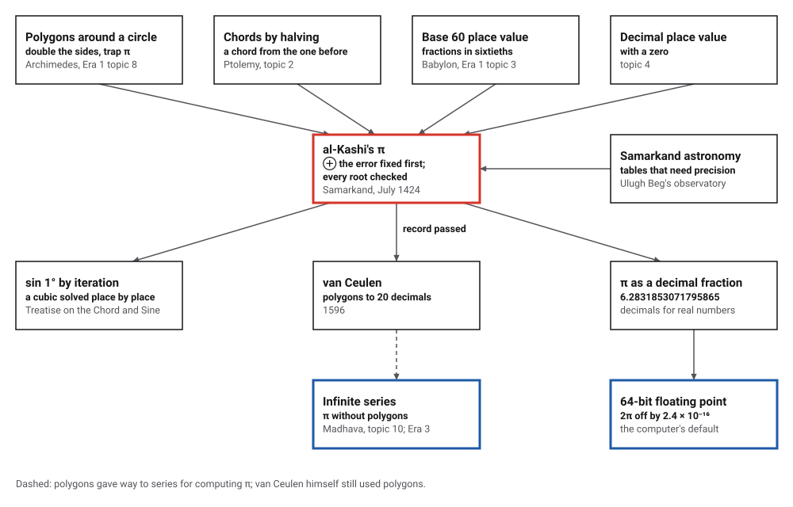
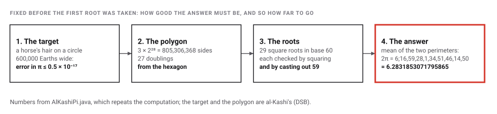
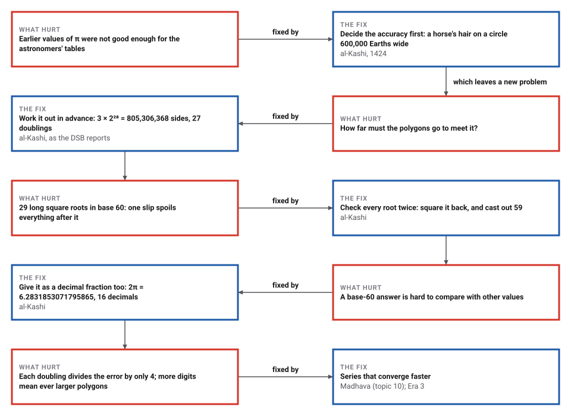
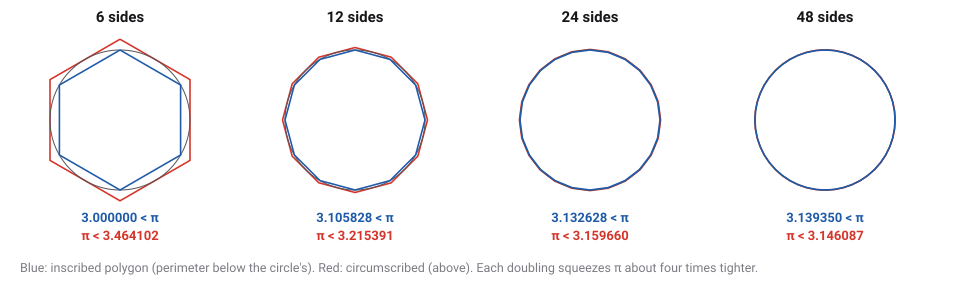

# Al-Kashi's Pi

*Era 2 · topic 11 · 1424 CE* · [Era 2 index](../README.md) · [← Madhava's Series for Pi](../10-madhava-series/README.md) · [Interactive edition](al-kashi-pi.html) · [Program](../../../code/era-02-algorithms-travel/11-al-kashi-pi/)

> **Field note from the visiting historian.** Archimedes' method was already seventeen centuries old. What was new in Samarkand was the accounting: a precision fixed before the work began, a computation planned to meet it, and every root checked twice. His sixteen decimals stood for almost two hundred years.

| | |
|---|---|
| **When** | July 1424 (Sha'ban 827 AH) |
| **Where** | Samarkand, at Ulugh Beg's court |
| **What hurt** | Values of π not accurate enough for astronomical tables |
| **The fix** | Fix the error first; double the polygon to 3 × 2²⁸ sides; check every root |
| **Cost** | 29 square roots in base 60 for 16 decimals |

## How ideas combined

A new algorithm is usually an older idea combined with a new one. Al-Kashi's method was Archimedes' polygons (Era 1, topic 8), with chords found by halving as Ptolemy did (topic 2), all in Babylonian base 60 (Era 1, topic 3). What he added was accounting: how accurate the answer had to be, decided before he began, and a check on every step. He then wrote the answer in decimal fractions too. Each box names the idea that was added.

<picture>
  <source media="(prefers-color-scheme: dark)" srcset="assets/family-dark.svg">
  
</picture>
*Red: al-Kashi's computation. Blue: where computing π went next, and where it sits today.*

## Double the sides until the error is a horse's hair

Move the slider to double the sides, starting from a hexagon. The page repeats al-Kashi's recursion exactly, in whole-number arithmetic: one square root per doubling, plus one for the side. Bold digits are correct. The bar shows the error of the mean on a scale from 1 down to 10⁻²⁰; the red line is al-Kashi's target.

<picture>
  <source media="(prefers-color-scheme: dark)" srcset="assets/plan-dark.svg">
  
</picture>
*In the interactive edition you can step from the hexagon to al-Kashi's 805,306,368 sides and watch the error fall below his target.*

## Era 2, algorithms travel

<picture>
  <source media="(prefers-color-scheme: dark)" srcset="assets/era-timeline-dark.svg">
  
</picture>

## Each fix leaves a new pain

<picture>
  <source media="(prefers-color-scheme: dark)" srcset="assets/chain-dark.svg">
  
</picture>
*Read it as a snake: each new problem sits directly under the fix that exposed it.*

## A target, a polygon, and twenty-nine square roots

**First the target.** Al-Kashi asked for the circumference of a circle 600,000 times as wide as the Earth, with an error no larger than the breadth of a horse's hair. The *Dictionary of Scientific Biography* (DSB) converts this into an error in π of at most 0.5 × 10⁻¹⁷.

**Then the polygon.** A polygon inside the circle has a shorter perimeter than the circle, and one outside has a longer one. Doubling the sides squeezes π between them:

<picture>
  <source media="(prefers-color-scheme: dark)" srcset="assets/polygons-dark.svg">
  
</picture>

Each doubling makes the gap about four times smaller. The program worked out how many doublings, starting from the hexagon, meet the target:

| Using | Doublings needed |
|---|---|
| The inscribed polygon alone | 28 |
| The circumscribed polygon alone | 28 |
| The mean of the two | 27 |

Al-Kashi's polygon has 3 × 2²⁸ = 805,306,368 sides: 27 doublings. The DSB says he took the arithmetic mean of the two perimeters as his answer, exactly what the table shows the target needs.

**Then the roots.** On a circle of radius 60, the chord of 180° minus half an arc follows from the chord of 180° minus the whole arc: square it, and you get 60 × (120 + the old chord). So each doubling is one square root. Starting from the chord of 60°, which is the radius, the program's chords (base 60, to four places) are:

| Chord of | Length (radius 60) |
|---|---|
| 120° | 103;55,22,58,27 |
| 150° | 115;54,39,57,25 |
| 165° | 118;58,24,10,48 |
| 180° − 60°/2²⁷ | 119;59,59,59,59 |

Twenty-eight chords, then one more root for the side by Pythagoras: 29 square roots in all. Al-Kashi set out his chords in 28 tables, and checked each root by squaring it and by "casting out 59", the base-60 cousin of casting out nines: a number and the sum of its base-60 digits leave the same remainder when divided by 59, so root × root + remainder must match the number under the root modulo 59. The program does both checks on every root. The side of the final polygon is 0;0,0,0,6,4,1,14,59 parts.

| 2π from | Base 60 | Decimal |
|---|---|---|
| Inscribed polygon | 6;16,59,28,1,34,51,46,14,49,45 | 6.2831853071795864610 |
| Circumscribed polygon | 6;16,59,28,1,34,51,46,14,50,14 | 6.2831853071795865088 |
| Their mean | 6;16,59,28,1,34,51,46,14,50 (rounded) | 6.2831853071795864849 |
| True value | 6;16,59,28,1,34,51,46,14,49,55 | 6.2831853071795864769 |

The mean, rounded to nine base-60 places, is **6;16,59,28,1,34,51,46,14,50**, the true value rounded the same way. Al-Kashi converted his result into the decimal fraction **6.2831853071795865**, which is 2π rounded to sixteen decimals (error 2.3 × 10⁻¹⁷).

> **Key idea.** Decide how good the answer must be, then work out how much computation that takes, then check every step. Archimedes' method was 1,700 years old; the new thing was an error budget, set before the first root was taken.

## How many places to carry, and sin 1°

Al-Kashi also had to decide how many base-60 places to carry in every chord: too few and rounding errors pile up over 29 roots. The DSB says he worked this out too, without saying how many places he used. The program ran the whole computation at different precisions:

| Base-60 places carried | Correct decimals of 2π (mean) |
|---|---|
| 10 | 2 |
| 12 | 5 |
| 14 | 9 |
| 16 | 12 |
| 18 | 16 |
| 20 | 16 |
| 22 | 16 |
| 24 | 16 |
| 26 | 16 |

From 18 places on, the answer is good to sixteen decimals; the page uses 20.

In his last work, the *Treatise on the Chord and Sine*, al-Kashi computed sin 1° "to the same accuracy as he had computed π" (MacTutor). Sin 3° follows from Ptolemy's chords; sin 1° is then the root of a cubic, from sin 3t = 3 sin t − 4 sin³ t. His iteration x = (sin 3° + 4x³)/3, started from sin 3°/3, gains about three decimals a round:

| Round | Correct decimals of sin 1° |
|---|---|
| 1 | 7 |
| 2 | 10 |
| 3 | 13 |
| 4 | 16 |

The DSB gives his value for radius 60 as 1;2,49,43,11,14,44,16,26,17. The program's true value is 1;2,49,43,11,14,44,16,26,18 (truncated), so the first 8 places agree and the ninth is one unit low. Converted, his value is 0.017452406437283510371: correct to **17 decimals**. The decimal the DSB prints beside it, 0.017452406437283571, shares the first 16 digits with the true value but is 5.8 × 10⁻¹⁷ off, so it is not an exact conversion of his base-60 digits.

## One treatise, dated to the month

Al-Kashi finished *al-Risala al-muhitiyya*, the *Treatise on the Circumference*, in July 1424 (Sha'ban 827 AH) in Samarkand, where he worked for Ulugh Beg; at least eight manuscripts survive (ISMI lists 9 witnesses). Whether one of them is in his own hand is **disputed**. He died in 1429 according to MacTutor (Muslim Heritage: c. 1436, **disputed**).

How many decimals are correct? Sixteen, say MacTutor, the DSB and Strick; Gourdon and Sebah write "about 14 correct decimals" (**disputed**; the program finds sixteen for the decimal fraction the DSB prints). MacTutor: "It would be almost 200 years before van Ceulen surpassed Al-Kashi's accuracy with 20 decimal places"; van Ceulen's book with 20 decimals is from 1596. Al-Kashi did not invent decimal fractions: "the idea had been present in the work of several mathematicians" (MacTutor), but he used them methodically (DSB) and for a number like π (Rashed, as quoted by MacTutor).

## Your computer's 2π is less accurate

A computer's default number, the 64-bit double, carries about 16 significant digits. Java's `2 * Math.PI` prints as 6.283185307179586.

> **Full circle.** The double nearest 2π is exactly 6.2831853071795862320…, off by 2.4 × 10⁻¹⁶. Al-Kashi's 6.2831853071795865 is off by 2.3 × 10⁻¹⁷: about **11 times** closer. A value computed by hand in Samarkand in 1424 beats the 2π built into every laptop. His habit of fixing the error first and then planning the computation to meet it is the same question a programmer asks when choosing between float and double.

## Before you read on

<details>
<summary><b>1.</b> Why does doubling the sides make the error about four times smaller, not two?</summary>

The gap between polygon and circle grows like the square of the angle each side cuts off; halving the angle quarters the gap.
</details>

<details>
<summary><b>2.</b> Why did al-Kashi's polygon need only 27 doublings, when either polygon alone needs 28?</summary>

The inscribed perimeter is too small by some amount e, and the circumscribed one too big by about 2e. Their mean is off by only about e/2, half the inscribed error: just enough, at this target, to save one doubling.
</details>

<details>
<summary><b>3.</b> What does casting out 59 check?</summary>

In base 60, a number and the sum of its digits leave the same remainder on division by 59, as a number and its digit sum do for 9 in base 10. If a² + remainder doesn't match the radicand modulo 59, the root is wrong.
</details>

<details>
<summary><b>4.</b> Why give the answer as a decimal fraction as well?</summary>

To compare it with values written in other notations, and because decimals were familiar to readers who did not use base 60.
</details>

<details>
<summary><b>5.</b> Is 6.2831853071795865 correct to 16 decimals or 15?</summary>

Sixteen by rounding: the true value is 6.28318530717958647…, which rounds to …865. The 16th digit differs if you only truncate.
</details>


## Where the evidence lives

| | Object | Where to see it | Licence |
|---|---|---|---|
| — | **al-Risala al-muhitiyya, Istanbul and Mashhad manuscripts**. Jan Hogendijk's Samarkand page gives facsimiles of two manuscripts of the treatise, with a bibliography; ISMI catalogues nine witnesses. | [Hogendijk, Utrecht](https://www.jphogendijk.nl/samarkand.html) | Drawn placeholder (827 AH = 1424 CE). |

## Every link was opened before it was listed

| Level | Link | Why |
|---|---|---|
| Start | [Ghiyath al-Din Jamshid Mas'ud al-Kashi](https://mathshistory.st-andrews.ac.uk/Biographies/Al-Kashi/) — MacTutor | Life, Samarkand, the July 1424 treatise, and the *Key to Arithmetic* (completed 2 March 1427) |
| Start | [Al-Kashi](https://mathshistory.st-andrews.ac.uk/Strick/al-kashi.pdf) — H. K. Strick, trans. J. O'Connor, MacTutor | Short illustrated article: the 805,306,368-sided polygon, sin 1°, and Ulugh Beg |
| Start | [The Scholars of Samarkand](https://muslimheritage.com/the-scholars-of-samarkand/) — Muslim Heritage (2005) | Ulugh Beg's madrasa and observatory, and al-Kashi's place among the Samarkand astronomers |
| Deeper | [π and its computation through the ages](https://gauss.dartmouth.edu/~m56s13/Gourdan2010notes_computing_pi_through_ages.pdf) — Xavier Gourdon and Pascal Sebah (2010), reading on a Dartmouth course server (Math 56, per the URL) | Places al-Kashi (6·2^27 sides, 1424) in a table of polygon computations of π. Gives the more cautious "about 14 correct decimals" |
| Deeper | [Al-Kāshī](https://mathshistory.st-andrews.ac.uk/DSB/Al-Kashi.pdf) — A. P. Youschkevitch and B. A. Rosenfeld, *Dictionary of Scientific Biography* (via MacTutor) | The fullest account opened here: the error target, the polygon, the sexagesimal result, comparisons with earlier and later values |
| Deeper | [al-Kāshī (BEA entry)](https://mathshistory.st-andrews.ac.uk/BEA/al_kashi_bea.pdf) — *Biographical Encyclopedia of Astronomers* (via MacTutor) | Al-Kashi as astronomer: the observatory, the *Zij*, sin 1° to 18 places and π to 16 |
| Deeper | [Um estudo da primeira e segunda parte do tratado da circunferência de Al-Kāshī](https://revistas.uece.br/index.php/BOCEHM/article/download/4964/4374/21743) — K. F. C. Andrade, *Boletim Cearense de Educação e História da Matemática* 8(23):665–676 (2021) | In Portuguese. Works through the recursion from the hexagon (R = 60) and the 28 tables |
| Scholar | [The Introduction of Al-Risāla Al-Muhītīyya: An English Translation](https://webcf.waybackmachine.org/web/20220512123120/https://ijpam.eu/contents/2009-57-6/5/5.pdf) — M. K. Azarian, *Int. J. Pure and Applied Mathematics* 57(6):903–914 (2009), archived copy | Al-Kashi's own statement of purpose, his critique of earlier values and the horse-hair target, in English |
| Scholar | [The Samarkand school in astronomy and mathematics (ca. 1420 CE)](https://www.jphogendijk.nl/samarkand.html) — Jan P. Hogendijk (Utrecht) | Facsimiles of the Istanbul and Mashhad manuscripts of the treatise, plus a bibliography (Luckey 1953; Hogendijk 2009; Azarian) |
| Scholar | [al-Risālah al-Muḥīṭiyyah](https://ismi.mpiwg-berlin.mpg.de/text/499858) — Islamic Scientific Manuscripts Initiative (ISMI), Max Planck Institute for the History of Science | Catalogue of the 9 known manuscript witnesses, with a description of the method |
| Scholar | [Al-Risala al-Muhitiyya (The Treatise on the Circumference). Preliminary report](https://www.jointmathematicsmeetings.org/amsmtgs/2109_abstracts/1035-01-248.pdf) — M. K. Azarian, AMS meeting abstract (received August 2007) | Dating of the autograph to Sha'ban 827 AH (July 1424) |

More, with certainty labels and the gaps we could not fill: [Era 2 reference catalog](https://github.com/vij658/AlgorithmEvolutionAtlas/blob/main/book/era-02-algorithms-travel/reference-catalog.md).

## The program behind every number here

[AlKashiPi.java](https://github.com/vij658/AlgorithmEvolutionAtlas/blob/main/code/era-02-algorithms-travel/11-al-kashi-pi/AlKashiPi.java) makes **594 checks**: every one of the 29 square roots by squaring and by casting out 59 (at nine precisions), the two polygons trapping π, the mean rounded to nine base-60 places, the DSB's decimal against 2π, sin 1° by al-Kashi's iteration and his base-60 value, and his 2π against a 64-bit double. Run it with `java AlKashiPi.java` (JDK 17 or newer). The heart of it:

```java
/** Square root of a whole number in base 60, checked as al-Kashi checked his: square it back, and cast out 59. */
static BigInteger root(BigInteger radicand) {
    BigInteger r = radicand.sqrt(), rem = radicand.subtract(r.multiply(r));
    check(castOut59(r.multiply(r).add(rem)) == castOut59(radicand), "casting out 59 confirms the root");
    check(rem.signum() >= 0 && rem.compareTo(r.shiftLeft(1)) <= 0, "the remainder is less than twice the root plus one");
    casts++;
    return r;
}

/** Al-Kashi's 28 roots with every number carried to `places` sexagesimal places. Returns {inscribed, circumscribed, side}. */
static BigDecimal[] polygons(int places, List<String> table) {
    BigInteger S = BigInteger.valueOf(60).pow(places);  // one part = S units
    BigInteger r = BigInteger.valueOf(60).multiply(S);  // the radius, 60 parts
    BigInteger d = r;                                   // the chord of 60 degrees = the radius ; then 120, 150, 165, ...
    for (int k = 0; k < 28; k++) {
        d = root(r.multiply(r.shiftLeft(1).add(d)));    // chord(180 - a/2)^2 = r (2r + chord(180 - a))
        if (table != null && (k < 3 || k == 27)) {
            String arc = k < 3 ? (180 - (60 >> k)) + " degrees" : "180 - 60/2^" + k + " degrees";
            table.add(arc + ": " + sexa(new BigDecimal(d).divide(new BigDecimal(S), MC), 4));
        }
        if (table != null && k < 4) {                   // the first few polygons, for the picture (not counted as his roots)
            BigInteger dm = r.shiftLeft(1), sd = dm.subtract(d).multiply(dm.add(d)).sqrt();
            BigDecimal nk = BigDecimal.valueOf(6L << k), sdD = new BigDecimal(sd);
            BigDecimal lo = nk.multiply(sdD).divide(new BigDecimal(dm), MC), hi = nk.multiply(sdD).divide(new BigDecimal(d), MC);
            check(lo.compareTo(PI) < 0 && hi.compareTo(PI) > 0, "each polygon pair traps pi");
            bounds.add(String.format("%d sides %s < pi < %s", 6L << k, lo.setScale(6, RoundingMode.DOWN).toPlainString(), hi.setScale(6, RoundingMode.UP).toPlainString()));
        }
    }
    // the side of the 3 x 2^28-gon by Pythagoras in the semicircle: side^2 = (D - d)(D + d)
    BigInteger diam = r.shiftLeft(1);
    BigInteger side = root(diam.subtract(d).multiply(diam.add(d)));
    BigDecimal n = BigDecimal.valueOf(3L << 28), Sd = new BigDecimal(S);
    BigDecimal sideD = new BigDecimal(side).divide(Sd, MC), apothem = new BigDecimal(d).divide(Sd, MC).divide(BigDecimal.valueOf(2), MC);
    BigDecimal inscribed = n.multiply(sideD).divide(BigDecimal.valueOf(60), MC);    // perimeter over the radius: 2 pi from below
    BigDecimal circumscribed = n.multiply(sideD).divide(apothem, MC);               // the circumscribed side is side x r / apothem
    return new BigDecimal[]{inscribed, circumscribed, sideD};
}
```

