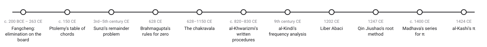
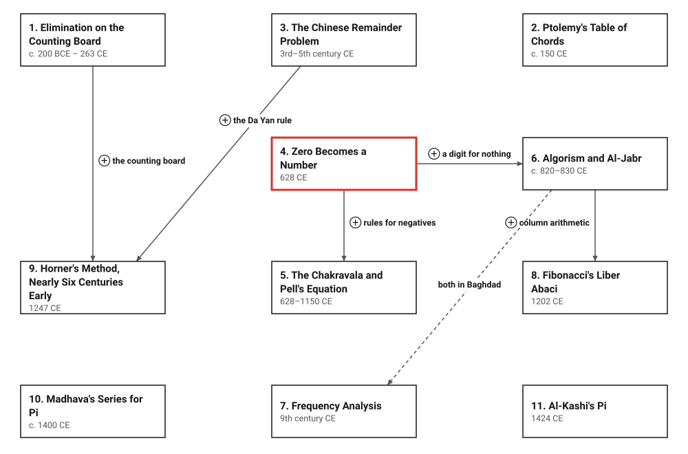

# Era 2 — Algorithms Travel

*c. 200 BCE to 1424 CE* · [Book contents](../README.md) · [Interactive edition](index.html) · [Reference catalog](reference-catalog.md) · [Programs](../../code/era-02-algorithms-travel/README.md)

> **Field note from the visiting historian.** In the first era, procedures were invented in a few places. In this one they travel: from China and India to Baghdad, and from Baghdad to Pisa. Along the way they gain a sign for nothing, a name, and the first infinite series.

## When

<picture>
  <source media="(prefers-color-scheme: dark)" srcset="assets/era-timeline-dark.svg">
  
</picture>

## How the ideas combined

<picture>
  <source media="(prefers-color-scheme: dark)" srcset="assets/era-map-dark.svg">
  
</picture>

*An arrow means the later development reuses the earlier idea. It does not claim one culture learned it from another; where a borrowing is documented, the topic page says so. The dashed line joins two developments that shared a city, not a procedure. Boxes without arrows build on Era 1: Ptolemy on Babylonian tables, Madhava and al-Kashi on Archimedes.*

## The topics

| # | Topic | When | What hurt | Read |
|---|---|---|---|---|
| 1 | **Elimination on the Counting Board** | *Nine Chapters*, c. 200 BCE – 50 CE (disputed); Liu Hui's commentary 263 CE | Several unknowns tied together by several conditions | [page](01-fangcheng/README.md) · [interactive](01-fangcheng/fangcheng.html) · [program](../../code/era-02-algorithms-travel/01-fangcheng/README.md) |
| 2 | **Ptolemy's Table of Chords** | *Almagest*, c. 150 CE | Astronomy needs the chord of every angle | [page](02-ptolemys-chords/README.md) · [interactive](02-ptolemys-chords/ptolemys-chords.html) · [program](../../code/era-02-algorithms-travel/02-ptolemys-chords/README.md) |
| 3 | **The Chinese Remainder Problem** | *Sunzi Suanjing*, 3rd–5th century CE (disputed) | Find a number from its remainders | [page](03-chinese-remainder-problem/README.md) · [interactive](03-chinese-remainder-problem/chinese-remainder-problem.html) · [program](../../code/era-02-algorithms-travel/03-chinese-remainder-problem/README.md) |
| 4 | **Zero Becomes a Number** | Brahmagupta, 628 CE; Gwalior inscription, 876 CE | An empty place needs a sign, and arithmetic needs rules for it | [page](04-zero-becomes-a-number/README.md) · [interactive](04-zero-becomes-a-number/zero-becomes-a-number.html) · [program](../../code/era-02-algorithms-travel/04-zero-becomes-a-number/README.md) |
| 5 | **The Chakravala and Pell's Equation** | Brahmagupta, 628; Jayadeva (quoted 1073); Bhaskara II, 1150 | Whole-number solutions of x² − Ny² = 1 | planned · [references](reference-catalog.md#5-the-chakravala-and-pells-equation) |
| 6 | **Algorism and Al-Jabr** | al-Khwarizmi, c. 820–830 CE | Hindu numerals and quadratic problems needed written procedures | planned · [references](reference-catalog.md#6-algorism-and-al-jabr) |
| 7 | **Frequency Analysis** | al-Kindi, c. 850 CE (estimate) | Reading a cipher without the key | planned · [references](reference-catalog.md#7-frequency-analysis) |
| 8 | **Fibonacci's Liber Abaci** | 1202 CE | Merchants reckoned with Roman numerals and counting boards | planned · [references](reference-catalog.md#8-fibonaccis-liber-abaci) |
| 9 | **Horner's Method, Nearly Six Centuries Early** | Qin Jiushao, 1247 CE | Roots of higher-degree equations | planned · [references](reference-catalog.md#9-horners-method-nearly-six-centuries-early-and-the-da-yan-rule) |
| 10 | **Madhava's Series for Pi** | c. 1350–1425 CE (Kerala school) | Polygons need more square roots for every digit of π | planned · [references](reference-catalog.md#10-madhavas-series-for-π) |
| 11 | **Al-Kashi's Pi** | 1424 CE | Astronomical tables needed π to more places than ever | planned · [references](reference-catalog.md#11-al-kashis-π) |

The interactive edition is a single HTML file per topic: download it and open it in a browser, or use the published copy linked from the [book contents](../README.md).
