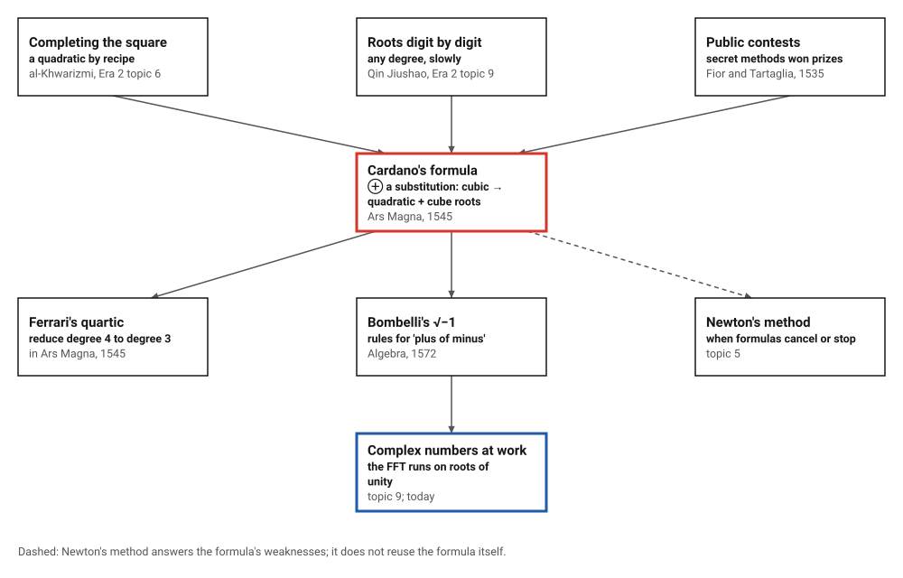
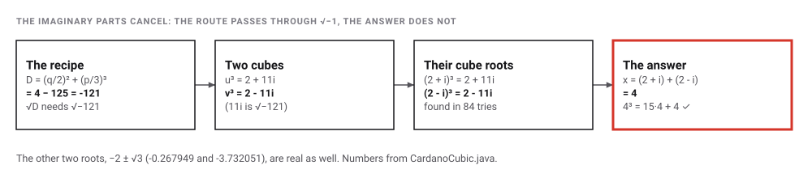
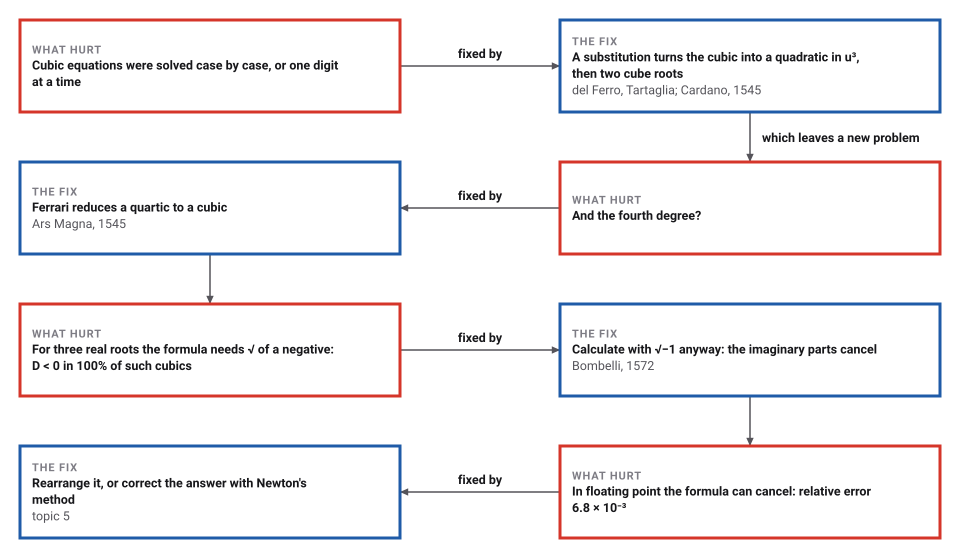

# Cardano's Cubic

*Era 3 · topic 1 · 1545 CE* · [Era 3 index](../README.md) · [Logarithms →](../02-logarithms/README.md) · [Interactive edition](cardanos-cubic.html) · [Program](../../../code/era-03-tables-and-machines/01-cardanos-cubic/)

> **Field note from the visiting historian.** I expected the people of this century to throw away a recipe that asks for impossible numbers. Instead, one of them wrote rules for the impossible numbers and calculated straight through, and the real answer came out at the other end.

| | |
|---|---|
| **When** | del Ferro c. 1515; Tartaglia 1535; Ars Magna 1545; Bombelli 1572 |
| **Where** | Bologna, Venice, Milan |
| **What hurt** | Cubic equations had no general method |
| **The fix** | A substitution that turns the cubic into a quadratic; rules for √−1 |
| **Cost** | One square root and two cube roots, sometimes of complex numbers |

## How ideas combined

A new algorithm is usually an older idea combined with a new one. Al-Khwarizmi had solved quadratics by completing the square (Era 2, topic 6); Qin Jiushao dug out roots of any degree one digit at a time (Era 2, topic 9). In Renaissance Italy, where mathematicians won pupils and prizes in public contests, the cubic fell to a substitution that turns it into a quadratic. Each box names the idea that was added.

<picture>
  <source media="(prefers-color-scheme: dark)" srcset="assets/family-dark.svg">
  
</picture>
*Red: Cardano's formula. Blue: where its complex numbers work today.*

## Follow the recipe, even through √−1

Choose p and q in x³ + px = q. The steps on the right are Cardano's recipe. When D is positive, everything stays real. When D is negative, the recipe takes the square root of a negative number, and Bombelli's rules carry it through: watch the imaginary parts cancel. The graph marks the real roots. The starting values are Bombelli's x³ = 15x + 4.

<picture>
  <source media="(prefers-color-scheme: dark)" srcset="assets/bombelli-dark.svg">
  
</picture>
*In the interactive edition you can change p and q and follow the recipe for any cubic of this form.*

## Era 3, tables and machines

<picture>
  <source media="(prefers-color-scheme: dark)" srcset="assets/era-timeline-dark.svg">
  
</picture>

## Each fix leaves a new pain

<picture>
  <source media="(prefers-color-scheme: dark)" srcset="assets/chain-dark.svg">
  
</picture>
*Read it as a snake: each new problem sits directly under the fix that exposed it.*

## A cubic becomes a quadratic

**Step 1: remove the square term.** Any cubic ax³ + bx² + cx + d = 0 loses its x² term when x is shifted by b/(3a). The program on one example:

| Cubic | Shift | Without the square term | Root |
|---|---|---|---|
| 2x³ − 6x² + 18x − 34 = 0 | x = y + 1 | y³ + 6y − 10 = 0 | y = 1.300271, so x = 2.300271 |

**Step 2: split the unknown in two.** Write y = u + v. Then y³ = u³ + v³ + 3uv(u + v). Choose 3uv = −p, and the cubic y³ + py + q = 0 becomes u³ + v³ = −q. Knowing both the sum and the product of u³ and v³ means they are the two roots of a quadratic, which al-Khwarizmi could already solve:

> **The formula.** u³, v³ = −q/2 ± √D, where D = (q/2)² + (p/3)³, and y = ∛(u³) + ∛(v³).

On x³ + 6x = 20 (here written with q on the right): D = 108, u = ∛(√108 + 10) = 2.732050807569, v = −∛(√108 − 10) = -0.732050807569, and x = u + v = **2.000000000000**. A cubic has become a quadratic plus two cube roots.

**Step 3: the trap.** When the cubic has three real roots, D is negative. The program checked 100,000 cubics with three distinct whole-number roots: D < 0 in **100%** of them. Among 100,000 random cubics, 48,151 (48.2%) had three real roots, so the recipe needs square roots of negatives about half the time. Cardano had already multiplied (5 + √−15)(5 − √−15) = 40 and called it "so subtle that it is useless". Bombelli calculated straight through:

<picture>
  <source media="(prefers-color-scheme: dark)" srcset="assets/bombelli-steps-dark.svg">
  
</picture>

The program then solved 100,000 random cubics with known roots by the formula in complex arithmetic. It recovered every root; the worst error was 8.2 × 10⁻¹¹.

> **Key idea.** Reduce a new problem to one you can already solve: the cubic to a quadratic, the quartic to a cubic. And when the method passes through something that "cannot exist", calculate anyway; the impossible quantities cancel and the answer is real.

## Where the formula breaks

A formula is exact; a computer is not. For y³ + 3,000,000,000y − 1 = 0 the root is tiny, and u and v are large and nearly opposite, so u + v subtracts two nearly equal numbers and loses most of its digits:

| Method (64-bit floating point) | Value | Relative error |
|---|---|---|
| True root | 3.3333333333333330e-10 | — |
| Plain formula, u + v | 3.3105607144534590e-10 | 6.8 × 10⁻³ |
| Rearranged: (u³ + v³)/(u² − uv + v²) | 3.3333333333333330e-10 | 0 |
| Plain formula, then one Newton step (topic 5) | 3.3333333333333330e-10 | 0 |

The rearranged form adds only positive quantities, so nothing cancels. A single correction step of Newton's method (topic 5) repairs the plain formula too. This is one reason computers find roots by iteration rather than by formula.

## A secret, an oath, and a book

Scipione del Ferro solved one form of the cubic "around 1515 but kept his work a complete secret until just before his death, in 1526" (MacTutor). Antonio Fior challenged Niccolò Tartaglia to a contest in 1535; "in the early hours of 13 February 1535, inspiration came to Tartaglia", and he solved Fior's problems in under two hours. In March 1539 Tartaglia gave the method to Girolamo Cardano, in verse, after Cardano swore to keep it secret. In 1543 Cardano and Lodovico Ferrari saw del Ferro's notes in Bologna, and Cardano felt free to publish: *Ars Magna* (Nuremberg, 1545), with Ferrari's solution of the quartic. Tartaglia's dislike "turned into a pathological hatred" (all **documented**, MacTutor).

Rafael Bombelli's *Algebra* (1572) named √−n "plus of minus" and gave rules such as "plus of minus times plus of minus makes minus". The example x³ = 15x + 4 is given as Bombelli's in secondary sources (Merino); the *Algebra* itself was not opened for this page (**documented** in secondary sources only).

## The cube roots of one

A cube root has three values: one, and that one times ω or ω², where ω = −½ + (√3/2)i is a cube root of 1. The program finds all three roots of every cubic exactly this way.

> **Full circle.** The numbers Cardano called useless and Bombelli made rules for are now the working material of computation. Gauss's fast Fourier transform (topic 9) is built from roots of unity like ω; it runs inside phones and in audio and image software, in complex arithmetic.

## Before you read on

<details>
<summary><b>1.</b> Why does shifting x by b/(3a) remove the x² term?</summary>

Expanding a(y − b/(3a))³ gives −b y² from the cube, which cancels the +b y² from b(y − b/(3a))².
</details>

<details>
<summary><b>2.</b> Why must 3uv = −p?</summary>

Then the 3uv(u + v) term cancels the py term, leaving only u³ + v³ = −q.
</details>

<details>
<summary><b>3.</b> Is the irreducible case rare?</summary>

No. Every cubic with three distinct real roots has D < 0; in the program's random sample that was 48.2% of all cubics.
</details>

<details>
<summary><b>4.</b> What is (2 + i)³?</summary>

(2 + i)² = 3 + 4i, and (3 + 4i)(2 + i) = 2 + 11i. That is why 2 + i is a cube root of 2 + √−121.
</details>

<details>
<summary><b>5.</b> Why did the plain formula lose its digits?</summary>

u = 31622.8 and v = -31622.8 are large and nearly opposite, while their sum is 3.3333333333333330e-10: subtracting nearly equal numbers leaves mostly rounding error.
</details>


## Where the evidence lives

| | Object | Where to see it | Licence |
|---|---|---|---|
| — | **Ars Magna (Nuremberg, 1545)**. Cardano's book, with the cubic and Ferrari's quartic. The Source Library has all 172 pages, scanned by Smithsonian Libraries, with an English translation. | [Source Library](https://sourcelibrary.org/book/cardano-ars-magna-1545-first-edition-cardano) | Drawn placeholder; the scans are public domain. |

## Every link was opened before it was listed

| Level | Link | Why |
|---|---|---|
| Start | [Whopping Cool Math! (March 2013)](https://people.math.harvard.edu/~engelwar/MathS305/Cardanos%20Formula.pdf) — James Tanton, newsletter column (hosted on a Harvard course page) | The Cardano–Tartaglia story, then the cubic formula as guided exercises, ending with an "imaginary" expression that equals 2 |
| Start | [Quadratic, cubic and quartic equations](https://mathshistory.st-andrews.ac.uk/HistTopics/Quadratic_etc_equations/) — MacTutor (O'Connor and Robertson) | The whole story in one page: del Ferro, Fior, Tartaglia, Cardan, Ferrari, Bombelli |
| Start | [Niccolò Fontana Tartaglia](https://mathshistory.st-andrews.ac.uk/Biographies/Tartaglia/) — MacTutor | The contest, the night of 13 February 1535, the verse, the oath and the 1548 debate |
| Start | [Girolamo Cardano](https://mathshistory.st-andrews.ac.uk/Biographies/Cardan/) — MacTutor | Why Cardan felt free to publish, and the first calculation with complex numbers |
| Deeper | [Rafael Bombelli](https://mathshistory.st-andrews.ac.uk/Biographies/Bombelli/) — MacTutor | "Plus of minus": the first rules for calculating with complex numbers |
| Deeper | [A Short History of Complex Numbers](https://math.mit.edu/~dunkel/Teach/18.04_2019S/historic/Merino_2006.pdf) — Orlando Merino, University of Rhode Island (2006), on an MIT course page | Cardano's formula on x³ = 15x + 4, and how Bombelli found the cube roots 2 ± i |
| Deeper | [Bombelli, Rafael](https://mathshistory.st-andrews.ac.uk/DSB/Bombelli.pdf) — S. A. Jayawardene, *Dictionary of Scientific Biography* (via MacTutor) | How the *Algebra* handles the irreducible case |
| Scholar | [Ars Magna, sive de regulis algebraicis (1545)](https://sourcelibrary.org/book/cardano-ars-magna-1545-first-edition-cardano) — Source Library: 172 scans digitized by Smithsonian Libraries (public domain), with an English translation | The book itself, Nuremberg 1545 |

More, with certainty labels and the gaps we could not fill: [Era 3 reference catalog](https://github.com/vij658/AlgorithmEvolutionAtlas/blob/main/book/era-03-tables-and-machines/reference-catalog.md).

## The program behind every number here

[CardanoCubic.java](https://github.com/vij658/AlgorithmEvolutionAtlas/blob/main/code/era-03-tables-and-machines/01-cardanos-cubic/CardanoCubic.java) makes **199,857 checks**: Bombelli's cube roots in exact integer complex arithmetic, the sign of D against the number of real roots for 100,000 random cubics, all three roots of 100,000 more cubics by the formula, and the cancellation and its repairs. Run it with `java CardanoCubic.java` (JDK 17 or newer). The heart of it:

```java
/** The three roots of y^3 + p y + q = 0 by Cardano's formula, in complex arithmetic. */
static C[] cardano(double p, double q) {
    double D = (q / 2) * (q / 2) + (p / 3) * (p / 3) * (p / 3);
    C s = C.sqrt(D);
    C u3 = new C(-q / 2, 0).plus(s);
    C u = u3.cbrt();
    if (u.abs() < 1e-300) { u3 = new C(-q / 2, 0).minus(s); u = u3.cbrt(); }
    C[] y = new C[3];
    C uk = u;
    for (int k = 0; k < 3; k++) {
        C v = uk.abs() < 1e-300 ? new C(0, 0) : new C(-p / 3, 0).div(uk);   // 3uv = -p
        y[k] = uk.plus(v);
        uk = uk.times(OMEGA);
    }
    return y;
}
```

