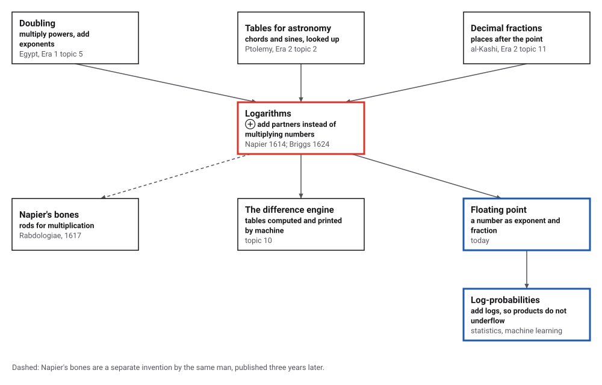
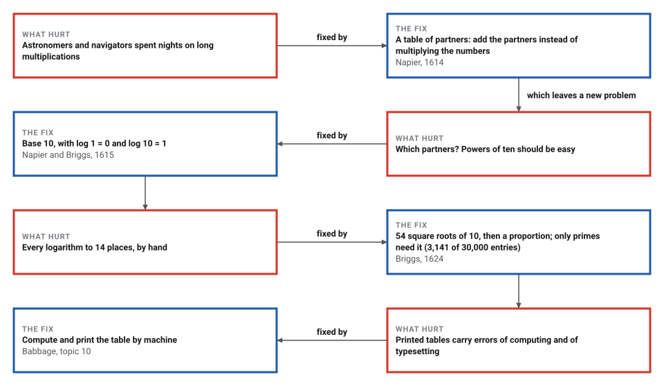
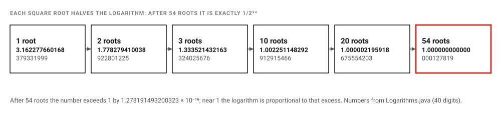

# Logarithms

*Era 3 · topic 2 · 1614–1624* · [Era 3 index](../README.md) · [← Cardano's Cubic](../01-cardanos-cubic/README.md) · [The Carry, Mechanized →](../03-mechanical-carry/README.md) · [Interactive edition](logarithms.html) · [Program](../../../code/era-03-tables-and-machines/02-logarithms/)

> **Field note from the visiting historian.** The table is the algorithm's output, printed once and used by everyone. Its maker paid in square roots: fifty-four of them, one after another, each to thirty decimals, so that navigators would never have to.

| | |
|---|---|
| **When** | Napier 1614; Briggs 1617 and 1624 |
| **Where** | Edinburgh and London |
| **What hurt** | Long multiplications for astronomy and navigation |
| **The fix** | A printed table: multiplication becomes addition |
| **Cost** | 54 square roots of 10, and logarithms of the primes only |

## How ideas combined

A new algorithm is usually an older idea combined with a new one. Egyptian scribes multiplied by doubling (Era 1, topic 5), which hides a fact: multiplying powers of 2 means adding their exponents. Astronomers had long worked from printed tables (Era 2, topic 2), and decimal fractions had arrived (Era 2, topic 11). Napier made every number a power, so that every multiplication becomes an addition of exponents read from a table. Each box names the idea that was added.

<picture>
  <source media="(prefers-color-scheme: dark)" srcset="assets/family-dark.svg">
  
</picture>
*Red: logarithms. Blue: where the idea lives in today's computers.*

## Multiply by adding, and build the table

On the left, multiply two numbers the way a navigator would in 1630: look up two logarithms, add them, look up the answer. Change the table's precision to see the price of fewer decimals. On the right, repeat Briggs's construction: choose how many square roots of 10 to take, and watch how many decimals of log 2 come out right (the page computes with 40-digit whole numbers).

<picture>
  <source media="(prefers-color-scheme: dark)" srcset="assets/roots-dark.svg">
  
</picture>
*In the interactive edition you can multiply any two numbers by look-up and addition, and choose how many square roots of 10 Briggs takes.*

## Era 3, tables and machines

<picture>
  <source media="(prefers-color-scheme: dark)" srcset="assets/era-timeline-dark.svg">
  
</picture>

## Each fix leaves a new pain

<picture>
  <source media="(prefers-color-scheme: dark)" srcset="assets/chain-dark.svg">
  
</picture>
*Read it as a snake: each new problem sits directly under the fix that exposed it.*

## Partners that add

**Using the table.** log(ab) = log a + log b. To multiply 4567 by 8912 with a 7-place table: log 4567 = 3.6596310, log 8912 = 3.9499752, the sum is 7.6096062, and the number with that logarithm is 40,701,105. The exact product is 40,701,104: a relative error of 2.4 × 10⁻⁸, from the table's rounding. The program's examples:

| Product | log a + log b | Read back | Exact | Relative error |
|---|---|---|---|---|
| 4567 × 8912 | 3.6596310 + 3.9499752 = 7.6096062 | 40,701,105 | 40,701,104 | 2.4 × 10⁻⁸ |
| 1234 × 5678 | 3.0913152 + 3.7541954 = 6.8455106 | 7,006,653 | 7,006,652 | 1.2 × 10⁻⁷ |
| 7854 × 3906 | 3.8950909 + 3.5917322 = 7.4868231 | 30,677,721 | 30,677,724 | 8.3 × 10⁻⁸ |
| 9999 × 9999 | 3.9999566 + 3.9999566 = 7.9999132 | 99,980,016 | 99,980,001 | 1.5 × 10⁻⁷ |

**Making the table.** In base 10, log 10 = 1. A square root halves a logarithm, so the square root of 10 has logarithm ½, its square root ¼, and so on. Briggs took 54 square roots in a row:

<picture>
  <source media="(prefers-color-scheme: dark)" srcset="assets/roots-steps-dark.svg">
  
</picture>

So close to 1, the logarithm is proportional to the excess over 1. To find log 2, take square roots of 2 until it is just as close to 1, compare the two excesses, and multiply back by the number of halvings. The program did exactly this with 40-digit arithmetic:

| Number | By Briggs's method | True value | Roots of the number | Correct decimals |
|---|---|---|---|---|
| 2 | 0.3010299956639812 | 0.3010299956639812 | 53 | 16 |
| 3 | 0.4771212547196624 | 0.4771212547196624 | 53 | 17 |
| 7 | 0.8450980400142568 | 0.8450980400142568 | 54 | 16 |

Only primes need this work: log 6 = log 2 + log 3. A table of 1 to 20,000 and 90,001 to 100,000 (the ranges of Briggs's 1624 table, as Roegel gives them) has 30,000 entries; 3,141 are prime (2,262 below 20,000), 25,830 follow by adding logarithms of smaller entries, and 1,029 have a prime factor above 20,000 that is not in the table, and need more work.

> **Key idea.** Do the hard work once, print it, and let everyone look it up. A table converts an expensive operation (multiplication) into a cheap one (addition) plus memory, the trade every cache and lookup table still makes.

## Decimals cost square roots, and tables cost accuracy

| Square roots of 10 | Correct decimals of log 2 |
|---|---|
| 10 | 3 |
| 20 | 6 |
| 30 | 9 |
| 40 | 12 |
| 50 | 15 |
| 60 | 18 |

Each ten extra square roots buys three more decimals: the proportion's error shrinks as the root comes closer to 1. Briggs's 54 roots were enough for his 14 decimals.

| Table precision | Worst relative error | Average relative error |
|---|---|---|
| 4 places | 2.3 × 10⁻⁴ | 7.7 × 10⁻⁵ |
| 7 places | 2.3 × 10⁻⁷ | 7.7 × 10⁻⁸ |
| 14 places | 2.3 × 10⁻¹⁴ | 7.7 × 10⁻¹⁵ |

Twenty thousand random products of five-digit numbers, by look-up: the error is set by the table's last decimal, never by the arithmetic. A 4-place school table gives about four significant figures, a 14-place table about fourteen.

## Twenty years, and a month in Edinburgh

"Napier published his system in 1614, but he wrote that it took him some twenty years to invent it" (Stewart, Gresham College). His *Rabdologiae* of 1617 described numbering rods made of ivory, "Napier's bones"; he died on 4 April 1617 (MacTutor). Henry Briggs, Gresham College's first professor of geometry, visited him in the summer of 1615 and again in 1616; Napier proposed tables with log 1 = 0 and base 10, which Briggs built (**documented**, MacTutor).

*Arithmetica logarithmica* (1624) gives the logarithms of 1 to 20,000 and of 90,000 to 100,000 "computed to 14 decimal places" (MacTutor; Roegel starts the second range at 90,001: a small **dispute**). Briggs "computed these values until n = 54" square roots of 10, then used a proportion for numbers near 1 and finite differences to speed the roots (Roegel, **documented**). Adriaan Vlacq's table of 1628 cut Briggs's figures to 10 places and was called a second edition, "although it actually wasn't".

## Adding logarithms still saves the day

Every 64-bit floating-point number is stored as a power of 2 and a fraction: in effect, the whole part of its binary logarithm and the rest. And when a computation multiplies many small numbers, logarithms come back in their original role.

> **Full circle.** The program multiplied 400 probabilities near 0.01 in 64-bit floating point. The answer came out as 0.0: the true product is too small for the format. Adding their logarithms instead gives -794.910625, so the product is 10 to that power, exactly right. Statistics and machine learning work with log-probabilities for this reason: Napier's trade of products for sums, four centuries on.

## Before you read on

<details>
<summary><b>1.</b> With a log table, how do you take a square root?</summary>

Halve the logarithm and look up the number that has it: log √x = ½ log x.
</details>

<details>
<summary><b>2.</b> Why is base 10 convenient?</summary>

log(10x) = 1 + log x: moving the decimal point only changes the whole part of the logarithm, so one table of fractions serves every size of number.
</details>

<details>
<summary><b>3.</b> Why does each square root of 10 bring the number closer to 1?</summary>

Its logarithm halves each time: 1, ½, ¼, …, 1/2⁵⁴. A number whose logarithm is nearly 0 is nearly 1.
</details>

<details>
<summary><b>4.</b> Why compute logarithms only for primes?</summary>

Every other whole number is a product of primes, and the logarithm of a product is the sum of the logarithms.
</details>

<details>
<summary><b>5.</b> Why did the 400 probabilities come out as 0?</summary>

Their product is 10 to the power -794.910625, far below the smallest positive 64-bit double, 4.9 × 10⁻³²⁴, so it underflows to zero. Its logarithm is an ordinary number.
</details>


## Where the evidence lives

| | Object | Where to see it | Licence |
|---|---|---|---|
| — | **Napier's Descriptio (1614), translated**. Ian Bruce's English translation of Napier's own description and construction of his logarithms, with the Latin. | [17centurymaths.com](https://www.17centurymaths.com/contents/napiercontents.html) | Drawn placeholder. |
| — | **Arithmetica logarithmica (1624), reconstructed**. Denis Roegel's reconstruction of Briggs's table, with an account of how it was computed. | [LOCOMAT](https://locomat.loria.fr/briggs1624/briggs1624doc.pdf) | Drawn placeholder. |

## Every link was opened before it was listed

| Level | Link | Why |
|---|---|---|
| Start | [Four Centuries of Logarithms](https://www.gresham.ac.uk/sites/default/files/27jan97ianstewart_fourcenturiesoflogorithms.pdf) — Ian Stewart, Gresham Professor of Geometry, 27 January 1997 (transcript) | From Napier's twenty years of work and Briggs's base 10 to the slide rule |
| Start | [John Napier](https://mathshistory.st-andrews.ac.uk/Biographies/Napier/) — MacTutor | The 1614 book, the bones, and the agreement with Briggs |
| Start | [Henry Briggs](https://mathshistory.st-andrews.ac.uk/Biographies/Briggs/) — MacTutor | Gresham College, the 1615 visit and the 1624 tables |
| Deeper | [Arithmetica logarithmica (1624): a reconstruction](https://locomat.loria.fr/briggs1624/briggs1624doc.pdf) — Denis Roegel, LOCOMAT project (2011, revised 2014) | How Briggs computed: 54 square roots of 10, proportions near 1, finite differences, and what Vlacq did with the table |
| Scholar | [Napier's Descriptio and Constructio, translated](https://www.17centurymaths.com/contents/napiercontents.html) — Ian Bruce, 17centurymaths.com | Napier's own description (1614) and construction (1619) of his logarithms, in English with the Latin |

More, with certainty labels and the gaps we could not fill: [Era 3 reference catalog](https://github.com/vij658/AlgorithmEvolutionAtlas/blob/main/book/era-03-tables-and-machines/reference-catalog.md).

## The program behind every number here

[Logarithms.java](https://github.com/vij658/AlgorithmEvolutionAtlas/blob/main/code/era-03-tables-and-machines/02-logarithms/Logarithms.java) makes **85,847 checks**: 60,000 products by table look-up against the bound set by each table's rounding, Briggs's square roots against ln 10/2⁵⁴, log 2, log 3 and log 7 by his proportion to 14 decimals or more, the addition law on every composite entry of a Briggs-sized table, and the underflow of a product of probabilities. Run it with `java Logarithms.java` (JDK 17 or newer). The heart of it:

```java
/** Briggs's proportion: log10 x from k square roots of x and n square roots of 10, at 40 significant digits. */
static BigDecimal briggs(BigDecimal x, int n, MathContext mc, int[] rootsOut) {
    BigDecimal r10 = BigDecimal.TEN;
    for (int i = 0; i < n; i++) r10 = r10.sqrt(mc);
    BigDecimal d10 = r10.subtract(BigDecimal.ONE);                 // 10^(1/2^n) = 1 + d10
    BigDecimal rx = x;
    int k = 0;
    while (rx.subtract(BigDecimal.ONE).abs().compareTo(d10) > 0) { rx = rx.sqrt(mc); k++; }   // until x^(1/2^k) is as close to 1
    // log10(rx) ~ (rx - 1)/d10 * 2^-n ; log10 x = 2^k log10(rx)
    BigDecimal frac = rx.subtract(BigDecimal.ONE).divide(d10, mc);
    if (rootsOut != null) { rootsOut[0] = n; rootsOut[1] = k; }
    return frac.multiply(BigDecimal.valueOf(2).pow(k), mc).divide(BigDecimal.valueOf(2).pow(n), mc);
}
```

