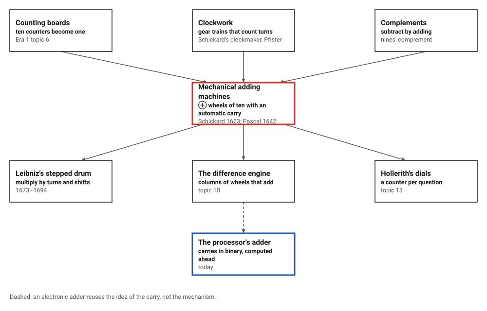
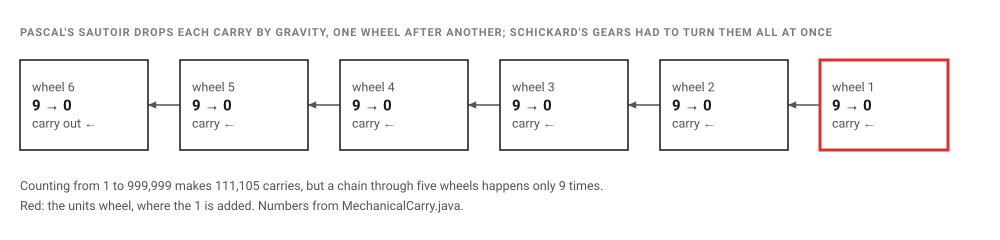
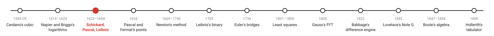
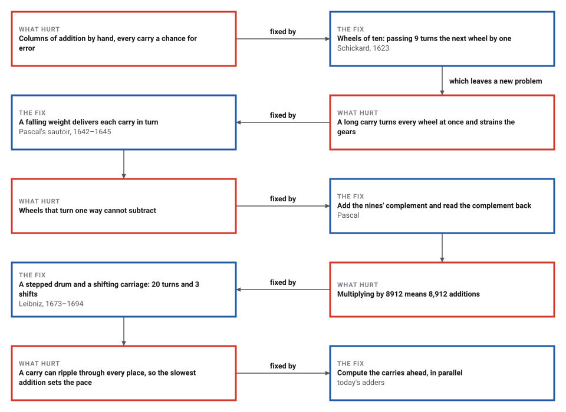

# The Carry, Mechanized

*Era 3 · topic 3 · 1623–1694* · [Era 3 index](../README.md) · [← Logarithms](../02-logarithms/README.md) · [The Problem of Points →](../04-problem-of-points/README.md) · [Interactive edition](mechanical-carry.html) · [Program](../../../code/era-03-tables-and-machines/03-mechanical-carry/)

> **Field note from the visiting historian.** What impressed me was not the arithmetic but the forgetting. A merchant with one of these boxes no longer needed to remember to carry; the box remembered for him.

| | |
|---|---|
| **When** | Schickard 1623; Pascal 1642–1645; Leibniz 1673–1694 |
| **Where** | Tübingen, Rouen and Paris, London and Hanover |
| **What hurt** | Columns of addition, and every carry by hand |
| **The fix** | Wheels of ten with an automatic carry; complements; a stepped drum |
| **Cost** | 20 crank turns for 4567 × 8912, against 8,912 additions |

## How ideas combined

A new algorithm is usually an older idea combined with a new one. On a counting board (Era 1, topic 6), ten counters in one column become one in the next, but a person has to notice. Clockmakers already built gear trains that count turns. Put a digit on every gear, and make each gear passing 9 nudge the next: the carry becomes a mechanism. Each box names the idea that was added.

<picture>
  <source media="(prefers-color-scheme: dark)" srcset="assets/family-dark.svg">
  
</picture>
*Red: the mechanical adding machine. Blue: where the carry lives today.*

## Turn the wheels and watch the carries

Six wheels, each showing one digit. Press + 1 to count, or add any number. A wheel turns red when it passes 9 and drops a carry onto its left neighbour. Set 999,999 and press + 1 to see the longest chain. Below, subtract the way Pascal's machine had to: its wheels only turn forward.

<picture>
  <source media="(prefers-color-scheme: dark)" srcset="assets/wheels-dark.svg">
  
</picture>
*In the interactive edition you can turn the wheels yourself, watch each carry travel, and subtract by complements.*

## Era 3, tables and machines

<picture>
  <source media="(prefers-color-scheme: dark)" srcset="assets/era-timeline-dark.svg">
  
</picture>

## Each fix leaves a new pain

<picture>
  <source media="(prefers-color-scheme: dark)" srcset="assets/chain-dark.svg">
  
</picture>
*Read it as a snake: each new problem sits directly under the fix that exposed it.*

## Wheels of ten, a carry, and a complement

**The carry.** Each wheel has ten positions. When a wheel turns from 9 to 0, the next wheel must advance by one. Most of the time nothing happens; occasionally one carry sets off another. The program counted from 1 to 999,999 on six wheels:

| Carries set off by one step | How often |
|---|---|
| 0 | 900,000 |
| 1 | 90,000 |
| 2 | 9,000 |
| 3 | 900 |
| 4 | 90 |
| 5 | 9 |

111,105 carries in all, but only nine steps set off a chain through five wheels, and 999,999 + 1 runs through all 6. In Schickard's machine a single tooth on each wheel pushed the next, so a long chain made every wheel turn together, driven from the first; Pascal's sautoir is a weighted lever that falls when its wheel passes 9, delivering each carry in turn without the wheels pushing one another.

<picture>
  <source media="(prefers-color-scheme: dark)" srcset="assets/ripple-dark.svg">
  
</picture>

Adding a column of 1,000 five-digit figures (total 48,826,454) took 2,496 carries, 2.50 per figure, and the longest chain was 4 wheels.

**Subtraction.** Pascal's wheels turn one way, so the machine can only add. The nines' complement of x is 999,999 − x. Enter the complement of a, add b, and read the complement of the result: it is a − b. For 4567 − 1234: enter 995432, add 1234 to get 996666, read its complement 003333 = **3333**. The program checked this on 100,000 random pairs.

**Multiplication.** Leibniz's stepped drum has nine teeth of different lengths; setting a digit d engages d of them, so one turn of the crank adds the whole number set on the drums. A carriage shifts the setting one place left for each digit of the multiplier. 4567 × 8912 takes 20 turns and 3 shifts, where repeated addition would take 8,912. Division runs the same way with subtraction: 40701104 ÷ 4567 = 8912, remainder 0, in 20 turns.

> **Key idea.** Turn a rule into a mechanism, and the rule is obeyed every time. The carry, the complement and the shift are the three tricks every adding circuit since has used.

## Turns against additions

| Method | Work per product of two numbers below 100,000 (average) |
|---|---|
| Repeated addition | 50,080 additions |
| Leibniz's stepped drum, with the shifting carriage | 22.5 turns of the crank |

Over 100,000 random products, the stepped drum needs the sum of the multiplier's digits in turns, never more than nine per digit: the shift turns a count of additions into a count of digits.

## A fire, fifty prototypes and a wooden model

Schickard wrote to Kepler on 20 September 1623: "What you have done by calculation I have just tried to do by way of mechanics." The first machine "was destroyed in a fire while still incomplete"; the drawings were found among Kepler's papers in the 1950s and the machine reconstructed at Tübingen (MacTutor). Wikipedia notes that the drawings had in fact been published at least once a century from 1718 (**disputed** as a rediscovery).

Pascal began in 1642, at 18, because of "the laborious arithmetical calculations required by his father's" work in Rouen; he built 50 prototypes, nine machines survive, and the royal privilege dates from 1649 (Wikipedia). His 18-page *Lettre dédicatoire* appeared in 1645; a machine signed in 1652 is in the Musée des Arts et Métiers, Paris (History of Information). Leibniz showed a wooden model to the Royal Society on 1 February 1673 and completed his machine in 1694; "a design flaw in the carry mechanism" kept it from working reliably, and the survivor is in Hanover. How many machines he built is **disputed** between Wikipedia's two articles.

## The carry is still the slow part

A processor adds in binary, but the problem is Pascal's: a carry may have to travel through every place. If each bit waits for the carry from the one before, a 64-bit addition must allow for a chain of 64.

> **Full circle.** The program added 200,000 random pairs of 64-bit numbers bit by bit. The longest carry chain averaged 5.31 bits (median 5); the longest seen was 23. Long chains are rare, exactly as on Pascal's wheels, but a circuit must be ready for the worst case, so fast adders work out the carries for many places at once instead of waiting for them to ripple.

## Before you read on

<details>
<summary><b>1.</b> When counting up by one, how often does the tens wheel receive a carry?</summary>

Once every ten steps: whenever the units wheel passes from 9 to 0.
</details>

<details>
<summary><b>2.</b> Why does C(C(a) + b) = a − b work?</summary>

C(x) = 999,999 − x. So C(C(a) + b) = 999,999 − (999,999 − a + b) = a − b.
</details>

<details>
<summary><b>3.</b> How many crank turns does 4567 × 8912 take on Leibniz's machine?</summary>

The sum of the multiplier's digits: 8 + 9 + 1 + 2 = 20, with 3 shifts.
</details>

<details>
<summary><b>4.</b> Why did Pascal use a falling weight rather than gears to carry?</summary>

With gears, a long chain of carries makes every wheel turn at once, all driven from the first wheel; the force adds up and can damage the mechanism.
</details>

<details>
<summary><b>5.</b> What happens when you add 1 to 999,999 on six wheels?</summary>

Every wheel returns to 0 and the last carry falls off the end: the machine overflows.
</details>


## Where the evidence lives

| | Object | Where to see it | Licence |
|---|---|---|---|
| — | **A Pascaline signed in 1652**. Pascal's adding machine in the Musée des Arts et Métiers, Paris, as recorded by Jeremy Norman's History of Information. | [History of Information](https://historyofinformation.com/detail.php?id=382) | Drawn placeholder. |

## Every link was opened before it was listed

| Level | Link | Why |
|---|---|---|
| Start | [Early Mechanical Computers](https://cspages.ucalgary.ca/~tam/2025/409F/notes/early_mechanical/early_mechanical_part1_6_per_page.pdf) — James Tam, CPSC 409 (history of computing), University of Calgary | Schickard's single-tooth carry, Pascal's falling weights, Leibniz's stepped drum and its manual carries |
| Start | [Pascal's calculator](https://en.wikipedia.org/wiki/Pascaline) — Wikipedia | The sautoir, nines' complement subtraction, the 50 prototypes and the nine survivors |
| Start | [Blaise Pascal Invents a Calculator: The Pascaline](https://historyofinformation.com/detail.php?id=382) — Jeremy Norman, History of Information | The 1645 pamphlet and the 1652 machine in Paris |
| Start | [Wilhelm Schickard](https://mathshistory.st-andrews.ac.uk/SH/schickard_sh.pdf) — MacTutor (illustrated poster, unsigned) | The letter to Kepler, the fire and the reconstruction |
| Deeper | [Stepped reckoner](https://en.wikipedia.org/wiki/Stepped_reckoner) — Wikipedia | The Leibniz wheel, the shifting carriage and the carry flaw |

More, with certainty labels and the gaps we could not fill: [Era 3 reference catalog](https://github.com/vij658/AlgorithmEvolutionAtlas/blob/main/book/era-03-tables-and-machines/reference-catalog.md).

## The program behind every number here

[MechanicalCarry.java](https://github.com/vij658/AlgorithmEvolutionAtlas/blob/main/code/era-03-tables-and-machines/03-mechanical-carry/MechanicalCarry.java) makes **1,401,003 checks**: every step of counting to 999,999 on six wheels, a column of 1,000 figures, nines'-complement subtraction on 100,000 pairs, 100,000 products on a simulated stepped drum, and 200,000 64-bit additions bit by bit against the processor's own. Run it with `java MechanicalCarry.java` (JDK 17 or newer). The heart of it:

```java
    /** Add d (0..base-1) on wheel i; the carries ripple left one wheel at a time. Returns the chain length. */
    int addAt(int i, int d) {
        int chain = 0;
        w[i] += d;
        while (i < w.length && w[i] >= base) {
            w[i] -= base;
            carries++;
            chain++;
            i++;
            if (i < w.length) w[i] += 1; else overflow++;
        }
        longest = Math.max(longest, chain);
        return chain;
    }

/** Multiply on a stepped-drum machine: set x on the drums; for each digit d of y, turn the crank d times, then shift. Returns {product, turns, shifts}. */
static long[] leibnizMultiply(long x, long y, int places) {
    Wheels acc = new Wheels(places, 10);
    long turns = 0, shifts = 0, pos = 0;
    String ys = Long.toString(y);
    for (int k = ys.length() - 1; k >= 0; k--) {
        int d = ys.charAt(k) - '0';
        for (int t = 0; t < d; t++) {                              // one turn adds the setting x, shifted pos places
            long s = x;
            for (int i = (int) pos; s > 0; i++, s /= 10) acc.addAt(i, (int) (s % 10));
            turns++;
        }
        if (k > 0) { pos++; shifts++; }
    }
    return new long[]{acc.value(), turns, shifts};
}
```

