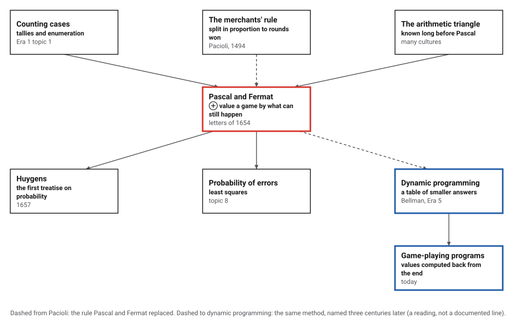
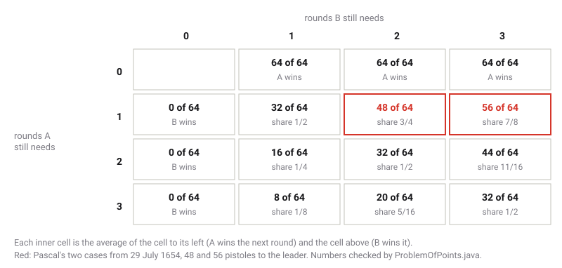
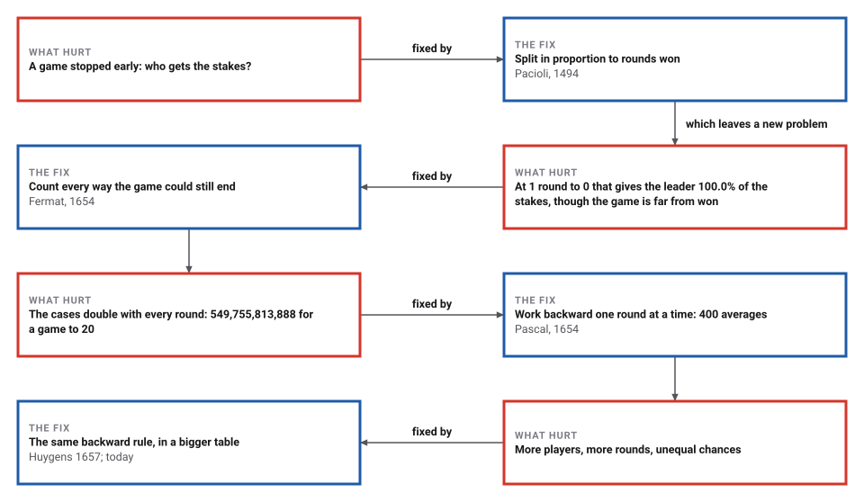

# The Problem of Points

*Era 3 · topic 4 · 1654* · [Era 3 index](../README.md) · [← The Carry, Mechanized](../03-mechanical-carry/README.md) · [Newton's Method →](../05-newtons-method/README.md) · [Interactive edition](problem-of-points.html) · [Program](../../../code/era-03-tables-and-machines/04-problem-of-points/)

> **Field note from the visiting historian.** Pascal never listed the futures. He started from the games that were already over, where the answer is obvious, and filled in a table backward, each answer the average of two easier ones. I have seen the same table, under other names, in every century since.

| | |
|---|---|
| **When** | Letters of July to September 1654 |
| **Where** | Paris and Toulouse |
| **What hurt** | No fair rule for a game stopped early |
| **The fix** | Value a position by what can still happen: count, or work backward |
| **Cost** | One average per position, instead of a list that doubles every round |

## How ideas combined

A new algorithm is usually an older idea combined with a new one. Counting cases is as old as tally marks (Era 1, topic 1); merchants' arithmetic books had offered rules for interrupted games since Pacioli (1494); the arithmetic triangle was known in several cultures. In the summer of 1654 two Frenchmen turned the question around: a share should depend on what can still happen, not on what has happened. Each box names the idea that was added.

<picture>
  <source media="(prefers-color-scheme: dark)" srcset="assets/family-dark.svg">
  
</picture>
*Red: the Pascal–Fermat letters. Blue: where backward reasoning over a table went.*

## Fill in Pascal's table

Each cell is the fair amount for A when A still needs the row's number of rounds and B the column's. The edges are finished games: A has everything or nothing. Every inner cell is the average of its two neighbours one round later (shaded blue). Click a cell to see Pascal's average, Fermat's count and the old proportional rule side by side.

<picture>
  <source media="(prefers-color-scheme: dark)" srcset="assets/pascal-table-dark.svg">
  
</picture>
*In the interactive edition you can choose the length of the game and the stakes, and click any position.*

## Era 3, tables and machines

<picture>
  <source media="(prefers-color-scheme: dark)" srcset="assets/era-timeline-dark.svg">
  
</picture>

## Each fix leaves a new pain

<picture>
  <source media="(prefers-color-scheme: dark)" srcset="assets/chain-dark.svg">
  
</picture>
*Read it as a snake: each new problem sits directly under the fix that exposed it.*

## Two routes to the same fair share

**Pascal's example.** In his letter of 29 July 1654, two players have put 32 pistoles each on a game of three. If one leads by two rounds to one and the game stops, Pascal reasons: if the next round went to the leader he would have all 64; if not, they would be level and each deserve 32. Either is equally likely, so he is owed the average, (64 + 32) ÷ 2 = **48**, and the other 16. One round further back, at two to none, the leader is owed the average of 64 and 48, **56**, the other 8. The program's table repeats both figures exactly:

<picture>
  <source media="(prefers-color-scheme: dark)" srcset="assets/pascal-table-steps-dark.svg">
  
</picture>

**Fermat's route.** If A needs a rounds and B needs b, the game is surely over within a + b − 1 more. List every way those rounds could fall; each is equally likely; count. The program compared both methods in exact fractions for all 144 positions up to 12 rounds each: they agree every time.

Fermat's letter of 25 September 1654 counts a game for three players: "I find here only 17 combinations for the first and 5 for each of the others." The case that gives these numbers is one player needing 1 round and the other two needing 2: the game is over within 3 rounds, and of the 27 equally likely sequences the first player wins **17**, the others 5 and 5.

**Pascal's triangle.** Counting Fermat's cases is reading a row of the arithmetic triangle: when A needs 2 and B needs 3, four more rounds settle it, and A wins whenever A takes at least 2 of the 4: 6 + 4 + 1 = 11 of the 16 equally likely outcomes in row 4.

| Row | Entries |
|---|---|
| 0 | 1 |
| 1 | 1 1 |
| 2 | 1 2 1 |
| 3 | 1 3 3 1 |
| 4 | 1 4 6 4 1 |
| 5 | 1 5 10 10 5 1 |
| 6 | 1 6 15 20 15 6 1 |

> **Key idea.** Build a table of answers to smaller problems, starting from the ones whose answers are obvious, and fill in each new answer from earlier ones. Pascal's shares are the oldest example in this book of what is now called dynamic programming.

## Counting against filling in

| Rounds each player needs | Pascal's table (cells) | Fermat's list (outcomes) |
|---|---|---|
| 5 | 25 | 512 |
| 10 | 100 | 524,288 |
| 20 | 400 | 549,755,813,888 |
| 30 | 900 | 576,460,752,303,423,488 |

Fermat's method is the clearest proof that a share is fair; Pascal's is the one that scales. The list of outcomes doubles with every extra round, while the table grows only with the square of the length of the game.

| Score in a game to 5 | Proportional (Pacioli) | Fair (Pascal, Fermat) |
|---|---|---|
| 1 to 0 | 100.0% | 63.7% |
| 2 to 1 | 66.7% | 65.6% |
| 3 to 1 | 75.0% | 81.3% |
| 4 to 3 | 57.1% | 75.0% |
| 4 to 0 | 100.0% | 96.9% |

The proportional rule gives the whole stake to a player who leads 1 to 0, and too little to one who leads 4 to 3. A simulation of 1,000,000 finished games for A needing 3 and B needing 5 estimated 0.7735; the table's exact answer is 99/128 = 0.7734, with no sampling error at all.

## Five letters in one summer

Pacioli's *Summa* (1494) divided the stakes "in proportion to the number of rounds won by each player"; Tartaglia found "counterintuitive results" and wrote that "in whatever way the division is made there will be cause for litigation" (Wikipedia). The question reached Pascal from the Chevalier de Méré around 1654 (Wikipedia; Hart, Gresham College).

The letters are dated: Pascal's of 29 July 1654 with the 48-to-16 and 56-to-8 divisions; Pascal on 24 August, "your theory which proceeds by combinations is very just"; Fermat's replies of 29 August and 25 September (translation by Vera Sanford, in Smith's *Source Book*). MacTutor: they "laid the foundation for the theory of probability", solving the problem of points only for two players, and "Pascal was not the first to study the Pascal triangle". Calling Pascal's backward table the first dynamic programming is this book's reading (**conjecture**).

## Values computed backward from the end

Pascal's move, reasoning from the finished game backward, one step at a time, is how a computer finds the value of a position in any game of chance or strategy with a known end: start from the positions where the outcome is settled, and fill in the rest from them.

> **Full circle.** For a game to 20 rounds, Fermat's list would have 549,755,813,888 entries; Pascal's table has 400. Richard Bellman's dynamic programming (Era 5) gives the method a name and a theory, and it is still how programs plan when each step's value depends on the steps that follow.

## Before you read on

<details>
<summary><b>1.</b> At two rounds to one in a game to three, why is the leader owed 48 of 64?</summary>

One more round: if he wins, he has 64; if he loses, it is level and he deserves 32. Each is equally likely: (64 + 32) ÷ 2 = 48.
</details>

<details>
<summary><b>2.</b> Why may Fermat play out a + b − 1 rounds even if the game would have ended sooner?</summary>

Extra rounds after the end do not change who won, and they make every listed outcome equally likely.
</details>

<details>
<summary><b>3.</b> Why does Pacioli's rule fail at 1 to 0?</summary>

It gives everything to the leader, though the other player can easily still win: it measures the past, not the future.
</details>

<details>
<summary><b>4.</b> How many cells does Pascal need for a game in which each player needs 10 rounds?</summary>

One per position: 10 × 10 = 100 averages, against 524,288 outcomes to list.
</details>

<details>
<summary><b>5.</b> Where are the 17, 5 and 5 in Fermat's three-player game?</summary>

Three more rounds, each won by any of the three players: 27 sequences. The player needing one round wins in 17; each of the others in 5.
</details>


## Where the evidence lives

| | Object | Where to see it | Licence |
|---|---|---|---|
| — | **Fermat and Pascal on Probability**. The letters of 1654 in English, translated by Vera Sanford and Maxine Merrington. | [Utrecht University](https://www.uu.nl/sites/default/files/correspondentie_fermat_en_pascal.pdf) | Drawn placeholder. |

## Every link was opened before it was listed

| Level | Link | Why |
|---|---|---|
| Start | [Lottery-Winning Maths](https://www.gresham.ac.uk/node/15381) — Gresham College, Sarah Hart, 31 January 2023 (video and transcript) | How a nobleman's dispute led Pascal and Fermat to the problem of points, and the triangle "known as Pascal's triangle now" |
| Start | [Problem of points](https://en.wikipedia.org/wiki/Problem_of_points) — Wikipedia | Pacioli, Tartaglia, de Méré, the two methods, the triangle and Huygens |
| Start | [Blaise Pascal](https://mathshistory.st-andrews.ac.uk/Biographies/Pascal/) — MacTutor | The 1654 letters, the arithmetical triangle, and the calculating machine |
| Scholar | [Fermat and Pascal on Probability](https://www.uu.nl/sites/default/files/correspondentie_fermat_en_pascal.pdf) — The 1654 letters, trans. Vera Sanford (Smith, *A Source Book in Mathematics*) and Maxine Merrington (David, *Games, Gods and Gambling*), on a Utrecht University page | Pascal's 64 pistoles divided 48 to 16 and 56 to 8; Fermat's "combinations" |

More, with certainty labels and the gaps we could not fill: [Era 3 reference catalog](https://github.com/vij658/AlgorithmEvolutionAtlas/blob/main/book/era-03-tables-and-machines/reference-catalog.md).

## The program behind every number here

[ProblemOfPoints.java](https://github.com/vij658/AlgorithmEvolutionAtlas/blob/main/code/era-03-tables-and-machines/04-problem-of-points/ProblemOfPoints.java) makes **295 checks**: Pascal's 48 to 16 and 56 to 8, Fermat's enumeration against Pascal's table in exact fractions in 144 positions, the 17, 5 and 5 of Fermat's three-player game, the triangle's row sums in every position, and a million simulated games against the exact share. Run it with `java ProblemOfPoints.java` (JDK 17 or newer). The heart of it:

```java
/** Pascal: A's share (as a fraction of the stakes) when A needs a rounds and B needs b, filled backward in a table. */
static Q[][] pascalTable(int A, int B) {
    Q[][] t = new Q[A + 1][B + 1];
    for (int a = 0; a <= A; a++)
        for (int b = 0; b <= B; b++) {
            if (a == 0 && b == 0) continue;
            if (a == 0) t[a][b] = Q.of(1, 1);
            else if (b == 0) t[a][b] = Q.of(0, 1);
            else { t[a][b] = t[a - 1][b].plus(t[a][b - 1]).half(); cells++; }
        }
    return t;
}

/** Fermat: list every way the next a + b - 1 rounds could fall, and count those in which A wins. */
static Q fermat(int a, int b) {
    int n = a + b - 1;
    long wins = 0;
    for (long mask = 0; mask < (1L << n); mask++) if (Long.bitCount(mask) >= a) wins++;   // A wins the rounds whose bit is 1
    return Q.of(wins, 1L << n);
}
```

