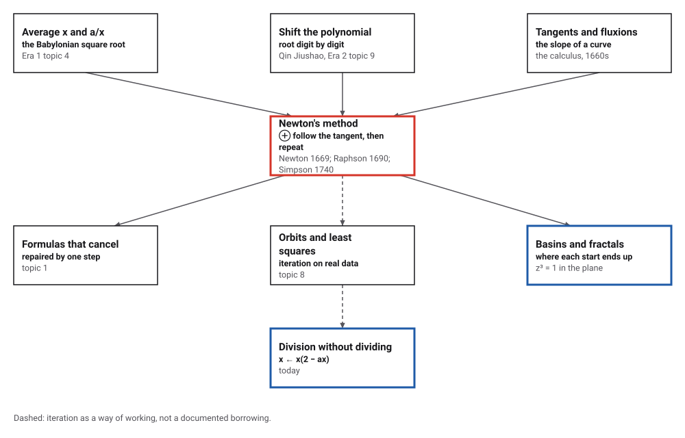
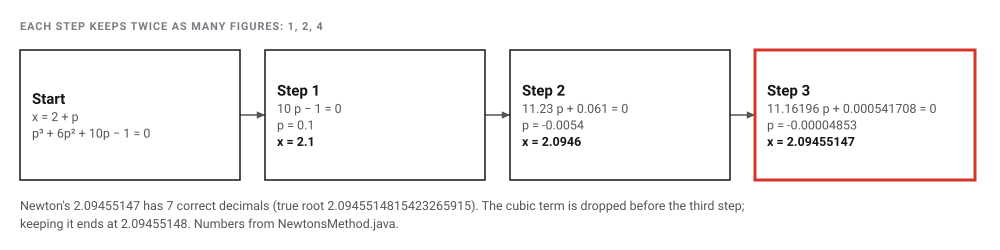
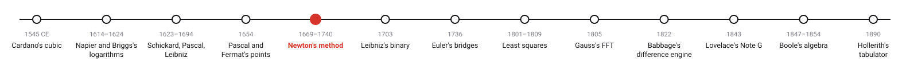
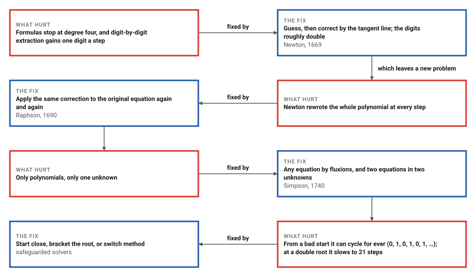

# Newton's Method

*Era 3 · topic 5 · 1669–1740* · [Era 3 index](../README.md) · [← The Problem of Points](../04-problem-of-points/README.md) · [Binary Arithmetic →](../06-binary-arithmetic/README.md) · [Interactive edition](newtons-method.html) · [Program](../../../code/era-03-tables-and-machines/05-newtons-method/)

> **Field note from the visiting historian.** Qin Jiushao dug out roots one digit at a time. Here the digits arrive in growing heaps: one, two, four, eight. The cost is trust: start in the wrong place and the method may wander for ever.

| | |
|---|---|
| **When** | Newton 1669 (printed 1685, 1711); Raphson 1690; Simpson 1740 |
| **Where** | Cambridge and London |
| **What hurt** | Formulas stop at degree four; digit-by-digit roots are slow |
| **The fix** | Follow the tangent line, and repeat |
| **Cost** | 6 steps for 60 decimals, against 198 halvings by bisection |

## How ideas combined

A new algorithm is usually an older idea combined with a new one. The Babylonians improved a square root by averaging (Era 1, topic 4); Qin Jiushao shifted a polynomial so that its next digit could be read off (Era 2, topic 9); in the 1660s Newton learned to find the slope of any curve. Put together: shift the polynomial by a guess, and read the next correction from the slope. Each box names the idea that was added.

<picture>
  <source media="(prefers-color-scheme: dark)" srcset="assets/family-dark.svg">
  
</picture>
*Red: Newton's method. Blue: two places where it shows up today.*

## Follow the tangent

Choose a function and a starting guess, then press Step. Each step draws the tangent at the current guess (red) and moves to where it crosses zero. Bold digits are correct. Try Newton's own equation (he started at 2; the default start here is further away, so the tangents show), then the trap and the double root.

<picture>
  <source media="(prefers-color-scheme: dark)" srcset="assets/newton-steps-dark.svg">
  
</picture>
*In the interactive edition you can step Newton's method on four equations from any starting point and watch the tangents.*

## Era 3, tables and machines

<picture>
  <source media="(prefers-color-scheme: dark)" srcset="assets/era-timeline-dark.svg">
  
</picture>

## Each fix leaves a new pain

<picture>
  <source media="(prefers-color-scheme: dark)" srcset="assets/chain-dark.svg">
  
</picture>
*Read it as a snake: each new problem sits directly under the fix that exposed it.*

## Guess, correct, repeat

**Newton's way (1669).** For x³ − 2x − 5 = 0, start at 2 and put x = 2 + p. The polynomial in p is p³ + 6p² + 10p − 1 = 0. For small p the last two terms matter most: 10p − 1 = 0, so p ≈ 0.1. Put p = 0.1 + q, write out the polynomial in q, and repeat, keeping twice as many figures each time:

<picture>
  <source media="(prefers-color-scheme: dark)" srcset="assets/newton-own-dark.svg">
  
</picture>

The program repeats these shifts exactly. With the cubic term dropped before the third step, as negligible, it arrives at Newton's **2.09455147**, with the intermediate equations 11.16196 p + 0.000541708 = 0; keeping every term instead gives 2.09455148.

**Raphson's way (1690).** Skip the new polynomials: apply x ← x − f(x)/f′(x) to the original equation again and again. Geometrically, slide down the tangent line to where it crosses zero. The program, with 80-digit arithmetic:

| Step | Correct decimals |
|---|---|
| 1 | 1 |
| 2 | 4 |
| 3 | 9 |
| 4 | 19 |
| 5 | 39 |

The correct decimals roughly double each step: the error is roughly squared. Over 10,000 random polynomials of degree 3 to 6, started 1% away from a known root, Newton's method reached 12 significant figures in 3 steps for 6,909, 4 steps for 3,091 (average 3.31).

**Simpson's way (1740).** Any equation, not only polynomials: cos x = x from 1 gives 0.739085133215161 in 4 steps. And two equations in two unknowns: for x² + y² = 4 and xy = 1, each step solves a 2 × 2 linear system by Cramer's rule, giving (1.931851652578137, 0.517638090205042).

> **Key idea.** Replace a hard problem by an easy one that is nearly the same (a curve by its tangent), solve the easy one, and repeat. When each repetition squares the error, a few steps are enough for any precision.

## Steps for sixty decimals, and where it fails

| Method | Steps for 60 correct decimals of Newton's root |
|---|---|
| Newton's method | 6 |
| Digit by digit (Era 2, topic 9) | 61 |
| Bisection (halve the bracket) | 198 |

The price is reliability. From 0, x³ − 2x + 2 = 0 gives the guesses 0, 1, 0, 1, 0, 1, … for ever. At a double root the curve is flat and the error only halves: (x − 1)²(x + 2) needs 21 steps to come within 10⁻⁶ of 1, where the simple root of x³ − 1 needs 5. In the complex plane, z³ = 1 has three roots; of 360,000 starting points in a square around 0, 360,000 converged (127,052 to 1, 116,474 and 116,474 to the other two), but 2,770 needed more than 20 steps, and the borders between the three regions are endlessly intricate.

## Three names for one method

*De analysi* was written "probably mid-1669" and printed in 1711; the earliest printed account of the method is chapter 94 of John Wallis's *A Treatise of Algebra* (1685). Raphson's *Analysis aequationum universalis* (1690) iterated on the original equation and, in his words, was "not only, I believe, not of the same origin, but also, certainly, not with the same development". Simpson's *Essays* (1740) gave the general form and the case of two equations. Ypma concludes that "the Newton-Raphson-Simpson method is a designation more nearly representing the facts of history"; Kollerstrom argues that "this invention has migrated back in time" from Simpson to Newton (**disputed**).

Earlier forms: Ypma reports a method algebraically equivalent to Newton's in al-Ṭūsī, and a form of it in al-Kashi for xᴾ − N = 0. The modern notation f′(x) comes from Lagrange (1798 per Ypma; 1797 per the DNB: **disputed**).

## The Babylonian rule was Newton's method all along

Applied to x² − 2 = 0, Newton's step is x − (x² − 2)/(2x) = (x + 2/x)/2: the Babylonian rule of averaging x and 2/x (Era 1, topic 4). The program computed both in exact fractions from 1: 3/2, 17/12, 577/408, 665857/470832, identical at every step.

> **Full circle.** Newton's method can even divide without dividing: for 1/a, iterate x ← x(2 − ax), which uses only multiplication and subtraction. For 1/7 from 0.1 the correct decimals went 1, 2, 4, 8, 17, 34, 67. A method from 1669 turns the slowest arithmetic operation into a few of the fastest.

## Before you read on

<details>
<summary><b>1.</b> Why does Newton keep only the two lowest terms, 10p − 1?</summary>

For small p, p² and p³ are much smaller than p, so the line 10p − 1 is a good stand-in for the whole polynomial near p = 0.
</details>

<details>
<summary><b>2.</b> What does one step of x ← x − f(x)/f′(x) mean on a graph?</summary>

Draw the tangent at the current guess and slide down it to where it meets the x-axis.
</details>

<details>
<summary><b>3.</b> Why do the correct digits double?</summary>

Near a simple root the new error is proportional to the square of the old one: an error of 10⁻⁵ becomes about 10⁻¹⁰.
</details>

<details>
<summary><b>4.</b> Why is a double root slow?</summary>

There f′ is also zero, the curve is flat, and each step only halves the distance to the root.
</details>

<details>
<summary><b>5.</b> What does x ← x(2 − ax) converge to?</summary>

1/a: if x = 1/a exactly, then 2 − ax = 1 and x stays put; near it, the error is squared each step.
</details>


## Where the evidence lives

| | Object | Where to see it | Licence |
|---|---|---|---|
| — | **Ypma, Historical Development of the Newton–Raphson Method**. SIAM Review 37 (1995): Newton's worked example, Raphson's tract and Simpson's essays, side by side. | [PDF](https://www.math.pku.edu.cn/teachers/litj/notes/numer_anal/NewtonRaphson_SIAMRev.pdf) | Drawn placeholder. |

## Every link was opened before it was listed

| Level | Link | Why |
|---|---|---|
| Start | [Newton's method](https://en.wikipedia.org/wiki/Newton%27s_method) — Wikipedia | The method, its history from 1669 to 1740, and why the digits double |
| Deeper | [Historical Development of the Newton–Raphson Method](https://www.math.pku.edu.cn/teachers/litj/notes/numer_anal/NewtonRaphson_SIAMRev.pdf) — Tjalling J. Ypma, *SIAM Review* 37(4):531–551 (1995), on a Peking University course page | The standard account: Newton's x³ − 2x − 5 worked step by step, Raphson, Simpson, and the earlier forms |
| Deeper | [Raphson, Joseph](https://mathshistory.st-andrews.ac.uk/DNB/Raphson.html) — *Dictionary of National Biography* (via MacTutor) | Raphson's life, his 1690 book and his independence from the calculus |
| Scholar | [Thomas Simpson and 'Newton's method of approximation': an enduring myth](https://cambridge.org/core/journals/british-journal-for-the-history-of-science/article/thomas-simpson-and-newtons-method-of-approximation-an-enduring-myth/265FA038F1A1873E8850CAFB4468DD8F) — Nick Kollerstrom, *British Journal for the History of Science* 25(3):347–354 (1992); abstract open | The case that the standard method is Simpson's of 1740 |

More, with certainty labels and the gaps we could not fill: [Era 3 reference catalog](https://github.com/vij658/AlgorithmEvolutionAtlas/blob/main/book/era-03-tables-and-machines/reference-catalog.md).

## The program behind every number here

[NewtonsMethod.java](https://github.com/vij658/AlgorithmEvolutionAtlas/blob/main/code/era-03-tables-and-machines/05-newtons-method/NewtonsMethod.java) makes **10,016 checks**: Newton's own shifts reaching 2.09455147, the doubling of correct digits, 10,000 random polynomials converging from 1% away, Simpson's system by Cramer's rule, the 2-cycle, the Babylonian rule as Newton's step in exact fractions, and division without dividing. Run it with `java NewtonsMethod.java` (JDK 17 or newer). The heart of it:

```java
/** Coefficients highest power first: shift x -> x + d (repeated synthetic division, as in Era 2 topic 9). */
static BigDecimal[] shift(BigDecimal[] c, BigDecimal d) {
    BigDecimal[] a = c.clone();
    int n = a.length - 1;
    for (int k = 0; k < n; k++) for (int i = 1; i <= n - k; i++) a[i] = a[i].add(a[i - 1].multiply(d));
    return a;
}
```

