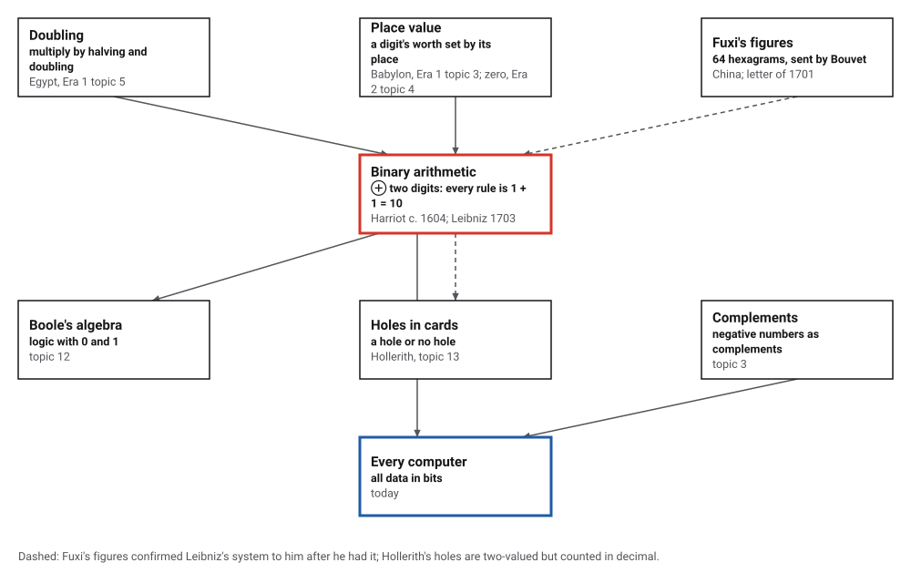
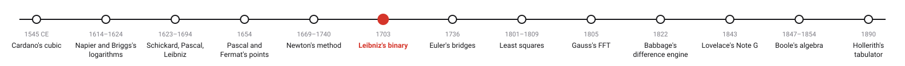
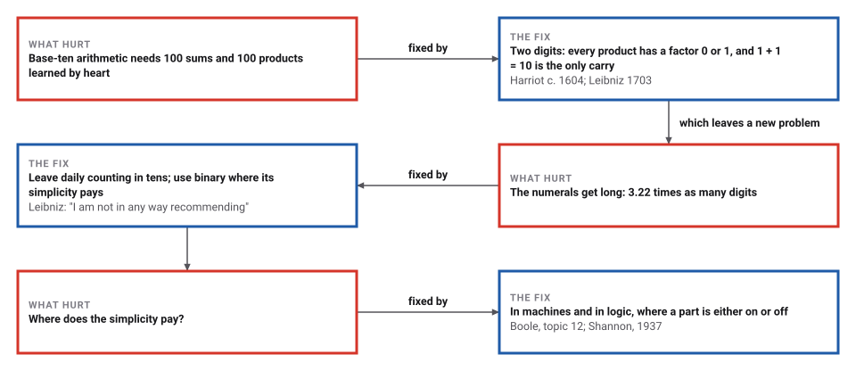
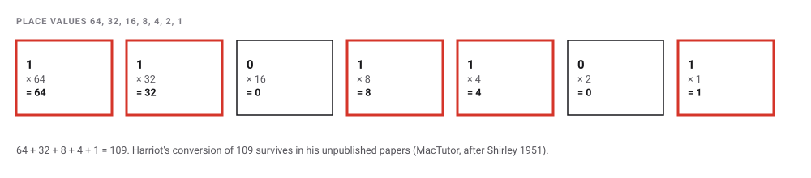
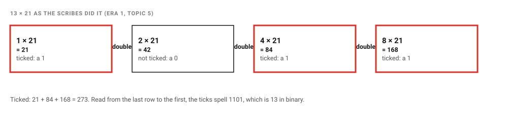

# Binary Arithmetic

*Era 3 · topic 6 · 1703* · [Era 3 index](../README.md) · [← Newton's Method](../05-newtons-method/README.md) · [The Bridges of Königsberg →](../07-konigsberg-bridges/README.md) · [Interactive edition](binary-arithmetic.html) · [Program](../../../code/era-03-tables-and-machines/06-binary-arithmetic/)

> **Field note from the visiting historian.** An Englishman worked it out around 1604 and left it in a drawer; a German philosopher made it public a century later and admired its simplicity without finding a use. The use came with machines, which care nothing for the length of a numeral and everything for the simplicity of its rules.

| | |
|---|---|
| **When** | Harriot c. 1601–1605 (unpublished); Caramuel 1670; Leibniz 1679, 1703 |
| **Where** | England, Paris, Hanover |
| **What hurt** | Base-ten arithmetic needs memorised tables |
| **The fix** | Two digits; every operation reduces to 1 + 1 = 10 |
| **Cost** | 3.22 times as many digits |

## How ideas combined

A new algorithm is usually an older idea combined with a new one. Egyptian scribes multiplied by doubling (Era 1, topic 5), which secretly writes every number as a sum of powers of two; place value (Era 1, topic 3, with zero from Era 2, topic 4) lets a digit's position carry its worth. Put the two together and a number needs only two digits. Each box names the idea that was added.

<picture>
  <source media="(prefers-color-scheme: dark)" srcset="assets/family-dark.svg">
  
</picture>
*Red: binary arithmetic. Blue: where it lives today.*

## Flip the bits

Click any bit to flip it between 0 and 1. The right side adds the two numbers with the carries written above, and multiplies them the way Leibniz recommended: one shifted copy of a for each 1 in b. The starting value of a is Harriot's 1101101 = 109.

<picture>
  <source media="(prefers-color-scheme: dark)" srcset="assets/places-dark.svg">
  
</picture>
*In the interactive edition you can set two 8-bit numbers bit by bit and watch the sum and the shift-and-add product.*

## Era 3, tables and machines

<picture>
  <source media="(prefers-color-scheme: dark)" srcset="assets/era-timeline-dark.svg">
  
</picture>

## Each fix leaves a new pain

<picture>
  <source media="(prefers-color-scheme: dark)" srcset="assets/chain-dark.svg">
  
</picture>
*Read it as a snake: each new problem sits directly under the fix that exposed it.*

## Two digits, one rule

**Reading and writing.** Each place is worth twice the place to its right. Harriot's 1101101 is 64 + 32 + 8 + 4 + 1 = **109**. To go back, halve and keep the remainders: 109 r 1, 54 r 0, 27 r 1, 13 r 1, 6 r 0, 3 r 1, 1 r 1; the remainders read upward are 1101101. The program converted every number below 2²⁰ (1,048,576 of them) both ways.

<picture>
  <source media="(prefers-color-scheme: dark)" srcset="assets/places-steps-dark.svg">
  
</picture>

**Nothing to memorise.** Base ten has 100 single-digit sums and 100 products (55 of each if a + b and b + a count once), and 36 of the products have no factor 0 or 1, so they must be learned. Base two has 4 of each (3 counted once), and every product has a factor 0 or 1. Leibniz: in binary "there would no longer be any need to learn anything by heart".

**Multiplying is doubling.** Each digit of the multiplier says: add a shifted copy of the number, or don't. That is exactly the scribes' table of doublings:

<picture>
  <source media="(prefers-color-scheme: dark)" srcset="assets/egypt-dark.svg">
  
</picture>

The program added and multiplied 100,000 random pairs bit by bit, with no multiplication table: all correct. Multipliers of about 19.00 bits needed on average 10.00 shifted additions, one per 1.

> **Key idea.** Choose the representation that makes the algorithm simplest. In base two, every arithmetic rule collapses to "1 + 1 = 10" and "add it or don't": rules a machine can follow without understanding numbers at all.

## The price is length

| Numbers 1 to 1,000,000 | Digits used |
|---|---|
| In decimal | 5,888,896 |
| In binary | 18,951,445 |

Binary needed 3.22 times as many digits; for very large numbers the ratio approaches log₂ 10 = 3.3219. Leibniz saw this and wrote, "I am not in any way recommending this way of counting" for everyday use: counting by ten is shorter.

## Invented in a drawer, published from Paris

Thomas Harriot converted numbers to binary (1101101 = 109) and added, subtracted and multiplied in it, in papers left unpublished at his death; "He saw no practical applications for his theory in his day, and he dropped it" (MacTutor, after Shirley 1951). Strickland dates the work between September 1601 and November 1605 and treats the often-quoted 1604 as Knuth's conjecture (**documented** range).

Juan Caramuel's *Mathesis biceps* of 1670 "probably contains ... the first known publication in Europe on the binary system" (Ineichen, quoted by Bruderer; Wikipedia gives 1700: **disputed**). Leibniz's first binary paper dates from 1679; his *Explication de l'Arithmétique Binaire* appeared for 1703, after Joachim Bouvet wrote from China in 1701 of Fuxi's "grand figure, which goes up to 64". Reading the hexagrams as an independent invention of binary is Bouvet's and Leibniz's interpretation (**conjecture**).

## Harriot's numeral, printed by Java

Ask Java for the binary form of 109 and it prints 1101101, the numeral in Harriot's papers. Negative numbers reuse the complement trick of Pascal's machine (topic 3): in an 8-bit byte, −109 is stored as 10010011 = 256 − 109 = 147, which is the ones' complement 10010010 plus 1.

> **Full circle.** Leibniz did not recommend binary for counting, and he was right: people still count in tens. But a switch, a relay, a transistor or a hole in a card has two states, and for machines binary's one rule is worth any length. There are 2⁶ = 64 six-digit binary numbers, as many as the hexagrams Bouvet sent; a computer's 64-bit word has 2⁶⁴.

## Before you read on

<details>
<summary><b>1.</b> What is 1101101 in decimal?</summary>

64 + 32 + 8 + 4 + 1 = 109.
</details>

<details>
<summary><b>2.</b> How do you write 13 in binary?</summary>

Halve and keep remainders: 13 r 1, 6 r 0, 3 r 1, 1 r 1; read upward: 1101.
</details>

<details>
<summary><b>3.</b> Why does binary multiplication need no table?</summary>

Each multiplier digit is 0 or 1: the partial product is either nothing or a shifted copy of the number.
</details>

<details>
<summary><b>4.</b> Why did Leibniz not recommend binary for everyday use?</summary>

Its numerals are about three and a third times as long; counting by ten is shorter.
</details>

<details>
<summary><b>5.</b> Where are the Egyptian scribe's ticks in binary?</summary>

They are the 1s of the multiplier: for 13 the ticked rows are 1, 4 and 8, and 13 is 1101 in binary.
</details>


## Where the evidence lives

| | Object | Where to see it | Licence |
|---|---|---|---|
| — | **Explanation of binary arithmetic (1703)**. Leibniz's own case for binary, in English, with Bouvet's report of Fuxi's figures. | [PDF](https://kastalia.medienhaus.udk-berlin.de/odl/Leibniz.pdf) | Drawn placeholder. |

## Every link was opened before it was listed

| Level | Link | Why |
|---|---|---|
| Start | [Binary number](https://en.wikipedia.org/wiki/Binary_number) — Wikipedia | From Pingala and the *I Ching* to Harriot, Leibniz, Boole and Shannon |
| Start | [Harriot and binary numbers](https://mathshistory.st-andrews.ac.uk/Extras/Harriot_binary_numbers) — MacTutor (after J. W. Shirley, *Am. J. Physics* 19, 1951) | Harriot's conversions and binary arithmetic, a century before Leibniz |
| Deeper | [The binary system was created long before Leibniz](https://cacm.acm.org/blogs/blog-cacm/221749-the-binary-system-was-created-long-before-leibniz/fulltext) — Herbert Bruderer, *Communications of the ACM* blog | Harriot, Napier's chessboard, Caramuel 1670 and Leibniz |
| Scholar | [Why Did Thomas Harriot Invent Binary?](https://fermatslibrary.com/s/why-did-thomas-harriot-invent-binary) — Lloyd Strickland, *The Mathematical Intelligencer* (2023), via Fermat's Library | Dating Harriot's manuscripts (1601–1605) and why he invented binary |
| Scholar | [Explanation of binary arithmetic (1703)](https://kastalia.medienhaus.udk-berlin.de/odl/Leibniz.pdf) — Leibniz, English text © Lloyd Strickland 2007 (hosted at UdK Berlin) | Leibniz's own case for binary: no tables to memorise, and Fuxi's figures |

More, with certainty labels and the gaps we could not fill: [Era 3 reference catalog](https://github.com/vij658/AlgorithmEvolutionAtlas/blob/main/book/era-03-tables-and-machines/reference-catalog.md).

## The program behind every number here

[BinaryArithmetic.java](https://github.com/vij658/AlgorithmEvolutionAtlas/blob/main/code/era-03-tables-and-machines/06-binary-arithmetic/BinaryArithmetic.java) makes **1,248,581 checks**: conversion of every number below 2²⁰ both ways against Java's own, 100,000 sums and shift-and-add products bit by bit, Egyptian doubling as binary, the length of a million numerals, and two's complement. Run it with `java BinaryArithmetic.java` (JDK 17 or newer). The heart of it:

```java
/** Add two binary numerals digit by digit with the one rule 1 + 1 = 10. */
static String add(String a, String b) {
    StringBuilder s = new StringBuilder();
    int i = a.length() - 1, j = b.length() - 1, carry = 0;
    while (i >= 0 || j >= 0 || carry > 0) {
        int t = carry + (i >= 0 ? a.charAt(i--) - '0' : 0) + (j >= 0 ? b.charAt(j--) - '0' : 0);
        s.append(t % 2);
        carry = t / 2;
        bitOps++;
    }
    return s.reverse().toString();
}

/** Multiply by shift and add: for each 1 in b, add a shifted copy of a. No multiplication table is used. */
static String multiply(String a, String b, int[] adds) {
    String acc = "0";
    for (int k = 0; k < b.length(); k++) {
        if (b.charAt(b.length() - 1 - k) == '1') {
            acc = add(acc, a + "0".repeat(k));
            adds[0]++;
        }
    }
    return acc;
}
```

