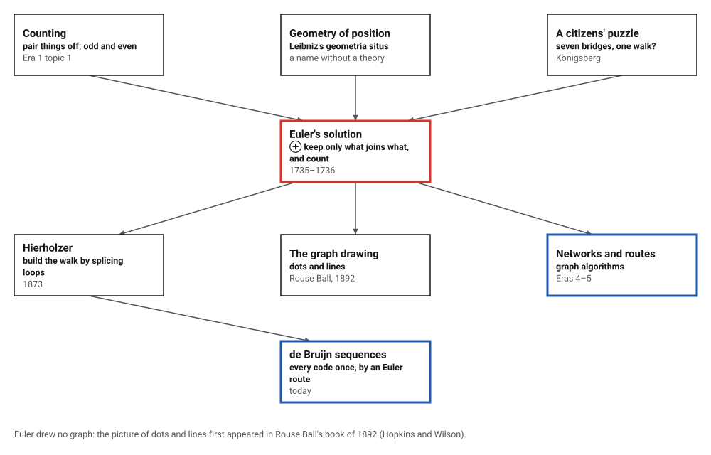
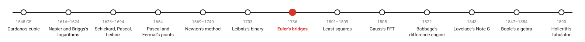
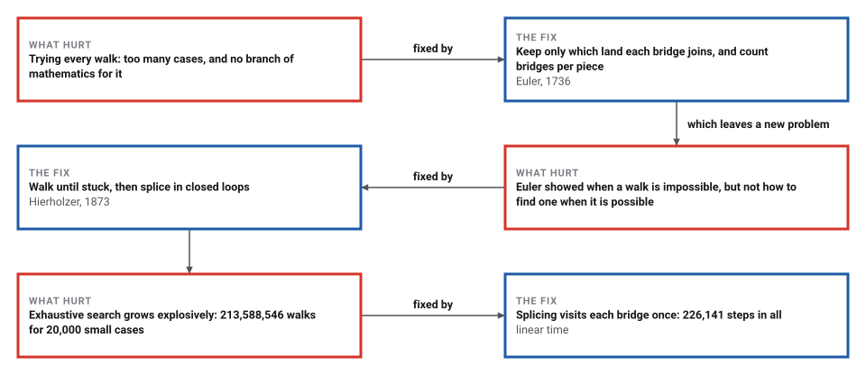
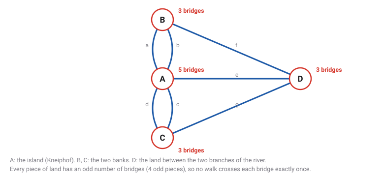

# The Bridges of Königsberg

*Era 3 · topic 7 · 1736* · [Era 3 index](../README.md) · [← Binary Arithmetic](../06-binary-arithmetic/README.md) · [Least Squares, and the Lost Planet →](../08-least-squares/README.md) · [Interactive edition](konigsberg-bridges.html) · [Program](../../../code/era-03-tables-and-machines/07-konigsberg-bridges/)

> **Field note from the visiting historian.** Listing every walk was hopeless. Euler threw away the river, the distances and the shapes, kept only which land touched which bridge, and counted. He called the question banal. It is the first time I have seen a problem solved by deciding what to ignore.

| | |
|---|---|
| **When** | Presented 1735; dated 1736; printed 1741; Hierholzer 1873 |
| **Where** | St Petersburg, about Königsberg |
| **What hurt** | A route question with too many cases to try |
| **The fix** | Keep only the connections, and count: zero or two odd places |
| **Cost** | One look at each bridge |

## How ideas combined

A new algorithm is usually an older idea combined with a new one. Counting in pairs, odd and even, is as old as tally marks (Era 1, topic 1). Leibniz had asked for a "geometry of position" that would deal with arrangement rather than size, but no one had written one. The citizens of Königsberg supplied the question. Euler answered it by throwing away everything except which land each bridge joins, and counting. Each box names the idea that was added.

<picture>
  <source media="(prefers-color-scheme: dark)" srcset="assets/family-dark.svg">
  
</picture>
*Red: Euler's solution. Blue: where routes through networks went.*

## Cross every bridge once

Click a piece of land to start, then click bridges to cross them. Euler's test, on the right, counts the bridges at each piece; odd counts are red. Choose "none" for Königsberg itself and try to cross all seven. Then add an eighth bridge and try again, or let the page find a route by Hierholzer's splicing.

<picture>
  <source media="(prefers-color-scheme: dark)" srcset="assets/city-dark.svg">
  
</picture>
*In the interactive edition you can walk the bridges yourself, add extra bridges, and ask for a route.*

## Era 3, tables and machines

<picture>
  <source media="(prefers-color-scheme: dark)" srcset="assets/era-timeline-dark.svg">
  
</picture>

## Each fix leaves a new pain

<picture>
  <source media="(prefers-color-scheme: dark)" srcset="assets/chain-dark.svg">
  
</picture>
*Read it as a snake: each new problem sits directly under the fix that exposed it.*

## Count the bridges, not the walks

**The city, reduced.** Four pieces of land: the island A and the regions B, C and D, joined by seven bridges. A has 5 bridges; B, C and D have 3, 3 and 3. Their total, 14, is twice the number of bridges, because "each bridge is counted twice, once for each of the two areas which it joins" (Euler, in Hopkins and Wilson's translation).

<picture>
  <source media="(prefers-color-scheme: dark)" srcset="assets/city-steps-dark.svg">
  
</picture>

**Euler's count.** A route over 7 bridges can be written as a string of 8 letters, the pieces of land in the order visited. A piece with an odd number k of bridges must appear (k + 1)/2 times: A 3, B 2, C 2, D 2. That is 9 letters, more than 8: no route exists. Euler's general rule: "If there are more than two areas to which an odd number of bridges lead, then such a journey is impossible."

**Checking by brute force.** The program tried every walk that never repeats a bridge, from every piece of land: 824 walks, the longest crossing 6 of the 7 bridges.

**Hierholzer's construction (1873).** Euler's condition is also enough. Walk until you are stuck, which can only happen at the end; then, from any place on the walk that still has unused bridges, walk a closed loop and splice it into the route. With an eighth bridge from B to C, the counts become 5, 4, 4 and 3: two odd pieces. The program's route: **D → A → B → A → C → D → B → C → A**, all 8 bridges.

> **Key idea.** Decide what to ignore. Distances, shapes and the river itself do not matter; only which land touches which bridge. Once the problem is a list of connections, a parity count settles it, and a simple procedure builds the answer.

## Counting against searching

| Test | Result |
|---|---|
| 20,000 random small networks (3–6 pieces, 4–10 bridges) | a full route exists in 15,081: exactly those where the land is connected and 0 or 2 pieces are odd; in the other 4,919, none |
| Work, exhaustive search | 213,588,546 walks examined |
| Work, Hierholzer's splicing | 226,141 steps |
| A network of 200 pieces and 2,000 bridges | Hierholzer: a closed route in 4,001 steps |

Euler's count needs one look at each bridge; Hierholzer's splicing needs about two steps per bridge. Exhaustive search grows explosively with the number of bridges. On every one of the random cases, Euler's rule agreed with the search.

## A banal question, and a paper dated 1736

Euler presented his solution to the St Petersburg Academy on 26 August 1735; the paper is dated 1736 (*Commentarii* 8, pp. 128–140) but "was not actually published until 1741" (Hopkins and Wilson; Sachs, Stiebitz and Wilson). To Marinoni, on 13 March 1736, he called the question "so banal" but "worthy of attention"; to Ehler he wrote that "the solution is based on reason alone". Euler stated, but did not prove, that his condition is sufficient; "A valid proof was not published until 1873, by Carl Hierholzer" (*Mathematische Annalen* 6). That the paper appeared after Hierholzer's death is often said but was not found in an opened source (**conjecture**).

Euler drew no graph: "graphs of this kind didn't make their first appearance until the second half of the nineteenth century", and the dots-and-lines Königsberg graph first appeared in W. W. Rouse Ball's book of 1892 (Hopkins and Wilson). The figure on this page is that later form. Today two of the seven bridges are gone, lost to bombing in the Second World War, two were replaced by a highway, and three remain (Wikipedia).

## Every code exactly once

Turn codes into bridges: let each three-digit binary string be a piece of land, and each four-digit string xyzw a one-way bridge from xyz to yzw. Every piece then has two bridges in and two out, so an Euler route exists.

> **Full circle.** The program's route spells 0000100110101111000: 19 digits in which every one of the 16 four-digit codes appears exactly once, against 64 digits to type them one by one. Such de Bruijn sequences come straight out of Euler's bridges, and Hierholzer's splicing builds them in time proportional to their length.

## Before you read on

<details>
<summary><b>1.</b> Why must the bridges at a piece of land pair up?</summary>

Every time the walker enters by one bridge, they leave by another, except at the start and the end.
</details>

<details>
<summary><b>2.</b> Why can there never be exactly one odd piece?</summary>

The bridge counts add up to twice the number of bridges, an even number, so the odd counts come in pairs.
</details>

<details>
<summary><b>3.</b> Why does A, with 5 bridges, appear 3 times in a route?</summary>

Each visit in the middle uses 2 bridges; 5 bridges need at least 3 appearances (2 + 2 + 1, the last as start or end).
</details>

<details>
<summary><b>4.</b> With two odd pieces, where must a route start?</summary>

At one odd piece, ending at the other.
</details>

<details>
<summary><b>5.</b> Why is Hierholzer's splicing fast?</summary>

Each bridge is crossed once when walking and looked at once when backing up: the work is proportional to the number of bridges.
</details>


## Where the evidence lives

| | Object | Where to see it | Licence |
|---|---|---|---|
| — | **Solutio problematis ad geometriam situs pertinentis**. Euler's paper of 1736 (printed 1741), in Latin, from the Euler Archive. | [PDF](https://phantom.cs.qc.cuny.edu/gavva/teaching/s24/euler-bridges-paper.pdf) | Drawn placeholder. |

## Every link was opened before it was listed

| Level | Link | Why |
|---|---|---|
| Start | [Seven Bridges of Königsberg](https://en.wikipedia.org/wiki/Seven_Bridges_of_K%C3%B6nigsberg) — Wikipedia | The puzzle, Euler's answer, and what became of the bridges |
| Start | [Leonard Euler's Solution to the Konigsberg Bridge Problem](https://www.maa.org/book/export/html/116599) — Teo Paoletti, MAA *Convergence* | Euler's letters, and why he thought the problem trivial |
| Deeper | [Euler tours](https://www.ics.uci.edu/~eppstein/163/lecture4b.pdf) — David Eppstein, CS 163/265 Graph Algorithms, UC Irvine (Winter 2026) | Euler's condition, Hierholzer's splicing algorithm and its linear running time |
| Deeper | [Das Problem der Königsberger Brücken](https://bez.unibas.ch/fileadmin/user_upload/bez/Koenigsberg.pdf) — Hanspeter Kraft, University of Basel (in German), with Hopkins and Wilson's "The Truth about Königsberg" (2004) reprinted | What Euler actually did, in his own counting, without a graph |
| Scholar | [An Historical Note: Euler's Königsberg Letters](https://www.ime.usp.br/~yw/2016/grafinhos/aulas/Paper-Euler-Letters.pdf) — Horst Sachs, Michael Stiebitz and Robin J. Wilson, *Journal of Graph Theory* 12(1):133–139 (1988) | The letters of 1736 and the publication dates |
| Scholar | [Solutio problematis ad geometriam situs pertinentis (E53)](https://phantom.cs.qc.cuny.edu/gavva/teaching/s24/euler-bridges-paper.pdf) — Euler, 1736 (printed 1741); Euler Archive copy on a Queens College course page | The paper itself, in Latin |
| Scholar | [Ueber die Möglichkeit, einen Linienzug ohne Wiederholung und ohne Unterbrechung zu umfahren](https://eudml.org/doc/156599) — Carl Hierholzer, *Mathematische Annalen* 6:30–32 (1873), EuDML record with a link to the Göttingen scan | The proof of sufficiency, and the construction |

More, with certainty labels and the gaps we could not fill: [Era 3 reference catalog](https://github.com/vij658/AlgorithmEvolutionAtlas/blob/main/book/era-03-tables-and-machines/reference-catalog.md).

## The program behind every number here

[KonigsbergBridges.java](https://github.com/vij658/AlgorithmEvolutionAtlas/blob/main/code/era-03-tables-and-machines/07-konigsberg-bridges/KonigsbergBridges.java) makes **35,090 checks**: Euler's count on Königsberg, an exhaustive search of every walk, Hierholzer's route with an eighth bridge, Euler's condition against search on 20,000 random networks, a closed route over 2,000 bridges, and a de Bruijn sequence built as an Euler route. Run it with `java KonigsbergBridges.java` (JDK 17 or newer). The heart of it:

```java
/** Hierholzer: a route over every edge exactly once, as a list of vertices (null if Euler's condition fails). */
static List<Integer> hierholzer(Graph g) {
    if (!g.connected()) return null;
    int[] d = g.degrees();
    int odd = 0, start = -1;
    for (int i = 0; i < g.n; i++) if (d[i] % 2 == 1) { odd++; start = i; }
    if (odd != 0 && odd != 2) return null;
    if (start < 0) for (int i = 0; i < g.n; i++) if (d[i] > 0) { start = i; break; }
    List<List<int[]>> adj = new ArrayList<>();
    for (int i = 0; i < g.n; i++) adj.add(new ArrayList<>());
    for (int i = 0; i < g.edges.length; i++) { adj.get(g.edges[i][0]).add(new int[]{g.edges[i][1], i}); adj.get(g.edges[i][1]).add(new int[]{g.edges[i][0], i}); }
    boolean[] used = new boolean[g.edges.length];
    int[] ptr = new int[g.n];
    Deque<Integer> stack = new ArrayDeque<>();
    LinkedList<Integer> route = new LinkedList<>();
    stack.push(start);
    while (!stack.isEmpty()) {                              // walk until stuck, then back up and splice
        int v = stack.peek();
        while (ptr[v] < adj.get(v).size() && used[adj.get(v).get(ptr[v])[1]]) ptr[v]++;
        hierholzerSteps++;
        if (ptr[v] == adj.get(v).size()) { route.addFirst(stack.pop()); }
        else { int[] e = adj.get(v).get(ptr[v]); used[e[1]] = true; stack.push(e[0]); }
    }
    return route;
}
```

