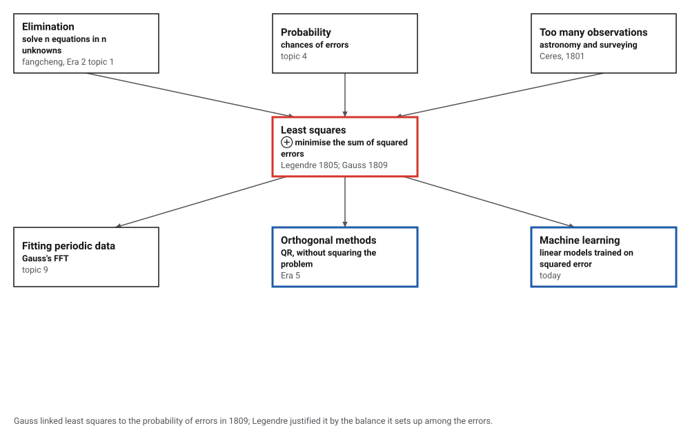
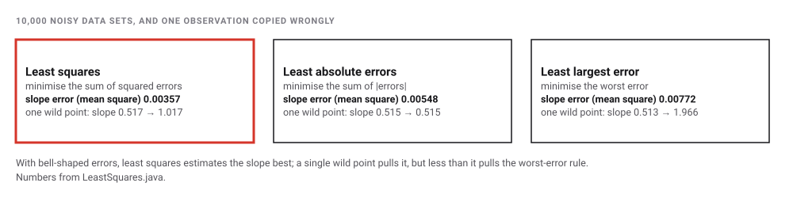
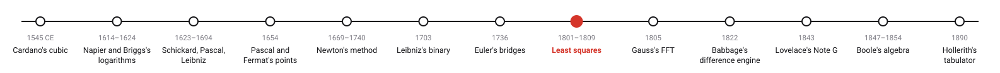
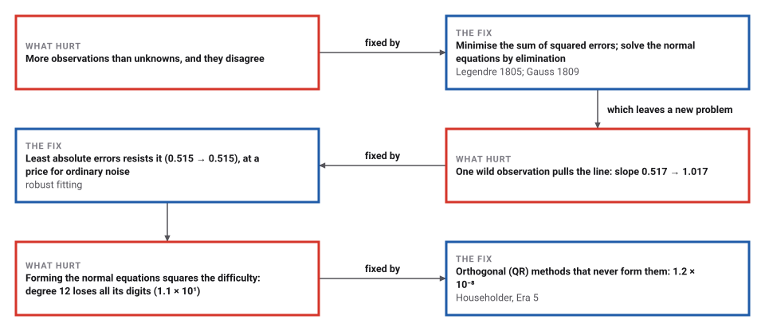

# Least Squares, and the Lost Planet

*Era 3 · topic 8 · 1801–1809* · [Era 3 index](../README.md) · [← The Bridges of Königsberg](../07-konigsberg-bridges/README.md) · [Gauss's Fast Fourier Transform →](../09-gauss-fft/README.md) · [Interactive edition](least-squares.html) · [Program](../../../code/era-03-tables-and-machines/08-least-squares/)

> **Field note from the visiting historian.** I expected the astronomers to argue about which measurement to trust. Instead a geometer in Paris proposed a rule for trusting all of them a little: make the sum of the squared errors as small as possible. The old algorithm for equations then did the rest.

| | |
|---|---|
| **When** | Ceres 1801; Legendre 1805; Gauss 1809 |
| **Where** | Palermo, Paris, Göttingen |
| **What hurt** | More observations than unknowns, and they disagree |
| **The fix** | Minimise the sum of squared errors; solve the normal equations |
| **Cost** | A small system of equations, the same size for any number of observations |

## How ideas combined

A new algorithm is usually an older idea combined with a new one. Chinese elimination (Era 2, topic 1) solves as many equations as unknowns; Pascal and Fermat (topic 4) began the calculation of chances; astronomers had more observations than unknowns, and the observations disagreed. Legendre's rule turns the too-many equations into exactly as many as unknowns, which elimination can solve. Each box names the idea that was added.

<picture>
  <source media="(prefers-color-scheme: dark)" srcset="assets/family-dark.svg">
  
</picture>
*Red: least squares. Blue: where it went after this era.*

## Drag the points; watch the squares

Each red square is a residual squared: the gap between a point and the blue line, drawn as a square. The blue line is the one with the smallest total area. Drag the points, copy one wrongly, and switch on the other two rules to compare them.

<picture>
  <source media="(prefers-color-scheme: dark)" srcset="assets/rules-dark.svg">
  
</picture>
*In the interactive edition you can drag the points and compare least squares with the other two rules.*

## Era 3, tables and machines

<picture>
  <source media="(prefers-color-scheme: dark)" srcset="assets/era-timeline-dark.svg">
  
</picture>

## Each fix leaves a new pain

<picture>
  <source media="(prefers-color-scheme: dark)" srcset="assets/chain-dark.svg">
  
</picture>
*Read it as a snake: each new problem sits directly under the fix that exposed it.*

## As many equations as unknowns

Fit y = c₀ + c₁x (or more terms) to m observations. Each observation gives an equation that will not hold exactly; its error is the residual. Legendre's rule: make the sum of the squared residuals as small as possible. At the minimum, the derivative with respect to each coefficient is zero, which gives one linear equation per coefficient: the normal equations. However many observations there are, a straight line gives 2 equations and a quadratic 3, solved by elimination.

| Model, fitted to 22 noisy observations | Coefficients | Sum of squared residuals |
|---|---|---|
| Straight line | 1.6157 + 1.3084x | 0.9130 |
| Quadratic (the true curve is 2 + 0.7x + 0.15x²) | 2.0004 + 0.7173x + 0.1442x² | 0.05733 |

The program also nudged the coefficients of each fit a little in 2,000 random ways: no nudge ever lowered the sum of squares.

<picture>
  <source media="(prefers-color-scheme: dark)" srcset="assets/rules-steps-dark.svg">
  
</picture>

> **Key idea.** When the data cannot all be satisfied, decide what "best" means, as a number to minimise, and then minimise it. Squares make the minimum a set of linear equations, which an old algorithm already solves.

## Cheap in observations, fragile in digits

| Observations (quadratic fit) | Multiply-adds to form and solve the normal equations |
|---|---|
| 22 | 206 |
| 1,000 | 9,008 |
| 100,000 | 900,008 |

The work grows only in proportion to the number of observations: each observation adds its share to a 3 × 3 system, and the system is the same size for 22 observations or 100,000.

| Polynomial degree | Largest coefficient error, normal equations | Largest coefficient error, QR |
|---|---|---|
| 3 | 5.5 × 10⁻¹³ | 1.8 × 10⁻¹⁴ |
| 6 | 5.9 × 10⁻⁹ | 2.1 × 10⁻¹³ |
| 9 | 2.8 × 10⁻⁴ | 3.8 × 10⁻¹⁰ |
| 12 | 1.1 × 10¹ | 1.2 × 10⁻⁸ |

The price: forming the normal equations squares the sensitivity of the problem. On exact data, the coefficients of a degree-12 fit come out completely wrong from the normal equations in 64-bit floating point, while an orthogonal (QR) method, which never forms them, keeps most of its digits.

## A planet found, lost and found again

Piazzi discovered Ceres on 1 January 1801 and "had only been able to observe 9 degrees of its orbit before it disappeared behind the Sun" (MacTutor); Weiss counts 22 observations over 41 days. Gauss's prediction "differed greatly from the others", and Ceres was found "almost exactly where Gauss had predicted": by Zach on 7 December (MacTutor) or by Zach and Olbers in December, Olbers on the 31st (Weiss; **disputed** dates). Whether Gauss used least squares for the Ceres orbit is **disputed**: MacTutor and Weiss say yes; *thatsmaths* says it is unclear.

Legendre published first, in 1805: the method "consiste à rendre minimum la somme des quarrés des erreurs", which sets up "entre les erreurs une sorte d'équilibre" that keeps the extreme errors from prevailing. Gauss, in 1809, called it "principium nostrum quo jam inde ab anno 1795 usi sumus": our principle, used since 1795. The priority dispute is **disputed** to this day; Stigler could not reproduce Gauss's 1799 results with least squares (Chalberg).

## Training a model is fitting a line

Machine-learning libraries rarely solve normal equations. They start from a guess and repeatedly nudge the coefficients downhill on the sum of squared errors: gradient descent.

> **Full circle.** The program trained a straight line by gradient descent on the 15 points with the wild one. After 17,292 small steps it reached y = -1.283070 + 1.016560x, exactly the line the normal equations give in one elimination: y = -1.283070 + 1.016560x. Legendre's sum of squares is still the loss function of a linear model.

## Before you read on

<details>
<summary><b>1.</b> Why squares rather than plain errors?</summary>

Plain errors cancel (+3 and −3 sum to 0). Squares are always positive, and their sum has a minimum found by setting derivatives to zero: linear equations.
</details>

<details>
<summary><b>2.</b> How many normal equations for a quadratic fitted to 1,000 points?</summary>

Three: one per coefficient, however many points.
</details>

<details>
<summary><b>3.</b> Why does one wild point move least squares so much?</summary>

Its error is squared: an error of 20 counts 400, outweighing many small errors.
</details>

<details>
<summary><b>4.</b> Why does least absolute errors resist it?</summary>

Each point counts in proportion to its error, not its square, and the best line passes through two of the points; a single wild point cannot drag it far.
</details>

<details>
<summary><b>5.</b> What is the point of the QR method?</summary>

It finds the same least-squares answer without forming FᵀF, which would square the problem's sensitivity to rounding.
</details>


## Where the evidence lives

| | Object | Where to see it | Licence |
|---|---|---|---|
| — | **Sur la méthode des moindres quarrés (1805)**. Legendre's appendix to his book on comet orbits: the first publication of least squares, in French. | [University of York](https://www.york.ac.uk/depts/maths/histstat/legendre2.pdf) | Drawn placeholder. |

## Every link was opened before it was listed

| Level | Link | Why |
|---|---|---|
| Start | [Gauss Predicts the Orbit of Ceres](https://thatsmaths.com/2021/06/24/gauss-predicts-the-orbit-of-ceres/) — *thatsmaths* blog (24 June 2021) | The lost planet and the prediction, with the caution about least squares |
| Start | [Gauss and Ceres](https://ow3.math.rutgers.edu/~cherlin/History/Papers1999/weiss.html) — Leorah Weiss, history of mathematics term paper, Rutgers (1999) | Piazzi's 22 observations over 41 days, the three Gauss used, and the recovery |
| Start | [Carl Friedrich Gauss](https://mathshistory.st-andrews.ac.uk/Biographies/Gauss/) — MacTutor | Ceres, the *Theoria motus*, and Gauss's life |
| Deeper | [Regression Analysis – A Powerful Tool and Riveting Drama](https://old.maa.org/sites/default/files/pdf/upload_library/46/HOMSIGMAA/Chalberg-RegressionHistoryPaper.pdf) — Tim Chalberg, Pacific Lutheran University, MAA HOMSIGMAA | Legendre, Gauss, Adrain and the priority dispute |
| Scholar | [Gauss and the method of least squares](https://gtfp.cs.rhul.ac.uk/pulskamp/Gauss/Gauss.html) — Richard Pulskamp, sources in the history of probability and statistics | Where to find Gauss's least-squares writings in translation |
| Scholar | [Sur la méthode des moindres quarrés](https://www.york.ac.uk/depts/maths/histstat/legendre2.pdf) — Legendre, appendix to *Nouvelles méthodes pour la détermination des orbites des comètes* (Paris, 1805), scan on the University of York history of statistics pages | The first publication of least squares, in French |

More, with certainty labels and the gaps we could not fill: [Era 3 reference catalog](https://github.com/vij658/AlgorithmEvolutionAtlas/blob/main/book/era-03-tables-and-machines/reference-catalog.md).

## The program behind every number here

[LeastSquares.java](https://github.com/vij658/AlgorithmEvolutionAtlas/blob/main/code/era-03-tables-and-machines/08-least-squares/LeastSquares.java) makes **4,007 checks**: that no nearby coefficients beat the least-squares fit (4,000 random nudges), the three rules on 10,000 noisy data sets, the pull of one wild point, the work of forming normal equations, their loss of digits against QR, and gradient descent reaching the same line. Run it with `java LeastSquares.java` (JDK 17 or newer). The heart of it:

```java
/** Least squares by the normal equations: (F^T F) c = F^T y, with F[i][j] = x_i^j. */
static double[] normalEquations(double[] x, double[] y, int n) {
    double[][] M = new double[n][n];
    double[] r = new double[n];
    for (int i = 0; i < x.length; i++) {
        double[] f = new double[n];
        for (int j = 0; j < n; j++) f[j] = Math.pow(x[i], j);
        for (int a = 0; a < n; a++) { r[a] += f[a] * y[i]; for (int b = 0; b < n; b++) { M[a][b] += f[a] * f[b]; flops++; } }
    }
    return solve(M, r);
}

/** Gaussian elimination with partial pivoting: solve A c = b (A is n x n). */
static double[] solve(double[][] A0, double[] b0) {
    int n = b0.length;
    double[][] A = new double[n][];
    for (int i = 0; i < n; i++) A[i] = A0[i].clone();
    double[] b = b0.clone();
    for (int k = 0; k < n; k++) {
        int p = k;
        for (int i = k + 1; i < n; i++) if (Math.abs(A[i][k]) > Math.abs(A[p][k])) p = i;
        double[] t = A[k]; A[k] = A[p]; A[p] = t; double tb = b[k]; b[k] = b[p]; b[p] = tb;
        for (int i = k + 1; i < n; i++) {
            double f = A[i][k] / A[k][k];
            for (int j = k; j < n; j++) { A[i][j] -= f * A[k][j]; flops++; }
            b[i] -= f * b[k];
        }
    }
    double[] c = new double[n];
    for (int i = n - 1; i >= 0; i--) { double s = b[i]; for (int j = i + 1; j < n; j++) s -= A[i][j] * c[j]; c[i] = s / A[i][i]; }
    return c;
}
```

