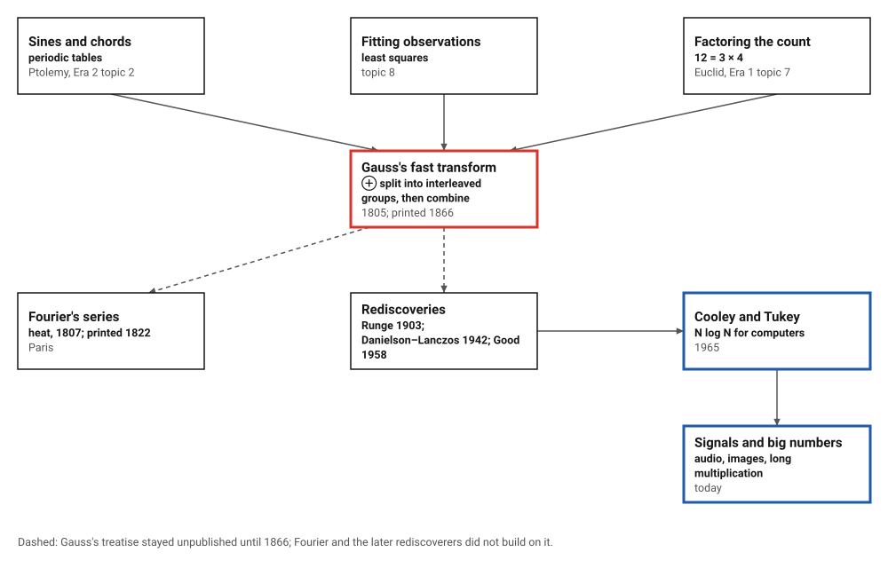
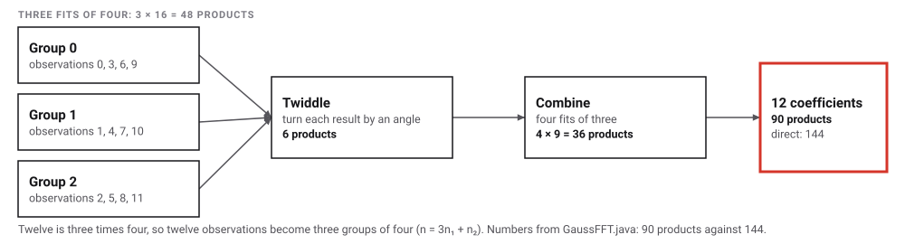
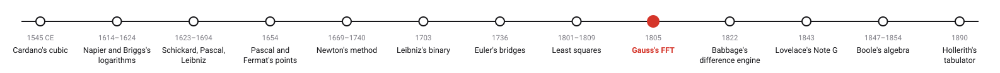
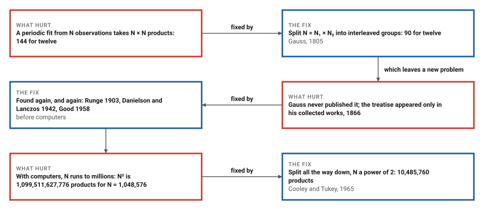

# Gauss's Fast Fourier Transform

*Era 3 · topic 9 · 1805* · [Era 3 index](../README.md) · [← Least Squares, and the Lost Planet](../08-least-squares/README.md) · [Babbage's Difference Engine →](../10-difference-engine/README.md) · [Interactive edition](gauss-fft.html) · [Program](../../../code/era-03-tables-and-machines/09-gauss-fft/)

> **Field note from the visiting historian.** I have seen many methods found twice. This one waited longest: written in a few weeks of 1805, printed after its author's death, and rediscovered three more times before anyone had the machines that made it indispensable.

| | |
|---|---|
| **When** | Probably October–November 1805; printed 1866; Cooley and Tukey 1965 |
| **Where** | Göttingen |
| **What hurt** | A periodic fit from N observations costs N² products |
| **The fix** | Split N = N₁ × N₂ and combine small fits |
| **Cost** | 90 products instead of 144 for twelve; N log N in general |

## How ideas combined

A new algorithm is usually an older idea combined with a new one. Astronomers had described periodic motion with sines and chords since Ptolemy (Era 2, topic 2); fitting curves to observations was Gauss's daily work (topic 8). The new idea was arithmetic: if the number of observations factors, the fit can be done in pieces. Each box names the idea that was added.

<picture>
  <source media="(prefers-color-scheme: dark)" srcset="assets/family-dark.svg">
  
</picture>
*Red: Gauss's fast transform. Blue: its return in 1965, and where it runs today.*

## Fit twelve observations, then split them

Twelve observations around a full period, like the positions of an asteroid at twelve points of its orbit. The grey curve is the sum of sines and cosines through all twelve; drag any point up or down. Tick the box to colour Gauss's three interleaved groups of four. On the right, choose N to compare the work done directly and by the fast transform.

<picture>
  <source media="(prefers-color-scheme: dark)" srcset="assets/split-dark.svg">
  
</picture>
*In the interactive edition you can drag the observations, show Gauss's three groups, and compare the work for any N.*

## Era 3, tables and machines

<picture>
  <source media="(prefers-color-scheme: dark)" srcset="assets/era-timeline-dark.svg">
  
</picture>

## Each fix leaves a new pain

<picture>
  <source media="(prefers-color-scheme: dark)" srcset="assets/chain-dark.svg">
  
</picture>
*Read it as a snake: each new problem sits directly under the fix that exposed it.*

## Twelve is three times four

Twelve observations at 0°, 30°, …, 330° (the program's test data: 1252, 905, 448, 90, -39, 65, 328, 646, 923, 1130, 1288, 1364) determine a sum of sines and cosines that passes through all of them. The program's coefficients: mean 700.00 ; cos 1t 449.88, sin 1t -520.10 ; cos 2t 90.00, sin 2t 35.22 ; cos 3t 12.00, sin 3t 0.00. The curve misses no observation by more than 3.4 × 10⁻¹³, and between them it interpolates: at 15° it gives 1104.10.

**Directly**, each of the twelve coefficients uses all twelve observations: 144 products. **Gauss's way**: take the observations three at a stride, as three interleaved groups of four (observation n = 3n₁ + n₂). Fit each group of four (3 × 16 = 48 products), turn each result by an angle that depends on its group (the "twiddle", 6 products), then combine the three groups with four fits of three (4 × 9 = 36). Total **90**. Splitting the other way, 3 × 4, also gives 90, and all three methods give the same coefficients.

<picture>
  <source media="(prefers-color-scheme: dark)" srcset="assets/split-steps-dark.svg">
  
</picture>

For twelve observations the saving is modest. But the split can be repeated: when N is a power of 2, split in halves again and again, and the N² products of the direct method become (N/2)·log₂N.

> **Key idea.** Divide and conquer: break a big computation into small ones of the same kind, solve those, and combine. The order in which the work is done can matter more than the work itself.

## From 64 products to a trillion

| N | Direct (N²) | Fast ((N/2) log₂ N) | Times fewer |
|---|---|---|---|
| 8 | 64 | 12 | 5 |
| 64 | 4,096 | 192 | 21 |
| 1,024 | 1,048,576 | 5,120 | 204 |
| 32,768 | 1,073,741,824 | 245,760 | 4,369 |
| 1,048,576 | 1,099,511,627,776 | 10,485,760 | 104,857 |

The program checked the fast transform against the direct one, and its inverse against the data, on random sequences of 11 lengths from 2 to 2,048. For a million points the direct method needs over a trillion products; the fast one about ten million.

## A Latin treatise in a drawer

Heideman, Johnson and Burrus "infer that GAUSS wrote this treatise in October-November, 1805" (a well-argued **conjecture** from his notes and dated entries); the *Theoria interpolationis methodo nova tractata* "appeared only in his collected works", volume 3, in 1866. "The example of N = 12 for the orbit of the asteroid Pallas was worked out in Article 28", both as 4 × 3 and as 3 × 4. The treatise predates Fourier's presentation of December 1807. Gauss's own Pallas observations are not printed in the sources opened for this book, so the page uses test data.

The method was found again by Runge (1903), by Danielson and Lanczos (1942) and, in another form, by Good (1958). Cooley and Tukey's paper of 1965 promised "a number of operations proportional to N log N rather than N²"; they later wrote that it "was at first credited with a great discovery", and that the algorithm "should be put in the public domain to prevent anyone from patenting it".

## Multiplying long numbers by fitting curves

Multiplying two numbers digit by digit is a convolution, and a fast transform turns a convolution into a single multiplication at each point. Transform the digits of both numbers, multiply point by point, transform back, and carry as on Pascal's wheels (topic 3).

> **Full circle.** The program multiplied two random 2,000-digit numbers this way: the 4,000-digit product matches Java's BigInteger exactly, using 77,824 complex multiplications against 4,000,000 digit products by long multiplication. An idea Gauss wrote down for an asteroid in 1805 is how computers multiply very long numbers, and how they process sound and images.

## Before you read on

<details>
<summary><b>1.</b> Why does the direct method need N × N products?</summary>

Each of the N coefficients is a weighted sum of all N observations.
</details>

<details>
<summary><b>2.</b> Which observations go into Gauss's first group of four?</summary>

Every third one: 0, 3, 6 and 9 (then 1, 4, 7, 10 and 2, 5, 8, 11).
</details>

<details>
<summary><b>3.</b> How many products does a radix-2 FFT need for N = 1,024?</summary>

(N/2) log₂ N = 512 × 10 = 5,120, against 1,048,576 directly.
</details>

<details>
<summary><b>4.</b> Why must the numbers be carried after the inverse transform?</summary>

Each point of the result is a sum of digit products and can exceed 9; carrying turns it back into digits.
</details>

<details>
<summary><b>5.</b> Why did nobody use Gauss's method for 160 years?</summary>

It sat unpublished until 1866, in Latin, in his collected works; and before computers, nobody had a million observations to transform.
</details>


## Where the evidence lives

| | Object | Where to see it | Licence |
|---|---|---|---|
| — | **Gauss and the History of the Fast Fourier Transform**. Heideman, Johnson and Burrus (1985): the article that found Gauss's FFT in his collected works. | [PDF](https://faculty.washington.edu/seattle/physics541/%202010-Fourier-transforms/history-3.pdf) | Drawn placeholder. |

## Every link was opened before it was listed

| Level | Link | Why |
|---|---|---|
| Deeper | [Historical Notes on the Fast Fourier Transform](https://faculty.washington.edu/seattle/physics541/%202010-Fourier-transforms/history-2.pdf) — James W. Cooley, Peter A. W. Lewis and Peter D. Welch (1967), on a University of Washington course page | What was known before 1965, written two years after it |
| Scholar | [Gauss and the History of the Fast Fourier Transform](https://faculty.washington.edu/seattle/physics541/%202010-Fourier-transforms/history-3.pdf) — Michael T. Heideman, Don H. Johnson and C. Sidney Burrus, *Archive for History of Exact Sciences* (1985) | The discovery that Gauss had the FFT in 1805, with his Pallas and Juno examples |
| Scholar | [An Algorithm for the Machine Calculation of Complex Fourier Series](https://www.ece.ucdavis.edu/~bbaas/281/papers/CooleyTukey.1965.pdf) — James W. Cooley and John W. Tukey, *Mathematics of Computation* 19:297–301 (1965), on a UC Davis course page | The paper that made the FFT standard |
| Scholar | [On the Origin and Publication of the FFT Paper](https://faculty.washington.edu/seattle/physics541/%202010-Fourier-transforms/history-1.pdf) — Cooley and Tukey, *Current Contents* "Citation Classic" (1993) | The authors' own account of how the 1965 paper came about |

More, with certainty labels and the gaps we could not fill: [Era 3 reference catalog](https://github.com/vij658/AlgorithmEvolutionAtlas/blob/main/book/era-03-tables-and-machines/reference-catalog.md).

## The program behind every number here

[GaussFFT.java](https://github.com/vij658/AlgorithmEvolutionAtlas/blob/main/code/era-03-tables-and-machines/09-gauss-fft/GaussFFT.java) makes **460 checks**: Gauss's 4 × 3 and 3 × 4 splits against the direct fit, the fitted curve through all twelve observations, the fast transform and its inverse on random data of eleven lengths, the product counts, and a 2,000-digit multiplication against BigInteger. Run it with `java GaussFFT.java` (JDK 17 or newer). The heart of it:

```java
/** Gauss's split for N = N1 * N2: N2 interleaved groups n = N2*n1 + n2, transformed, twiddled, combined. */
static double[][] split(double[] re, double[] im, int N1, int N2) {
    int N = N1 * N2;
    double[][] YR = new double[N2][], YI = new double[N2][];
    for (int n2 = 0; n2 < N2; n2++) {                       // N2 transforms of length N1
        double[] gr = new double[N1], gi = new double[N1];
        for (int n1 = 0; n1 < N1; n1++) { gr[n1] = re[N2 * n1 + n2]; gi[n1] = im[N2 * n1 + n2]; }
        double[][] Y = dft(gr, gi);
        YR[n2] = Y[0]; YI[n2] = Y[1];
    }
    double[] R = new double[N], I = new double[N];
    for (int k1 = 0; k1 < N1; k1++) {
        double[] zr = new double[N2], zi = new double[N2];
        for (int n2 = 0; n2 < N2; n2++) {                   // twiddle by e^(-2 pi i n2 k1 / N)
            double a = -2 * Math.PI * n2 * k1 / N, c = Math.cos(a), s = Math.sin(a);
            zr[n2] = YR[n2][k1] * c - YI[n2][k1] * s; zi[n2] = YR[n2][k1] * s + YI[n2][k1] * c;
            if (n2 * k1 != 0) mults++;
        }
        double[][] Z = dft(zr, zi);                         // N1 transforms of length N2
        for (int k2 = 0; k2 < N2; k2++) { R[k1 + N1 * k2] = Z[0][k2]; I[k1 + N1 * k2] = Z[1][k2]; }
    }
    return new double[][]{R, I};
}

/** Radix-2 fast transform (recursive), counting the twiddle multiplications. */
static void fft(double[] re, double[] im, boolean inverse) {
    int N = re.length;
    if (N == 1) return;
    double[] er = new double[N / 2], ei = new double[N / 2], or = new double[N / 2], oi = new double[N / 2];
    for (int i = 0; i < N / 2; i++) { er[i] = re[2 * i]; ei[i] = im[2 * i]; or[i] = re[2 * i + 1]; oi[i] = im[2 * i + 1]; }
    fft(er, ei, inverse); fft(or, oi, inverse);
    for (int k = 0; k < N / 2; k++) {
        double a = (inverse ? 2 : -2) * Math.PI * k / N, c = Math.cos(a), s = Math.sin(a);
        double tr = or[k] * c - oi[k] * s, ti = or[k] * s + oi[k] * c;
        mults++;
        re[k] = er[k] + tr; im[k] = ei[k] + ti; re[k + N / 2] = er[k] - tr; im[k + N / 2] = ei[k] - ti;
    }
}
```

