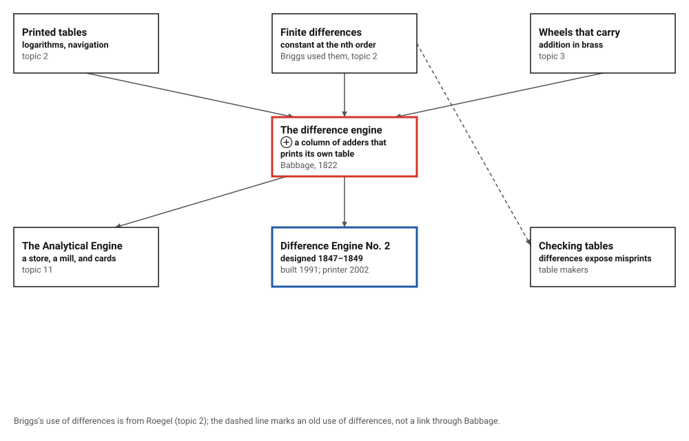
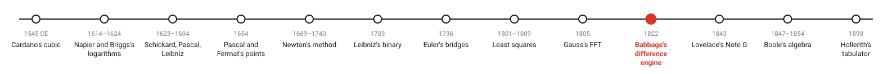
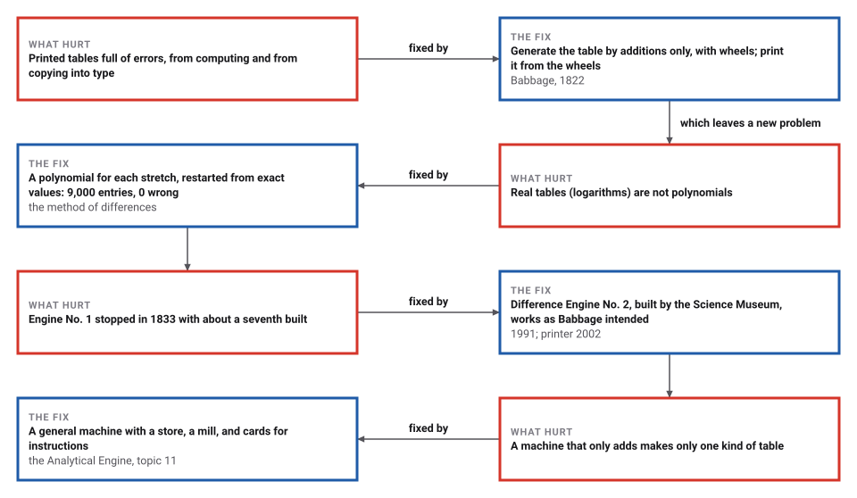
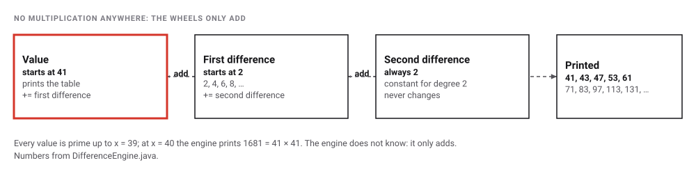

# Babbage's Difference Engine

*Era 3 · topic 10 · 1822* · [Era 3 index](../README.md) · [← Gauss's Fast Fourier Transform](../09-gauss-fft/README.md) · [Lovelace's Note G →](../11-note-g/README.md) · [Interactive edition](difference-engine.html) · [Program](../../../code/era-03-tables-and-machines/10-difference-engine/)

> **Field note from the visiting historian.** Until now every table I have recorded was computed by people and set in type by people, and errors crept in at both steps. Babbage's answer removed the people from both, and his engine was finished by others, from his drawings, in 1991.

| | |
|---|---|
| **When** | 1821–1822; Engine No. 2 designed 1847–1849, built 1991 |
| **Where** | London |
| **What hurt** | Printed tables full of errors |
| **The fix** | Constant differences: every entry by additions, printed by the machine |
| **Cost** | n additions per entry for a polynomial of degree n |

## How ideas combined

A new algorithm is usually an older idea combined with a new one. The world ran on printed tables (topic 2), whose makers had long used differences to speed and check their work; the carry had been put into wheels (topic 3). Babbage saw that the method of differences needs nothing but addition, and addition is what wheels do. Each box names the idea that was added.

<picture>
  <source media="(prefers-color-scheme: dark)" srcset="assets/family-dark.svg">
  
</picture>
*Red: the difference engine. Blue: the engine built to Babbage's later design.*

## Turn the handle

Each column holds one number: the value, then its differences. A turn of the handle adds each column into the one to its left, and the value column prints the next entry of the table. Start with Babbage's x² + x + 41 and turn past x = 40. Then try a cubic and a quartic: they need more columns, but still only additions.

<picture>
  <source media="(prefers-color-scheme: dark)" srcset="assets/model-dark.svg">
  
</picture>
*In the interactive edition you can turn the handle on three polynomials and watch the table print.*

## Era 3, tables and machines

<picture>
  <source media="(prefers-color-scheme: dark)" srcset="assets/era-timeline-dark.svg">
  
</picture>

## Each fix leaves a new pain

<picture>
  <source media="(prefers-color-scheme: dark)" srcset="assets/chain-dark.svg">
  
</picture>
*Read it as a snake: each new problem sits directly under the fix that exposed it.*

## Constant differences

List a polynomial's values at x = 0, 1, 2, …, and subtract neighbours: the first differences. Subtract again: the second differences. For a polynomial of degree n, the nth differences never change. Run the table backwards and every new value needs only n additions:

<picture>
  <source media="(prefers-color-scheme: dark)" srcset="assets/model-steps-dark.svg">
  
</picture>

Babbage's first model had two orders of difference and made "a table from the formula x² + x + 41". The program repeats it: 41, 43, 47, 53, 61, 71, 83, 97, 113, 131, …, every value checked against the formula. It also ran engines of every order up to 7 on 2,000 random polynomials, 200 values each, all exact.

**Tables that are not polynomials.** A logarithm is not a polynomial, but over a short stretch a polynomial imitates it closely. The program made a 7-place table of log₁₀ x for x = 1,000 to 9,999 with a seventh-order engine, restarting from exact values every 50 entries: 9,000 entries, **0** different from the true rounded value; the largest error before rounding was 9.2 × 10⁻¹³, using 6.9 additions per entry.

> **Key idea.** Reformulate the work so that it needs only the operation your machine does well. The method of differences turns multiplication-heavy tables into chains of additions, and then removes the person who copies the numbers into type.

## Differences catch misprints

Differences also check a finished table. The program printed x² + x + 41 for x = 0 to 11 with one entry wrong (93 instead of 83). Its third differences should all be zero; instead they read 0, 0, 0, 10, -30, 30, -10, 0, 0. The pattern 1, −3, 3, −1 times the error points straight at the bad entry.

| Degree | Engine: additions per entry | Horner's rule: multiplications and additions |
|---|---|---|
| 2 | 2 | 2 and 2 |
| 4 | 4 | 4 and 4 |
| 7 | 7 | 7 and 7 |

## By steam

Checking astronomical tables, Babbage exclaimed, "I wish to God these calculations had been executed by steam"; Herschel replied, "It is quite possible." On 14 June 1822 he announced a finished model, "limited ... to two orders of differences", that made tables "of square and triangular numbers, as well as a table from the singular x² + x + 41" (James, I Programmer). In his letter to Davy he reported thirty numbers in "two minutes and thirty seconds" and, in another trial, figures "at the rate of forty-four in a minute". Difference Engine No. 1, built with Joseph Clement, stopped in 1833 after a dispute over compensation, with about a seventh assembled.

Difference Engine No. 2 was designed in 1847–1849. The Science Museum's calculating section "was finished in 1991 in time for the bicentenary of Babbage's birth", and "the printing and stereotyping apparatus was completed in 2002": 8,000 parts, five tons. "The completed machine works as Babbage intended" (Computer History Museum). The cost of Engine No. 1 to the government, often quoted, was not found in an opened source.

## A machine finished in 1991

Babbage never saw a difference engine complete. The one in the Science Museum was built from his drawings with the tolerances of his day, to settle whether his design could have worked.

> **Full circle.** It does: designed in 1847–1849, calculating in 1991, printing in 2002. And the idea outlived the machine. Stepping a polynomial forward by additions alone is still how a computer can walk along a curve without multiplying, and differences still expose a wrong entry in a table, exactly as the program found the misprinted 93.

## Before you read on

<details>
<summary><b>1.</b> What are the first differences of 41, 43, 47, 53, 61?</summary>

2, 4, 6, 8: and their differences, 2, 2, 2, are constant.
</details>

<details>
<summary><b>2.</b> Why does a cubic need four columns?</summary>

Its third differences are constant, so the engine holds the value and three differences.
</details>

<details>
<summary><b>3.</b> Why must the logarithm engine restart every so often?</summary>

Its polynomial only imitates the logarithm over a short stretch; small errors in the differences grow with every turn.
</details>

<details>
<summary><b>4.</b> How does one misprint show in the third differences?</summary>

As the error times 1, −3, 3, −1: the binomial coefficients, centred on the bad entry.
</details>

<details>
<summary><b>5.</b> What does x² + x + 41 give at x = 40?</summary>

40² + 40 + 41 = 1681 = 41 × 41: the first value that is not prime.
</details>


## Where the evidence lives

| | Object | Where to see it | Licence |
|---|---|---|---|
| — | **Difference Engine No. 2**. Built by the Science Museum from Babbage's designs of 1847–1849: calculating section 1991, printer 2002. | [Science Museum Group](https://collection.sciencemuseumgroup.org.uk/objects/co62748) | Drawn placeholder. |

## Every link was opened before it was listed

| Level | Link | Why |
|---|---|---|
| Start | [200 Years Ago Charles Babbage Proposed His Difference Engine](https://i-programmer.info/news/82-heritage/15481-difference-engine-reported-14-june-1822.html) — Mike James, I Programmer (14 June 2022) | The note of 1822, the model, x² + x + 41, Clement, and why Engine No. 1 stopped |
| Start | [A Modern Sequel](https://www.computerhistory.org/babbage/modernsequel/) — Computer History Museum | How the Science Museum built Difference Engine No. 2 and found that it works |
| Start | [Difference Engine No. 2](https://collection.sciencemuseumgroup.org.uk/objects/co62748) — Science Museum Group collection | The machine itself, with Doron Swade's role |
| Scholar | [Letter to Sir Humphry Davy (excerpt)](https://ed-thelen.org/bab/bab-letter.html) — Babbage, 1822, from *The Works of Charles Babbage* vol. 2 (ed. Campbell-Kelly), on Ed Thelen's site | Babbage on his working model: x² + x + 41 at forty-four figures a minute |
| Scholar | [The Calculating Engine (Edinburgh Review, 1834)](https://gutenberg.org/files/71292/71292-h/71292-h.htm) — Project Gutenberg eBook 71292 | A contemporary explanation of the method of differences and of errors in printed tables |

More, with certainty labels and the gaps we could not fill: [Era 3 reference catalog](https://github.com/vij658/AlgorithmEvolutionAtlas/blob/main/book/era-03-tables-and-machines/reference-catalog.md).

## The program behind every number here

[DifferenceEngine.java](https://github.com/vij658/AlgorithmEvolutionAtlas/blob/main/code/era-03-tables-and-machines/10-difference-engine/DifferenceEngine.java) makes **411,062 checks**: every value of Babbage's x² + x + 41 to x = 50, 2,000 random polynomials of degree up to 7 for 200 values each, a 9,000-entry table of 7-place logarithms against the true rounded values, and the misprint pattern. Run it with `java DifferenceEngine.java` (JDK 17 or newer). The heart of it:

```java
    BigInteger turn() {
        for (int k = 0; k < col.length - 1; k++) { col[k] = col[k].add(col[k + 1]); additions++; }   // top first: uses the old differences
        return col[0];
    }

/** The starting column from the first n + 1 values: f(0), and the differences at 0. */
static BigInteger[] setUp(BigInteger[] firstValues) {
    int n = firstValues.length;
    BigInteger[] row = firstValues.clone(), col = new BigInteger[n];
    for (int k = 0; k < n; k++) {
        col[k] = row[0];
        BigInteger[] next = new BigInteger[row.length - 1];
        for (int i = 0; i + 1 < row.length; i++) next[i] = row[i + 1].subtract(row[i]);
        row = next;
    }
    return col;
}
```

