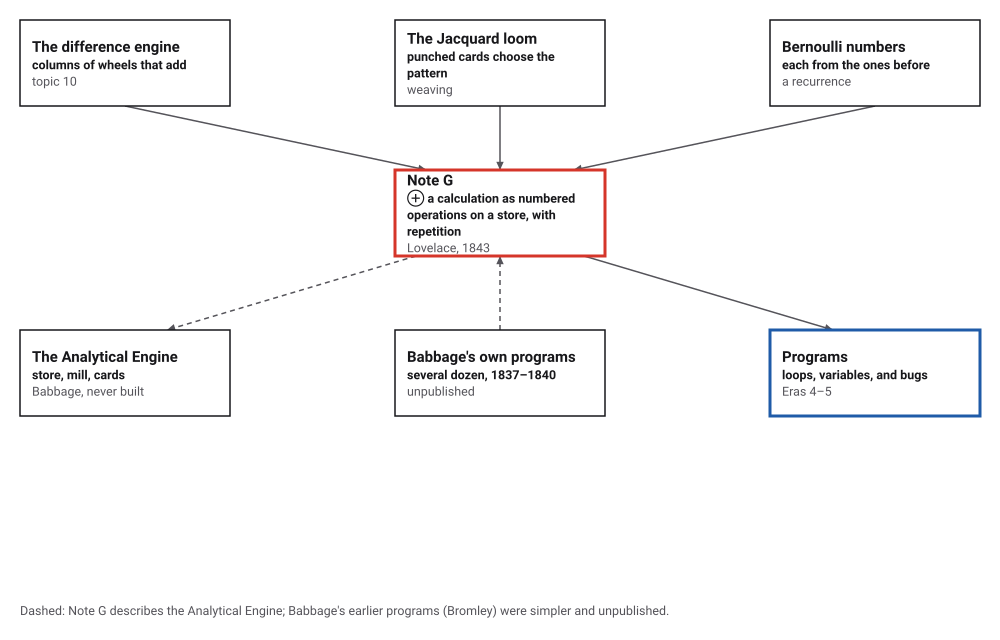
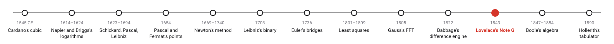
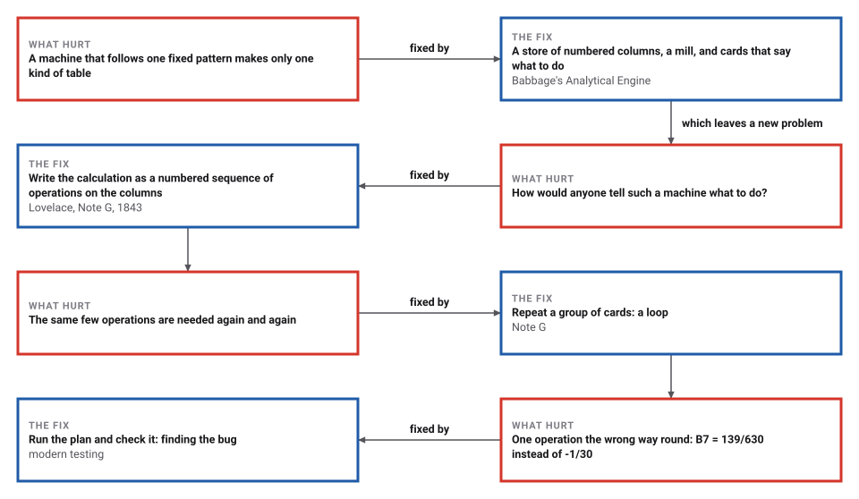
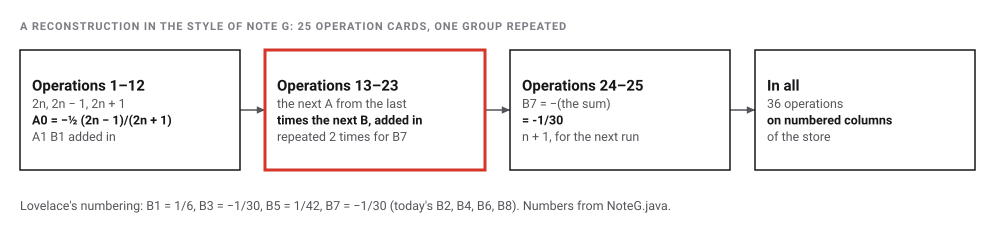

# Lovelace's Note G

*Era 3 · topic 11 · 1843* · [Era 3 index](../README.md) · [← Babbage's Difference Engine](../10-difference-engine/README.md) · [Boole's Algebra of Logic →](../12-boolean-algebra/README.md) · [Interactive edition](note-g.html) · [Program](../../../code/era-03-tables-and-machines/11-note-g/)

> **Field note from the visiting historian.** Babbage's machines carried numbers; this note carried instructions. It is the first time I have found a calculation written down not for a person to follow, but for a machine to obey, step by numbered step.

| | |
|---|---|
| **When** | Menabrea 1842; Lovelace's notes, August 1843 |
| **Where** | London |
| **What hurt** | A general machine has to be told what to do |
| **The fix** | Numbered operations on a store, with a repeated group |
| **Cost** | 36 operations for B7 |

## How ideas combined

A new algorithm is usually an older idea combined with a new one. Babbage's difference engine (topic 10) held numbers in columns of wheels; the Jacquard loom chose its pattern from punched cards; Bernoulli numbers are defined each from the ones before. Babbage's Analytical Engine combined the first two: a store of columns, a mill, and cards. Lovelace's Note G showed, step by step, what the cards would say. Each box names the idea that was added.

<picture>
  <source media="(prefers-color-scheme: dark)" srcset="assets/family-dark.svg">
  
</picture>
*Red: Note G. Blue: what it anticipates.*

## Run the cards

Twenty-five operation cards act on the numbered columns of the store, V1 to V24, in exact fractions. Press Next operation to feed one card to the mill; the shaded cards 13 to 23 repeat once for each middle term. Run to the end to get Lovelace's B7. Then tick the box to make operation 4 divide the wrong way round, as Wikipedia reports for the printed table, and run again.

<picture>
  <source media="(prefers-color-scheme: dark)" srcset="assets/plan-dark.svg">
  
</picture>
*In the interactive edition you can step through all the operations, watch the store change, and switch on the bug.*

## Era 3, tables and machines

<picture>
  <source media="(prefers-color-scheme: dark)" srcset="assets/era-timeline-dark.svg">
  
</picture>

## Each fix leaves a new pain

<picture>
  <source media="(prefers-color-scheme: dark)" srcset="assets/chain-dark.svg">
  
</picture>
*Read it as a snake: each new problem sits directly under the fix that exposed it.*

## A calculation as a list of operations

In Lovelace's numbering, B1 = 1/6, B3 = −1/30, B5 = 1/42. Each new one follows from those before by one identity: 0 = A0 + A1 B1 + A3 B3 + … + B₂ₙ₋₁, with A0 = −½ (2n − 1)/(2n + 1), A1 = 2n/2, and each later A obtained from the one before by two more factors on top and two more below. For B7, n = 4.

The calculation becomes a list of operations, each naming two columns of the store, an operation for the mill, and a column for the result. The middle terms all have the same shape, so one group of cards, repeated, computes them all. The program's 25 cards:

| Card | Operation | What it computes |
|---|---|---|
| 1 | V2 × V3 → V4 | 2n into V4 (and V5, V6) |
| 2 | V4 − V1 → V4 | 2n - 1 |
| 3 | V5 + V1 → V5 | 2n + 1 |
| 4 | V4 ÷ V5 → V11 | (2n - 1)/(2n + 1) |
| 5 | V11 ÷ V2 → V11 | half of it |
| 6 | V13 − V11 → V13 | A0 = -(1/2)(2n - 1)/(2n + 1) |
| 7 | V3 − V1 → V10 | n - 1: the count |
| 8 | V2 + V7 → V7 | 2 |
| 9 | V6 ÷ V7 → V11 | A1 = 2n/2 |
| 10 | V21 × V11 → V12 | B1 A1 |
| 11 | V12 + V13 → V13 | A0 + B1 A1 |
| 12 | V10 − V1 → V10 | count down |
| 13 | V6 − V1 → V6 | next falling factor |
| 14 | V1 + V7 → V7 | next rising factor |
| 15 | V6 ÷ V7 → V8 | their quotient |
| 16 | V8 × V11 → V11 | into A |
| 17 | V6 − V1 → V6 | next falling factor |
| 18 | V1 + V7 → V7 | next rising factor |
| 19 | V6 ÷ V7 → V9 | their quotient |
| 20 | V9 × V11 → V11 | the next A |
| 21 | V22 × V11 → V12 | B A (the B column advances each time) |
| 22 | V12 + V13 → V13 | add to the sum |
| 23 | V10 − V1 → V10 | count down |
| 24 | V0 − V13 → V24 | B_(2n-1) = -(the sum) |
| 25 | V1 + V3 → V3 | n + 1, ready for the next |

For B7 the mill executes **36** operations, the group 13–23 twice, and column V24 ends holding **-1/30**. The first steps, as the program traced them: 1: V2 x V3 -> V4 = 8; 2: V4 - V1 -> V4 = 7; 3: V5 + V1 -> V5 = 9; 4: V4 / V5 -> V11 = 7/9; 5: V11 / V2 -> V11 = 7/18; 6: V13 - V11 -> V13 = -7/18.

<picture>
  <source media="(prefers-color-scheme: dark)" srcset="assets/plan-steps-dark.svg">
  
</picture>

> **Key idea.** Separate the machine from the instructions. The same store and mill compute anything the cards describe; the description, with named storage and a repeated group, is what we now call a program.

## Feeding each answer into the next

| Lovelace's numbering | The program's value |
|---|---|
| B1 | 1/6 |
| B3 | -1/30 |
| B5 | 1/42 |
| B7 | -1/30 |
| B9 | 5/66 |
| B11 | -691/2730 |
| B13 | 7/6 |
| B15 | -3617/510 |
| B17 | 43867/798 |
| B19 | -174611/330 |

Run after run, each result is fed into the next, and every value agrees with the standard recurrence. The work grows by one pass of the group per new term: B7: 36 operations; B19: 102 operations; B39: 212 operations; all of B3 to B39 take 2,147 operations, and B39 = -261082718496449122051/13530.

**The bug.** With operation 4 dividing (2n + 1) by (2n − 1) instead, A0 for n = 4 becomes −½ · 9/7 and B7 comes out **139/630** instead of -1/30. Fed forward from B1, the errors grow: B3 = 1/2, B5 = -23/10, B7 = 1011/70, B9 = -85217/630.

## Forty-one pages of notes, signed A.A.L.

Lovelace's translation of Menabrea appeared in *Taylor's Scientific Memoirs* in August 1843: 66 pages, of which "forty-one make up her appendices", signed only "A.A.L." (Hollings, Martin and Rice). Note A says the Analytical Engine "weaves algebraical patterns just as the Jacquard-loom weaves flowers and leaves". Note G computes the eighth Bernoulli number (B₈ today, B7 in her numbering), choosing a method whose "object is not simplicity or facility of computation, but the illustration of the powers of the engine"; and it insists that "The Analytical Engine has no pretensions whatever to originate any thing."

Wikipedia reports that in operation 4 of the printed table "the division is the wrong way round" and that, run as printed, it "would fail to generate Bernoulli numbers correctly"; the program was never run in Babbage's or Lovelace's lifetime. Is it "the first computer program"? Hollings, Martin and Rice call the table an execution trace, the program proper being the card decks, and Bromley found "several dozen sample programs prepared by Babbage between 1837 and 1840" (**disputed**). The table itself could not be read in an opened copy, so the 25 cards on this page are this book's reconstruction in its style, not a transcription.

## Variables, loops, and a bug

Every element of the plan has a name now: the numbered columns are variables, the repeated group is a loop with a counter (V10), the cards are instructions, and the wrong-way division is a bug.

> **Full circle.** The bug was found the modern way: by running the plan. The program on this page runs the corrected cards to -1/30 and the reversed ones to 139/630. Lovelace wrote her plan for a machine that was never built; it took machines of the kind she imagined to test it.

## Before you read on

<details>
<summary><b>1.</b> Why is a Bernoulli number a good test for an engine?</summary>

Each is defined from the ones before by a fixed rule, so the same operations repeat, and the answer can be checked.
</details>

<details>
<summary><b>2.</b> What is A0 for n = 4?</summary>

−½ × 7/9 = −7/18.
</details>

<details>
<summary><b>3.</b> Why do cards 13–23 repeat?</summary>

Each middle term A B has the same shape: two new factors into A, times the next B, added to the sum.
</details>

<details>
<summary><b>4.</b> What does the wrong-way division change?</summary>

It replaces 7/9 by 9/7 in A0, so the sum and every later B is wrong.
</details>

<details>
<summary><b>5.</b> Is Note G the first program?</summary>

It is the first such plan to be published; Babbage had written simpler, unpublished ones from 1837, and historians disagree on what counts.
</details>


## Where the evidence lives

| | Object | Where to see it | Licence |
|---|---|---|---|
| — | **Sketch of the Analytical Engine, with notes by the translator**. Menabrea's paper and Lovelace's notes A to G (London, 1843), as a Project Gutenberg text. | [Project Gutenberg](https://gutenberg.org/files/75107/75107-src/75107-src.htm) | Drawn placeholder. |

## Every link was opened before it was listed

| Level | Link | Why |
|---|---|---|
| Start | [Note G](https://en.wikipedia.org/wiki/Note_G) — Wikipedia | What the table computes, the bug in operation 4, and the "first program" debate |
| Start | [Ada Lovelace](https://mathshistory.st-andrews.ac.uk/SH/lovelace_sh.pdf) — MacTutor (illustrated poster) | Her life and the 1843 translation in one page |
| Deeper | [Ada Lovelace and the Analytical Engine](https://blogs.bodleian.ox.ac.uk/adalovelace/2018/07/26/ada-lovelace-and-the-analytical-engine/) — Christopher Hollings, Ursula Martin and Adrian Rice, Bodleian Libraries (2018) | The historians who studied her papers: the notes, the loops, the execution trace, and music |
| Scholar | [Sketch of the Analytical Engine, with notes by the translator](https://gutenberg.org/files/75107/75107-src/75107-src.htm) — L. F. Menabrea, trans. with notes by A.A.L. (London, 1843), Project Gutenberg | The paper and the notes, including the Jacquard sentence (the copy opened was cut off before Note G's table) |

More, with certainty labels and the gaps we could not fill: [Era 3 reference catalog](https://github.com/vij658/AlgorithmEvolutionAtlas/blob/main/book/era-03-tables-and-machines/reference-catalog.md).

## The program behind every number here

[NoteG.java](https://github.com/vij658/AlgorithmEvolutionAtlas/blob/main/code/era-03-tables-and-machines/11-note-g/NoteG.java) makes **50 checks**: Lovelace's B7 from 25 operation cards in exact fractions, B1 to B39 fed run to run against the standard recurrence, the operation count 14 + 11(n − 2) for every run, and the wrong-way division of operation 4. Run it with `java NoteG.java` (JDK 17 or newer). The heart of it:

```java
/** Run the program for n, given the earlier Bernoulli numbers B1, B3, ... (Lovelace's numbering). */
static Q run(int n, List<Q> earlier, boolean bug, List<String> trace) {
    Map<Integer, Q> V = new HashMap<>();
    V.put(0, Q.of(0)); V.put(1, Q.of(1)); V.put(2, Q.of(2)); V.put(3, Q.of(n));
    for (int c : new int[]{4, 5, 6, 7, 8, 9, 10, 11, 12, 13, 24}) V.put(c, Q.of(0));
    int bIndex = 1;                                             // the first middle term uses B3
    V.put(21, earlier.get(0));
    int pc = 0;
    while (pc < PROGRAM.length) {
        Op op = PROGRAM[pc];
        int a = op.a(), b = op.b();
        if (op.num() == 4 && bug) { int t = a; a = b; b = t; }     // the printed table divides the wrong way round
        if (op.num() == 21) V.put(22, earlier.get(bIndex));
        Q x = V.get(a), y = V.get(b), r = switch (op.kind()) {
            case '+' -> x.add(y); case '-' -> x.sub(y); case 'x' -> x.mul(y); default -> x.div(y);
        };
        if (op.num() == 1) { V.put(4, r); V.put(5, r); V.put(6, r); } else V.put(op.dest(), r);
        executed++;
        if (trace != null) trace.add(String.format("%d: V%d %c V%d -> V%d = %s", op.num(), a, op.kind(), b, op.dest(), V.get(op.dest() == 4 && op.num() == 1 ? 4 : op.dest())));
        if (op.num() == 12) {                                       // enter the repeated group only if a middle term remains
            if (V.get(10).n().signum() == 0) { pc = 23; continue; }
        }
        if (op.num() == 21) bIndex++;
        if (op.num() == 23) {                                       // repeat operations 13-23 while the count is not 0
            if (V.get(10).n().signum() != 0) { pc = 12; continue; }
        }
        pc++;
    }
    return V.get(24);
}
```

