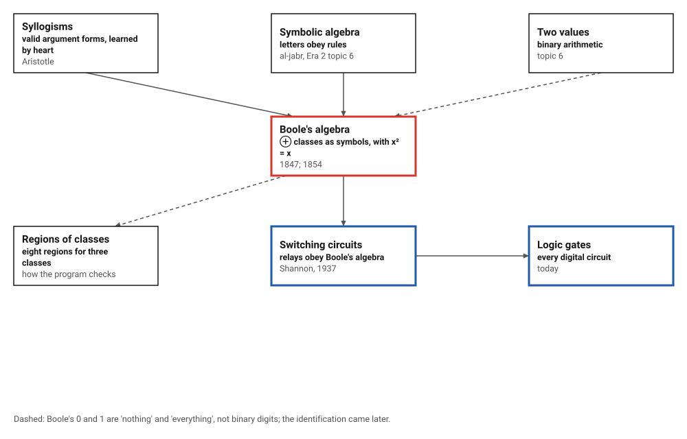
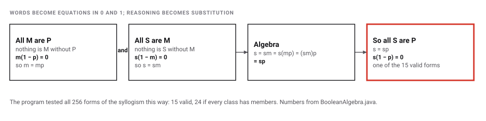
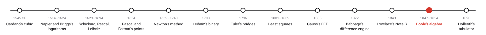
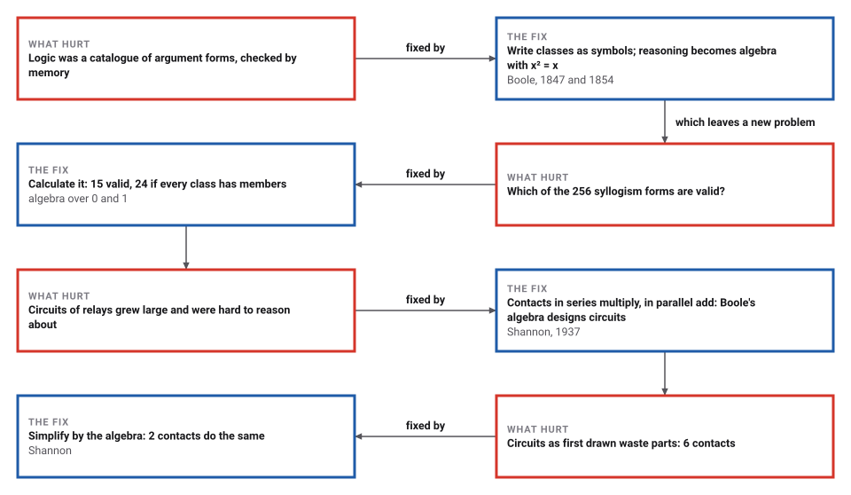

# Boole's Algebra of Logic

*Era 3 · topic 12 · 1847–1854* · [Era 3 index](../README.md) · [← Lovelace's Note G](../11-note-g/README.md) · [Hollerith's Tabulator →](../13-hollerith-tabulator/README.md) · [Interactive edition](boolean-algebra.html) · [Program](../../../code/era-03-tables-and-machines/12-boolean-algebra/)

> **Field note from the visiting historian.** For two thousand years, valid arguments were a list to be memorised. In Lincoln I found a man who turned the list into algebra, so that the valid forms could be calculated rather than remembered. A student later found the same algebra in a box of relays.

| | |
|---|---|
| **When** | 1847 and 1854; Shannon 1937 |
| **Where** | Lincoln and Cork; Shannon at MIT |
| **What hurt** | Logic as a catalogue of syllogisms |
| **The fix** | Classes as symbols, with x² = x: an algebra of 0 and 1 |
| **Cost** | Substitution and multiplication instead of memory |

## How ideas combined

A new algorithm is usually an older idea combined with a new one. Logic since Aristotle was a list of valid argument forms; algebra since al-Khwarizmi (Era 2, topic 6) let letters obey rules. Boole wrote logic in letters, found the one rule that sets it apart from arithmetic, x² = x, and turned reasoning into calculation. Each box names the idea that was added.

<picture>
  <source media="(prefers-color-scheme: dark)" srcset="assets/family-dark.svg">
  
</picture>
*Red: Boole's algebra. Blue: where it went in the twentieth century.*

## Check a syllogism by algebra

Choose two premises and a conclusion. Each becomes one of Boole's equations (blue). The page then checks every way the eight regions of three classes can be filled: if some way makes both premises true and the conclusion false, it shows it in red. The starting form is the classic "All M are P; all S are M; so all S are P".

<picture>
  <source media="(prefers-color-scheme: dark)" srcset="assets/barbara-dark.svg">
  
</picture>
*In the interactive edition you can build any of the 256 syllogism forms and see whether it is valid, with a counterexample when it is not.*

## Era 3, tables and machines

<picture>
  <source media="(prefers-color-scheme: dark)" srcset="assets/era-timeline-dark.svg">
  
</picture>

## Each fix leaves a new pain

<picture>
  <source media="(prefers-color-scheme: dark)" srcset="assets/chain-dark.svg">
  
</picture>
*Read it as a snake: each new problem sits directly under the fix that exposed it.*

## An algebra of 0 and 1

Let x stand for a class (men) and xy for the things in both x and y (mortal men). Selecting men from men gives men, so xx = x. Boole: "x² = x" is "the expression of a second general law" of these symbols, and "the equation x² = x, considered as algebraic, has no other roots than 0 and 1". The program checked: among the whole numbers from −1,000 to 1,000 only 0 and 1 satisfy it, and none of 155,464 fractions does.

So the symbols behave like numbers that are only 0 (nothing) or 1 (everything); 1 − x means "not x", and x(1 − x) = 0: nothing is both x and not x. "All x are y" says nothing is x without y: x(1 − y) = 0. Then a syllogism is substitution:

<picture>
  <source media="(prefers-color-scheme: dark)" srcset="assets/barbara-steps-dark.svg">
  
</picture>

Boole also showed that any expression can be expanded as f(x) = f(1) x + f(0)(1 − x), a truth table written as one formula. The program checked the expansion for all 16 functions of two variables and all 256 of three.

> **Key idea.** Find the algebra that a subject obeys, and its reasoning becomes calculation. For logic the algebra is that of 0 and 1, with the single extra law x² = x.

## All 256 syllogisms, and two circuits

| Test | Result |
|---|---|
| All 256 syllogism forms (4 figures × 4³ moods), against every way three classes can share members | 15 valid |
| The same, if every class is assumed to have members | 24 valid |
| A full adder written in Boole's algebra | correct on all 8 inputs |
| Sixteen of them chained | 200,000 random 16-bit additions, all correct |
| xy + x(1 − y) + (1 − x)y, as relay contacts | 6 contacts; simplified to x + y − xy: 2 |
| Majority of three, xy + xz + yz | 6 contacts; factored as x(y + z) + yz: 5 |

Which syllogisms are valid had been a matter of memorised lists for two thousand years. With Boole's algebra a program can simply check every form against every possibility.

## From a schoolroom in Lincoln to Cork

Boole was born on 2 November 1815 in Lincoln and died on 8 December 1864 near Cork; in August 1849 he was announced as "the first Professor of Mathematics at Queen's College, Cork" (MacTutor). *The Mathematical Analysis of Logic* (1847) was subtitled "a calculus of deductive reasoning"; *An Investigation of the Laws of Thought* (1854), his "greatest work" (Lynch), "approached logic in a new way reducing it to a simple algebra" (MacTutor). What prompted the 1847 book is often said to be the dispute between De Morgan and Hamilton, but the opened sources do not say so (**conjecture**).

Shannon's MIT thesis (signed 10 August 1937, published 1938) showed that Boolean algebra "could be used to simplify the arrangement of the relays", and that "This calculus is shown to be exactly analogous to the Calculus of Propositions used in the symbolic study of logic". Goldstine called it "surely ... one of the most important master's theses ever written"; Gardner "possibly the most important, and also the most famous, master's thesis of the century".

## Thought, then circuits

Boole called his book the laws of thought. Eighty-three years later, a student noticed that a relay contact obeys the same laws: closed is 1, open is 0, contacts in series multiply, contacts in parallel add.

> **Full circle.** The program wrote an adder in nothing but Boole's algebra, chained sixteen copies and added 200,000 random pairs of 16-bit numbers without an error: binary arithmetic (topic 6) with the carry of Pascal's wheels (topic 3), built from the laws of thought. Digital circuits are still designed in this algebra.

## Before you read on

<details>
<summary><b>1.</b> Why is xx = x for classes?</summary>

Selecting the men from the class of men gives the class of men again.
</details>

<details>
<summary><b>2.</b> Write "No x are y" as an equation.</summary>

xy = 0: nothing is in both.
</details>

<details>
<summary><b>3.</b> What does x(1 − x) = 0 say?</summary>

Nothing is both x and not x: the principle of contradiction, as algebra.
</details>

<details>
<summary><b>4.</b> Why are there 256 syllogism forms?</summary>

Each of the three statements is one of four types (4³ = 64 moods), and the middle term can sit in four arrangements (figures): 64 × 4 = 256.
</details>

<details>
<summary><b>5.</b> Why does a parallel pair of contacts compute x + y − xy?</summary>

Current flows if either is closed; when both are closed, x + y would count 2, so subtract xy.
</details>


## Where the evidence lives

| | Object | Where to see it | Licence |
|---|---|---|---|
| — | **An Investigation of the Laws of Thought (1854)**. Boole's book, public domain, as Project Gutenberg eBook 15114. | [Project Gutenberg](https://www.gutenberg.org/etext/15114) | Drawn placeholder. |
| — | **A Symbolic Analysis of Relay and Switching Circuits**. Claude Shannon's MIT master's thesis, signed 10 August 1937. | [MIT DSpace](https://dspace.mit.edu/bitstream/handle/1721.1/11173/34541425.pdf%20?sequence=1) | Drawn placeholder. |

## Every link was opened before it was listed

| Level | Link | Why |
|---|---|---|
| Start | [George Boole](https://mathshistory.st-andrews.ac.uk/Biographies/Boole/) — MacTutor | His life from Lincoln to Cork, and the two books |
| Start | [A Symbolic Analysis of Relay and Switching Circuits](https://en.wikipedia.org/wiki/A_Symbolic_Analysis_of_Relay_and_Switching_Circuits) — Wikipedia | How Shannon turned Boole's algebra into circuit design |
| Deeper | [The Life and Work of George Boole (review)](https://www.maths.tcd.ie/pub/ims/bull74/Lynch2.pdf) — Peter Lynch, *Irish Mathematical Society Bulletin* 74:97–101 (2014) | A short guide to MacHale's biography and to why Boole matters |
| Scholar | [An Investigation of the Laws of Thought (1854)](https://www.gutenberg.org/etext/15114) — George Boole, Project Gutenberg eBook 15114 (public domain; [PDF](https://www.gutenberg.org/files/15114/15114-pdf.pdf)) | The book: x² = x, and logic as an algebra of 0 and 1 |
| Scholar | [A Symbolic Analysis of Relay and Switching Circuits](https://dspace.mit.edu/bitstream/handle/1721.1/11173/34541425.pdf%20?sequence=1) — Claude E. Shannon, MIT master's thesis (signed 10 August 1937; degree listed 1940), MIT DSpace | "This calculus is shown to be exactly analogous to the Calculus of Propositions used in the symbolic study of logic" |

More, with certainty labels and the gaps we could not fill: [Era 3 reference catalog](https://github.com/vij658/AlgorithmEvolutionAtlas/blob/main/book/era-03-tables-and-machines/reference-catalog.md).

## The program behind every number here

[BooleanAlgebra.java](https://github.com/vij658/AlgorithmEvolutionAtlas/blob/main/code/era-03-tables-and-machines/12-boolean-algebra/BooleanAlgebra.java) makes **357,599 checks**: that only 0 and 1 satisfy x² = x, Boole's expansion on every function of two and three variables, all 256 syllogism forms against all 256 ways three classes can share members, a full adder and 200,000 16-bit additions, and two circuit simplifications. Run it with `java BooleanAlgebra.java` (JDK 17 or newer). The heart of it:

```java
/** Is "X are Y" of the given type true? type: A all, E no, I some, O some not. x, y are 0 = S, 1 = M, 2 = P. */
static boolean holds(int world, char type, int x, int y) {
    boolean someXY = false, someXnotY = false;
    for (int r = 0; r < 8; r++) {
        if (((world >> r) & 1) == 0) continue;
        int[] bits = {(r >> 2) & 1, (r >> 1) & 1, r & 1};    // s, m, p
        if (bits[x] == 1 && bits[y] == 1) someXY = true;
        if (bits[x] == 1 && bits[y] == 0) someXnotY = true;
    }
    return switch (type) {
        case 'A' -> !someXnotY;                              // x(1 - y) = 0
        case 'E' -> !someXY;                                 // xy = 0
        case 'I' -> someXY;                                  // xy is not 0
        default -> someXnotY;                                // x(1 - y) is not 0
    };
}
```

