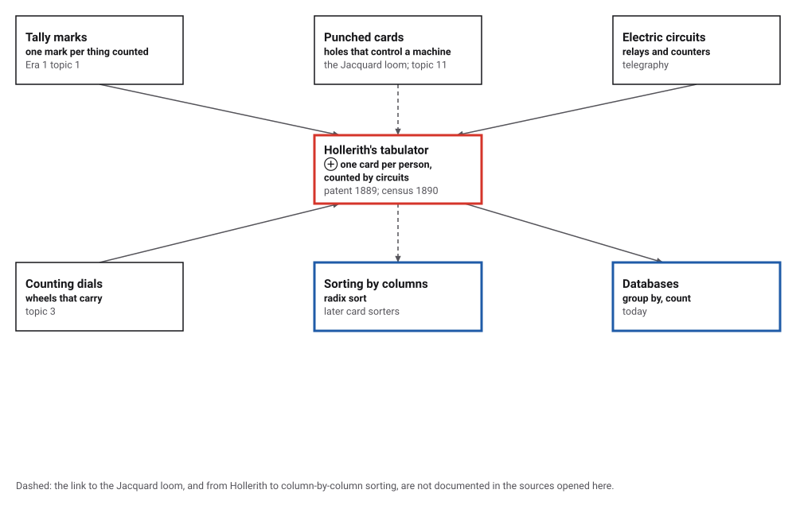
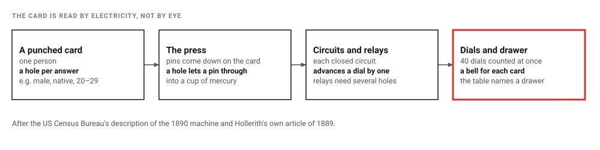
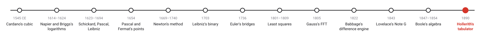
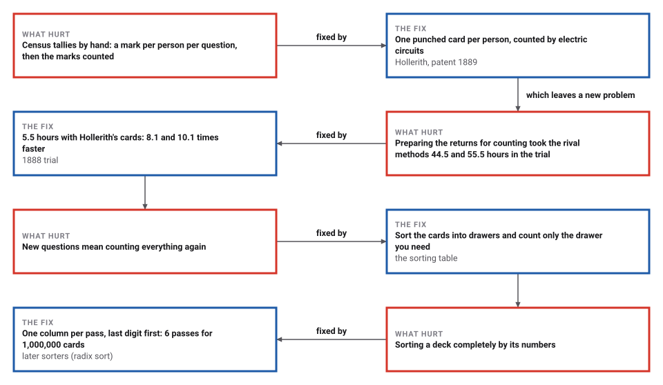

# Hollerith's Tabulator

*Era 3 · topic 13 · 1890* · [Era 3 index](../README.md) · [← Boole's Algebra of Logic](../12-boolean-algebra/README.md) · [Interactive edition](hollerith-tabulator.html) · [Program](../../../code/era-03-tables-and-machines/13-hollerith-tabulator/)

> **Field note from the visiting historian.** My first entry in this record was a tally mark on a bone. Here, at the end of the third era, the tally marks have become holes in cards, read by electricity, and the cards can be counted again for questions nobody thought of when they were punched.

| | |
|---|---|
| **When** | Patent issued 8 January 1889; trial 1888; census of 1890 |
| **Where** | New York and Washington |
| **What hurt** | Census tallies took years |
| **The fix** | One punched card per person, counted by circuits and sorted into drawers |
| **Cost** | One pass of the cards per set of questions; 80 cards a minute |

## How ideas combined

A new algorithm is usually an older idea combined with a new one. The census clerks of 1880 still counted by tally marks (Era 1, topic 1). Cards with holes had controlled looms, and were to control Babbage's engine (topic 11); counting dials went back to Pascal (topic 3); electric circuits and relays were everyday telegraph technology. Hollerith put a person on a card and let electricity read it. Each box names the idea that was added.

<picture>
  <source media="(prefers-color-scheme: dark)" srcset="assets/family-dark.svg">
  
</picture>
*Red: Hollerith's tabulator. Blue: where counting and sorting cards led.*

## Punch a card, feed the press

Choose one person's answers on the card, then feed it: the dial for that combination of sex, birthplace and age group moves on by one, as a relay closes only when all three holes are present. Feed a hundred random cards to fill the dials faster.

<picture>
  <source media="(prefers-color-scheme: dark)" srcset="assets/press-dark.svg">
  
</picture>
*In the interactive edition you can punch cards and feed them to forty combination dials.*

## Era 3, tables and machines

<picture>
  <source media="(prefers-color-scheme: dark)" srcset="assets/era-timeline-dark.svg">
  
</picture>

## Each fix leaves a new pain

<picture>
  <source media="(prefers-color-scheme: dark)" srcset="assets/chain-dark.svg">
  
</picture>
*Read it as a snake: each new problem sits directly under the fix that exposed it.*

## A person on a card

By hand, a census clerk made a tally mark in a small square for every person and every property, then added and counted the marks. Hollerith punched each person's answers as holes in one card instead. In the press, "Pins that passed through the punch card completed an electrical circuit when contacting the mercury below", advancing one of 40 dials (US Census Bureau).

<picture>
  <source media="(prefers-color-scheme: dark)" srcset="assets/press-steps-dark.svg">
  
</picture>

The program punched an invented population of 1,000,000 people. By hand, 5 questions mean 5,000,000 tally marks, each later counted again. The tabulator reads each card once and fills every question's dials in the same pass: males 500,038, females 499,962; native 849,597, foreign-born 150,403.

Relays count combinations. With 2 sexes × 2 birthplaces × 10 age groups = 40 dials, as many as the 1890 machine had, one pass gives, for example, 72,734 native males aged 20 to 29 and 4,164 foreign-born females aged 60 to 69. Counting each combination separately would read 40,000,000 cards instead of 1,000,000.

**Sorting.** After a card is read, the sorting table names a drawer. Dropping the cards by region gives drawers of 166,978, 166,655, 166,785, 166,393, 166,527, 166,662; one drawer can then be counted again for a new question, without punching anything. Sorting the whole deck by card number, one digit column per pass and the last digit first, needs 6 passes (6,000,000 card handlings) for 1,000,000 cards.

> **Key idea.** Record each case once, in a form a machine can read, and let the machine count it as many ways as you like. The data, not the tally, becomes the thing that is kept.

## The 1888 trial in hours

| 1880 returns from four areas of St Louis | Rival 1 | Rival 2 | Hollerith | Hollerith faster by |
|---|---|---|---|---|
| Capturing the data (hours) | 144.5 | 100.5 | 72.5 | 2.0× and 1.4× |
| Preparing it for tabulation (hours) | 44.5 | 55.5 | 5.5 | 8.1× and 10.1× |

The hours are the Census Bureau's; the ratios are the program's. Capturing the data was about twice as fast, preparing it for tabulation eight to ten times. At the documented rate of 80 cards a minute, one clerk would feed the program's 1,000,000 cards in 12,500 minutes, about 208 hours, per pass.

| Sorting 1,000,000 cards by a 6-digit number | Work |
|---|---|
| Column by column, last digit first | 6 passes, 6,000,000 card handlings |
| A comparison sort | about 19,931,569 comparisons |

## Tally marks in small squares

Hollerith described hand tabulation as "making tally-marks in small squares and then adding and counting such tally-marks", and warned that without new methods the next census would be "impossible" "on account of the time and expense involved"; records become machine-readable by "punching holes in cards or strips of paper, which perforations can then be used to control circuits" (*An Electric Tabulating System*, April 1889). His patent, US 395,782, issued on 8 January 1889, claims "recording separate statistical items pertaining to the individual by holes or combinations of holes punched in sheets".

The Census Bureau's history page gives the 1888 trial hours, the mercury cups, the 40 dials, the bell and the sorting table, and "An experienced clerk could process 80 cards per minute". Columbia's history says the machines "reduced a ten-year job to three months" and saved "five million dollars", while noting that other sources give different timeframes (**disputed**). The work earned Hollerith a Columbia PhD in 1890. Column-by-column sorting machines came later and are not covered by the opened sources (**conjecture** as a direct descendant).

## Group by, count

A tabulator pass is what a database calls a group-by with a count: read every record once, and add one to the counter for its combination of values.

> **Full circle.** The program counted its cards once more as a modern group-by on sex and birthplace: female foreign-born 75,284, female native 424,678, male foreign-born 75,119, male native 424,919, exactly the totals of the dials. The tally marks of the first era became holes, the holes became bits, and counting became a query.

## Before you read on

<details>
<summary><b>1.</b> How does the press know where the holes are?</summary>

Where there is a hole, a pin passes through into mercury and closes a circuit; where there is none, the card stops the pin.
</details>

<details>
<summary><b>2.</b> How can one pass count "native males aged 20 to 29"?</summary>

A relay closes only when the holes for male, native and 20–29 are all present, so that combination's dial moves only for such cards.
</details>

<details>
<summary><b>3.</b> Why is sorting into drawers useful?</summary>

A drawer can be counted again for a new question, without punching or reading the rest of the deck.
</details>

<details>
<summary><b>4.</b> Why sort by the last digit first?</summary>

Each pass keeps the order of the previous one within each pocket, so after the last pass (the first digit) the whole number is in order.
</details>

<details>
<summary><b>5.</b> How many passes to sort cards numbered up to 999,999?</summary>

One per digit: 6.
</details>


## Where the evidence lives

| | Object | Where to see it | Licence |
|---|---|---|---|
| — | **An Electric Tabulating System (1889)**. Hollerith's own account in Columbia's School of Mines Quarterly: the problem, the cards, the circuits and the sorting box. | [Columbia University](https://columbia.edu/cu/computinghistory/hh/index.html) | Drawn placeholder. |
| — | **US patent 395,782: Art of compiling statistics**. Issued 8 January 1889: holes for statistical items, counted by electric circuits. | [Google Patents](https://patents.google.com/patent/US395782) | Drawn placeholder. |

## Every link was opened before it was listed

| Level | Link | Why |
|---|---|---|
| Start | [The Hollerith Machine](https://www.census.gov/about/history/bureau-history/census-innovations/technology/hollerith-machine.html) — US Census Bureau history | The 1888 trial in hours, the mercury cups, the 40 dials and the sorting table |
| Start | [Herman Hollerith](https://columbia.edu/cu/computinghistory/hollerith.html) — Frank da Cruz, Columbia University Computing History (2001, updated 2023) | His life, the patent, the PhD and the 1890 census |
| Scholar | [An Electric Tabulating System](https://columbia.edu/cu/computinghistory/hh/index.html) — Herman Hollerith, *School of Mines Quarterly* X(16):238–255 (April 1889), reproduced by Columbia University | His own description: the problem, the cards, the circuits and the sorting box |
| Scholar | [US 395,782: Art of compiling statistics](https://patents.google.com/patent/US395782) — Herman Hollerith, US patent issued 8 January 1889, Google Patents | The claims: holes for statistical items, counted by electric circuits |

More, with certainty labels and the gaps we could not fill: [Era 3 reference catalog](https://github.com/vij658/AlgorithmEvolutionAtlas/blob/main/book/era-03-tables-and-machines/reference-catalog.md).

## The program behind every number here

[HollerithTabulator.java](https://github.com/vij658/AlgorithmEvolutionAtlas/blob/main/code/era-03-tables-and-machines/13-hollerith-tabulator/HollerithTabulator.java) makes **1,000,052 checks**: every card counted once per question, the 40 relay combinations against separate counts, a drawer recounted, a million shuffled cards sorted by six column passes, and the dials against a group-by. The population is invented test data. Run it with `java HollerithTabulator.java` (JDK 17 or newer). The heart of it:

```java
/** A card: the punched positions, one per field. */
record Card(int sex, int nativity, int age, int region, int occupation, int serial) {}
```

