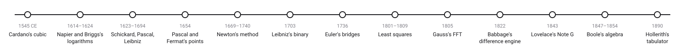
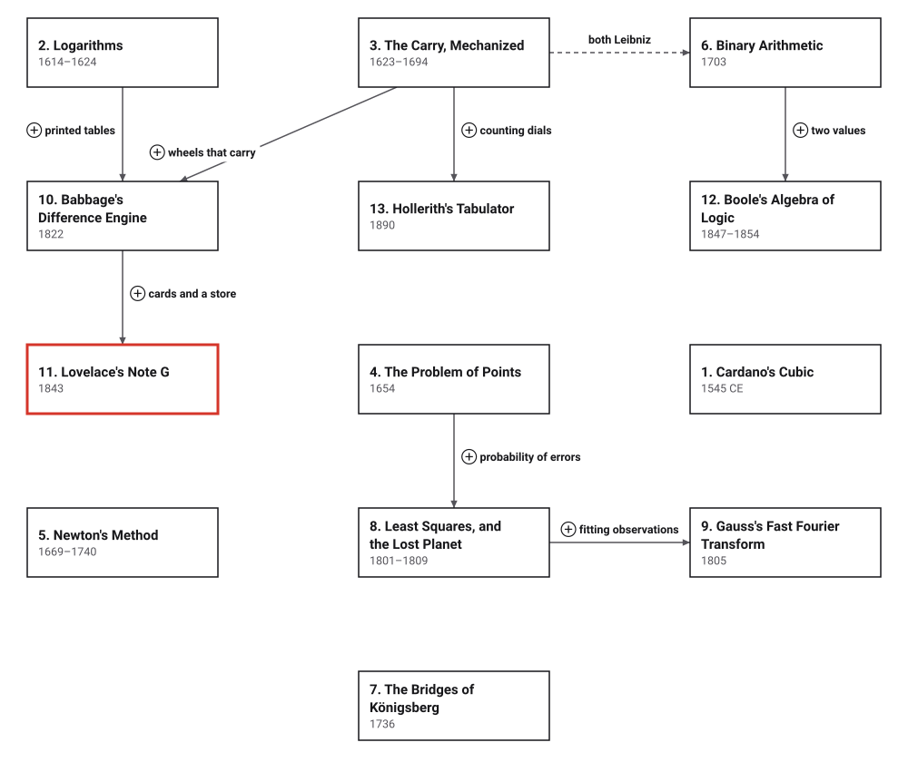

# Era 3 — Tables and Machines

*1545 to 1890 CE* · [Book contents](../README.md) · [Interactive edition](index.html) · [Reference catalog](reference-catalog.md) · [Programs](../../code/era-03-tables-and-machines/README.md)

> **Field note from the visiting historian.** In the second era, procedures travelled. In this one they are made to run without a thinking person: printed as tables, built into wheels, turned into rules that correct themselves, and at last written as instructions for a machine.

## When

<picture>
  <source media="(prefers-color-scheme: dark)" srcset="assets/era-timeline-dark.svg">
  
</picture>

## How the ideas combined

<picture>
  <source media="(prefers-color-scheme: dark)" srcset="assets/era-map-dark.svg">
  
</picture>

*An arrow means the later development reuses the earlier idea; it is not a claim that one inventor learned from the other. The dashed line joins two developments by the same person. Boxes without arrows build on earlier eras: Cardano on al-jabr, Newton on digit-by-digit roots, Euler on nothing but counting.*

## The topics

| # | Topic | When | What hurt | Read |
|---|---|---|---|---|
| 1 | **Cardano's Cubic** | Tartaglia 1535; *Ars Magna* 1545; Bombelli 1572 | Cubic equations had no general method | [page](01-cardanos-cubic/README.md) · [interactive](01-cardanos-cubic/cardanos-cubic.html) · [program](../../code/era-03-tables-and-machines/01-cardanos-cubic/README.md) |
| 2 | **Logarithms** | Napier 1614; Briggs 1617, 1624 | Long multiplications for astronomy and navigation | [page](02-logarithms/README.md) · [interactive](02-logarithms/logarithms.html) · [program](../../code/era-03-tables-and-machines/02-logarithms/README.md) |
| 3 | **The Carry, Mechanized** | Schickard 1623; Pascal 1642–1645; Leibniz 1673–1694 | Columns of addition, and every carry by hand | [page](03-mechanical-carry/README.md) · [interactive](03-mechanical-carry/mechanical-carry.html) · [program](../../code/era-03-tables-and-machines/03-mechanical-carry/README.md) |
| 4 | **The Problem of Points** | Pascal and Fermat, 1654 | No fair rule for a game stopped early | [page](04-problem-of-points/README.md) · [interactive](04-problem-of-points/problem-of-points.html) · [program](../../code/era-03-tables-and-machines/04-problem-of-points/README.md) |
| 5 | **Newton's Method** | Newton 1669; Raphson 1690; Simpson 1740 | Formulas stop at degree four, and digit-by-digit roots are slow | [page](05-newtons-method/README.md) · [interactive](05-newtons-method/newtons-method.html) · [program](../../code/era-03-tables-and-machines/05-newtons-method/README.md) |
| 6 | **Binary Arithmetic** | Harriot c. 1601–1605 (unpublished); Leibniz 1703 | Base-ten arithmetic needs memorised tables | [page](06-binary-arithmetic/README.md) · [interactive](06-binary-arithmetic/binary-arithmetic.html) · [program](../../code/era-03-tables-and-machines/06-binary-arithmetic/README.md) |
| 7 | **The Bridges of Königsberg** | Euler 1736 (printed 1741); Hierholzer 1873 | A route question with too many cases to try | planned · [references](reference-catalog.md#7-the-bridges-of-königsberg) |
| 8 | **Least Squares, and the Lost Planet** | Ceres 1801; Legendre 1805; Gauss 1809 | More observations than unknowns, and they disagree | planned · [references](reference-catalog.md#8-least-squares-and-the-lost-planet) |
| 9 | **Gauss's Fast Fourier Transform** | Gauss 1805 (printed 1866); Cooley and Tukey 1965 | A periodic fit from N observations costs N² products | planned · [references](reference-catalog.md#9-gausss-fast-fourier-transform-160-years-early) |
| 10 | **Babbage's Difference Engine** | 1822; No. 2 built 1991 | Printed tables full of errors | planned · [references](reference-catalog.md#10-babbages-difference-engine) |
| 11 | **Lovelace's Note G** | 1843 | A general machine has to be told what to do | planned · [references](reference-catalog.md#11-lovelaces-note-g) |
| 12 | **Boole's Algebra of Logic** | 1847, 1854; Shannon 1937 | Logic as a catalogue of syllogisms | planned · [references](reference-catalog.md#12-booles-algebra-of-logic) |
| 13 | **Hollerith's Tabulator** | Patent 1889; census of 1890 | Census tallies took years | planned · [references](reference-catalog.md#13-holleriths-tabulator) |

The interactive edition is a single HTML file per topic: download it and open it in a browser, or use the published copy linked from the [book contents](../README.md).
