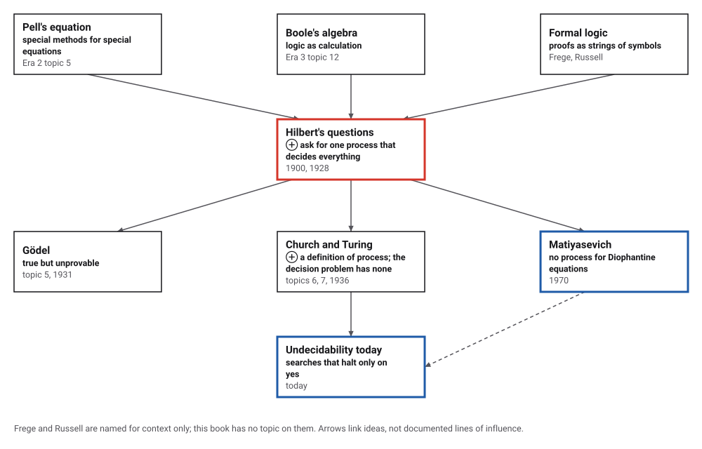
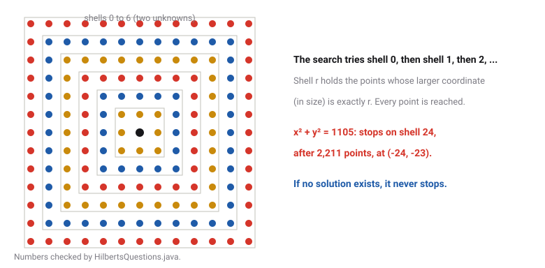
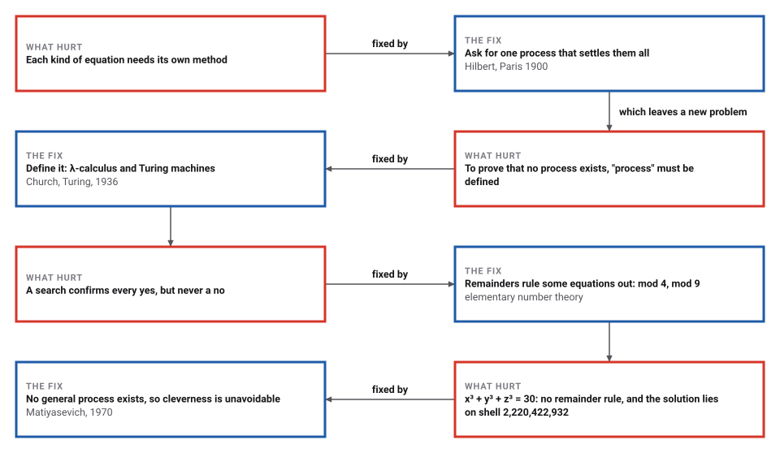

# Hilbert's Questions

*Era 4 · topic 1 · 1900–1928* · [Era 4 index](../README.md) · [Runge–Kutta →](../02-runge-kutta/README.md) · [Interactive edition](hilberts-questions.html) · [Program](../../../code/era-04-what-can-be-computed/01-hilberts-questions/)

> **Field note from the visiting historian.** He was certain the process existed: in mathematics, he said, there is no ignorabimus, nothing we shall not know. The search I ran for x³ + y³ + z³ = 30 found nothing in 64,481,201 tries, though an answer exists. Whether one exists for 114, nobody on this planet knows.

| | |
|---|---|
| **When** | Paris 1900; Hilbert and Ackermann 1928 |
| **Where** | Paris and Göttingen |
| **What hurt** | Each kind of equation needed its own method |
| **The fix** | Ask for one process that decides them all |
| **Answer** | No such process exists (1936 for logic, 1970 for equations) |

## How ideas combined

A new algorithm is usually an older idea combined with a new one. Here the new idea is a question. Earlier eras invented a method for each kind of problem: Pell's equation (Era 2, topic 5), roots of polynomials (Era 2, topic 9), logic as algebra (Era 3, topic 12). In 1900 Hilbert asked for one process that decides every equation of a kind, and in 1928, with Ackermann, for one that decides every statement of logic. Each box names the idea that was added.

<picture>
  <source media="(prefers-color-scheme: dark)" srcset="assets/family-dark.svg">
  
</picture>
*Red: Hilbert's questions. Blue: the negative answers and what they mean today.*

## Search for a solution, or prove there is none

Pick an equation. The page first tries remainders: if the left side can never leave the same remainder as n for some divisor m up to 60, there is no solution, and no search is needed. Otherwise it searches outward, shell by shell, as the program does, and stops at the first solution. Try 1103 (impossible), 29 (quick), 30 or 42 (solutions exist, far out of reach) and 114 (nobody knows).

<picture>
  <source media="(prefers-color-scheme: dark)" srcset="assets/shells-dark.svg">
  
</picture>
*In the interactive edition you can choose the equation and watch the search run.*

## Era 4, what can be computed

<picture>
  <source media="(prefers-color-scheme: dark)" srcset="assets/era-timeline-dark.svg">
  
</picture>

## Each fix leaves a new pain

<picture>
  <source media="(prefers-color-scheme: dark)" srcset="assets/chain-dark.svg">
  
</picture>
*Read it as a snake: each new problem sits directly under the fix that exposed it.*

## Half a process is easy

**Search, shell by shell.** List every tuple of whole numbers so that each one comes up after finitely many steps: first the tuple whose largest entry (in size) is 0, then those whose largest entry is 1, then 2, and so on. Each shell is finite, so the list reaches every tuple. The program checked this for three unknowns, shells 0 to 25: 132,651 tuples, each visited exactly once.

Run down the list and test each tuple. If the equation has a solution, the search finds one and stops: x² + y² = 1105 stops on shell 24 after 2,211 tuples, at (-24, -23); x³ + y³ + z³ = 29 stops on shell 3 after 207 tuples, at (3, 1, 1). This is the half of Hilbert's tenth problem that is easy: a yes can always be confirmed.

**Proof by remainders.** The other half needs an argument. Squares leave only the remainders {0, 1} when divided by 4, and no two of them add up to 3; since 1103 = 4 × 275 + 3, x² + y² = 1103 has no solution. Cubes leave only {0, 1, 8} when divided by 9, and no three of them add up to 4, so x³ + y³ + z³ = 4 is impossible. The program's search agrees as far as it goes: 4,004,001 tuples and 8,120,601 tuples, none a solution.

| Remainder of a cube mod 9 | Possible sums of three, mod 9 |
|---|---|
| 0, 1, 8 | 0, 1, 2, 3, 6, 7, 8 (never 4 or 5) |

**When neither works.** For x³ + y³ + z³ = 30, no remainder up to 60 forbids a solution, and the program's search through shell 200 (64,481,201 tuples) finds nothing. A solution does exist; the program checks it exactly. It lies on shell 2,220,422,932, and the shells inside that one hold about 10²⁸ tuples:

| Equation | The program's search | Known solution (checked) | Its shell | Tuples in the shells inside |
|---|---|---|---|---|
| x³ + y³ + z³ = 30 | none through shell 200 (64,481,201 tuples) | (-283,059,965, -2,218,888,517, 2,220,422,932) | 2,220,422,932 | about 10²⁸ |
| x³ + y³ + z³ = 33 | none through shell 200 (64,481,201 tuples) | (8,866,128,975,287,528, -8,778,405,442,862,239, -2,736,111,468,807,040) | 8,866,128,975,287,528 | about 10⁴⁸ |
| x³ + y³ + z³ = 42 | none through shell 200 (64,481,201 tuples) | (-80,538,738,812,075,974, 80,435,758,145,817,515, 12,602,123,297,335,631) | 80,538,738,812,075,974 | about 10⁵¹ |

**One unknown is easy.** For a polynomial in one unknown with whole-number coefficients, any whole-number root divides the constant term, so only finitely many candidates need testing. x³ − 6x² + 11x − 6 has roots 1, 2, 3, found with 8 tests; x⁵ − x − 1 has none, shown with 2 tests. On 3000 random polynomials the divisor test needed 33,574 evaluations against 501,814 for a full search, and the two agreed every time.

> **Key idea.** A search that stops whenever the answer is yes is not a decision procedure: it can run for ever when the answer is no. Hilbert asked for a procedure that always stops. For one unknown it exists; for equations in general, Matiyasevich proved in 1970 that it does not.

## What each equation cost

| Equation | Outcome | Tuples tried |
|---|---|---|
| x² + y² = 1105 | solution on shell 24 | 2,211 |
| x³ + y³ + z³ = 29 | solution on shell 3 | 207 |
| x² + y² = 1103 | impossible mod 4; searched through shell 1000 | 4,004,001 |
| x³ + y³ + z³ = 4 | impossible mod 9; searched through shell 100 | 8,120,601 |
| x³ + y³ + z³ = 30 | nothing through shell 200 | 64,481,201 |
| x³ + y³ + z³ = 33 | nothing through shell 200 | 64,481,201 |
| x³ + y³ + z³ = 42 | nothing through shell 200 | 64,481,201 |

A remainder argument settles the question for every tuple at once, not just for those searched. The blind searches for 30, 33 and 42 are hopeless at any speed; the known solutions were found by other methods.

## Two questions and their answers

Hilbert's tenth problem (Paris, 1900) asks "to devise a process according to which it can be determined by a finite number of operations" whether a Diophantine equation is solvable in whole numbers, and the address insists that "in mathematics there is no ignorabimus" (Newson's translation, Project Gutenberg). MacTutor speaks of 23 Paris problems while its own links say 24 (**disputed** count). In 1928 Hilbert and Ackermann posed the Entscheidungsproblem; Church and Turing proved it unsolvable in 1936 (Wikipedia; Dawar, Cambridge).

Matiyasevich completed the negative answer to the tenth problem in January 1970, building on Davis, Putnam and Julia Robinson (MacTutor). Sums of three cubes: no number that leaves 4 or 5 mod 9 is one, and "it is unknown whether this necessary condition is sufficient"; 33 and 42 were settled in 2019 (Booker; Booker and Sutherland); 114, 390, 627, 633, 732, 921 and 975 are the open cases below 1,000 (Wikipedia, Sums of three cubes).

## Searches that halt only on yes

Hilbert's question is now asked of programs. A tool that looks for a bug, a counterexample or a proof halts when it finds one; when there is none, it may run for ever, and Turing (topic 7) showed that no tool can always tell the difference. Practical tools therefore combine a search with arguments, like the remainders here, that settle some of the no cases.

> **Full circle.** Remainders mod 9 settle infinitely many sums of three cubes in one line. For 30 a blind search would need about 10²⁸ tries; for 114, nobody knows whether any number of tries will do.

## Before you read on

<details>
<summary><b>1.</b> Why search in shells instead of trying x = 0, 1, 2, ... with y = 0 fixed?</summary>

That order never reaches y = 1. Shells are finite, so every tuple comes up after finitely many steps.
</details>

<details>
<summary><b>2.</b> Show that x² + y² = 1103 has no solution.</summary>

Squares leave remainder 0 or 1 when divided by 4, so x² + y² leaves 0, 1 or 2. But 1103 leaves 3.
</details>

<details>
<summary><b>3.</b> Can x³ + y³ + z³ = 23 be ruled out by remainders mod 9?</summary>

Yes. 23 leaves 5 when divided by 9; cubes leave 0, 1 or 8, and no three of these add up to 5 mod 9.
</details>

<details>
<summary><b>4.</b> Find the whole-number roots of x³ − 6x² + 11x − 6.</summary>

They must divide 6: try ±1, ±2, ±3, ±6. The roots are 1, 2 and 3.
</details>

<details>
<summary><b>5.</b> If a search has run for a year without finding a solution, what do you know?</summary>

Only that there is no solution in the shells searched so far. Without a separate argument, nothing about the rest.
</details>


## Where the evidence lives

| | Object | Where to see it | Licence |
|---|---|---|---|
| — | **Mathematical Problems (1900)**. Hilbert's Paris address in Mary Winston Newson's English translation of 1902, problem 10 included. | [Project Gutenberg](https://gutenberg.org/files/71655/71655-h/71655-h.htm) | Drawn placeholder. |

## Every link was opened before it was listed

| Level | Link | Why |
|---|---|---|
| Start | [David Hilbert](https://mathshistory.st-andrews.ac.uk/Biographies/Hilbert/) — MacTutor | The Paris problems, the Königsberg speech, and what Gödel did to the programme |
| Start | [Entscheidungsproblem](https://en.wikipedia.org/wiki/Entscheidungsproblem) — Wikipedia | The decision problem of 1928 and its negative answer in 1936 |
| Start | [Hilbert's tenth problem](https://en.wikipedia.org/wiki/Hilbert%27s_tenth_problem) — Wikipedia | Why searching for solutions works only one way |
| Start | [Sums of three cubes](https://en.wikipedia.org/wiki/Sums_of_three_cubes) — Wikipedia | A search that halts only if an answer exists, run for decades |
| Deeper | [Computation Theory (lecture slides)](https://www.cl.cam.ac.uk/teaching/2324/CompTheory/slides.pdf) — Anuj Dawar (after Andrew Pitts), University of Cambridge, 2024 | The Entscheidungsproblem as the starting point of computation theory: register machines, Turing machines, the lambda calculus and the halting problem |
| Deeper | [Yuri Matiyasevich](https://mathshistory.st-andrews.ac.uk/Biographies/Matiyasevich/) — MacTutor | The final step of 1970, in Matiyasevich's own words |
| Scholar | [Mathematical Problems (1900)](https://gutenberg.org/files/71655/71655-h/71655-h.htm) — David Hilbert, trans. Mary Winston Newson (1902), Project Gutenberg | The address itself, with problem 10 and "no ignorabimus" |
| Scholar | [Mathematical problems (reprint)](https://www.ams.org/bull/2000-37-04/S0273-0979-00-00881-8/) — *Bulletin of the AMS* 37:407–436 (2000), reprinting Bull. AMS 8 (1902) | The same translation in the journal of record |

More, with certainty labels and the gaps we could not fill: [Era 4 reference catalog](https://github.com/vij658/AlgorithmEvolutionAtlas/blob/main/book/era-04-what-can-be-computed/reference-catalog.md).

## The program behind every number here

[HilbertsQuestions.java](https://github.com/vij658/AlgorithmEvolutionAtlas/blob/main/code/era-04-what-can-be-computed/01-hilberts-questions/HilbertsQuestions.java) makes **12,392,947 checks**: every tuple of three unknowns visited exactly once through shell 25, the searches for 1105 and 29, millions of tuples tested against the remainder proofs for 1103 and 4, the known solutions for 30, 33 and 42 checked exactly, and the divisor test against a full search on 3,000 polynomials. Run it with `java HilbertsQuestions.java` (JDK 17 or newer). The heart of it:

```java
/**
 * Visit every tuple whose largest entry (in absolute value) is exactly r, each once: the first coordinate that
 * reaches r is coordinate i; coordinates before it stay inside the shell, coordinates after it range freely.
 */
static boolean shell(int k, long r, Visit visit) {
    long[] v = new long[k];
    if (r == 0) { tried++; return visit.at(v); }
    for (int i = 0; i < k; i++)
        for (long s : new long[]{-r, r}) {
            v[i] = s;
            if (fill(v, 0, i, r, visit)) return true;
        }
    return false;
}

// ---- 3. proof by remainders ---------------------------------------------------------------------------------------
/** The smallest m <= maxM for which the equation has no solution even in remainders mod m, or 0 if there is none. */
static int obstruction(Eq e, int maxM) {
    for (int m = 2; m <= maxM; m++) {
        boolean[] isPow = new boolean[m];
        for (int a = 0; a < m; a++) isPow[(int) (e.power == 2 ? (long) a * a % m : (long) a * a % m * a % m)] = true;
        int t = (int) Math.floorMod(e.target, (long) m);
        boolean possible = false;
        if (e.vars == 2) {
            for (int a = 0; a < m && !possible; a++) if (isPow[a] && isPow[Math.floorMod(t - a, m)]) possible = true;
        } else {
            for (int a = 0; a < m && !possible; a++)
                for (int b = 0; b < m && !possible; b++)
                    if (isPow[a] && isPow[b] && isPow[Math.floorMod(t - a - b, m)]) possible = true;
        }
        if (!possible) return m;
    }
    return 0;
}
```

