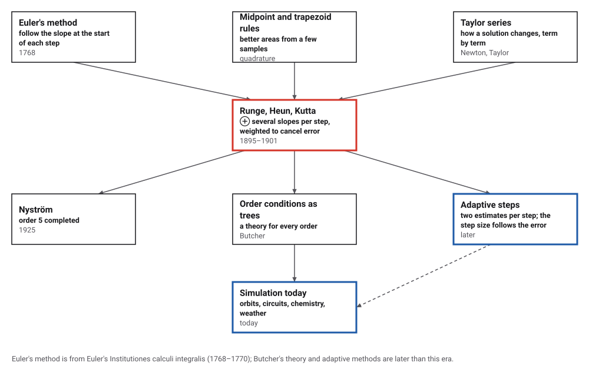
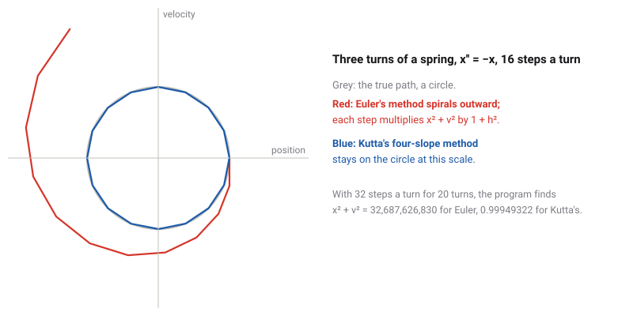
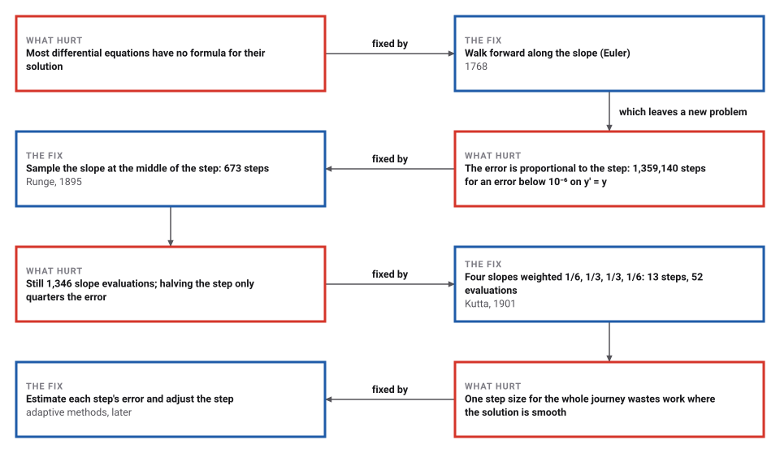

# Runge–Kutta

*Era 4 · topic 2 · 1895–1901* · [Era 4 index](../README.md) · [← Hilbert's Questions](../01-hilberts-questions/README.md) · [Markov Chains →](../03-markov-chains/README.md) · [Interactive edition](runge-kutta.html) · [Program](../../../code/era-04-what-can-be-computed/02-runge-kutta/)

> **Field note from the visiting historian.** With one slope per step, I needed 1,359,140 steps to get e right to six places. With four slopes, weighted one sixth, one third, one third and one sixth, I needed 13. The weights came from a German doctoral thesis of 1901.

| | |
|---|---|
| **When** | Runge 1895; Heun 1900; Kutta 1901 |
| **Where** | Germany |
| **What hurt** | Euler's steps must be tiny to be accurate |
| **The fix** | Several slopes per step, weighted to cancel error |
| **Cost** | Error ∝ h⁴ for 4 slopes a step; error ∝ h for 1 |

## How ideas combined

A new algorithm is usually an older idea combined with a new one. Euler had shown how to follow a differential equation forward in small steps; the midpoint and trapezoid rules had shown that a few well-placed samples estimate an area far better than one. Runge combined the two in 1895: sample the slope more than once inside each step. Heun and Kutta then chose the samples and weights so that the step agrees with the true solution's Taylor series to higher and higher powers of the step. Each box names the idea that was added.

<picture>
  <source media="(prefers-color-scheme: dark)" srcset="assets/family-dark.svg">
  
</picture>
*Red: the Runge–Kutta methods of 1895–1901. Blue: where the idea went.*

## Keep a spring on its circle

A weight on a spring, x'' = −x, moves so that position and velocity trace a circle. Pick a method and a number of steps per turn, and watch the computed path against the true circle (dashed). The dots mark the first turn's steps. Euler's method spirals out whatever you do; Kutta's four slopes, with 32 steps a turn, stay within a thousandth of the circle for 20 turns.

<picture>
  <source media="(prefers-color-scheme: dark)" srcset="assets/orbit-dark.svg">
  
</picture>
*In the interactive edition you can choose the method, the steps per turn and the number of turns.*

## Era 4, what can be computed

<picture>
  <source media="(prefers-color-scheme: dark)" srcset="assets/era-timeline-dark.svg">
  
</picture>

## Each fix leaves a new pain

<picture>
  <source media="(prefers-color-scheme: dark)" srcset="assets/chain-dark.svg">
  
</picture>
*Read it as a snake: each new problem sits directly under the fix that exposed it.*

## Several slopes, weighted to cancel the error

A differential equation y' = f(t, y) gives the slope of the solution at every point. **Euler's step** follows the slope at the start: y(t + h) ≈ y + h·f(t, y). The true solution curves away during the step, and the error of a whole journey is proportional to h.

**Kutta's classical step** samples four slopes: k₁ at the start; k₂ at the middle, reached with k₁; k₃ at the middle again, reached with k₂; k₄ at the end, reached with k₃. Then y(t + h) ≈ y + h·(k₁ + 2k₂ + 2k₃ + k₄)/6. The weights are not guesses: they make the step agree with the Taylor series of the true solution through the h⁴ term, which comes to eight equations (the order conditions). The program writes each method as a table of weights and tests the eight equations in exact fractions:

| Method | Slopes per step | Weights | Conditions met | Order | First failure |
|---|---|---|---|---|---|
| Euler (Euler, 1768) | 1 | 1 | 1 of 8 | 1 | 0 instead of 1/2 |
| Runge's midpoint (Runge, 1895) | 2 | 0, 1 | 2 of 8 | 2 | 1/4 instead of 1/3 |
| Heun-type third order (third order, of the kind Heun gave in 1900) | 3 | 1/4, 0, 3/4 | 4 of 8 | 3 | 2/9 instead of 1/4 |
| **Kutta's classical (Kutta, 1901)** | **4** | **1/6, 1/3, 1/3, 1/6** | **8 of 8** | **4** | **—** |
| Kutta's 3/8 rule (Kutta, 1901) | 4 | 1/8, 3/8, 3/8, 1/8 | 8 of 8 | 4 | — |

"First failure" is the first condition a method misses: the sum it gives against the value the Taylor series needs. Order p means the error of a journey shrinks like hᵖ: halve the step and the error falls by 2ᵖ.

> **Key idea.** Do a little more work inside each step, arranged so that the errors of the samples cancel. Four slope evaluations per step buy an error proportional to h⁴ instead of h, and that is far cheaper than taking smaller steps.

## Halve the step, divide the error

On y' = y from y(0) = 1, the answer at t = 1 is e. The program's errors with 10, 20, 40, 80 and 160 steps, and the ratio each time the step is halved:

| Method | 10 steps | 20 | 40 | 80 | 160 | Ratio when halved | Measured order |
|---|---|---|---|---|---|---|---|
| Euler | 1.25 × 10⁻¹ | 6.50 × 10⁻² | 3.32 × 10⁻² | 1.68 × 10⁻² | 8.45 × 10⁻³ | 1.99 | 0.992 |
| Runge's midpoint | 4.20 × 10⁻³ | 1.09 × 10⁻³ | 2.78 × 10⁻⁴ | 7.01 × 10⁻⁵ | 1.76 × 10⁻⁵ | 3.98 | 1.993 |
| Heun-type third order | 1.05 × 10⁻⁴ | 1.36 × 10⁻⁵ | 1.73 × 10⁻⁶ | 2.19 × 10⁻⁷ | 2.75 × 10⁻⁸ | 7.96 | 2.993 |
| Kutta's classical | 2.08 × 10⁻⁶ | 1.36 × 10⁻⁷ | 8.67 × 10⁻⁹ | 5.47 × 10⁻¹⁰ | 3.44 × 10⁻¹¹ | 15.92 | 3.992 |
| Kutta's 3/8 rule | 2.08 × 10⁻⁶ | 1.36 × 10⁻⁷ | 8.67 × 10⁻⁹ | 5.47 × 10⁻¹⁰ | 3.44 × 10⁻¹¹ | 15.92 | 3.992 |

The two four-slope methods give identical numbers here: on an equation as simple as y' = y, any four-slope method of order 4 reproduces the first five terms of the exponential series exactly. They differ on harder equations.

| Method | Steps for an error below 10⁻⁶ | Slope evaluations |
|---|---|---|
| Euler | 1,359,140 | 1,359,140 |
| Runge's midpoint | 673 | 1,346 |
| Heun-type third order | 49 | 147 |
| Kutta's classical | 13 | 52 |
| Kutta's 3/8 rule | 13 | 52 |

**The spring.** With 32 steps per turn for 20 turns, x² + v² should stay 1. Euler's method multiplies it by exactly 1 + h² every step, and the program confirms the prediction: 32,687,626,830.3 against (1 + h²)^640 = 32,687,626,830.3. Runge's midpoint gives 1.26841868, the third-order method 0.92472602, and Kutta's two methods 0.99949322 and 0.99949322.

**A pendulum** swinging through 90 degrees obeys θ'' = −sin θ, and its period has no elementary formula. Kutta's classical method with h = 1/1024 (15,432 slope evaluations, including the search for the turning point) gives a period of 7.416298709206; Gauss's arithmetic–geometric mean gives 7.416298709205, a difference of 4.1 × 10⁻¹⁴. The small-swing approximation 2π = 6.283185 is off by 1.133.

## Euler, Runge, Heun, Kutta

Euler proposed his method in the *Institutionum calculi integralis* (1768–1770); it is first order (Wikipedia, Euler method). Runge's idea was to base the step "not on this unsymmetrical and relatively inaccurate Riemann rule, but on such improved formulas as the midpoint and trapezoidal rules"; Heun "took the order conditions as far as 4"; Kutta "made a complete classification of order 4 methods" and reached order 5, a gap closed by Nyström in 1925 (Butcher, *Applied Numerical Mathematics*, 1996).

Kutta's doctoral thesis of 1901 "contains the now famous Runge-Kutta method" (MacTutor); the 3/8 rule is "also due to Kutta in 1901" (Wikipedia). The third-order weights used here (1/4, 0, 3/4) are the commonly quoted ones for a method of Heun's kind; Butcher's printed table could not be read in the opened copy, so the program checks their order rather than their attribution (**conjecture** for the attribution).

## Every simulation takes steps

Planets, circuits, chemical reactions and weather are all described by differential equations that no formula solves. Programs that simulate them still take steps, and the idea of this topic, several slope samples per step with weights that cancel the error, is inside the standard solvers, usually paired with a second estimate that tells the program how large its next step may safely be.

> **Full circle.** For an error below 10⁻⁶ on the simplest equation, Euler's method needs 1,359,140 slope evaluations and Kutta's classical method 52: the same answer for about 1/26,137 of the work.

## Before you read on

<details>
<summary><b>1.</b> Take one Euler step of size 1 on y' = y from y(0) = 1. What do you get, and what is the truth?</summary>

1 + 1·1 = 2, against e = 2.718...: Euler's step follows the starting slope, which is too small for a solution that keeps getting steeper.
</details>

<details>
<summary><b>2.</b> Halving the step of a fourth-order method divides the error by about how much?</summary>

2⁴ = 16. The program measures ratios of 15.35 to 15.92 as the step shrinks.
</details>

<details>
<summary><b>3.</b> Why does Euler's method make a spring's circle grow?</summary>

Each step moves along the tangent to the circle, which always leads slightly outward: x² + v² gains a factor 1 + h².
</details>

<details>
<summary><b>4.</b> The classical method uses four slopes per step and Euler one. Why can the classical method still be cheaper?</summary>

Its error shrinks like h⁴, so it can take far longer steps for the same accuracy: 52 evaluations against 1,359,140 here.
</details>

<details>
<summary><b>5.</b> What does an order condition say?</summary>

That some weighted sum of the method's coefficients equals the number the Taylor series of the true solution requires, for example Σ bᵢcᵢ = 1/2.
</details>


## Where the evidence lives

| | Object | Where to see it | Licence |
|---|---|---|---|
| — | **Ueber die numerische Auflösung von Differentialgleichungen (1895)**. Runge's paper, in an open-access scan. | [Zenodo (CC0)](https://zenodo.org/record/2178704) | Drawn placeholder. |

## Every link was opened before it was listed

| Level | Link | Why |
|---|---|---|
| Start | [Runge–Kutta methods](https://en.wikipedia.org/wiki/Runge%E2%80%93Kutta_methods) — Wikipedia | The family of methods, RK4, and adaptive steps |
| Start | [Euler method](https://en.wikipedia.org/wiki/Euler_method) — Wikipedia | The first-order method that Runge improved |
| Start | [Martin Wilhelm Kutta](https://mathshistory.st-andrews.ac.uk/Biographies/Kutta/) — MacTutor | Kutta's thesis of 1901 and his aerofoil theorem |
| Start | [Carl Runge](https://mathshistory.st-andrews.ac.uk/Biographies/Runge/) — MacTutor | Runge's applied mathematics at Göttingen |
| Deeper | [A history of Runge–Kutta methods](https://tlakoba.w3.uvm.edu/math337/paper_1996_Butcher_RKhistory.pdf) — J. C. Butcher, *Applied Numerical Mathematics* 20:247–260 (1996), on a University of Vermont course page | From Euler and Runge to Heun, Kutta and Nyström |
| Scholar | [Ueber die numerische Auflösung von Differentialgleichungen (1895)](https://zenodo.org/record/2178704) — Carl Runge, open-access scan on Zenodo (CC0) | Runge's paper that started the family |
| Scholar | [Ueber die numerische Auflösung totaler Differentialgleichungen (1905)](https://eudml.org/doc/58614) — Carl Runge, *Nachrichten ... Göttingen* (1905), 252–257, EuDML record | Runge's later paper on systems of equations |

More, with certainty labels and the gaps we could not fill: [Era 4 reference catalog](https://github.com/vij658/AlgorithmEvolutionAtlas/blob/main/book/era-04-what-can-be-computed/reference-catalog.md).

## The program behind every number here

[RungeKutta.java](https://github.com/vij658/AlgorithmEvolutionAtlas/blob/main/code/era-04-what-can-be-computed/02-runge-kutta/RungeKutta.java) makes **42 checks**: the eight order conditions for each of five methods in exact fractions, the measured error ratios, Euler's growth factor on the spring, the smallest step count for an error below 10⁻⁶ (and that one fewer step misses it), and the pendulum's period against Gauss's arithmetic–geometric mean. Run it with `java RungeKutta.java` (JDK 17 or newer). The heart of it:

```java
static double[] step(Method m, Sys sys, double t, double[] y, double h) {
    int s = m.stages(), n = y.length;
    double[][] k = new double[s][];
    for (int i = 0; i < s; i++) {
        double[] yi = y.clone();
        for (int j = 0; j < m.a[i].length; j++)
            for (int q = 0; q < n; q++) yi[q] += h * m.a[i][j].v() * k[j][q];
        k[i] = sys.f(t + m.c[i].v() * h, yi);
        evals++;
    }
    double[] out = y.clone();
    for (int i = 0; i < s; i++)
        for (int q = 0; q < n; q++) out[q] += h * m.b[i].v() * k[i][q];
    return out;
}

/** The conditions for orders 1, 2, 3, 3, 4, 4, 4, 4, as {order, left side, right side}. */
static Object[][] conditions(Method m) {
    F[] c = m.c;
    return new Object[][]{
            {1, sumB(m, i -> f(1, 1)), f(1, 1)},
            {2, sumB(m, i -> c[i]), f(1, 2)},
            {3, sumB(m, i -> c[i].times(c[i])), f(1, 3)},
            {3, sumB(m, i -> ac(m, i, j -> c[j])), f(1, 6)},
            {4, sumB(m, i -> c[i].times(c[i]).times(c[i])), f(1, 4)},
            {4, sumB(m, i -> c[i].times(ac(m, i, j -> c[j]))), f(1, 8)},
            {4, sumB(m, i -> ac(m, i, j -> c[j].times(c[j]))), f(1, 12)},
            {4, sumB(m, i -> ac(m, i, j -> ac(m, j, k -> c[k]))), f(1, 24)},
    };
}
```

