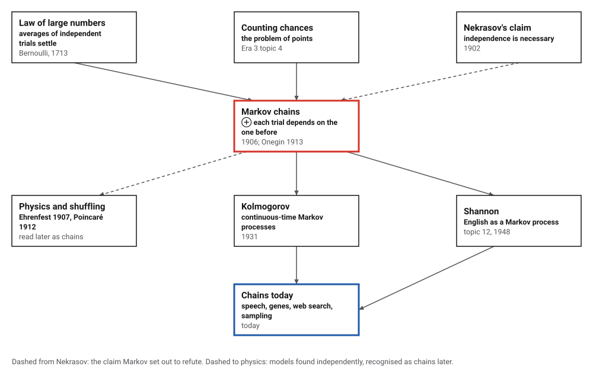
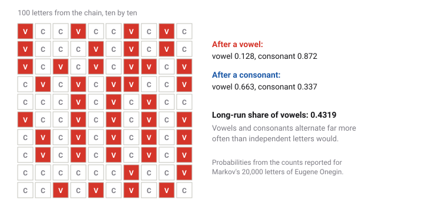
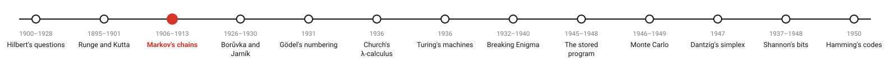
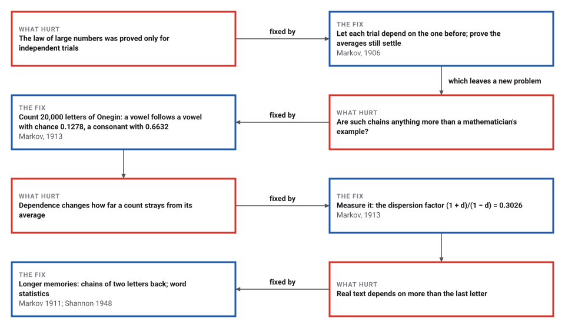

# Markov Chains

*Era 4 · topic 3 · 1906–1913* · [Era 4 index](../README.md) · [← Runge–Kutta](../02-runge-kutta/README.md) · [The Cheapest Network →](../04-cheapest-network/README.md) · [Interactive edition](markov-chains.html) · [Program](../../../code/era-04-what-can-be-computed/03-markov-chains/)

> **Field note from the visiting historian.** After a vowel, Pushkin wrote a vowel only 13 times in a hundred; after a consonant, 66 times. His letters remember their neighbours, and still the share of vowels settles, at 0.4319. Markov wrote them out in 200 grids of ten by ten.

| | |
|---|---|
| **When** | 1906; 23 January 1913 |
| **Where** | St Petersburg |
| **What hurt** | The law of large numbers assumed independent trials |
| **The fix** | A chain: the next state depends on the present one |
| **Cost** | A table of chances; the averages still settle |

## How ideas combined

A new algorithm is usually an older idea combined with a new one. Bernoulli's law of large numbers (1713) said that the share of heads in many independent tosses settles near one half. In 1902 Nekrasov claimed that independence is necessary for this. Markov added one idea, that each trial may depend on the one before through a fixed table of chances, and proved that the averages settle anyway. Each box names the idea that was added.

<picture>
  <source media="(prefers-color-scheme: dark)" srcset="assets/family-dark.svg">
  
</picture>
*Red: Markov's chains. Blue: where chains are used today (Hayes, *American Scientist*, 2013).*

## Write a text with a one-letter memory

Set two chances: that a vowel follows a vowel, and that a vowel follows a consonant. The page writes 20,000 letters, shows the first hundred ten by ten (as Markov wrote out Pushkin's letters), and plots the share of vowels as the text grows. The share settles at the dashed line whatever you choose, unless both chances are extreme. What changes is how much the counts wobble on the way.

<picture>
  <source media="(prefers-color-scheme: dark)" srcset="assets/grid-dark.svg">
  
</picture>
*In the interactive edition you can set the two chances and watch the share of vowels settle.*

## Era 4, what can be computed

<picture>
  <source media="(prefers-color-scheme: dark)" srcset="assets/era-timeline-dark.svg">
  
</picture>

## Each fix leaves a new pain

<picture>
  <source media="(prefers-color-scheme: dark)" srcset="assets/chain-dark.svg">
  
</picture>
*Read it as a snake: each new problem sits directly under the fix that exposed it.*

## A table of four chances

**The counts.** The figures reported for Markov's sample (Hayes, 2013): 20,000 letters, 8,638 vowels and 11,362 consonants; 1,104 vowel–vowel pairs, 3,827 consonant–consonant pairs and 15,069 mixed. From them the program recomputes the chances: a vowel 0.4319; a vowel after a vowel 0.1278; a vowel after a consonant 0.6632. If letters were independent, about 3,731 double vowels would be expected; the poem has 1,104.

|  | next is a vowel | next is a consonant |
|---|---|---|
| after a vowel | 0.1278 | 0.8722 |
| after a consonant | 0.6632 | 0.3368 |

**A small puzzle in the counts.** The pairs add up to 20,000, one for each letter. That does not fit 19,999 pairs inside the sample, nor a closed loop (which would need 15,068 mixed pairs, not 15,069). It fits exactly if every letter starts a pair and the last pair reaches one letter past the sample, and only if the sample's first letter is a consonant and the 20,001st a vowel. Chapter one begins «Мой дядя», with a consonant. Markov's own text, which would settle how he counted, was not opened (see the catalog).

**The long run.** Whatever the first letter, the chance of a vowel n letters later approaches p₂ / (1 − p₁ + p₂) = 0.4319, and the difference shrinks by a factor |p₁ − p₂| = 0.5354 each letter:

| Letters later | Chance of a vowel, after a vowel | after a consonant |
|---|---|---|
| 1 | 0.127807 | 0.663175 |
| 2 | 0.594752 | 0.308132 |
| 3 | 0.344764 | 0.498211 |
| 5 | 0.406949 | 0.450929 |
| 8 | 0.435766 | 0.429018 |
| 12 | 0.432248 | 0.431693 |

> **Key idea.** Dependence does not stop averages from settling, as long as the chain cannot get stuck or trapped in a cycle. It changes the size of the wobble: here the counts of vowels in groups of 100 letters vary about a third as much as they would for independent letters.

## The wobble, and the settling

| Groups of 100 letters | Variance of the vowel count |
|---|---|
| independent letters: n·p·q | 24.54 |
| independent letters, simulated | 24.56 |
| **the chain: exact formula** | **7.54** |
| the chain, simulated | 7.58 |

Over 200,000 simulated groups, the chain's variance is 0.3072 times that of independent letters; for very long groups the ratio tends to Markov's dispersion factor (1 + d)/(1 − d) = 0.3026, with d = p₁ − p₂. Markov's own value for his "simple" coefficient was 0.303, which a recount reproduced (Sabatini).

| Letters simulated | Share of vowels |
|---|---|
| 100 | 0.45000 |
| 1,000 | 0.43400 |
| 10,000 | 0.43010 |
| 100,000 | 0.43343 |
| 1,000,000 | 0.43217 |
| 10,000,000 | 0.43196 |
| long-run value | 0.43193 |

## A quarrel, then a poem

Nekrasov (1902) argued that the law of large numbers requires independence; Markov called this "an abuse of mathematics" and showed that the law "applies perfectly well to systems of dependent variables if they meet certain criteria" (Hayes, *American Scientist*, 2013). His first paper on the subject was written in 1906 and printed in 1907 in the Kazan *Izvestiya* (Basharin, Langville and Naumov).

On 23 January 1913 he presented the Onegin analysis to the Imperial Academy in St Petersburg (Harvard Gazette, 2013); the letters were written out without punctuation or spaces, in 200 grids of 10 by 10 (Schwartz, IEEE Spectrum). How much of the poem he used is **disputed** among the opened sources: "the first 70 stanzas" (Angelino) or "the first 76 stanzas" (Sabatini).

## From Pushkin to predictive text

Markov chose letters to show that dependence is everywhere. Shannon (topic 12) used the same counts, on longer stretches of text, to generate imitation English in 1948; today chains with very long memories model speech, genes and the order of web pages (Hayes). Monte Carlo methods (topic 10) later ran chains on purpose, as a way to sample.

> **Full circle.** Independent letters would have given Pushkin about 3,731 double vowels in 20,000 letters. He wrote 1,104: the evidence, in one count, that a letter remembers the letter before it.

## Before you read on

<details>
<summary><b>1.</b> If a vowel follows a vowel with chance 0.128, what is the chance that a consonant follows a vowel?</summary>

1 − 0.128 = 0.872: after a vowel, one of the two must come next.
</details>

<details>
<summary><b>2.</b> Why would independent letters give about 3,731 double vowels?</summary>

Each pair of neighbours would be two vowels with chance 0.4319² ≈ 0.187, and there are 20,000 pairs.
</details>

<details>
<summary><b>3.</b> What long-run share of vowels does the chain with p₁ = 0.5, p₂ = 0.5 give?</summary>

0.5 / (1 − 0.5 + 0.5) = 0.5: with p₁ = p₂ the letters are independent, and the share is just that chance.
</details>

<details>
<summary><b>4.</b> Why does strict alternation (p₁ near 0, p₂ near 1) make the counts in a group of 100 almost fixed?</summary>

Vowels and consonants take turns, so any 100 letters hold almost exactly 50 of each: dependence has squeezed out the wobble.
</details>

<details>
<summary><b>5.</b> What did Markov's chains show against Nekrasov?</summary>

That the law of large numbers does not need independence: dependent trials can still have averages that settle.
</details>


## Where the evidence lives

| | Object | Where to see it | Licence |
|---|---|---|---|
| — | **Sur un cas d'épreuves liées en chaîne multiple (1911)**. One of Markov's papers on trials linked in a chain, in the Academy's Bulletin (in Russian). | [Math-Net.Ru](https://mathnet.ru/eng/im6871) | Drawn placeholder. |

## Every link was opened before it was listed

| Level | Link | Why |
|---|---|---|
| Start | [First Links in the Markov Chain](https://www.americanscientist.org/sites/americanscientist.org/files/201321152149545-2013-03Hayes.pdf) — Brian Hayes, *American Scientist* 101(2):92–97 (March–April 2013) | The quarrel with Nekrasov, the letter counts, and where chains are used now |
| Start | [Andrey Markov & Claude Shannon Counted Letters to Build the First Language-Generation Models](https://spectrum.ieee.org/andrey-markov-and-claude-shannon-built-the-first-language-generation-models) — Oscar Schwartz, IEEE Spectrum (11 November 2019) | How Markov laid out the letters, and how Shannon took the idea further |
| Start | [An idea that changed the world](https://news.harvard.edu/gazette/story/2013/01/an-idea-that-changed-the-world) — Corydon Ireland, Harvard Gazette (23 January 2013) | The centenary of the 1913 lecture |
| Start | [Andrei Andreyevich Markov](https://mathshistory.st-andrews.ac.uk/Biographies/Markov/) — MacTutor | Markov's life and his work on the law of large numbers |
| Deeper | [Markov chain](https://en.wikipedia.org/wiki/Markov_chain) — Wikipedia | Definitions, the history after Markov, and applications |
| Deeper | [A Historical Note](https://www.math.cuhk.edu.hk/course_builder/2425/math4240/HistoricalNote.pdf) — MATH4240 Stochastic Processes, Chinese University of Hong Kong | The 1906 theorem and the fixed vector (.432, .568) of the Onegin chain |
| Scholar | [The Life and Work of A. A. Markov](https://www.maths.tcd.ie/~nhb/talks/Markov.pdf) — G. P. Basharin, A. N. Langville and V. A. Naumov (PDF on a Trinity College Dublin page) | Markov's papers, his letters to Chuprov, and the Onegin probabilities |
| Scholar | [Markov reads Puškin, again](https://arxiv.org/pdf/2604.20221) — Angelo Maria Sabatini, arXiv 2604.20221 | A recount of Markov's encoding of *Onegin*, with his dispersion coefficients |
| Scholar | [Sur un cas d'épreuves liées en chaîne multiple](https://mathnet.ru/eng/im6871) — A. A. Markov, *Bulletin de l'Académie Impériale des Sciences de St.-Pétersbourg*, VI série, 5(3):171–186 (1911), in Russian; Math-Net.Ru record | One of Markov's papers on trials linked in a chain |
| Scholar | [Sur les valeurs liées qui ne forment pas une chaîne véritable](https://mathnet.ru/eng/im6867) — A. A. Markov, same *Bulletin*, 5(2):113–126 (1911), in Russian; Math-Net.Ru record | Markov on linked quantities that are not a true chain |

More, with certainty labels and the gaps we could not fill: [Era 4 reference catalog](https://github.com/vij658/AlgorithmEvolutionAtlas/blob/main/book/era-04-what-can-be-computed/reference-catalog.md).

## The program behind every number here

[MarkovChains.java](https://github.com/vij658/AlgorithmEvolutionAtlas/blob/main/code/era-04-what-can-be-computed/03-markov-chains/MarkovChains.java) makes **25 checks**: the reported counts against three ways of counting pairs, the chances 0.432, 0.128 and 0.663 and the 3,731 independent double vowels, the long-run share, the shrinking gap |d|ⁿ in the table's powers, and simulated variances against the exact formula. Run it with `java MarkovChains.java` (JDK 17 or newer). The heart of it:

```java
/** Exact variance of the number of vowels in n letters of a stationary two-state chain. */
static double varExact(int n, double p, double d) {
    double q = 1 - p, s = n;                                       // Var = p q (n + 2 sum_{k=1}^{n-1} (n - k) d^k)
    double dk = 1;
    for (int k = 1; k < n; k++) { dk *= d; s += 2 * (n - k) * dk; }
    return p * q * s;
}
```

