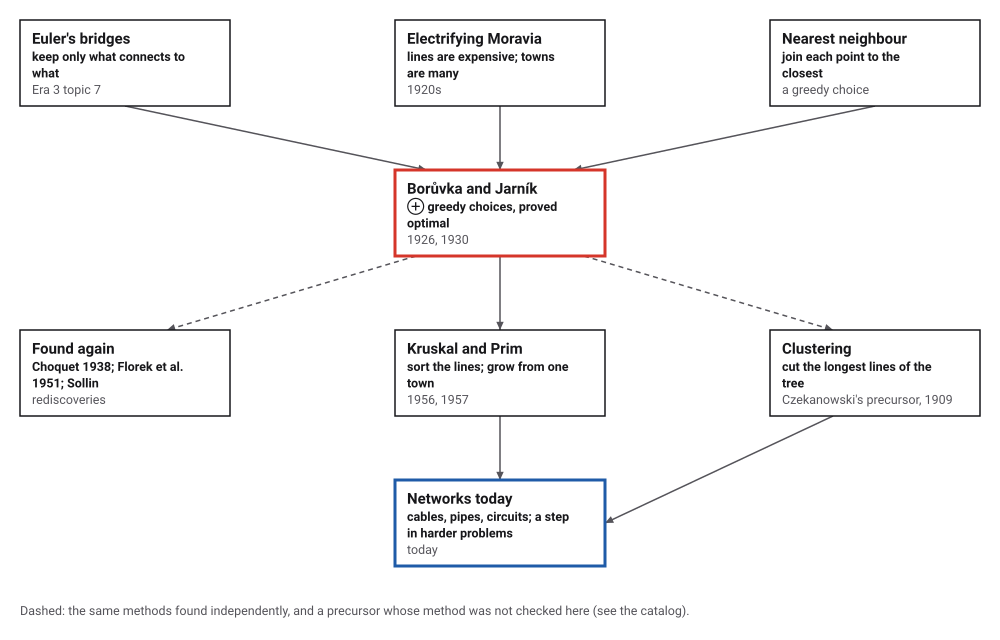
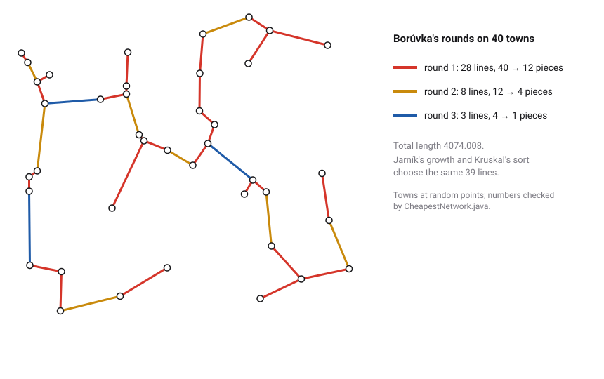
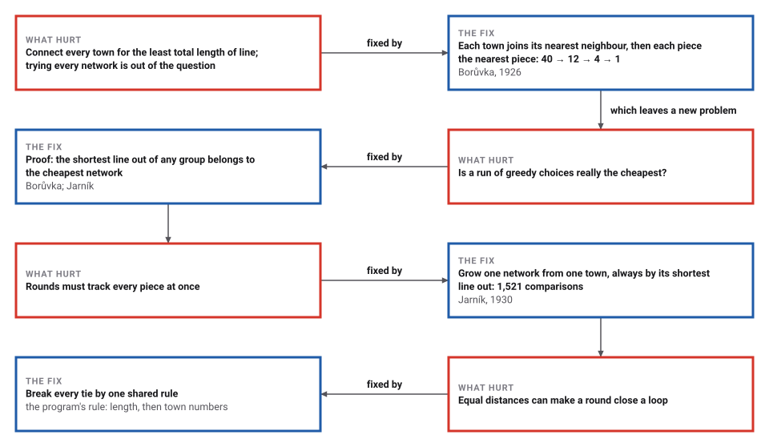

# The Cheapest Network

*Era 4 · topic 4 · 1926–1930* · [Era 4 index](../README.md) · [← Markov Chains](../03-markov-chains/README.md) · [Gödel's Numbering →](../05-godel-numbering/README.md) · [Interactive edition](cheapest-network.html) · [Program](../../../code/era-04-what-can-be-computed/04-cheapest-network/)

> **Field note from the visiting historian.** Every town reaches for its nearest neighbour. That leaves pieces; every piece reaches for the nearest piece. On my forty towns, 12 pieces, then 4 pieces, then one network. I have seen few algorithms so obviously right that also needed a proof.

| | |
|---|---|
| **When** | Borůvka 1926; Jarník 1930 |
| **Where** | Brno and Prague |
| **What hurt** | Connecting many towns with the least line |
| **The fix** | Greedy choices that are provably optimal |
| **Cost** | 3 rounds for 40 towns; at most log₂ n rounds |

## How ideas combined

A new algorithm is usually an older idea combined with a new one. Euler had shown how to keep only the connections in a problem about places (Era 3, topic 7); joining each point to its nearest neighbour is the most obvious greedy move there is. Borůvka's contribution, asked for by a friend at the West-Moravian power company, was to repeat that move on pieces instead of points, and to prove that the result is the cheapest network possible. Each box names the idea that was added.

<picture>
  <source media="(prefers-color-scheme: dark)" srcset="assets/family-dark.svg">
  
</picture>
*Red: Borůvka (1926) and Jarník (1930). Blue: where the cheapest network is used today.*

## Wire forty towns

Forty towns, at the random points the program used. Press Borůvka's button to run one round: every piece (at first, every town) takes its shortest line to another piece. Or start again and press Jarník's button to grow a single network from town 0, one line at a time. Either way you end with the same 39 lines, the ones the program found by three methods.

<picture>
  <source media="(prefers-color-scheme: dark)" srcset="assets/network-dark.svg">
  
</picture>
*In the interactive edition you can run Borůvka's rounds or Jarník's growth one step at a time.*

## Era 4, what can be computed

<picture>
  <source media="(prefers-color-scheme: dark)" srcset="assets/era-timeline-dark.svg">
  
</picture>

## Each fix leaves a new pain

<picture>
  <source media="(prefers-color-scheme: dark)" srcset="assets/chain-dark.svg">
  
</picture>
*Read it as a snake: each new problem sits directly under the fix that exposed it.*

## The shortest line out of any group

**The one fact.** Split the towns into two groups in any way. The shortest line that joins the groups belongs to the cheapest network (if no two distances are equal). For suppose a cheapest network did without it: adding it closes a loop, the loop must cross between the groups a second time by a longer line, and swapping the longer line for the shorter one gives a cheaper network, which is impossible.

**Borůvka (1926).** Treat every town as a piece. In each round, every piece picks the shortest line from itself to any other piece, and all picked lines are added at once. Every piece joins at least one other, so the number of pieces at least halves each round. On the program's forty towns: 40 → 12 → 4 → 1 pieces in 3 rounds (Borůvka's own forty cities went 40 → 13 → 4 → 1).

**Jarník (1930).** Start from one town. Repeatedly add the shortest line from the network built so far to a town not yet in it. After 39 additions every town is in. **Kruskal (1956)** sorts all 780 lines and keeps each one that joins two separate pieces. All three methods are the one fact applied in different orders, and the program checks that they choose exactly the same 39 lines, total length 4074.008.

**Brute force agrees.** On 200 sets of 7 towns, the program lists every one of the 16,807 possible networks (3,361,400 in all; Cayley's count 7^5) and finds that the algorithms' network is the unique cheapest every time. It also tests the one fact directly on 10,000 random splits of the forty towns.

> **Key idea.** A greedy choice is usually a gamble. Here it is safe, because of a fact you can check: the cheapest line out of any group is always part of a cheapest network. With equal distances, every choice must break ties by the same rule, or Borůvka's simultaneous picks can close a loop.

## Three orders, one network

| Method | Work on 40 towns | Result |
|---|---|---|
| Borůvka, 1926 | 3 rounds, 2,340 comparisons of a line | 39 lines, length 4074.008 |
| Jarník, 1930 | 1,521 comparisons | the same lines |
| Kruskal, 1956 | sort 780 lines, then examine 780 | the same lines |

| Rounds Borůvka needed | Sets of 40 random towns (of 1,000) |
|---|---|
| 2 | 10 |
| 3 | 846 |
| 4 | 144 |

Since each round at least halves the pieces, 40 towns can never need more than 5 rounds (40 → 20 → 10 → 5 → 2 → 1); in practice pieces merge faster, because several towns often pick the same nearest neighbour.

## A friend at the power company

The problem "was communicated to him by a friend Jindrich Saxel - an employee of Zapadomoravske elektrarny", during the electrification of southern Moravia; Borůvka's two papers of 1926 appeared in *Práce moravské přírodovědecké společnosti* and *Elektrotechnický obzor*, the second "by means of a geometric example with 40 cities" (Nešetřil, Milková and Nešetřilová). Jarník's paper of 1930 is a letter to Borůvka: "In your article ... you solved an interesting problem" (Korte and Nešetřil).

Kruskal's sort (1956) and Prim's growth (1957, the method Jarník had published) made the problem famous; Choquet (1938), Florek and colleagues (1951) and Sollin found Borůvka's method again. Sollin's date is **disputed** in the opened sources: 1961 (Graham and Hell) or 1965 (Wikipedia).

## Still the first network you build

The cheapest connecting network is still the first step in designing cable and pipe networks, and Kruskal's 1956 paper already tied it to the travelling salesman problem, where a cheapest network gives a lower bound for the length of any tour. Borůvka's rounds, which work on every piece at once, suit machines that do many things in parallel.

> **Full circle.** Borůvka's own forty cities needed three rounds; so did 846 of the program's 1,000 random sets of forty towns.

## Before you read on

<details>
<summary><b>1.</b> Four towns sit at the corners of a 3 by 4 rectangle. Which lines does the cheapest network use?</summary>

Three sides: two of length 3 and one of length 4, total 10. The diagonals (length 5) are never needed.
</details>

<details>
<summary><b>2.</b> Why must every Borůvka round at least halve the number of pieces?</summary>

Every piece joins at least one other piece, so the pieces pair up or merge in larger groups: no piece survives alone.
</details>

<details>
<summary><b>3.</b> How many lines does the cheapest network on n towns have?</summary>

n − 1: it connects everything without a loop, so it is a tree.
</details>

<details>
<summary><b>4.</b> Why do equal distances cause trouble for Borůvka but not for Jarník?</summary>

Borůvka's pieces choose at the same time, so three towns at equal distances can each pick a different line and close a loop. Jarník adds one line at a time, always to a new town.
</details>

<details>
<summary><b>5.</b> Is the cheapest network the same as the shortest round trip through all towns?</summary>

No. The round trip must visit the towns in a single loop; the cheapest network may branch. But the network is never longer than the round trip minus one line.
</details>


## Where the evidence lives

| | Object | Where to see it | Licence |
|---|---|---|---|
| — | **Borůvka's two papers of 1926, in English**. Both papers translated, with the 40-city example, by Nešetřil, Milková and Nešetřilová. | [Czech Digital Mathematics Library](https://www.dml.cz/bitstream/handle/10338.dmlcz/500413/Boruvka_03-0000-60_1.pdf) | Drawn placeholder. |
| — | **Jarník's letter of 1930**. In Czech and in English, with Korte and Nešetřil's commentary. | [Czech Digital Mathematics Library](https://www.dml.cz/bitstream/handle/10338.dmlcz/500662/Jarnik_04-0000-19_1.pdf) | Drawn placeholder. |

## Every link was opened before it was listed

| Level | Link | Why |
|---|---|---|
| Start | [Borůvka's algorithm](https://en.wikipedia.org/wiki/Bor%C5%AFvka%27s_algorithm) — Wikipedia | The rounds, the rediscoveries, and why ties must be broken consistently |
| Start | [Otakar Borůvka](https://mathshistory.st-andrews.ac.uk/Biographies/Boruvka/) — MacTutor | Borůvka's life in Brno and the friend at the power company |
| Start | [Vojtěch Jarník](https://mathshistory.st-andrews.ac.uk/Biographies/Jarnik/) — MacTutor | A number theorist's single, lasting excursion into networks |
| Deeper | [Algorithms for Minimum Spanning Trees](https://courses.grainger.illinois.edu/cs374/fa2020/lec_prerec/20/20_1_0_0.pdf) — CS/ECE 374, University of Illinois (Fall 2020), lecture 20 slides | Borůvka's electricity network and the history before Kruskal and Prim |
| Scholar | [On the History of the Minimum Spanning Tree Problem](https://math.ucdavis.edu/~saito/data/acha.read.w12/graham-hell-mst.pdf) — R. L. Graham and Pavol Hell, *Annals of the History of Computing* 7(1) (1985), on a UC Davis reading list | The standard history: Borůvka, Jarník, Choquet, Florek et al., Kruskal, Prim, Sollin |
| Scholar | [Otakar Borůvka on minimum spanning tree problem: translation of both the 1926 papers, comments, history](https://www.dml.cz/bitstream/handle/10338.dmlcz/500413/Boruvka_03-0000-60_1.pdf) — J. Nešetřil, E. Milková and H. Nešetřilová, *Discrete Mathematics* 233:3–36 (2001), Czech Digital Mathematics Library | Both of Borůvka's papers in English, including the 40-city example |
| Scholar | [Vojtěch Jarník's work in combinatorial optimization](https://www.dml.cz/bitstream/handle/10338.dmlcz/500662/Jarnik_04-0000-19_1.pdf) — B. Korte and J. Nešetřil, *Discrete Mathematics* 235:1–17 (2001), Czech Digital Mathematics Library | Jarník's letter of 1930, in Czech and in English translation |

More, with certainty labels and the gaps we could not fill: [Era 4 reference catalog](https://github.com/vij658/AlgorithmEvolutionAtlas/blob/main/book/era-04-what-can-be-computed/reference-catalog.md).

## The program behind every number here

[CheapestNetwork.java](https://github.com/vij658/AlgorithmEvolutionAtlas/blob/main/code/era-04-what-can-be-computed/04-cheapest-network/CheapestNetwork.java) makes **14,341 checks**: the three methods against each other on forty towns and on 1,000 more sets, every round halving the pieces, brute force over all 16,807 networks on 7 towns 200 times, the cut rule on 10,000 random splits, and the tie that closes a loop. Run it with `java CheapestNetwork.java` (JDK 17 or newer). The heart of it:

```java
/** Borůvka: each piece takes its shortest outgoing line, all at once; returns the lines, records the piece counts. */
static TreeSet<Long> boruvka(List<Integer> pieces) {
    parent = new int[n];
    for (int i = 0; i < n; i++) parent[i] = i;
    TreeSet<Long> chosen = new TreeSet<>();
    int count = n;
    pieces.add(count);
    while (count > 1) {
        int[] bi = new int[n], bj = new int[n];
        Arrays.fill(bi, -1);
        for (int i = 0; i < n; i++)
            for (int j = i + 1; j < n; j++) {
                examined++;
                int a = find(i), b = find(j);
                if (a == b) continue;
                for (int r : new int[]{a, b})
                    if (bi[r] < 0 || shorter(i, j, bi[r], bj[r])) { bi[r] = i; bj[r] = j; }
            }
        int before = count;
        for (int r = 0; r < n; r++)
            if (bi[r] >= 0) {
                int a = find(bi[r]), b = find(bj[r]);
                if (a != b) { parent[a] = b; count--; }
                chosen.add(key(bi[r], bj[r]));
            }
        check(count <= before / 2, "a round at least halves the pieces");
        pieces.add(count);
    }
    return chosen;
}

/** Jarník: grow one network from town 0 by the shortest line to a new town. */
static TreeSet<Long> jarnik() {
    boolean[] in = new boolean[n];
    int[] near = new int[n];                                      // for each outside town, its nearest town inside
    in[0] = true;
    TreeSet<Long> chosen = new TreeSet<>();
    for (int i = 1; i < n; i++) near[i] = 0;
    for (int step = 1; step < n; step++) {
        int best = -1;
        for (int i = 0; i < n; i++) {
            if (in[i]) continue;
            examined++;
            if (best < 0 || shorter(i, near[i], best, near[best])) best = i;
        }
        in[best] = true;
        chosen.add(key(best, near[best]));
        for (int i = 0; i < n; i++) if (!in[i]) { examined++; if (shorter(i, best, i, near[i])) near[i] = best; }
    }
    return chosen;
}
```

