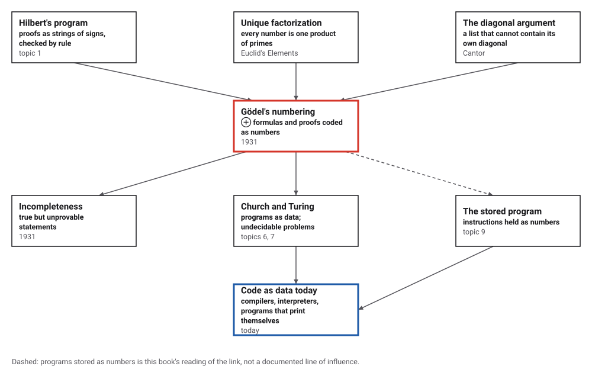
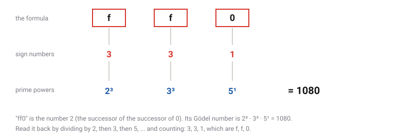
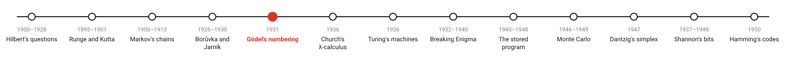
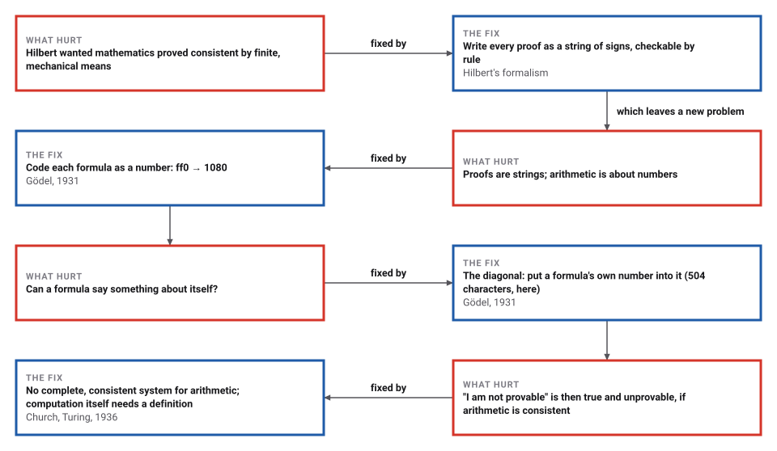

# Gödel's Numbering

*Era 4 · topic 5 · 1931* · [Era 4 index](../README.md) · [← The Cheapest Network](../04-cheapest-network/README.md) · [Church's Lambda Calculus →](../06-lambda-calculus/README.md) · [Interactive edition](godel-numbering.html) · [Program](../../../code/era-04-what-can-be-computed/05-godel-numbering/)

> **Field note from the visiting historian.** The formula "ff0", which means 2, is the number 1080. That is all the trick is: a formula becomes a number, and a number is something arithmetic can talk about. From it came the first proof that some true statements cannot be proved.

| | |
|---|---|
| **When** | Announced September 1930; printed 1931 |
| **Where** | Königsberg (announcement); Monatshefte (paper) |
| **What hurt** | Proofs were strings; arithmetic was about numbers |
| **The fix** | Code signs, formulas and proofs as numbers |
| **Cost** | Numbers far too large to write, but only numbers |

## How ideas combined

A new algorithm is usually an older idea combined with a new one. Hilbert's program (topic 1) treated proofs as strings of signs that a clerk could check by rule. Euclid had shown that every number factors into primes in only one way. Gödel combined them: if each string of signs is coded as a product of prime powers, statements about proofs become statements about numbers, and a formula can be made to speak about itself by the kind of diagonal construction Cantor had used. Each box names the idea that was added.

<picture>
  <source media="(prefers-color-scheme: dark)" srcset="assets/family-dark.svg">
  
</picture>
*Red: Gödel's numbering (1931). Blue: code treated as data, today.*

## Turn a formula into a number

Press Gödel's signs to write a formula: 0, f (the next number), ~ (not), ∨ (or), Π (for all), brackets and variables. The page gives each sign its number, raises the first prime to the first sign's number, the second prime to the second's, and multiplies. Then it factors the result to show that the formula comes back. "ff0", the number 2, is coded as 1080; a formula of a dozen signs already has hundreds of digits.

<picture>
  <source media="(prefers-color-scheme: dark)" srcset="assets/code-dark.svg">
  
</picture>
*In the interactive edition you can type any formula with Gödel's signs and see its number.*

## Era 4, what can be computed

<picture>
  <source media="(prefers-color-scheme: dark)" srcset="assets/era-timeline-dark.svg">
  
</picture>

## Each fix leaves a new pain

<picture>
  <source media="(prefers-color-scheme: dark)" srcset="assets/chain-dark.svg">
  
</picture>
*Read it as a snake: each new problem sits directly under the fix that exposed it.*

## Signs, products of primes, and a diagonal

**The sign table** (Gödel 1931, page 179 of the original): "0" is 1, f (the next number) 3, ~ (not) 5, ∨ (or) 7, Π (for all) 9, "(" 11 and ")" 13. Variables get the primes above 13 (x₁ is 17, y₁ 19, z₁ 23), and variables of the next type their squares (x₂ is 289). A string of signs with numbers n₁, n₂, …, nₖ becomes 2^n₁ · 3^n₂ · … · pₖ^nₖ:

| Formula | Sign numbers | Gödel number |
|---|---|---|
| 0 | 1 | 2 |
| f0 | 3 1 | 24 |
| ff0 | 3 3 1 | 1080 |
| x₂(x₁) | 289 11 17 13 | 116 digits, 130246…000000 |
| ~(x₂(x₁)) | 5 11 289 11 17 13 13 | 267 digits, 170871…500000 |
| x₁Π(x₂(x₁)) | 17 9 11 289 11 17 13 13 | 325 digits, 221612…000000 |

**Reading back.** Divide by 2 as often as possible, then by 3, then by 5, and count: the counts are the sign numbers. Because factorization is unique, no two strings share a number; the program coded 10,000 random strings (7,299 different), read every one back, and found no collision. The largest had 2,383 digits.

**Proofs.** A proof is a list of formulas, coded the same way with the formulas' numbers as exponents. Even the three-line list f0, ff0, x₂(x₁) is 2²⁴ · 3¹⁰⁸⁰ · 5 raised to a 116-digit number, whose last factor alone has about 10^115.0 digits. Nobody writes these numbers down; the point is that "x is the number of a proof of formula y" is a property of whole numbers that loops of known length can check. The program checks one such step, reading an exponent back with loops of fixed length, against plain division in 2,000,000 cases.

**The diagonal.** The same trick works with any numbering. The program numbers English sentences (each printable character a digit from 1 to 95) and takes the sentence A: "Put the number @ in place of every at-sign in sentence number @: the sentence you get is not provable." Its number has 202 digits. Writing that number in place of each at-sign gives a 504-character sentence G:

```java
Put the number 28074527597556145984…17677590 in place of every at-sign in sentence number 28074527597556145984…17677590: the sentence you get is not provable.
```

Follow G's recipe: take sentence number … (that is A), put the number in place of each at-sign, and you get G itself. G says of itself that it is not provable. Gödel built the same sentence inside arithmetic, with "provable" spelled out as a property of numbers.

> **Key idea.** Code the objects of a system (formulas, proofs, programs) as the system's own data, and the system can describe itself. That is what makes self-reference, and therefore its limits, possible.

## How fast the numbers grow

| Formula | Signs | Digits in its number |
|---|---|---|
| 0 | 1 | 1 |
| f0 | 2 | 2 |
| ff0 | 3 | 4 |
| x₂(x₁) | 4 | 116 |
| ~(x₂(x₁)) | 7 | 267 |
| x₁Π(x₂(x₁)) | 8 | 325 |

Each sign multiplies the number by a prime raised to the sign's number, so length grows with the sizes of the signs, not only their count. A variable of the second type (289) adds about 87 digits on the first prime alone. The sentence numbering grows more gently: 102 characters give 202 digits, about two per character, because it is ordinary positional notation in base 95.

## Königsberg, 1930

Gödel announced the first incompleteness theorem at a conference in Königsberg in September 1930; the announcement "drew little attention apart from that of von Neumann", who soon proved the second theorem independently and wrote to Gödel on 20 November 1930 (Wikipedia; Zach). The paper was submitted on 17 November 1930 and printed in *Monatshefte für Mathematik und Physik* 38 (1931), 173–198, with 45 primitive recursive definitions; the promised part II never appeared (Wikipedia).

The sign table is in Meltzer's translation (1962) at the original page [179], and in Hirzel's (2000). How much of Hilbert's program the theorems refuted is still argued (**disputed**); finitary consistency proofs of the kind Hilbert wanted are ruled out (Zach).

## Programs that read programs

Five years later Turing coded machines as numbers in the same spirit (topic 7), and fifteen years later the stored-program computer kept its instructions in memory as numbers (topic 9). Every compiler, interpreter and virus scanner today is a program that takes programs as data; the limits Gödel found reappear as the impossibility of a perfect bug-finder.

> **Full circle.** A 102-character template and its own 202-digit number make a sentence that refers to itself. The same construction, written in a programming language, is a program that prints its own text.

## Before you read on

<details>
<summary><b>1.</b> What formula has the Gödel number 24?</summary>

24 = 2³ · 3¹: sign numbers 3 and 1, that is, f0, the number 1.
</details>

<details>
<summary><b>2.</b> Is 2⁵ · 5¹ the number of any formula?</summary>

No: the exponent of 3 is zero, and every sign number is at least 1, so a gap means the number codes no string.
</details>

<details>
<summary><b>3.</b> Why must the code use prime powers rather than, say, the digits of the sign numbers written side by side?</summary>

Side by side, 1 followed by 13 and 11 followed by 3 both read 113. Prime powers are unambiguous because factorization is unique.
</details>

<details>
<summary><b>4.</b> Does G contain its own number?</summary>

No, it cannot: the number is longer than G. It contains A's number and a recipe whose result is G.
</details>

<details>
<summary><b>5.</b> If G were provable, what would go wrong?</summary>

G says it is not provable, so a proof of G would prove something false: the system would prove a falsehood. In a consistent system G is unprovable, and so it is true.
</details>


## Where the evidence lives

| | Object | Where to see it | Licence |
|---|---|---|---|
| — | **On Formally Undecidable Propositions (1931)**. Meltzer's English translation, with the original page numbers; the sign table is on [179]. | [University of the Basque Country](https://gtts.ehu.es/German/Docencia/2021/MTBYC/pdf/Godel.pdf) | Drawn placeholder. |

## Every link was opened before it was listed

| Level | Link | Why |
|---|---|---|
| Start | [Gödel's incompleteness theorems](https://en.wikipedia.org/wiki/G%C3%B6del%27s_incompleteness_theorems) — Wikipedia | The two theorems, the Königsberg announcement, and the link to the halting problem |
| Start | [Gödel numbering](https://en.wikipedia.org/wiki/G%C3%B6del_numbering) — Wikipedia | The sign table and the prime-power code, with modern variants |
| Start | [Kurt Gödel](https://mathshistory.st-andrews.ac.uk/Biographies/Godel/) — MacTutor | Gödel's life and the reception of his results |
| Deeper | [On Formally Undecidable Propositions of Principia Mathematica and Related Systems](https://en.wikipedia.org/wiki/On_Formally_Undecidable_Propositions_of_Principia_Mathematica_and_Related_Systems) — Wikipedia | The paper itself: dates, structure, the 45 primitive recursive definitions, translations |
| Scholar | [Hilbert's Program Then and Now](https://arxiv.org/pdf/math/0508572) — Richard Zach, arXiv math/0508572 | What Hilbert wanted, what Gödel showed, and what survived |
| Scholar | [On Formally Undecidable Propositions of Principia Mathematica and Related Systems](https://gtts.ehu.es/German/Docencia/2021/MTBYC/pdf/Godel.pdf) — Gödel (1931), translated by B. Meltzer with an introduction by R. B. Braithwaite (1962), on a University of the Basque Country course page | The whole paper in English, with the original page numbers |
| Scholar | [On formally undecidable propositions … (sections 1 and 2)](https://www.hirzels.com/martin/papers/canon00-goedel.pdf) — Gödel (1931), translated by Martin Hirzel (27 November 2000) | A free modern translation of the sign table, the primitive recursive functions and the main argument |

More, with certainty labels and the gaps we could not fill: [Era 4 reference catalog](https://github.com/vij658/AlgorithmEvolutionAtlas/blob/main/book/era-04-what-can-be-computed/reference-catalog.md).

## The program behind every number here

[GodelNumbering.java](https://github.com/vij658/AlgorithmEvolutionAtlas/blob/main/code/era-04-what-can-be-computed/05-godel-numbering/GodelNumbering.java) makes **2,017,311 checks**: the numbers of six formulas and their factoring back, 10,000 random strings coded and read back without a collision, the exponent read with fixed-length loops in 2,000,000 cases, and the self-referring sentence G. Run it with `java GodelNumbering.java` (JDK 17 or newer). The heart of it:

```java
/** Gödel's number of a sequence: 2^n1 * 3^n2 * 5^n3 * ... */
static BigInteger godel(List<Integer> seq) {
    BigInteger g = BigInteger.ONE;
    for (int i = 0; i < seq.size(); i++) g = g.multiply(BigInteger.valueOf(PRIMES[i]).pow(seq.get(i)));
    return g;
}

/** Read the sequence back: divide out 2, then 3, then 5, ... counting how often each divides. */
static List<Integer> decode(BigInteger g) {
    List<Integer> seq = new ArrayList<>();
    for (int i = 0; !g.equals(BigInteger.ONE); i++) {
        BigInteger p = BigInteger.valueOf(PRIMES[i]);
        int e = 0;
        while (g.mod(p).signum() == 0) { g = g.divide(p); e++; }
        seq.add(e);
    }
    return seq;
}

/** diag(n): take sentence number n and write the number n in place of every at-sign. */
static String diag(BigInteger n) {
    return sentence(n).replace("@", n.toString());
}
```

