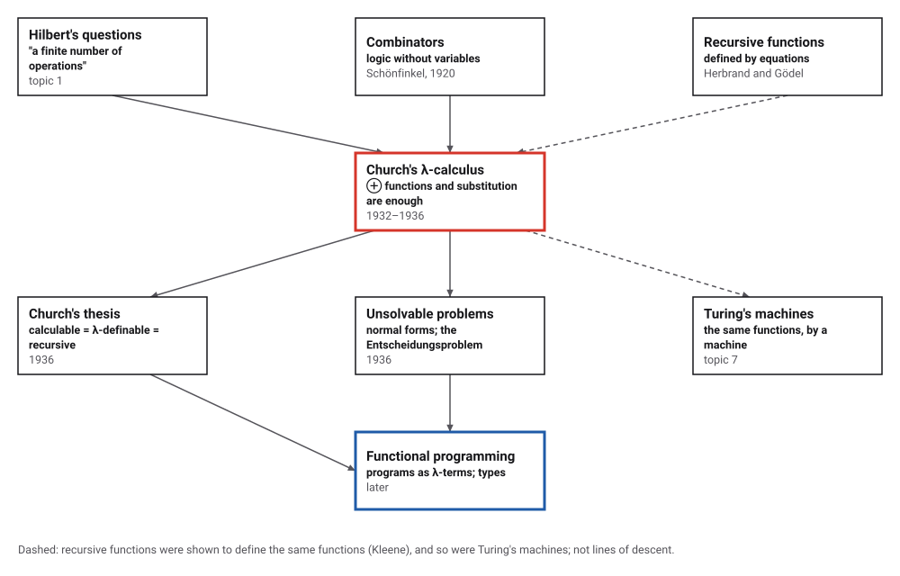
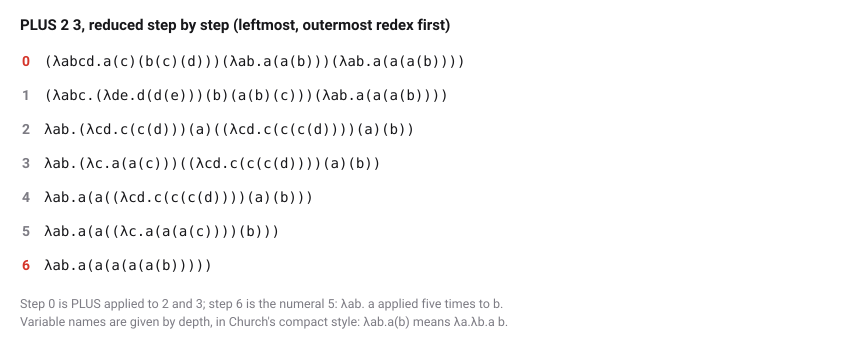
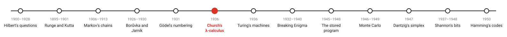
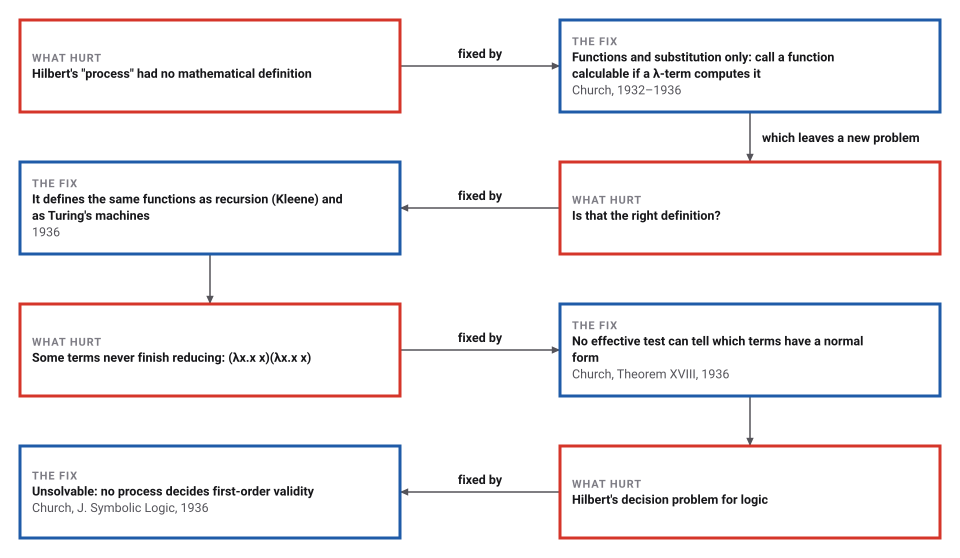

# Church's Lambda Calculus

*Era 4 · topic 6 · 1936* · [Era 4 index](../README.md) · [← Gödel's Numbering](../05-godel-numbering/README.md) · [Turing's Machines →](../07-turing-machines/README.md) · [Interactive edition](lambda-calculus.html) · [Program](../../../code/era-04-what-can-be-computed/06-lambda-calculus/)

> **Field note from the visiting historian.** In this calculus the number 3 is the instruction "do it three times", and adding is doing it a few times more. PLUS 2 3 became 5 in 6 substitutions. One term, fed to itself, substitutes for ever, and Church proved that no procedure can always tell such terms from the rest.

| | |
|---|---|
| **When** | Presented 19 April 1935; printed 1936 |
| **Where** | Princeton |
| **What hurt** | No definition of "effectively calculable" |
| **The fix** | λ-definable functions; one rule, substitution |
| **Cost** | 5! takes 26,898 reduction steps |

## How ideas combined

A new algorithm is usually an older idea combined with a new one. Hilbert asked for "a finite number of operations" without saying what an operation is (topic 1). Schönfinkel's combinators (1920) had shown that logic can be built from functions alone. Church's addition was a notation for functions with variables, λx.M, and a single rule for computing with it. Each box names the idea that was added.

<picture>
  <source media="(prefers-color-scheme: dark)" srcset="assets/family-dark.svg">
  
</picture>
*Red: Church's λ-calculus. Blue: where it went.*

## Compute by substitution

Pick an expression and reduce it one step at a time. Each step finds the leftmost, outermost place where a function λx.M meets an argument N, and replaces the pair by M with N put in place of x. PLUS 2 3 becomes the numeral 5 in 6 steps, as in the program. Try the last two: one never finishes, and the other finishes only because the first step throws the endless part away.

<picture>
  <source media="(prefers-color-scheme: dark)" srcset="assets/trace-dark.svg">
  
</picture>
*In the interactive edition you can reduce several expressions one step at a time.*

## Era 4, what can be computed

<picture>
  <source media="(prefers-color-scheme: dark)" srcset="assets/era-timeline-dark.svg">
  
</picture>

## Each fix leaves a new pain

<picture>
  <source media="(prefers-color-scheme: dark)" srcset="assets/chain-dark.svg">
  
</picture>
*Read it as a snake: each new problem sits directly under the fix that exposed it.*

## Three kinds of term, one rule

**Terms.** A variable x; a function λx.M, which given x returns M; an application M N, which applies M to N. **The rule.** (λx.M) N becomes M with N in place of x (β-reduction). A term with nothing left to reduce is in normal form: that is the answer.

**Numbers.** The numeral n applies a function n times: Church wrote 1 = λab.a(b), 2 = λab.a(a(b)), 3 = λab.a(a(a(b))) in 1936, starting from 1; today the list starts with 0 = λab.b. Arithmetic composes: PLUS = λm.λn.λf.λx.m f (n f x) applies f n times and then m times more; MULT = λm.λn.λf.m (n f) applies "f n times" m times; EXP = λm.λn.n m.

| Term | Reduction steps to the answer |
|---|---|
| PLUS 2 3 | 6 |
| MULT 2 3 | 7 |
| EXP 2 3 | 16 |
| PRED 3 | 11 |

The program checks PLUS, MULT and EXP on all numerals from 0 to 6, and the predecessor on 0 to 10: 144 results, every one equal to ordinary arithmetic. One wrinkle: EXP m 0 reduces to λa.a, the identity function, which is the numeral 1 only after a further rule (η-conversion) that this program does not use.

**Recursion without names.** Y = λg.(λx.g (x x)) (λx.g (x x)) reduces Y g to g (Y g), so a function can call itself without having a name. The program builds factorial from Y, the predecessor and a test for zero:

| n | n! by λ-reduction | Reduction steps |
|---|---|---|
| 0 | 1 | 9 |
| 1 | 1 | 30 |
| 2 | 2 | 127 |
| 3 | 6 | 646 |
| 4 | 24 | 3,873 |
| 5 | 120 | 26,898 |

> **Key idea.** Nothing but functions and substitution is enough to compute anything that can be computed, which is why Church proposed λ-definability as the meaning of "effectively calculable". The same power means that whether a term ever reaches a normal form cannot be decided in general.

## Order matters, and some terms never stop

(λx.x x)(λx.x x) reduces in one step to itself, so it has no normal form; the program confirms it is unchanged after 1,000 steps. Applied as the argument of λx.λy.y, which ignores its argument, it is thrown away: the leftmost, outermost order reaches λa.a in 1 step, while reducing the argument first is still working after 1,000 steps. Factorial's cost grows fast in this unary world: 5! = 120 takes 26,898 steps.

## Princeton, 1935–1936

"An Unsolvable Problem of Elementary Number Theory" was presented to the American Mathematical Society on 19 April 1935 and printed in the *American Journal of Mathematics* in April 1936. It proposes that "a function of positive integers shall be called effectively calculable if it is recursive", credits the definition of recursiveness jointly to Herbrand and Gödel and "the proof of equivalence of the two notions" chiefly to Kleene, and proves that "There is no recursive function of a formula C, whose value is 2 or 1 according as C has a normal form or not" (Theorem XVIII).

"A Note on the Entscheidungsproblem" (*Journal of Symbolic Logic* 1, received 15 April 1936) concludes that the general case "is unsolvable" (Church). Church's original logical system was "logically inconsistent in 1935"; the computational part survived as the untyped λ-calculus (Wikipedia). That calculability means λ-definability is a thesis, not a theorem: MacTutor quotes the view that it "is probably true but cannot be rigorously proved".

## Programs built from functions

Programming languages that treat functions as values, pass them to other functions and build recursion from them carry Church's notation forward; many still spell an anonymous function with the word lambda. Typed versions of the calculus, begun by Church in 1940, underlie the type systems that check programs before they run.

> **Full circle.** PLUS 2 3 reaches 5 in 6 substitutions. Nothing else happens in this calculus, and yet it computes everything a computer can.

## Before you read on

<details>
<summary><b>1.</b> Reduce (λx.x) y.</summary>

Put y in place of x in x: the answer is y. The identity function returns its argument.
</details>

<details>
<summary><b>2.</b> What does the numeral 2 do to a function f?</summary>

It returns λx.f (f x): f applied twice.
</details>

<details>
<summary><b>3.</b> Why does MULT = λm.λn.λf.m (n f) multiply?</summary>

n f applies f n times; m (n f) applies that m times: f applied m × n times.
</details>

<details>
<summary><b>4.</b> What is one step of (λx.x x)(λx.x x)?</summary>

Put λx.x x in place of x in x x: (λx.x x)(λx.x x) again. It never changes, so it never ends.
</details>

<details>
<summary><b>5.</b> Why is reducing the leftmost, outermost redex first a safe choice?</summary>

If any order reaches a normal form, this one does: it never wastes effort on an argument that will be thrown away.
</details>


## Where the evidence lives

| | Object | Where to see it | Licence |
|---|---|---|---|
| — | **An Unsolvable Problem of Elementary Number Theory (1936)**. Church's paper with his numerals and Theorem XVIII. | [Czech Technical University course page](https://courses.fit.cvut.cz/NI-VYC/church-an-unsolvable-problem-of-elementary-number-theory.pdf) | Drawn placeholder. |

## Every link was opened before it was listed

| Level | Link | Why |
|---|---|---|
| Start | [Lambda calculus](https://en.wikipedia.org/wiki/Lambda_calculus) — Wikipedia | Terms, β-reduction, Church numerals, Ω and Y, and the history |
| Start | [Alonzo Church](https://mathshistory.st-andrews.ac.uk/Biographies/Church/) — MacTutor | Church's life, his thesis, his theorem, and his students |
| Deeper | [Birth of lambda-calculus and combinatory logic](https://www.macs.hw.ac.uk/~fairouz/forest/events/history/birth-lambda.html) — Roger Hindley, talk abstract, Workshop on History of Logics, Types and Rewriting, Heriot-Watt University (5 December 2000) | Schönfinkel's combinators of 1920, before the λ-calculus |
| Scholar | [An Unsolvable Problem of Elementary Number Theory](https://courses.fit.cvut.cz/NI-VYC/church-an-unsolvable-problem-of-elementary-number-theory.pdf) — Alonzo Church, *American Journal of Mathematics* 58(2):345–363 (1936), scan on a Czech Technical University course page | The numerals, the thesis, and the first unsolvable problem |
| Scholar | [A Note on the Entscheidungsproblem](https://people.csail.mit.edu/brooks/idocs/church_ent.pdf) — Alonzo Church, *The Journal of Symbolic Logic* 1(1):40–41 (1936), reprint on an MIT page | Hilbert's decision problem for first-order logic, answered: no |

More, with certainty labels and the gaps we could not fill: [Era 4 reference catalog](https://github.com/vij658/AlgorithmEvolutionAtlas/blob/main/book/era-04-what-can-be-computed/reference-catalog.md).

## The program behind every number here

[LambdaCalculus.java](https://github.com/vij658/AlgorithmEvolutionAtlas/blob/main/code/era-04-what-can-be-computed/06-lambda-calculus/LambdaCalculus.java) makes **163 checks**: 144 arithmetic results against ordinary arithmetic, the identity from EXP m 0, the trace of PLUS 2 3, factorial up to 5! through the Y combinator, and the term that reduces to itself. Run it with `java LambdaCalculus.java` (JDK 17 or newer). The heart of it:

```java
/** (\.body) arg  ->  body with arg put in place of variable 0. */
static T beta(T body, T arg) { return shift(subst(body, 0, shift(arg, 1, 0)), -1, 0); }

/** One step of normal order (leftmost, outermost redex first), or null if t is in normal form. */
static T stepNormal(T t) {
    if (t instanceof App a) {
        if (a.f instanceof Lam l) return beta(l.body, a.a);
        T f = stepNormal(a.f);
        if (f != null) return new App(f, a.a);
        T x = stepNormal(a.a);
        return x == null ? null : new App(a.f, x);
    }
    if (t instanceof Lam l) { T b = stepNormal(l.body); return b == null ? null : new Lam(b); }
    return null;
}
```

