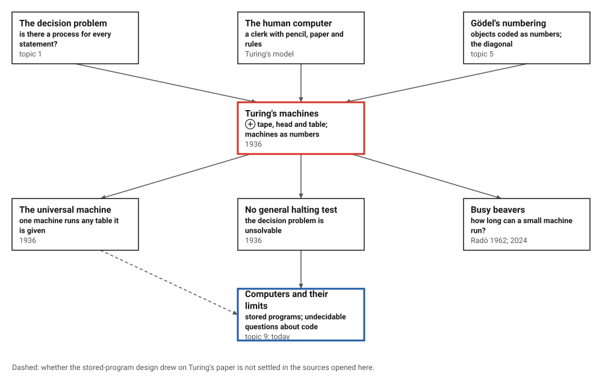
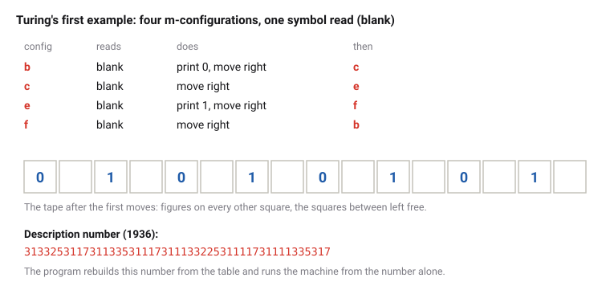
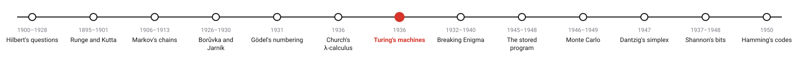
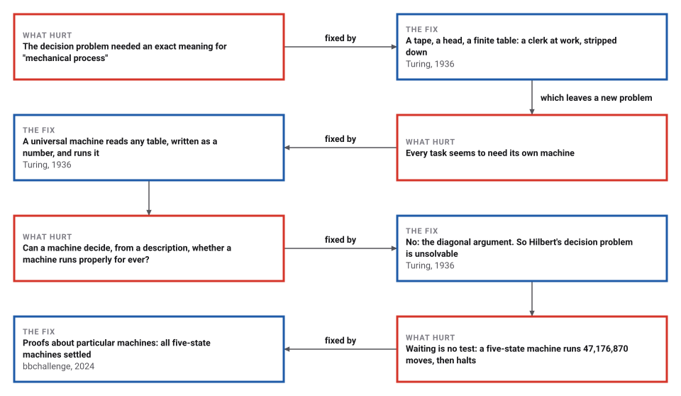

# Turing's Machines

*Era 4 · topic 7 · 1936* · [Era 4 index](../README.md) · [← Church's Lambda Calculus](../06-lambda-calculus/README.md) · [Breaking Enigma →](../08-breaking-enigma/README.md) · [Interactive edition](turing-machines.html) · [Program](../../../code/era-04-what-can-be-computed/07-turing-machines/)

> **Field note from the visiting historian.** Turing's first machine is the number 31332531​17311335​31117311​13322531​11173111​1335317. I gave that number to a program that knew nothing else, and it printed 0 and 1 on alternate squares, exactly as the paper says. A machine is a number; a number can be a machine.

| | |
|---|---|
| **When** | Received 28 May 1936; printed 1937 |
| **Where** | Cambridge; Princeton |
| **What hurt** | No exact meaning for "mechanical process" |
| **The fix** | Tape, head, table; a universal machine |
| **Limit** | No machine decides halting for all machines |

## How ideas combined

A new algorithm is usually an older idea combined with a new one. Hilbert's decision problem (topic 1) asked for a mechanical process; Gödel had just coded formulas as numbers and used a diagonal argument (topic 5). Turing's addition was a picture of the person doing the computing, a clerk following rules, reduced to a machine so simple that its tables could be listed, numbered, and fed to other machines. Each box names the idea that was added.

<picture>
  <source media="(prefers-color-scheme: dark)" srcset="assets/family-dark.svg">
  
</picture>
*Red: Turing's paper of 1936. Blue: where it led.*

## Run a machine, and read its number

Pick a machine and step it. The tape shows 17 squares around the head (outlined); the table highlights the line just used. Turing's own first example prints 0 and 1 on alternate squares for ever. The two-state busy beaver halts after 6 moves; the five-state one halts too, after 47,176,870 moves. Each machine's description number is shown: that number, given to a universal machine, is the program.

<picture>
  <source media="(prefers-color-scheme: dark)" srcset="assets/machine-dark.svg">
  
</picture>
*In the interactive edition you can run three machines move by move, or until they halt.*

## Era 4, what can be computed

<picture>
  <source media="(prefers-color-scheme: dark)" srcset="assets/era-timeline-dark.svg">
  
</picture>

## Each fix leaves a new pain

<picture>
  <source media="(prefers-color-scheme: dark)" srcset="assets/chain-dark.svg">
  
</picture>
*Read it as a snake: each new problem sits directly under the fix that exposed it.*

## A table, a number, and a question with no answer

**The machine.** A tape of squares, a head over one of them, and a table. Each line says: in this state, reading this symbol, write a symbol, move one square, and go to that state. Turing's first example has four states, b, c, e and f, and prints "the sequence 010101...": b prints 0 and moves right; c just moves right; e prints 1 and moves right; f moves right and starts again.

**The number.** Turing wrote each line in letters: D followed by A's for the state, D followed by C's for the symbol read and the symbol written, L, R or N for the move, and D with A's for the next state; then he replaced A, C, D, L, R, N and ; by the digits 1 to 7. For the first example the program builds the standard description DADDCRDAA;​DAADDRDAAA​;DAAADDCCR​DAAAA;DAAA​ADDRDA; and the description number 31332531​17311335​31117311​13322531​11173111​1335317, digit for digit the number printed in the paper. It then reads the number back into a table of 4 lines and runs the machine from the number alone: the tape is the same for 10,000 moves. A universal machine does exactly this, on its own tape.

**The question with no answer.** Suppose some machine H could read any description number and say whether that machine halts. Build a machine that, given a number, asks H about the machine with that number fed its own number, and does the opposite: loops if H says "halts", halts if H says "loops". Feed this machine its own number, and H must be wrong. So H cannot exist. Turing's own version asks whether a machine is "circle-free" (prints for ever without getting stuck); the conclusion is the same, and with it the Entscheidungsproblem falls.

> **Key idea.** A machine's table is finite, so it can be written as a number and handed to another machine: one universal machine can run them all. The same fact lets a machine be fed its own description, which is why no machine can decide, for every machine, whether it will halt.

## Small machines, long runs

| Two-state, two-symbol machines from a blank tape | Count |
|---|---|
| all machines (each of 4 lines: write 0 or 1, move left or right, go to A, B or halt) | 20,736 |
| halt | 9,784 |
| …of which halt after 1 move | 6,912 |
| …of which halt after 2 moves | 2,304 |
| …of which halt after 3 moves | 384 |
| …of which halt after 4 moves | 128 |
| …of which halt after 5 moves | 16 |
| **…of which halt after 6 moves** | **40** |
| still running after 1,000 moves | 10,952 |

No two-state machine that halts takes more than 6 moves or leaves more than 4 ones, which are Radó's values for two states. Knowing that number settles halting for every two-state machine: run it for 6 moves, and if it has not halted, it never will. For five states the number is 47,176,870, found in 1989 and proved only in 2024; the program runs that machine to the end, leaving 4,098 ones on a stretch of 12,289 squares. A test that waited 10,000,000 moves would have called it a machine that never halts.

## Cambridge and Princeton, 1936

Turing took Max Newman's course on the foundations of mathematics in spring 1935, which covered Gödel's results and Hilbert's decision problem; he finished the paper in April 1936 and revised it in August, and Newman had to argue for publishing it after Church's paper appeared (MacTutor). The paper was received on 28 May 1936 and read on 12 November 1936; its appendix, "Added 28 August, 1936", shows that Church's "effective calculability" is "equivalent to my 'computability'".

"It is possible to invent a single machine which can be used to compute any computable sequence", and "there can be no general process for determining whether a given number is satisfactory or not" (Turing 1936). Turing "did not use the terms 'halt' or 'halting'"; the name halting problem is credited to Martin Davis (Wikipedia). The five-state busy beaver of Marxen and Buntrock (1989) was "only proved to be the winning fifth busy beaver in 2024" by the bbchallenge collective (Wikipedia, Busy beaver).

## Every computer is universal

The machine you are reading this on is, apart from its finite memory, a universal machine: it runs whatever program it is given, and its programs are stored as numbers (topic 9). Turing's negative result came with it. No program can decide, for every program, whether it halts; tools that look for bugs in code must therefore sometimes say "I don't know".

> **Full circle.** Turing's first machine is the 47-digit number 31332531​17311335​31117311​13322531​11173111​1335317. A five-state machine, whose table fits on a postcard, ran 47,176,870 moves before halting, and proving that no five-state machine runs longer took until 2024.

## Before you read on

<details>
<summary><b>1.</b> What does Turing's machine I write on its first eight squares?</summary>

0, blank, 1, blank, 0, blank, 1, blank: figures on alternate squares.
</details>

<details>
<summary><b>2.</b> In Turing's code, what does DAA stand for, and DCC?</summary>

DAA is the second state (q2); DCC is the second symbol (S2), which in the first example is the figure 1.
</details>

<details>
<summary><b>3.</b> Why can a universal machine exist at all?</summary>

A machine is a finite table, so it can be written on a tape as a string of symbols; one machine can then read that string and do what each line says.
</details>

<details>
<summary><b>4.</b> Why is "run it for a long time and see" not a halting test?</summary>

A machine that has not halted yet may halt later: the five-state busy beaver is still running after 10,000,000 moves and halts at 47,176,870.
</details>

<details>
<summary><b>5.</b> If someone knew the longest a six-state machine can run before halting, what could they do?</summary>

Decide halting for every six-state machine from a blank tape: run it that long. Radó's function grows too fast to be computed, so no general method can supply those numbers.
</details>


## Where the evidence lives

| | Object | Where to see it | Licence |
|---|---|---|---|
| — | **On Computable Numbers (1936)**. The paper, with the first example machine and its description number. | [University of Virginia (scan)](https://www.cs.virginia.edu/~robins/Turing_Paper_1936.pdf) | Drawn placeholder. |

## Every link was opened before it was listed

| Level | Link | Why |
|---|---|---|
| Start | [Turing 2018/3: "On Computable Numbers" – Turing's 1936 Paper](https://podcasts.ox.ac.uk/turing-20183-computable-numbers-turings-1936-paper) — Peter Millican, University of Oxford, series *Alan Turing on Computability and Intelligence* (video, with transcript) | A walk through the paper: the human computer, the machines and their tables |
| Start | [Turing machine](https://en.wikipedia.org/wiki/Turing_machine) — Wikipedia | Tape, head, table, the universal machine, and the human "computer" Turing modelled |
| Start | [Alan Mathison Turing](https://mathshistory.st-andrews.ac.uk/Biographies/Turing/) — MacTutor | Newman's course, the paper, Princeton, and Bletchley Park |
| Start | [Halting problem](https://en.wikipedia.org/wiki/Halting_problem) — Wikipedia | The diagonal proof, and who named the problem |
| Deeper | [Turing 2018/4: Enumerating the Computable Numbers, and the Universal Turing Machine](https://www.podcasts.ox.ac.uk/turing-20184-enumerating-computable-numbers-and-universal-turing-machine?video=1) — Peter Millican, University of Oxford (video) | Description numbers, the universal machine and the diagonal argument |
| Deeper | [Description number](https://en.wikipedia.org/wiki/Description_number) — Wikipedia | How a machine becomes a number |
| Deeper | [Busy beaver](https://en.wikipedia.org/wiki/Busy_beaver) — Wikipedia | Radó's function, the five-state champion, and its proof in 2024 |
| Scholar | [On Computable Numbers, with an Application to the Entscheidungsproblem](https://www.cs.virginia.edu/~robins/Turing_Paper_1936.pdf) — A. M. Turing, *Proceedings of the London Mathematical Society* (2) 42:230–265 (1936–37), scan on a University of Virginia page | The paper |
| Scholar | [On Computable Numbers (transcription)](https://verostko.com/turing/1936-paper.html) — Transcription by abelard.org, reproduced with permission of the London Mathematical Society | A searchable text with the example tables and description numbers |

More, with certainty labels and the gaps we could not fill: [Era 4 reference catalog](https://github.com/vij658/AlgorithmEvolutionAtlas/blob/main/book/era-04-what-can-be-computed/reference-catalog.md).

## The program behind every number here

[TuringMachines.java](https://github.com/vij658/AlgorithmEvolutionAtlas/blob/main/code/era-04-what-can-be-computed/07-turing-machines/TuringMachines.java) makes **9,872 checks**: Turing's first machine and its description number against the one printed in 1936, the number decoded and run, every one of the 20,736 two-state machines, and the five-state busy beaver run to its halt at move 47,176,870. Run it with `java TuringMachines.java` (JDK 17 or newer). The heart of it:

```java
// ---- Turing's standard description: letters A C D L R N ; and the digits 1 to 7 ------------------------------------
/** States are numbered from 1 (q1 = DA), symbols from 0 (S0 = blank = D, S1 = DC, S2 = DCC). */
static String standardDescription(List<Rule> rules) {
    StringBuilder sb = new StringBuilder();
    for (Rule r : rules)
        sb.append("D").append("A".repeat(r.q + 1))
          .append("D").append("C".repeat(r.s))
          .append("D").append("C".repeat(r.w))
          .append(r.m < 0 ? "L" : r.m > 0 ? "R" : "N")
          .append("D").append("A".repeat(r.n + 1))
          .append(";");
    return sb.toString();
}

/** Read a description number back into a table: the universal machine's first job. */
static List<Rule> decode(String dn) {
    StringBuilder sd = new StringBuilder();
    for (char c : dn.toCharArray()) sd.append("ACDLRN;".charAt(c - '1'));
    List<Rule> rules = new ArrayList<>();
    for (String line : sd.toString().split(";")) {
        // D A^i D C^j D C^k M D A^m
        int p = 1, i = 0, j = 0, k = 0, m = 0;
        while (line.charAt(p) == 'A') { i++; p++; }
        p++;                                                            // D
        while (line.charAt(p) == 'C') { j++; p++; }
        p++;                                                            // D
        while (line.charAt(p) == 'C') { k++; p++; }
        char mv = line.charAt(p++);
        p++;                                                            // D
        while (p < line.length() && line.charAt(p) == 'A') { m++; p++; }
        rules.add(new Rule(i - 1, j, k, mv == 'L' ? -1 : mv == 'R' ? 1 : 0, m - 1));
    }
    return rules;
}
```

