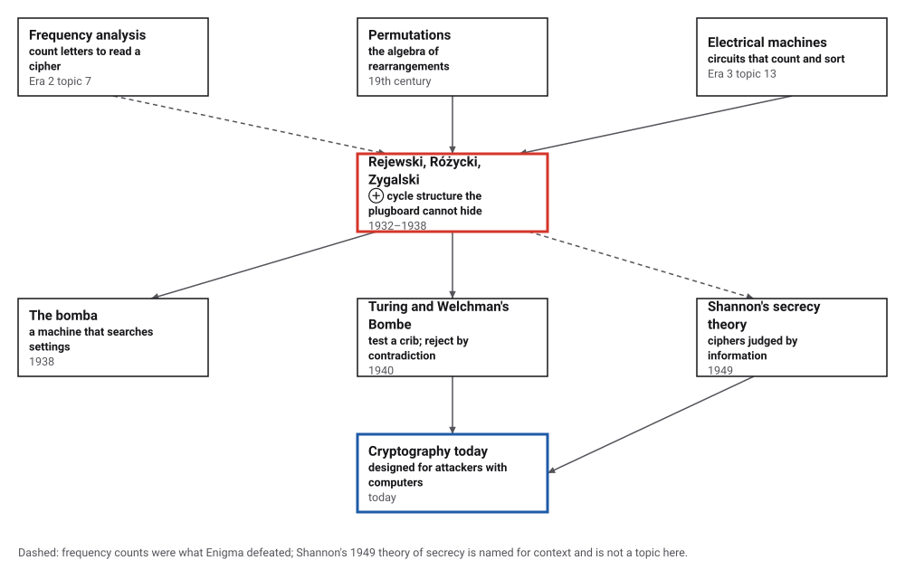
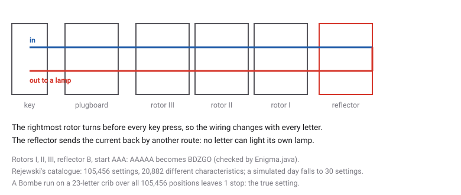
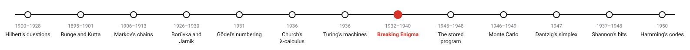
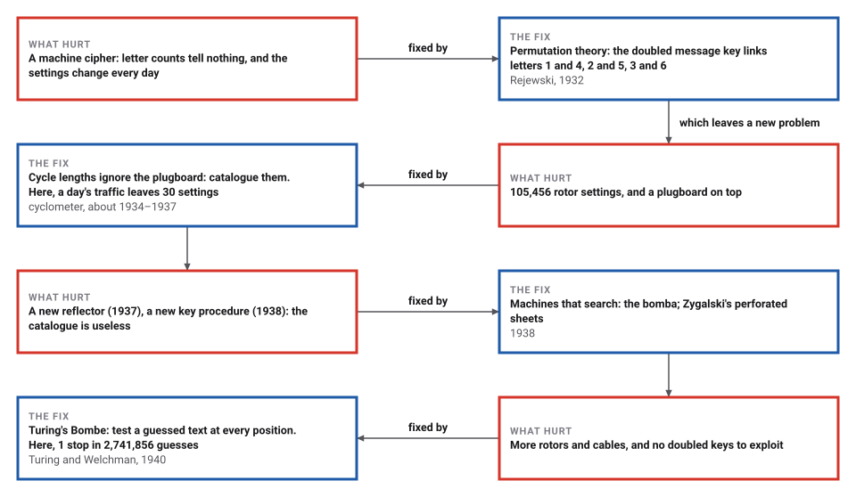

# Breaking Enigma

*Era 4 · topic 8 · 1932–1940* · [Era 4 index](../README.md) · [← Turing's Machines](../07-turing-machines/README.md) · [The Stored Program, and Merge Sort →](../09-stored-program/README.md) · [Interactive edition](breaking-enigma.html) · [Program](../../../code/era-04-what-can-be-computed/08-breaking-enigma/)

> **Field note from the visiting historian.** The machine could not hide two things: a letter is never itself, and the lengths of certain cycles do not care about the plug cables. On my simulated day, 125 intercepted indicators narrowed 105,456 settings to 30. Rejewski did it with paper, a catalogue, and a year of patience.

| | |
|---|---|
| **When** | Rejewski 1932; bomba 1938; Bombe 1940 |
| **Where** | Warsaw; Bletchley Park |
| **What hurt** | Too many settings to try, changed daily |
| **The fix** | Invariants that ignore the plugboard; search by contradiction |
| **Result** | 105,456 settings → 30; 2,741,856 guesses → 1 stop |

## How ideas combined

A new algorithm is usually an older idea combined with a new one. Frequency analysis (Era 2, topic 7) had broken ciphers for a thousand years; Enigma's turning rotors defeated it. The Polish mathematicians brought in the algebra of permutations, and then machines of their own to search the settings; the British scaled the search up. Each box names the idea that was added.

<picture>
  <source media="(prefers-color-scheme: dark)" srcset="assets/family-dark.svg">
  
</picture>
*Red: the Polish Cipher Bureau's work of 1932–1938. Blue: where it led.*

## Type on an Enigma

Choose the rotor order and start positions, plug some cables, and type. The page enciphers your message, then types the cipher text on a second machine set the same way, and gets the message back. Watch for two things: no letter is ever enciphered as itself, and at every position the machine simply swaps the alphabet in 13 pairs (shown on the right for the next key press).

<picture>
  <source media="(prefers-color-scheme: dark)" srcset="assets/path-dark.svg">
  
</picture>
*In the interactive edition you can set an Enigma I and type on it.*

## Era 4, what can be computed

<picture>
  <source media="(prefers-color-scheme: dark)" srcset="assets/era-timeline-dark.svg">
  
</picture>

## Each fix leaves a new pain

<picture>
  <source media="(prefers-color-scheme: dark)" srcset="assets/chain-dark.svg">
  
</picture>
*Read it as a snake: each new problem sits directly under the fix that exposed it.*

## Swaps, cycles, and contradictions

**The machine.** A key press goes through the plugboard, three rotors, the reflector, back through the rotors and the plugboard, to a lamp. The right rotor turns before every letter and carries the next one at its notch. The program builds the Enigma I with the wirings of 1930 and reproduces the published test: rotors I, II, III, reflector B, start AAA, AAAAA becomes **BDZGO**. Because of the reflector, each position swaps the letters in pairs: the program enciphered 1,000 random messages twice and got them back every time, and checked all 456,976 letter–position cases for rotors I-II-III: no letter ever goes to itself.

**Rejewski's characteristic.** Until 1938 operators enciphered each message's three-letter key twice, so cipher letters 1 and 4 come from the same letter. If A and D are the machine's swaps at positions 1 and 4, then letter 1 → letter 4 is the product of A and D, and a day's traffic reveals it completely. Its cycles always come in pairs of equal length, and the plugboard only relabels the letters in them, never the lengths.

| Catalogue (reflector A, used until November 1937) | Count |
|---|---|
| rotor settings (6 orders × 17,576 positions) | 105,456 |
| products AD, BE, CF checked: cycles in pairs every time | 316,368 |
| different characteristics | 20,882 |
| characteristics that belong to a single setting | 11,059 |
| most settings sharing one characteristic | 1,727 |

The program then simulates a day: a secret setting and plugboard, and the doubled keys of 125 messages, enough to fix all three products. The first product's cycle lengths are [11, 11, 2, 2]; looking up the three together, the catalogue lists **30** settings, the true one among them. What is left is a short list to try by hand.

**The Bombe.** From 1940 the doubled key was gone and the search started from a crib, a guessed piece of plain text. The program takes the crib WETTERVORHERSAGEBISKAYA and its cipher text ZSZEJDPNERKWXGMMTPEXCFN. At each rotor position it assumes a plug partner for the commonest letter (E) and follows what the crib forces: if plain letter x is plugged to a, the rotors send a to some b, so cipher letter y must be plugged to b. A letter plugged to two different letters is a contradiction, and the guess is rejected. Of 105,456 positions × 26 guesses, **1** survives: the true setting, where the crib fixes the partners of 23 letters, all correct.

> **Key idea.** Find a property of the secret that ignores most of the key: cycle lengths that the plugboard cannot change, or a contradiction that rules out a rotor position whatever the plugs are. Then search only what is left, by machine.

## From a hundred thousand settings to one

| Stage | Candidates left |
|---|---|
| rotor order and position, before any analysis | 105,456 |
| after Rejewski's catalogue, on one simulated day | 30 |
| Bombe guesses (positions × 26 plug guesses), 23-letter crib | 2,741,856 |
| Bombe stops | 1 |

The program's Bombe follows each forced plug in both directions (if x is plugged to y, then y is plugged to x), which is the effect of Welchman's diagonal board; the first Bombe of March 1940 had none, and would have stopped more often. Ring settings are fixed at A throughout, a simplification the real attacks did not have.

## Warsaw, 1932 to 1939

Rejewski joined the Cipher Bureau in Warsaw full-time on 1 September 1932 with Różycki and Zygalski (MacTutor); in December 1932 he worked out the rotor wirings using "the theory of permutations and groups", with German manuals and keys that French intelligence had bought from Hans-Thilo Schmidt (Wikipedia). The cyclometer, "probably in 1934 or 1935", catalogued 105,456 settings; making the catalogue "was laborious and took over a year"; it had to be redone after the reflector change of 1 November 1937 and became "completely useless" on 15 September 1938 (Wikipedia, Cyclometer).

The bomba, built with the AVA Radio Manufacturing Company, was "the first cryptanalytic machine to break Enigma codes" (IEEE Milestone, 2014); the Poles shared their work with the British and French near Warsaw in July 1939. The first British Bombe, "Victory", was installed at Bletchley Park on 18 March 1940; each position that led to "a logical contradiction" was ruled out (Wikipedia, Bombe). The wirings are from Wikipedia's Enigma rotor details, whose test vector is marked "citation needed"; the program reproduces it.

## Search as a weapon

Enigma was strong against people with pencils and weak against people with machines that could test thousands of settings an hour. Modern ciphers are designed the other way round: their keys are so long that no machine could try a useful fraction of them, and they are designed on the assumption that the attacker knows everything except the key, as the Poles knew the machine from its manuals.

> **Full circle.** Rejewski's cycles turn 105,456 settings into 20,882 fingerprints; Turing's contradictions turn 2,741,856 guesses into 1 stop. Both find what the secret cannot hide.

## Before you read on

<details>
<summary><b>1.</b> Why does typing the cipher text on a machine set the same way give back the message?</summary>

At each position the machine swaps letters in pairs: if A becomes Q, then Q becomes A.
</details>

<details>
<summary><b>2.</b> A crib says ATTACK is under the cipher letters QTXBNE. Can that alignment be right?</summary>

No: the second letter would have T enciphered as T, and Enigma never enciphers a letter as itself. Slide the crib along.
</details>

<details>
<summary><b>3.</b> Why do the plug cables not change the cycle lengths of AD?</summary>

The plugboard P acts on the way in and on the way out, so the product becomes P·AD·P: the same cycles with the letters renamed. Renaming letters cannot change a cycle's length.
</details>

<details>
<summary><b>4.</b> Why were the doubled message keys a gift?</summary>

Letters 1 and 4 hid the same letter, so every message linked the machine's swaps at positions 1 and 4, day after day.
</details>

<details>
<summary><b>5.</b> What does a Bombe stop mean?</summary>

That the guess for this position caused no contradiction. It is a candidate, checked by hand on a replica Enigma.
</details>


## Where the evidence lives

| | Object | Where to see it | Licence |
|---|---|---|---|
| — | **IEEE Milestone plaque, Warsaw (2014)**. "First Breaking of Enigma Code by the Team of Polish Cipher Bureau, 1932–1939". | [ETHW](https://ethw.org/Milestones:First_Breaking_of_Enigma_Code_by_the_Team_of_Polish_Cipher_Bureau%2C_1932-1939) | Drawn placeholder. |

## Every link was opened before it was listed

| Level | Link | Why |
|---|---|---|
| Start | [Cryptanalysis of the Enigma](https://en.wikipedia.org/wiki/Cryptanalysis_of_the_Enigma) — Wikipedia | The machine, the doubled indicators, Rejewski's characteristic, Zygalski's sheets and the Bombe |
| Start | [Marian Adam Rejewski](https://mathshistory.st-andrews.ac.uk/Biographies/Rejewski/) — MacTutor | Rejewski's life, from Poznań to the Cipher Bureau and after |
| Start | [Milestone: First Breaking of Enigma Code by the Team of Polish Cipher Bureau, 1932–1939](https://ethw.org/Milestones:First_Breaking_of_Enigma_Code_by_the_Team_of_Polish_Cipher_Bureau%2C_1932-1939) — IEEE History Center, Engineering and Technology History Wiki (dedicated 5 August 2014) | The citation for the bomba |
| Deeper | [Cyclometer](https://en.wikipedia.org/wiki/Cyclometer) — Wikipedia | The catalogue of 105,456 characteristics and why it failed in 1937–38 |
| Deeper | [Bombe](https://en.wikipedia.org/wiki/Bombe) — Wikipedia | Cribs, menus, logical contradictions and the diagonal board |
| Deeper | [The Polish recovery of the Enigma rotor wiring](https://www.cryptocellar.org/enigma/files/rejewski-paper.pdf) — F.L.C., Crypto Cellar (March 2005) | The permutation equations step by step |
| Deeper | [Enigma rotor details](https://en.wikipedia.org/wiki/Enigma_rotor_details) — Wikipedia | The wirings used by the program |

More, with certainty labels and the gaps we could not fill: [Era 4 reference catalog](https://github.com/vij658/AlgorithmEvolutionAtlas/blob/main/book/era-04-what-can-be-computed/reference-catalog.md).

## The program behind every number here

[Enigma.java](https://github.com/vij658/AlgorithmEvolutionAtlas/blob/main/code/era-04-what-can-be-computed/08-breaking-enigma/Enigma.java) makes **835,723 checks**: the published test vector, 1,000 messages enciphered and recovered, 456,976 positions without a fixed letter, cycles in pairs for all 316,368 products, the plugboard's invariance, the simulated day, and the Bombe run over every position. Run it with `java Enigma.java` (JDK 17 or newer). The heart of it:

```java
    /** The scrambler alone (rotors and reflector) at the current position. */
    int scramble(int c) {
        for (int k = 2; k >= 0; k--) c = (FWD[order[k]][(c + pos[k]) % 26] - pos[k] + 26) % 26;
        c = refl[c];
        for (int k = 0; k <= 2; k++) c = (BWD[order[k]][(c + pos[k]) % 26] - pos[k] + 26) % 26;
        return c;
    }

/** Record that a and b are plugged together; false if either already has a different partner. */
static boolean assign(int[] partner, int a, int b) {
    if (partner[a] >= 0 && partner[a] != b) return false;
    if (partner[b] >= 0 && partner[b] != a) return false;
    partner[a] = b;
    partner[b] = a;
    return true;
}
```

