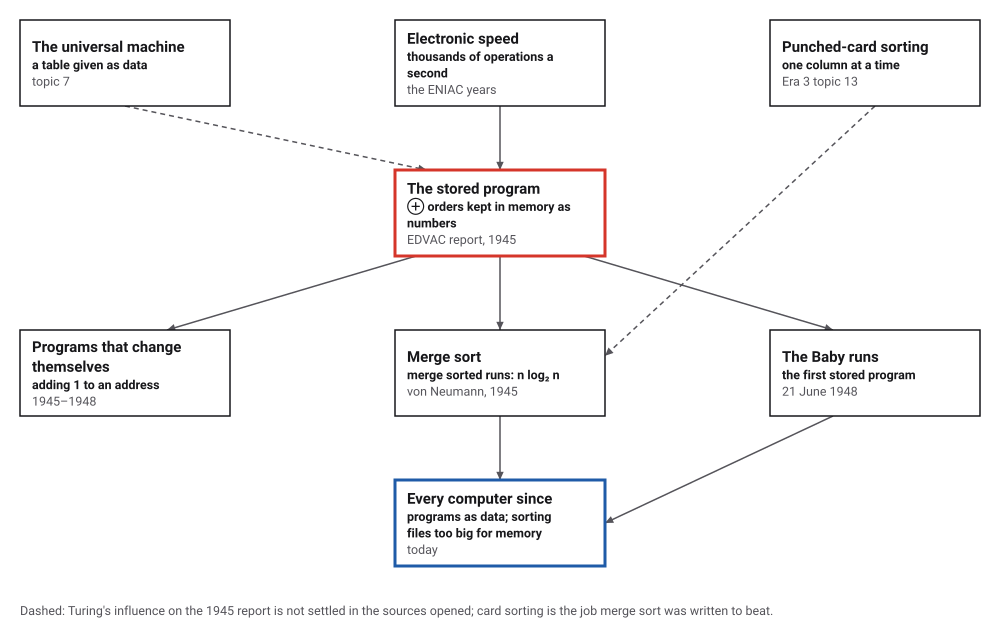
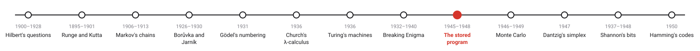
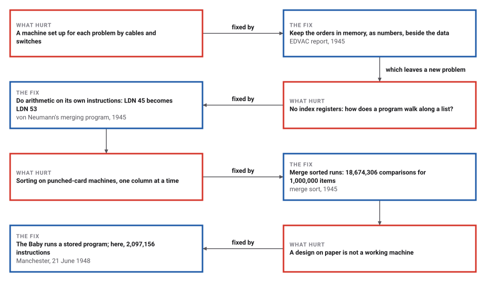

# The Stored Program, and Merge Sort

*Era 4 · topic 9 · 1945–1948* · [Era 4 index](../README.md) · [← Breaking Enigma](../08-breaking-enigma/README.md) · [Monte Carlo →](../10-monte-carlo/README.md) · [Interactive edition](stored-program.html) · [Program](../../../code/era-04-what-can-be-computed/09-stored-program/)

> **Field note from the visiting historian.** An instruction is a number: function times 8,192, plus an address. My merging program adds one to its own instructions to step along the lists, and after 432 instructions the word that said STO 63 says STO 79. The machine cannot tell its program from its data, and that is the point.

| | |
|---|---|
| **When** | EDVAC report 1945; the Baby, 21 June 1948 |
| **Where** | The EDVAC project; Manchester |
| **What hurt** | Machines rewired for each problem; slow card sorting |
| **The fix** | Orders stored as numbers; sorting by merging |
| **Cost** | 18,674,306 comparisons for 1,000,000 items |

## How ideas combined

A new algorithm is usually an older idea combined with a new one. Turing's universal machine (topic 7) read its instructions from its tape; the wartime electronic machines were fast but were set up for each problem by hand. The 1945 design report put the two together: instructions in the same fast memory as the numbers. To show that such a machine could do clerical work, not just arithmetic, von Neumann wrote out a program for merging sorted files. Each box names the idea that was added.

<picture>
  <source media="(prefers-color-scheme: dark)" srcset="assets/family-dark.svg">
  
</picture>
*Red: the stored-program design of 1945. Blue: every computer since.*

## Run a program that lives in its own data

The store on the right holds the program and its numbers side by side, in the Baby's seven instructions. The first program finds the highest proper factor of a number by repeated subtraction, the task of the Baby's first run; set the number to 262144 (2¹⁸) and run it: it executes 2,097,156 instructions, as in the program. The second merges two sorted lists, and adds 1 to the addresses inside its own instructions LA, LB and SC as it goes (they turn red).

| Word | Label | Contents |
|---|---|---|
| 0 | start | NUM 0 |
| 1 | outer | LDN b |
| 2 |  | STO t |
| 3 |  | LDN t |
| 4 |  | SUB one |
| 5 |  | STO b |
| 6 |  | LDN negN |
| 7 | inner | SUB b |
| 8 |  | CMP |
| 9 | back | JRP rel |
| 10 |  | STO t |
| 11 |  | LDN t |
| 12 |  | SUB b |
| 13 |  | CMP |
| 14 |  | JMP foundp |
| 15 |  | JMP outerp |
| 16 | found | STP |
| 17 | b | NUM 262144 |
| 18 | t | NUM 0 |
| 19 | one | NUM 1 |
| 20 | negN | NUM -262144 |
| 21 | rel | NUM inner-back-1 |
| 22 | foundp | NUM found-1 |
| 23 | outerp | NUM outer-1 |
*In the interactive edition you can run both programs one instruction at a time and watch the store change.*

## Era 4, what can be computed

<picture>
  <source media="(prefers-color-scheme: dark)" srcset="assets/era-timeline-dark.svg">
  
</picture>

## Each fix leaves a new pain

<picture>
  <source media="(prefers-color-scheme: dark)" srcset="assets/chain-dark.svg">
  
</picture>
*Read it as a snake: each new problem sits directly under the fix that exposed it.*

## Instructions are numbers

**The machine.** The Baby had 32 words of store, an accumulator and seven instructions: JMP and JRP (jump to an address held in a word, or forward by a number held in one), LDN (load minus a word), STO (store), SUB (subtract), CMP (skip the next instruction if the accumulator is negative) and STP (stop). There is no add: x + 1 is −(−x − 1). Each instruction is a single word: a function number times 8,192, plus an address.

**A program in 32 words.** The program's own version of the Baby's first task uses 16 instructions and 7 words of data: it tries divisors from 262,143 downward and divides by repeated subtraction. It stops with 131,072 after 2,097,156 instructions. (Kilburn's program of 21 June 1948 had 17 instructions and took about 3.5 million operations; this one is not his, so the counts differ.)

**A program that rewrites itself.** With no index registers, a program steps through a list by changing the address inside an instruction. The merging program (35 instructions) loads the front of each run with instructions LA and LB and writes with SC; after each move it adds 1 to the instruction it used. Merging [132, 179, 410, 504, 536, 551, 657, 844] with [53, 142, 278, 286, 296, 471, 937, 992] took 432 instructions, and afterwards LA had become LDN 53 (from LDN 45), LB LDN 62 (from LDN 54) and SC STO 79 (from STO 63). A large sentinel at the end of each run saves testing which run is empty, and equal keys are taken from the first run, so the merge is stable.

**Merge sort.** Merging two sorted runs of total length n takes at most n − 1 comparisons. Sorting merges runs of 1 into runs of 2, then 4, then 8: about log₂ n rounds of about n comparisons. The program checks the exact worst case over every permutation of up to 8 items:

| Items n | Merge sort, worst case (all permutations) | n⌈lg n⌉ − 2^⌈lg n⌉ + 1 | Lower bound ⌈lg n!⌉ for any comparison sort |
|---|---|---|---|
| 1 | 0 | 0 | 0 |
| 2 | 1 | 1 | 1 |
| 3 | 3 | 3 | 3 |
| 4 | 5 | 5 | 5 |
| 5 | 8 | 8 | 7 |
| 6 | 11 | 11 | 10 |
| 7 | 14 | 14 | 13 |
| 8 | 17 | 17 | 16 |

> **Key idea.** Keep the program in memory as numbers, and the machine can load it, change it and run it like data. And sort by merging: combining two sorted lists costs one comparison per item, so halving and merging costs about n log₂ n.

## Merging against inserting

| Random items | Merge sort comparisons | n log₂ n | Insertion sort shifts |
|---|---|---|---|
| 1,000 | 8,711 | 9,966 | 249,417 |
| 10,000 | 120,460 | 132,877 | 24,953,522 |
| 100,000 | 1,536,355 | 1,660,964 | 2,490,753,322 |
| 1,000,000 | 18,674,306 | 19,931,569 | 249,861,839,855 |

Insertion sort moves each item past every larger item before it, about n²/4 moves on random data; merge sort's comparisons stay just under n log₂ n. For a million items that is the difference between a quarter of a trillion steps and under twenty million. The program counts insertion sort's moves directly up to 10,000 items and, beyond that, as the number of out-of-order pairs, which merge sort counts as it merges.

## A report, a manuscript and a small machine

The "First Draft of a Report on the EDVAC" is dated 30 June 1945 and describes "a uniform memory containing both numbers (data) and orders (instructions)"; that it bears only von Neumann's name is **disputed** as credit, since Eckert and Mauchly designed the machine, and the report's circulation made the EDVAC patent unenforceable (Wikipedia). Knuth calls von Neumann's handwritten merging program "probably the earliest extant program for a stored program digital computer"; its aim was "to formulate code instructions for sorting and for meshing", and the planned machine would be "definitely faster than" IBM's card sorters (Knuth, *Computing Surveys*, 1970).

The Manchester Baby "ran its first program on 21 June 1948": Kilburn's 17 instructions searched for the highest proper factor of 2¹⁸ by repeated subtraction, in 52 minutes and about 3.5 million operations, on 32 words of 32 bits (Wikipedia). Merge sort "was invented by John von Neumann in 1945" and analysed by Goldstine and von Neumann in 1948 (Wikipedia).

## Programs as data, sorting as merging

Every computer since keeps programs in memory as numbers; loading an app is copying numbers into memory and jumping to them. Later machines added index registers, so programs no longer had to rewrite themselves, but the principle stayed: a program is data. Merge sort, meanwhile, is still how files too large for memory are sorted: sort pieces that fit, then merge them.

> **Full circle.** A million random items: 18,674,306 comparisons by merging, 249,861,839,855 moves by insertion. The argument von Neumann made in 1945, that the new machine could out-sort the card machines, rests on that gap.

## Before you read on

<details>
<summary><b>1.</b> The Baby has no add instruction. How do you compute x + 1?</summary>

LDN x gives −x; SUB one gives −x − 1; store it and LDN it again: −(−x − 1) = x + 1.
</details>

<details>
<summary><b>2.</b> Why does adding 1 to the word holding LDN 100 give LDN 101?</summary>

An instruction is a number: function × 8192 + address. Adding 1 adds 1 to the address part.
</details>

<details>
<summary><b>3.</b> Merge [2, 5, 9] and [3, 4, 10]. How many comparisons?</summary>

2–3, 5–3, 5–4, 5–10, 9–10: five comparisons, then 10 is copied. At most n − 1 = 5 for six items.
</details>

<details>
<summary><b>4.</b> Why is merge sort's worst case for 8 items 17 comparisons?</summary>

Four merges of 1 + 1 (1 each), two of 2 + 2 (up to 3 each), one of 4 + 4 (up to 7): 4 + 6 + 7 = 17.
</details>

<details>
<summary><b>5.</b> Can any sort by comparisons do 8 items in fewer than 16 comparisons in the worst case?</summary>

No: there are 8! = 40,320 orders, and 15 yes-or-no answers can tell apart at most 2¹⁵ = 32,768 of them.
</details>


## Where the evidence lives

| | Object | Where to see it | Licence |
|---|---|---|---|
| — | **First Draft of a Report on the EDVAC (1945)**. The design report: CA, CC, M, I and O, and orders stored as numbers. | [Carleton College course page](https://cs.carleton.edu/faculty/jondich/courses/cs207_f03/assignments/edvac.pdf) | Drawn placeholder. |
| — | **Von Neumann's First Computer Program (1970)**. Knuth's reading of the 1945 merging manuscript, line by line. | [Fermat's Library](https://fermatslibrary.com/s/von-neumanns-first-computer-program) | Drawn placeholder. |

## Every link was opened before it was listed

| Level | Link | Why |
|---|---|---|
| Start | [First Draft of a Report on the EDVAC](https://en.wikipedia.org/wiki/First_Draft_of_a_Report_on_the_EDVAC) — Wikipedia | The stored-program design, its distribution, and the dispute over credit |
| Start | [Manchester Baby](https://en.wikipedia.org/wiki/Manchester_Baby) — Wikipedia | The first stored program to run, and the seven instructions it used |
| Start | [Merge sort](https://en.wikipedia.org/wiki/Merge_sort) — Wikipedia | The algorithm, its analysis and its variants |
| Scholar | [Von Neumann's First Computer Program](https://fermatslibrary.com/s/von-neumanns-first-computer-program) — Donald E. Knuth, *Computing Surveys* 2(4):247–260 (December 1970), annotated on Fermat's Library | The 1945 merging program, read line by line |
| Scholar | [First Draft of a Report on the EDVAC](https://cs.carleton.edu/faculty/jondich/courses/cs207_f03/assignments/edvac.pdf) — John von Neumann (30 June 1945), reprinted from Laplante (ed.), *Great Papers in Computer Science*, on a Carleton College course page | The five organs, and orders stored as numbers |

More, with certainty labels and the gaps we could not fill: [Era 4 reference catalog](https://github.com/vij658/AlgorithmEvolutionAtlas/blob/main/book/era-04-what-can-be-computed/reference-catalog.md).

## The program behind every number here

[StoredProgram.java](https://github.com/vij658/AlgorithmEvolutionAtlas/blob/main/code/era-04-what-can-be-computed/09-stored-program/StoredProgram.java) makes **1,473,898 checks**: the factor program's answer, the merge program's output and its rewritten instructions, merge sort's worst case over every permutation of up to 8 items against the formula and the lower bound, and insertion sort's moves against the inversions counted by merge sort. Run it with `java StoredProgram.java` (JDK 17 or newer). The heart of it:

```java
    /** Run until STP; return the number of instructions executed. */
    long run(long limit) {
        while (executed < limit) {
            ci++;                                                  // the address counter moves on before each fetch
            int w = mem[ci], f = (w >>> 13) & 7, s = w & 8191;
            executed++;
            switch (f) {
                case 0 -> ci = mem[s];                             // JMP: to the address held in s
                case 1 -> ci += mem[s];                            // JRP: forward by the number held in s
                case 2 -> acc = -mem[s];                           // LDN
                case 3 -> mem[s] = acc;                            // STO
                case 4, 5 -> acc -= mem[s];                        // SUB
                case 6 -> { if (acc < 0) ci++; }                   // CMP: skip the next instruction if negative
                default -> { return executed; }                    // STP
            }
        }
        throw new IllegalStateException("no STP within " + limit + " instructions");
    }

static void mergeSort(int[] a, int[] tmp, int lo, int hi) {           // sorts a[lo, hi)
    if (hi - lo < 2) return;
    int mid = (lo + hi) >>> 1;
    mergeSort(a, tmp, lo, mid);
    mergeSort(a, tmp, mid, hi);
    int i = lo, j = mid, k = lo;
    while (i < mid && j < hi) {
        comparisons++;
        if (a[i] <= a[j]) tmp[k++] = a[i++];
        else { tmp[k++] = a[j++]; inversions += mid - i; }              // a[j] jumps over the mid - i items left
    }
    while (i < mid) tmp[k++] = a[i++];
    while (j < hi) tmp[k++] = a[j++];
    System.arraycopy(tmp, lo, a, lo, hi - lo);
}
```

