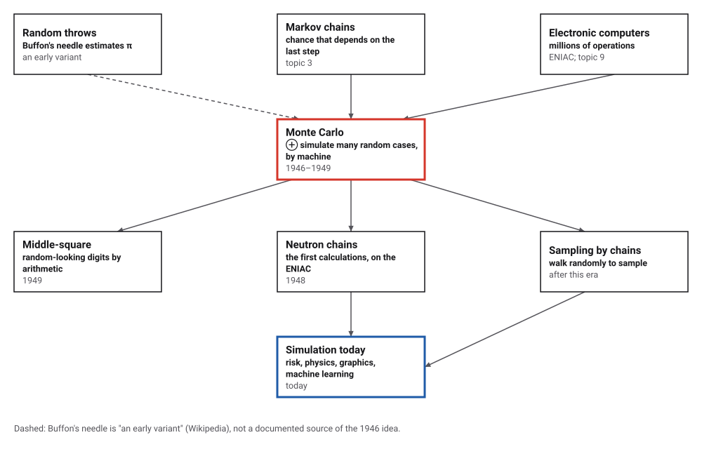
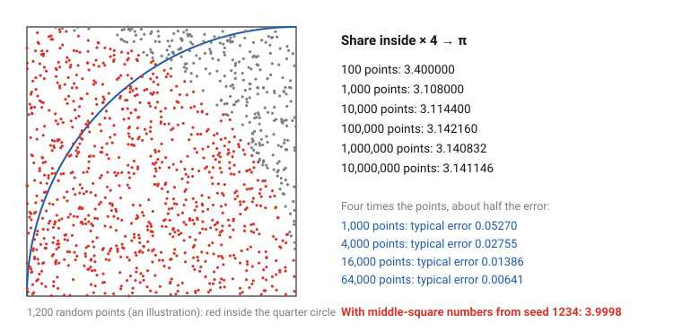
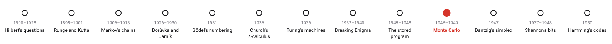
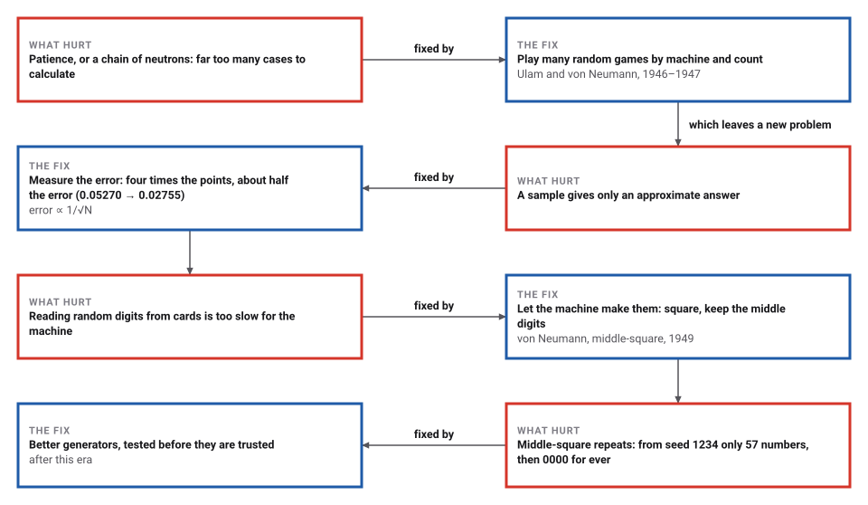

# Monte Carlo

*Era 4 · topic 10 · 1946–1949* · [Era 4 index](../README.md) · [← The Stored Program, and Merge Sort](../09-stored-program/README.md) · [The Simplex Method →](../11-simplex-method/README.md) · [Interactive edition](monte-carlo.html) · [Program](../../../code/era-04-what-can-be-computed/10-monte-carlo/)

> **Field note from the visiting historian.** Ten million random points told me π to three decimals, 3.141146. Then I tried von Neumann's home-made random numbers, starting from 1234: after 57 numbers they reached 0000 and never left, and my estimate of π became 3.9998. He warned that using them was a sin, and he used them anyway.

| | |
|---|---|
| **When** | 1946 idea; ENIAC runs 1948; papers 1949 |
| **Where** | Los Alamos |
| **What hurt** | Problems with too many interacting chances |
| **The fix** | Simulate random cases and count; machine-made random digits |
| **Cost** | Error ∝ 1/√N, in any dimension |

## How ideas combined

A new algorithm is usually an older idea combined with a new one. Estimating by random trials is old (Buffon's needle); chains of chance events had been studied since Markov (topic 3). What was new in 1946 was a machine fast enough to run the trials by the million, and a problem, neutron chains in a weapon core, too tangled for any formula. Each box names the idea that was added.

<picture>
  <source media="(prefers-color-scheme: dark)" srcset="assets/family-dark.svg">
  
</picture>
*Red: the Monte Carlo method at Los Alamos. Blue: simulation today.*

## Throw points, and make your own random numbers

Add random points to the square. The share that lands inside the quarter circle, times 4, estimates π, and the error shrinks slowly: a hundred times the points for one more correct digit. Then switch to middle-square numbers from seed 1234 and watch the estimate go wrong. Below, enter any 4-digit seed: the sequence always ends in a cycle (red).

<picture>
  <source media="(prefers-color-scheme: dark)" srcset="assets/darts-dark.svg">
  
</picture>
*In the interactive edition you can throw points and run the middle-square method from any seed.*

## Era 4, what can be computed

<picture>
  <source media="(prefers-color-scheme: dark)" srcset="assets/era-timeline-dark.svg">
  
</picture>

## Each fix leaves a new pain

<picture>
  <source media="(prefers-color-scheme: dark)" srcset="assets/chain-dark.svg">
  
</picture>
*Read it as a snake: each new problem sits directly under the fix that exposed it.*

## Count, and know how wrong you are

**Estimate by counting.** Choose random points in a square of side 1; a point (x, y) lies in the quarter circle when x² + y² < 1, which happens with probability π/4. So 4 × (share inside) estimates π. The program's estimates:

| Points | Estimate of π |
|---|---|
| 100 | 3.400000 |
| 1,000 | 3.108000 |
| 10,000 | 3.114400 |
| 100,000 | 3.142160 |
| 1,000,000 | 3.140832 |
| 10,000,000 | 3.141146 |

**The error.** Over 200 independent runs, the typical (root-mean-square) error at 1,000 points was 0.05270, close to the theoretical √(π(4 − π)/N) = 0.05193. Each fourfold increase in points roughly halved it (ratios 1.91, 1.99, 2.16). The same holds in any number of dimensions, which is why the method beats a grid in high dimensions:

| Dimension | Ball volume estimated from 1,000,000 points | Exact | Share of points inside |
|---|---|---|---|
| 2 | 3.1407 | 3.1416 | 78.52% |
| 5 | 5.2585 | 5.2638 | 16.43% |
| 10 | 2.6491 | 2.5502 | 0.26% |

A grid with only 10 points per side would need 10¹⁰ points in ten dimensions. The ten-dimensional estimate is the roughest here, because only a quarter of one per cent of the points fall in the ball: the error depends on the number of hits, not the dimension directly.

**Middle-square.** Square a 4-digit number, pad the square to 8 digits, keep the middle 4. From seed 1234: 1234 5227 3215 3362 3030 1809 2724 4201 6484 0422 1780 1684 … and after 57 different numbers the sequence reaches 0000 and stays there. The program ran every one of the 10,000 seeds: each ends in one of 8 cycles.

| Final cycle | Seeds that end there |
|---|---|
| 0000 | 1,968 |
| 0100 | 104 |
| 0540 2916 5030 3009 | 86 |
| 1600 5600 3600 9600 | 1,360 |
| 2100 4100 8100 6100 | 6,291 |
| 2500 | 130 |
| 3792 | 1 |
| 7600 | 60 |

> **Key idea.** When a quantity is too tangled to calculate, sample it at random and count, and report the error with the answer: it falls like one over the square root of the number of samples, in any dimension. The random numbers themselves can be made by arithmetic, but only if someone checks that the arithmetic does not repeat or collapse.

## How fast middle-square fails

Over all 10,000 seeds, a 4-digit middle-square sequence runs on average 43.7 numbers before repeating; the longest run, from seed 6239, is 111. Estimating π from 100,000 points built from middle-square numbers (seed 1234) gives 3.9998: only 57 different numbers ever appear, and once the sequence reaches 0000 every point is the corner (0, 0), inside the circle.

## Los Alamos, 1946–1949

Ulam: the method was "suggested by a question which occurred to me in 1946 as I was convalescing from an illness and playing solitaires" (Eckhardt, *Los Alamos Science*, 1987). Metropolis places "the spark" at the spring 1946 review of the ENIAC's results, and dates von Neumann's letter to Richtmyer outlining a statistical calculation of neutron diffusion 11 March 1947; Metropolis suggested the name, after Ulam's uncle who "just had to go to Monte Carlo" (Metropolis, 1987). The first fully automated Monte Carlo calculations ran on the ENIAC in spring 1948 (Wikipedia).

Von Neumann described middle-square in 1949, printed in 1951: "Anyone who considers arithmetical methods of producing random digits is, of course, in a state of sin"; such methods were "hundreds of times faster than reading 'truly' random numbers off punch cards" (Wikipedia, Middle-square method). That a Franciscan friar invented it in the 1240s rests on one book's report of a lost manuscript (**disputed**).

## Simulation is everywhere

Monte Carlo methods now price financial risk, render light in films, design reactors and train machine-learning models, and every one of them needs pseudo-random numbers. The generators are better than middle-square, and they are tested statistically before they are trusted, but they are still arithmetic, which is why von Neumann's joke about sin is still quoted.

> **Full circle.** Ten million points estimate π as 3.141146: three correct decimals for ten million random numbers. Monte Carlo is slow to converge, and it is still the method of choice when nothing else works.

## Before you read on

<details>
<summary><b>1.</b> Why does the share of points inside the quarter circle tend to π/4?</summary>

The quarter circle has area π/4 and the square area 1; random points land in each region in proportion to its area.
</details>

<details>
<summary><b>2.</b> You have an estimate with typical error 0.01 from 10,000 points. How many points for error 0.001?</summary>

A hundred times as many, 1,000,000: the error shrinks like 1/√N.
</details>

<details>
<summary><b>3.</b> Square 0540 and keep the middle digits. What comes next?</summary>

540² = 291,600, padded to 00291600; the middle four digits are 2916.
</details>

<details>
<summary><b>4.</b> Why must every middle-square sequence repeat?</summary>

There are only 10,000 four-digit numbers, and each one fixes the next, so within 10,001 steps some number recurs and the sequence cycles from there.
</details>

<details>
<summary><b>5.</b> Why does Monte Carlo beat a grid in ten dimensions?</summary>

A grid needs (points per side)¹⁰ points; random sampling's error depends on the number of samples, not on the dimension.
</details>


## Where the evidence lives

| | Object | Where to see it | Licence |
|---|---|---|---|
| — | **The Beginning of the Monte Carlo Method (1987)**. Metropolis's account in the Los Alamos Science special issue for Ulam. | [Los Alamos National Laboratory](https://mcnpx.lanl.gov/pdf_files/Article_1987_LAS_Metropolis_125--130.pdf) | Drawn placeholder. |

## Every link was opened before it was listed

| Level | Link | Why |
|---|---|---|
| Start | [Monte Carlo method](https://en.wikipedia.org/wiki/Monte_Carlo_method) — Wikipedia | The idea, its history at Los Alamos, and its accuracy |
| Start | [Middle-square method](https://en.wikipedia.org/wiki/Middle-square_method) — Wikipedia | Von Neumann's generator, its short cycles, and the "state of sin" |
| Deeper | [The Beginning of the Monte Carlo Method](https://mcnpx.lanl.gov/pdf_files/Article_1987_LAS_Metropolis_125--130.pdf) — N. Metropolis, *Los Alamos Science*, Special Issue 1987, 125–130 | A participant's account: ENIAC, the name, the first calculations |
| Deeper | [Ulam, von Neumann and the Monte Carlo method](https://mcnp-green.lanl.gov/pdf_files/Article_1987_LAS_Eckhardt_131--141.pdf) — Roger Eckhardt, *Los Alamos Science*, Special Issue 1987, 131–141 (the extracted title reads "Monte Carlo and the Monte Carlo Method") | Ulam's solitaire question and von Neumann's letter of 1947, quoted |

More, with certainty labels and the gaps we could not fill: [Era 4 reference catalog](https://github.com/vij658/AlgorithmEvolutionAtlas/blob/main/book/era-04-what-can-be-computed/reference-catalog.md).

## The program behind every number here

[MonteCarlo.java](https://github.com/vij658/AlgorithmEvolutionAtlas/blob/main/code/era-04-what-can-be-computed/10-monte-carlo/MonteCarlo.java) makes **16 checks**: every 4-digit middle-square seed followed to its cycle (including the fixed points and the cycle 0540 2916 5030 3009 that Wikipedia lists), π from ten million points, the error ratio when the points are quadrupled, the ball's volume in 2, 5 and 10 dimensions, and the failure of middle-square numbers. Run it with `java MonteCarlo.java` (JDK 17 or newer). The heart of it:

```java
/** One step of the 4-digit middle-square method. */
static int middleSquare(int x) { return (int) ((long) x * x / 100 % 10000); }

/** Volume of the unit ball in d dimensions: pi^(d/2) / Gamma(d/2 + 1), with Gamma by its recurrence. */
static double ballVolume(int d) {
    double gamma = d % 2 == 0 ? 1 : Math.sqrt(Math.PI);                // Gamma(1) or Gamma(1/2)
    for (double x = d % 2 == 0 ? 1 : 0.5; x < d / 2.0 + 1 - 1e-9; x++) gamma *= x;
    return Math.pow(Math.PI, d / 2.0) / gamma;
}
```

