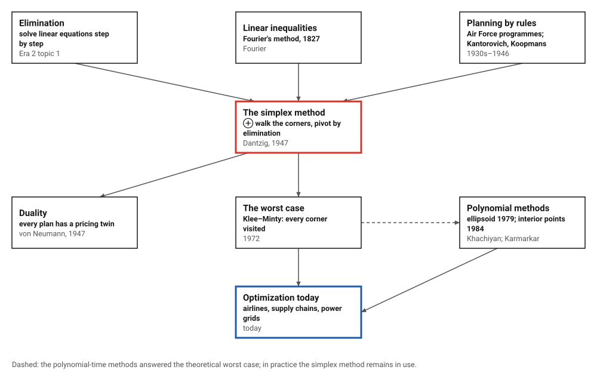
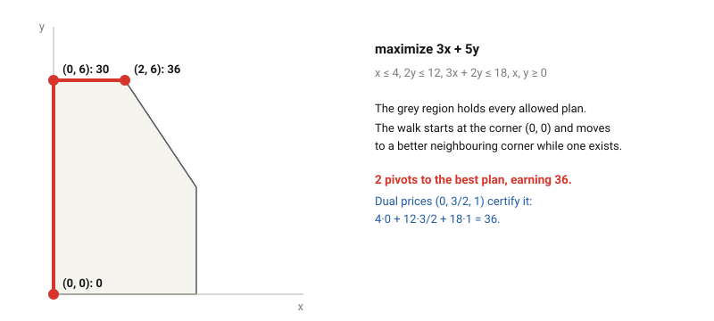
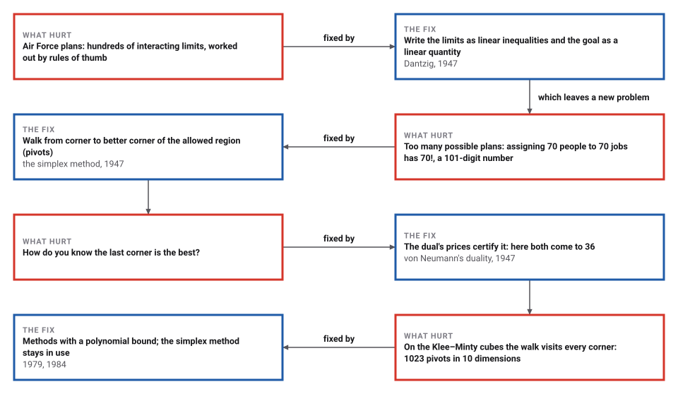

# The Simplex Method

*Era 4 · topic 11 · 1947* · [Era 4 index](../README.md) · [← Monte Carlo](../10-monte-carlo/README.md) · [Shannon's Bits →](../12-information-theory/README.md) · [Interactive edition](simplex-method.html) · [Program](../../../code/era-04-what-can-be-computed/11-simplex-method/)

> **Field note from the visiting historian.** There are 3,628,800 ways to give ten people ten jobs, and the walk found the cheapest in 201 steps. For seventy people the number of ways has 101 digits; the walk is still short. Nobody could say why for twenty-five years, and then someone built a solid on which it is not.

| | |
|---|---|
| **When** | 1947 |
| **Where** | The Pentagon (U.S. Air Force) |
| **What hurt** | Plans with astronomically many options |
| **The fix** | Linear programming; walk the corners by pivots |
| **Cost** | Usually a few pivots per limit; 2ⁿ − 1 on Klee–Minty |

## How ideas combined

A new algorithm is usually an older idea combined with a new one. Elimination for linear equations is two thousand years old (Era 2, topic 1); Fourier had studied systems of linear inequalities in 1827; in the late 1930s Kantorovich and Koopmans wrote economic problems in that form. Dantzig's addition, in 1947, was a goal to maximize and a way to reach it: walk from corner to corner of the allowed region, each step a round of elimination. Each box names the idea that was added.

<picture>
  <source media="(prefers-color-scheme: dark)" srcset="assets/family-dark.svg">
  
</picture>
*Red: Dantzig's simplex method. Blue: optimization today.*

## Walk the corners

The grey region holds every plan that obeys the limits. Change what x and y are worth, and the walk (red) starts again from (0, 0), moving each time to the neighbouring corner that gains fastest, as Dantzig's rule does. Then choose the two-dimensional Klee–Minty plan: the walk visits every corner before it reaches the best one.

<picture>
  <source media="(prefers-color-scheme: dark)" srcset="assets/plan-dark.svg">
  
</picture>
*In the interactive edition you can change the objective and watch the walk change.*

## Era 4, what can be computed

<picture>
  <source media="(prefers-color-scheme: dark)" srcset="assets/era-timeline-dark.svg">
  
</picture>

## Each fix leaves a new pain

<picture>
  <source media="(prefers-color-scheme: dark)" srcset="assets/chain-dark.svg">
  
</picture>
*Read it as a snake: each new problem sits directly under the fix that exposed it.*

## Corners, pivots and prices

**A small plan.** Maximize 3x + 5y with x ≤ 4, 2y ≤ 12, 3x + 2y ≤ 18 and x, y ≥ 0. The allowed plans form a five-sided region, and the best plan is at a corner. Starting from (0, 0), Dantzig's rule raises the variable that gains most per unit (y), as far as the limits allow, and then asks again: (0, 0) earning 0 → (0, 6) earning 30 → (2, 6) earning 36. That is 2 pivots; no neighbour of (2, 6) is better.

**Pivots.** In table form, the plan's limits get one extra "slack" variable each, and a corner is a choice of which variables may be non-zero. A pivot swaps one in and one out, and rewrites the table by elimination, exactly as in solving equations. **Prices.** The final table also gives the dual: a price for each limit such that every activity is priced at least at its value. Here the prices are (0, 3/2, 1); the limits 4, 12 and 18 priced at them come to 36, the best plan's value, which proves that no plan does better.

**Checked.** On 2,000 random small programs the program compares the simplex answer, in exact fractions, with the best of every corner found by brute force, runs Bland's rule as well, and checks the dual: every answer agreed, and the dual's value matched every time. They took 1.67 pivots on average and at most 5.

> **Key idea.** The best plan sits at a corner, and from any corner that is not best there is a better neighbour. So walk uphill from corner to corner. The number of corners grows explosively, but on practical problems the walk is short, and the dual prices prove the answer.

## Short walks, and one very long one

| Random dense program (variables × limits) | Average pivots, Dantzig's rule |
|---|---|
| 10 × 10 | 3.1 |
| 20 × 20 | 6.0 |
| 40 × 40 | 8.2 |
| 80 × 80 | 13.2 |
| 160 × 160 | 26.5 |

On random problems the number of pivots grows roughly in proportion to the size, not explosively. The Klee–Minty cubes (1972) are built to defeat Dantzig's rule: a cube squashed so that the walk visits every one of its 2ⁿ corners.

| Dimension n | Pivots on the Klee–Minty cube |
|---|---|
| 1 | 1 |
| 2 | 3 |
| 3 | 7 |
| 4 | 15 |
| 5 | 31 |
| 6 | 63 |
| 7 | 127 |
| 8 | 255 |
| 9 | 511 |
| 10 | 1023 |

**Assignment.** Dantzig's own illustration was assigning 70 people to 70 jobs: 70! = 119785716699… possible assignments, a number of 101 digits. The program does it for 10 people with random costs: Bland's rule needs 201 pivots and assigns everyone at a total cost of 144, and checking all 3,628,800 assignments finds the same minimum. The simplex answer comes out in whole numbers by itself.

## The Pentagon, 1947

Dantzig completed his PhD at Berkeley in 1946 and became mathematical adviser to the comptroller of the U.S. Air Force, where "in 1947 ... the linear programming problem and the simplex method took shape" (Cottle, NAS memoir). A colleague had challenged him "to mechanize the planning process"; the name simplex was suggested by T. S. Motzkin (Wikipedia). In his own account the method's efficiency came from "viewing the problem in the geometry of the columns rather than the rows"; in the fall of 1947 he visited von Neumann and had the Bureau of Standards test the method on Stigler's diet problem (Dantzig, 1987).

Von Neumann "immediately conjectured the theory of duality"; Kantorovich and Koopmans shared the 1975 Nobel Memorial Prize in Economic Sciences; Khachiyan (1979) and Karmarkar (1984) gave polynomial-time methods (Wikipedia, Linear programming). Stigler's own diet cost $39.93 a year in 1939 prices; the exact minimum is $39.69 (Wikipedia, Stigler diet).

## Planning, still by pivots

Airline crews, refinery blends, delivery routes and electricity markets are planned by linear programs with thousands or millions of variables. Interior-point methods, descendants of Karmarkar's, now share the work, but the simplex method, with better pivoting rules, is still one of the two standard ways to solve them.

> **Full circle.** Ten people, 3,628,800 possible assignments; the simplex method found the cheapest in 201 pivots. For seventy people the possibilities run to 101 digits, and the walk is still short.

## Before you read on

<details>
<summary><b>1.</b> Why must a best plan sit at a corner?</summary>

The value is linear: along any line through the region it rises in one direction, so from a non-corner point you can slide along an edge or face without losing value until you hit a corner.
</details>

<details>
<summary><b>2.</b> In the small plan, why does Dantzig's rule raise y first?</summary>

y earns 5 per unit, x only 3: the rule picks the larger gain per unit.
</details>

<details>
<summary><b>3.</b> How far can y rise from (0, 0)?</summary>

Until a limit stops it: 2y ≤ 12 allows 6, and 3x + 2y ≤ 18 allows 9, so y stops at 6.
</details>

<details>
<summary><b>4.</b> Check the dual prices: why do 0, 3/2 and 1 prove that 36 is best?</summary>

Any allowed plan has 3x + 5y ≤ 0·x + (3/2)(2y) + 1·(3x + 2y) ≤ 0·4 + (3/2)·12 + 1·18 = 36.
</details>

<details>
<summary><b>5.</b> How many pivots does Dantzig's rule take on the 10-dimensional Klee–Minty cube?</summary>

2¹⁰ − 1 = 1023: it visits every corner.
</details>


## Where the evidence lives

| | Object | Where to see it | Licence |
|---|---|---|---|
| — | **Origins of the Simplex Method (1987)**. Dantzig's own account of 1947, as a Stanford technical report. | [DTIC](https://apps.dtic.mil/sti/pdfs/ADA182708.pdf) | Drawn placeholder. |

## Every link was opened before it was listed

| Level | Link | Why |
|---|---|---|
| Start | [Simplex algorithm](https://en.wikipedia.org/wiki/Simplex_algorithm) — Wikipedia | Pivoting, the name, cycling and the Klee–Minty worst case |
| Start | [Linear programming](https://en.wikipedia.org/wiki/Linear_programming) — Wikipedia | Kantorovich, Koopmans, Dantzig and von Neumann's duality, and what came after |
| Start | [Stigler diet](https://en.wikipedia.org/wiki/Stigler_diet) — Wikipedia | The diet problem that was the method's first large test |
| Deeper | [George B. Dantzig, a Biographical Memoir](https://www.nasonline.org/wp-content/uploads/2024/06/dantzig-george-b.pdf) — Richard W. Cottle, National Academy of Sciences (2024) | Dantzig's life, from Neyman's unsolved problems to the Air Force |
| Scholar | [Origins of the Simplex Method](https://apps.dtic.mil/sti/pdfs/ADA182708.pdf) — George B. Dantzig, Technical Report SOL 87-5, Systems Optimization Laboratory, Stanford University (May 1987), via DTIC | Dantzig's own account of 1947: the Pentagon, von Neumann, column geometry and the diet problem |

More, with certainty labels and the gaps we could not fill: [Era 4 reference catalog](https://github.com/vij658/AlgorithmEvolutionAtlas/blob/main/book/era-04-what-can-be-computed/reference-catalog.md).

## The program behind every number here

[SimplexMethod.java](https://github.com/vij658/AlgorithmEvolutionAtlas/blob/main/code/era-04-what-can-be-computed/11-simplex-method/SimplexMethod.java) makes **19,025 checks**: the small plan and its dual, 2,000 random programs against brute force and duality, Dantzig's rule against Bland's, the Klee–Minty cubes up to 10 dimensions, and the 10-person assignment against all 3,628,800 possibilities. Run it with `java SimplexMethod.java` (JDK 17 or newer). The heart of it:

```java
/** Maximize c.x subject to A x <= b, x >= 0, with b >= 0, starting from x = 0. */
static Result simplex(long[][] A, long[] b, long[] c, boolean bland, boolean recordPath) {
    int m = A.length, n = c.length, w = n + m + 1;
    Q[][] T = new Q[m + 1][w];
    int[] basis = new int[m];
    for (int i = 0; i < m; i++) {
        for (int j = 0; j < n; j++) T[i][j] = Q.of(A[i][j]);
        for (int j = 0; j < m; j++) T[i][n + j] = i == j ? Q.ONE : Q.ZERO;
        T[i][w - 1] = Q.of(b[i]);
        basis[i] = n + i;
    }
    for (int j = 0; j < w; j++) T[m][j] = j < n ? Q.of(-c[j]) : Q.ZERO;
    int pivots = 0;
    List<Q[]> path = new ArrayList<>();
    if (recordPath) path.add(plan(T, basis, n));
    while (true) {
        int enter = -1;
        for (int j = 0; j < w - 1; j++) {
            if (T[m][j].signum() >= 0) continue;
            if (bland) { enter = j; break; }
            if (enter < 0 || T[m][j].compareTo(T[m][enter]) < 0) enter = j;     // Dantzig: the most negative
        }
        if (enter < 0) break;                                                    // no better neighbour: optimal
        int leave = -1;
        Q best = null;
        for (int i = 0; i < m; i++) {
            if (T[i][enter].signum() <= 0) continue;
            Q ratio = T[i][w - 1].div(T[i][enter]);
            int cmp = best == null ? -1 : ratio.compareTo(best);
            if (cmp < 0 || (cmp == 0 && basis[i] < basis[leave])) { best = ratio; leave = i; }
        }
        if (leave < 0) throw new IllegalStateException("unbounded");
        Q p = T[leave][enter];
        for (int j = 0; j < w; j++) T[leave][j] = T[leave][j].div(p);
        for (int i = 0; i <= m; i++) {
            if (i == leave || T[i][enter].signum() == 0) continue;
            Q f = T[i][enter];
            for (int j = 0; j < w; j++) T[i][j] = T[i][j].sub(f.mul(T[leave][j]));
        }
        basis[leave] = enter;
        pivots++;
        if (recordPath) path.add(plan(T, basis, n));
    }
    Q[] y = new Q[m];
    for (int i = 0; i < m; i++) y[i] = T[m][n + i];
    return new Result(T[m][w - 1], plan(T, basis, n), y, pivots, path);
}
```

