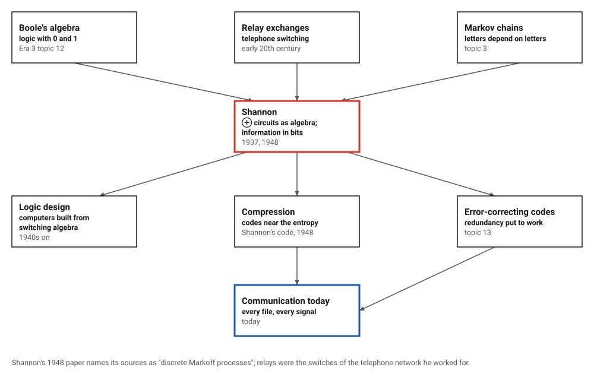
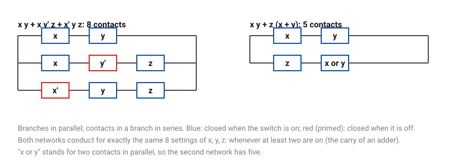
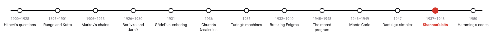
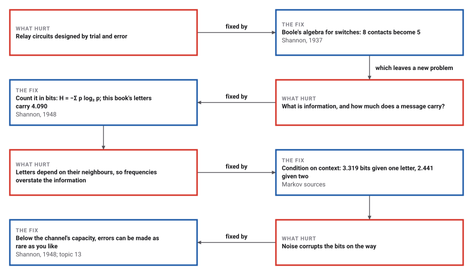

# Shannon's Bits

*Era 4 · topic 12 · 1937–1948* · [Era 4 index](../README.md) · [← The Simplex Method](../11-simplex-method/README.md) · [Hamming's Codes →](../13-hamming-codes/README.md) · [Interactive edition](information-theory.html) · [Program](../../../code/era-04-what-can-be-computed/12-information-theory/)

> **Field note from the visiting historian.** I fed the statistics of this book's own field notes to a machine and asked it to write. With letter pairs it wrote nonsense; with word pairs it wrote "i recorded era topic dug out a polynomial at all keep this one could". Each letter of mine carries about 4.090 bits; given its neighbours, much less. The rest is what lets you read me through noise.

| | |
|---|---|
| **When** | Thesis 1937 (printed 1938); paper 1948 |
| **Where** | MIT; Bell Telephone Laboratories |
| **What hurt** | Circuits by trial and error; no measure of information |
| **The fix** | Switching algebra; entropy in bits |
| **Measure** | 4.090 bits per letter here, 2.441 with context |

## How ideas combined

A new algorithm is usually an older idea combined with a new one. Boole's algebra of 0 and 1 (Era 3, topic 12) had been pure logic for eighty years; telephone exchanges were full of relays, switches that are either open or closed. In 1937 Shannon put the two together. In 1948, working for the telephone company, he asked what a message is worth, and measured it with Markov's statistics (topic 3). Each box names the idea that was added.

<picture>
  <source media="(prefers-color-scheme: dark)" srcset="assets/family-dark.svg">
  
</picture>
*Red: Shannon's thesis (1937) and paper (1948). Blue: where they led.*

## Switches, and imitation English

Flip the switches: the eight-contact and five-contact networks always light together, because they are the same Boolean formula. Then generate imitation text from the statistics of this book's own field notes, as Shannon did from English: random letters, then letter frequencies, pairs, triples, and words. Watch the bits per letter fall as the statistics use more context.

<picture>
  <source media="(prefers-color-scheme: dark)" srcset="assets/relays-dark.svg">
  
</picture>
*In the interactive edition you can flip the switches and generate imitation text.*

## Era 4, what can be computed

<picture>
  <source media="(prefers-color-scheme: dark)" srcset="assets/era-timeline-dark.svg">
  
</picture>

## Each fix leaves a new pain

<picture>
  <source media="(prefers-color-scheme: dark)" srcset="assets/chain-dark.svg">
  
</picture>
*Read it as a snake: each new problem sits directly under the fix that exposed it.*

## Contacts as variables, messages as surprise

**Switching algebra (1937).** A contact is a variable: x when it closes as the switch turns on, x' when it closes as the switch turns off. Contacts in series conduct only if all do (x·y); in parallel if any does (x + y). The network x y + x y' z + x' y z needs 8 contacts; Boole's algebra rewrites it as x y + z (x + y), with 5, and the program checks that the two conduct for the same settings, all 8 of them. It is the carry of a binary adder: on whenever at least two inputs are.

**Entropy (1948).** A source that emits symbol i with probability pᵢ carries H = −Σ pᵢ log₂ pᵢ bits per symbol on average. The program measures a sample of this book's own text, 17,744 letters and spaces from the field notes of Eras 1 to 3:

| What the next letter is predicted from | Bits per letter |
|---|---|
| nothing: 27 equally likely symbols, log₂ 27 | 4.755 |
| letter frequencies | 4.090 |
| the letter before | 3.319 |
| **the two letters before** | **2.441** |

The last figure is too low for real English: in a sample of only 17,744 letters, many three-letter strings occur once, so they look more predictable than they are. Shannon, judging English over about eight letters, put its redundancy at roughly 50 per cent; this small sample gives 49% at three letters, a coincidence rather than a confirmation.

**Imitations**, generated by the program from the same sample, in the manner of Shannon's series:

| Statistics used | Generated text |
|---|---|
| random letters | `CHKQP AIUBSPXDUXTUJTYSRFNBEQYXRPWLTSUBG SUSEXGVMTYPZMNOFNRSJNBCCVAVTMGHO` |
| letter frequencies | `HEOA DAIO Y NETANS DHAENVFT TSTEIIIOIOWTU ECIG O  RILOROA NTRSFIRA  ES O` |
| letter pairs | `INOWALDE F NYNOUTELSINDOUNK TWE WIGIT FIVA AROWE NT N WIOMUMERUL AVEANID` |
| letter triples | `I HAT LEARN ALING IN A ROT IT IND TOR THE ROTEN HE CAMENT SE IT FOR DOUT` |
| word frequencies | `IT SO REASONED IN THE ONE NINE A A ANOTHER THE NEGATIVE WHICH A` |
| word pairs | `I RECORDED ERA TOPIC DUG OUT A POLYNOMIAL AT ALL KEEP THIS ONE COULD` |

**Coding.** Give each letter a codeword of about −log₂ p bits: Shannon's code takes the first ⌈−log₂ p⌉ binary digits of the running total of the probabilities. Space gets 000, E 0010, T 0100, and Z 11111111101. No codeword begins another, so a string of bits can be read back without separators, and the average length, 4.683 bits, lies between H = 4.090 and H + 1, as Shannon proved it must. The whole sample takes 83,090 bits instead of 88,720 at five bits a letter.

> **Key idea.** Information is surprise. A source's entropy, in bits per symbol, is the least any code can average; context lowers it; and the gap between the entropy and the bits actually sent is redundancy, which can be removed to compress or added to protect against noise.

## The commonest letters

| Symbol | Share of the sample |
|---|---|
| space | 0.184 |
| E | 0.101 |
| T | 0.077 |
| A | 0.070 |
| N | 0.060 |
| O | 0.059 |
| I | 0.057 |
| S | 0.055 |

The sample has 3,260 words, 980 of them different. Space is the commonest symbol, then E and T.

## A thesis and a paper

The thesis was written at MIT in 1937 and published in the *Transactions of the American Institute of Electrical Engineers* in 1938; Howard Gardner called it "possibly the most important, and also the most famous, master's thesis of the century" (Wikipedia). MIT's catalogue dates it 1940, the year of the degree (DSpace@MIT), and MacTutor gives the MIT master's and PhD both as 1940.

"A Mathematical Theory of Communication" appeared in the *Bell System Technical Journal* in July and October 1948 and was reissued as a book with Warren Weaver in 1949 (Wikipedia). In it, units of base 2 "may be called binary digits, or more briefly bits, a word suggested by J. W. Tukey"; Theorem 2 gives H = −K Σ pᵢ log pᵢ, "the entropy of the set of probabilities"; the sources of English text "are known mathematically as discrete Markoff processes"; and below the capacity a noisy channel can carry messages with as few errors as desired (Theorems 11 and 12).

## Every file, every signal

Every compressed file is a code that tries to get close to its source's entropy, and every phone call and download is protected by redundancy added on purpose, the subject of Hamming's codes (topic 13). Computers themselves are built from switching algebra: millions of transistors arranged by the rules of the 1937 thesis.

> **Full circle.** Five bits a letter would be enough for 32 symbols; this book's letters carry 4.090 bits each on their own, and 2.441 given their neighbours. Everything between is redundancy, which is why a text can still be read with letters missing.

## Before you read on

<details>
<summary><b>1.</b> Two switches in series light a lamp when? In parallel?</summary>

In series, only when both are on (x·y); in parallel, when either is (x + y).
</details>

<details>
<summary><b>2.</b> How many bits does a fair coin toss carry? A coin that lands heads 90% of the time?</summary>

1 bit; −0.9 log₂ 0.9 − 0.1 log₂ 0.1 ≈ 0.469 bits: a predictable outcome tells you less.
</details>

<details>
<summary><b>3.</b> Why can no code average fewer bits than the entropy?</summary>

That is Shannon's theorem: the entropy is the average surprise, and a code that beats it would let you predict the source better than its own probabilities allow.
</details>

<details>
<summary><b>4.</b> Why must the codewords be prefix-free?</summary>

So that a string of bits can be split back into codewords without separators: no codeword may be the start of another.
</details>

<details>
<summary><b>5.</b> Why does the entropy fall when the previous letter is known?</summary>

Some pairs are common (TH) and many are rare (QZ): knowing the last letter narrows the choice of the next.
</details>


## Where the evidence lives

| | Object | Where to see it | Licence |
|---|---|---|---|
| — | **A Mathematical Theory of Communication (1948)**. The paper, with bits, entropy, the imitations of English and channel capacity. | [MIT course page](https://people.csail.mit.edu/dmoshkov/courses/codes/shannon1948.pdf) | Drawn placeholder. |
| — | **A symbolic analysis of relay and switching circuits**. Shannon's master's thesis, catalogued at MIT. | [DSpace@MIT](https://dspace.mit.edu/handle/1721.1/11173) | Drawn placeholder. |

## Every link was opened before it was listed

| Level | Link | Why |
|---|---|---|
| Start | [Claude Elwood Shannon](https://mathshistory.st-andrews.ac.uk/Biographies/Shannon/) — MacTutor | Shannon's life, the thesis and the 1948 paper |
| Start | [A Symbolic Analysis of Relay and Switching Circuits](https://en.wikipedia.org/wiki/A_Symbolic_Analysis_of_Relay_and_Switching_Circuits) — Wikipedia | Boole's algebra put to work in telephone exchanges |
| Start | [A Mathematical Theory of Communication](https://en.wikipedia.org/wiki/A_Mathematical_Theory_of_Communication) — Wikipedia | The paper, the book, and its reception |
| Start | [Andrey Markov & Claude Shannon Counted Letters to Build the First Language-Generation Models](https://spectrum.ieee.org/andrey-markov-and-claude-shannon-built-the-first-language-generation-models) — Oscar Schwartz, IEEE Spectrum (11 November 2019) | How Shannon's imitations of English grew out of Markov's counts |
| Scholar | [A Mathematical Theory of Communication](https://people.csail.mit.edu/dmoshkov/courses/codes/shannon1948.pdf) — C. E. Shannon, *Bell System Technical Journal* 27 (1948), reprint on an MIT course page | Bits, entropy, the approximations to English, and channel capacity |
| Scholar | [A symbolic analysis of relay and switching circuits](https://dspace.mit.edu/handle/1721.1/11173) — Claude Elwood Shannon, M.S. thesis, MIT Department of Electrical Engineering (catalogued 1940), DSpace@MIT | The thesis, with a scan of the original |

More, with certainty labels and the gaps we could not fill: [Era 4 reference catalog](https://github.com/vij658/AlgorithmEvolutionAtlas/blob/main/book/era-04-what-can-be-computed/reference-catalog.md).

## The program behind every number here

[InformationTheory.java](https://github.com/vij658/AlgorithmEvolutionAtlas/blob/main/code/era-04-what-can-be-computed/12-information-theory/InformationTheory.java) makes **723 checks**: the two relay networks and the adder on every input, the letter entropy computed two ways and falling with context, the imitations, and Shannon's code (prefix-free, with average length between H and H + 1). Run it with `java InformationTheory.java` (JDK 17 or newer). The heart of it:

```java
/** Entropy of the next letter given the previous k letters, from counts of (k+1)-letter strings. */
static double conditionalEntropy(String s, int k) {
    Map<String, Integer> ctx = new HashMap<>(), full = new HashMap<>();
    for (int i = k; i < s.length(); i++) {
        ctx.merge(s.substring(i - k, i), 1, Integer::sum);
        full.merge(s.substring(i - k, i + 1), 1, Integer::sum);
    }
    double total = s.length() - k, h = 0;
    for (Map.Entry<String, Integer> e : full.entrySet()) {
        double pJoint = e.getValue() / total, pCond = (double) e.getValue() / ctx.get(e.getKey().substring(0, k));
        h -= pJoint * log2(pCond);
    }
    return h;
}
```

