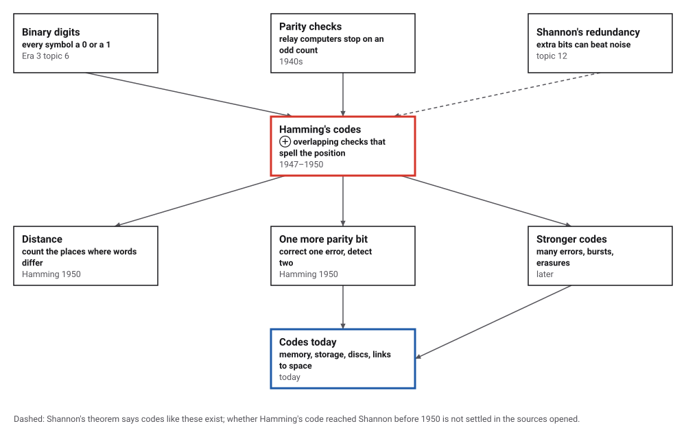
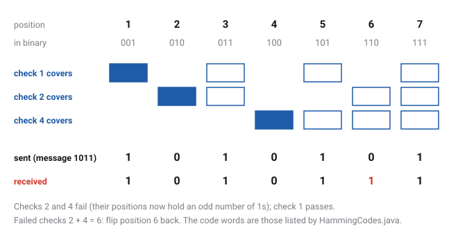
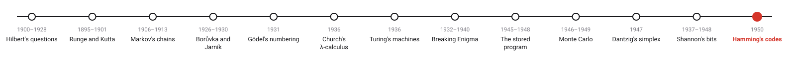
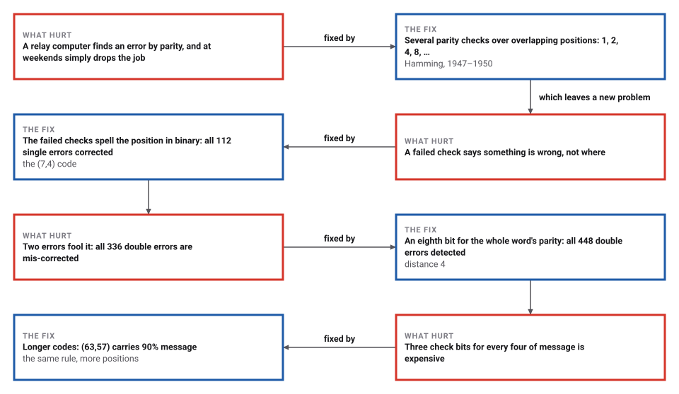

# Hamming's Codes

*Era 4 · topic 13 · 1950* · [Era 4 index](../README.md) · [← Shannon's Bits](../12-information-theory/README.md) · [Interactive edition](hamming-codes.html) · [Program](../../../code/era-04-what-can-be-computed/13-hamming-codes/)

> **Field note from the visiting historian.** Three check bits guard four bits of message. Flip any one of the seven, and the checks that fail add up to its position: 2 and 4 point at 6. I tried all 112 single errors; every one was repaired. The machines of this planet have been correcting themselves quietly ever since.

| | |
|---|---|
| **When** | 1947 idea; paper April 1950 |
| **Where** | Bell Telephone Laboratories |
| **What hurt** | A detected error meant starting again |
| **The fix** | Checks at 1, 2, 4 whose failures spell the position |
| **Cost** | 3 check bits for 4 of message; 6 for 57 |

## How ideas combined

A new algorithm is usually an older idea combined with a new one. A parity check (is the number of 1s even?) was already how relay computers noticed their own errors. Hamming's addition was to use several checks over overlapping groups of positions, arranged so that the pattern of failures is the binary number of the faulty position. Each box names the idea that was added.

<picture>
  <source media="(prefers-color-scheme: dark)" srcset="assets/family-dark.svg">
  
</picture>
*Red: Hamming's codes. Blue: error correction today.*

## Flip a bit and watch the checks find it

Choose a 4-bit message; the page adds the three check bits (blue) at positions 1, 2 and 4. Then flip any bit of the received word. With one flipped bit, the failed checks add up to its position and the word is repaired. Flip two and see what goes wrong.

<picture>
  <source media="(prefers-color-scheme: dark)" srcset="assets/checks-dark.svg">
  
</picture>
*In the interactive edition you can choose the message and flip any bits.*

## Era 4, what can be computed

<picture>
  <source media="(prefers-color-scheme: dark)" srcset="assets/era-timeline-dark.svg">
  
</picture>

## Each fix leaves a new pain

<picture>
  <source media="(prefers-color-scheme: dark)" srcset="assets/chain-dark.svg">
  
</picture>
*Read it as a snake: each new problem sits directly under the fix that exposed it.*

## Checks that spell a position

**The arrangement.** Number the positions 1 to 7 and write each number in binary: 1 = 001, 2 = 010, 3 = 011, …, 7 = 111. Check bit 1 makes the parity even over every position whose number ends in 1 (1, 3, 5, 7); check bit 2 over those with the middle digit 1 (2, 3, 6, 7); check bit 4 over those with the first digit 1 (4, 5, 6, 7). The message goes in positions 3, 5, 6 and 7. If one bit flips, exactly the checks whose groups contain it fail, and they add up to its position.

**The sixteen code words**, as the program builds them (position 1 first): 0000000, 1110000, 1001100, 0111100, 0101010, 1011010, 1100110, 0010110, 1101001, 0011001, 0100101, 1010101, 1000011, 0110011, 0001111, 1111111. Every two differ in at least 3 places (all 120 pairs checked), so one error leaves a word nearer its own code word than any other. Each code word and its 7 one-bit neighbours make 8 words, and 16 × 8 = 128 = 2⁷: every 7-bit word is within one place of exactly one code word. Hamming: "a seven-position single error correcting code admits of 16 code symbols".

| Errors in a 7-bit word | Cases tried (all of them) | What happens |
|---|---|---|
| one | 112 | corrected every time |
| two | 336 | mis-corrected every time: the checks point at a third position |
| one, with an eighth parity bit | 128 | corrected every time |
| two, with an eighth parity bit | 448 | detected every time |

> **Key idea.** Spread the code words apart: if every two differ in at least three places, a single error cannot carry one into the territory of another, and the nearest code word is the one that was sent. Hamming's checks make finding that nearest word a matter of adding up the failed checks.

## Cheaper codes, and a noisy channel

| Code (positions, message bits) | Check bits | Share of bits carrying the message |
|---|---|---|
| (7,4) | 3 | 57% |
| (15,11) | 4 | 73% |
| (31,26) | 5 | 84% |
| (63,57) | 6 | 90% |

Each of these longer codes corrected one random error in each of 20,000 random words. Over a channel that flips each bit with probability 0.01, the program sent 1,000,000 four-bit messages three ways:

| Method | Bits sent per message | Messages wrong | Share wrong |
|---|---|---|---|
| no code | 4 | 39,514 | 3.951% (expected 3.940%) |
| **Hamming (7,4)** | **7** | **1,957** | **0.196% (about 0.203%)** |
| each bit three times | 12 | 1,230 | 0.123% |

Hamming's code cuts the failures about 20-fold for less than double the bits; repeating every bit three times does a little better at three times the cost. Shannon's theorem (topic 12) says much better codes exist, and finding them took the rest of the century.

## Weekends at Bell Labs

Hamming ran the IBM computing machines at Los Alamos from 1945 and joined Bell Labs in 1946; in 1947 a weekend job ruined by an early error led him to ask why a machine that can detect an error cannot locate and correct it (MacTutor). The Bell Model V was "an electromechanical, relay-based computer"; at weekends it moved on to the next job when it found an error, and in a taped interview Hamming said: "Damn it, if the machine can detect an error, why can't it locate the position of the error and correct it?" (Wikipedia).

The paper, "Error Detecting and Error Correcting Codes", appeared in the *Bell System Technical Journal* 29(2), April 1950: "a large number of operations must be performed without a single error in the end result"; "The choice of the positions 1, 2, 4, 8, ... for check positions"; distance at least three for single-error correction, four for "single error correction plus double error detection". The paper calls its distance a "metric"; the name Hamming distance came later. Hamming received the Turing Award in 1968 (MacTutor).

## Errors fixed without anyone noticing

Error-correcting memory in servers still uses Hamming's arrangement with the extra parity bit: correct one error, detect two. Discs, QR codes, mobile networks and links to spacecraft use stronger codes built on the same idea of spreading code words apart. This era began by asking what can be computed at all; it ends with computing that can be trusted.

> **Full circle.** Seven bits, sixteen code words, every one of the 112 possible single errors repaired by adding up the failed checks. Hamming's weekend jobs would have run to the end.

## Before you read on

<details>
<summary><b>1.</b> Which checks cover position 6?</summary>

6 = 110 in binary: checks 2 and 4.
</details>

<details>
<summary><b>2.</b> Checks 1 and 4 fail and check 2 passes. Which bit is wrong?</summary>

1 + 4 = 5: position 5.
</details>

<details>
<summary><b>3.</b> Why can the (7,4) code not correct two errors?</summary>

Two errors can carry a code word to within one place of a different code word, and the decoder picks that one.
</details>

<details>
<summary><b>4.</b> How many check bits does a code with 15 positions need?</summary>

Four, at positions 1, 2, 4 and 8: 15 = 1111 in binary needs four digits. That leaves 11 positions for the message.
</details>

<details>
<summary><b>5.</b> Why does an eighth bit for the whole word's parity detect double errors?</summary>

Two errors leave the overall parity unchanged while the other checks fail; one error changes the overall parity. So the two cases can be told apart.
</details>


## Where the evidence lives

| | Object | Where to see it | Licence |
|---|---|---|---|
| — | **Error Detecting and Error Correcting Codes (1950)**. Hamming's paper in the Bell System Technical Journal, April 1950. | [Internet Archive](https://archive.org/details/bstj29-2-147) | Drawn placeholder. |

## Every link was opened before it was listed

| Level | Link | Why |
|---|---|---|
| Start | [Hamming code](https://en.wikipedia.org/wiki/Hamming_code) — Wikipedia | The weekend story, the (7,4) code and how the checks locate an error |
| Start | [Richard Wesley Hamming](https://mathshistory.st-andrews.ac.uk/Biographies/Hamming/) — MacTutor | Los Alamos, Bell Labs and the Turing Award |
| Scholar | [Error Detecting and Error Correcting Codes](https://zoo.cs.yale.edu/classes/cs323/doc/Hamming.pdf) — R. W. Hamming, *Bell System Technical Journal* 29(2):147–160 (April 1950), on a Yale course page | The paper: check positions, distance, and the bounds on redundancy |
| Scholar | [BSTJ 29: 2. April 1950: Error Detecting and Error Correcting Codes](https://archive.org/details/bstj29-2-147) — Internet Archive, Bell System Technical Journal collection | A scan of the journal pages |

More, with certainty labels and the gaps we could not fill: [Era 4 reference catalog](https://github.com/vij658/AlgorithmEvolutionAtlas/blob/main/book/era-04-what-can-be-computed/reference-catalog.md).

## The program behind every number here

[HammingCodes.java](https://github.com/vij658/AlgorithmEvolutionAtlas/blob/main/code/era-04-what-can-be-computed/13-hamming-codes/HammingCodes.java) makes **80,949 checks**: the 16 code words and their distances, the perfect packing of all 128 words, every single and double error with and without the eighth bit, the longer codes on random words, and 1,000,000 messages over a noisy channel. Run it with `java HammingCodes.java` (JDK 17 or newer). The heart of it:

```java
/** Encode data bits into a code word of n = 2^r - 1 positions; bit i of the result is position i + 1. */
static long encode(long data, int r) {
    int n = (1 << r) - 1;
    long word = 0;
    int d = 0;
    for (int pos = 1; pos <= n; pos++) {
        if (Integer.bitCount(pos) == 1) continue;                     // a check position, filled below
        if ((data >> d & 1) == 1) word |= 1L << (pos - 1);
        d++;
    }
    for (int k = 0; k < r; k++) {
        int parity = 0;
        for (int pos = 1; pos <= n; pos++) if ((pos >> k & 1) == 1 && (word >> (pos - 1) & 1) == 1) parity ^= 1;
        if (parity == 1) word |= 1L << ((1 << k) - 1);
    }
    return word;
}

/** The syndrome: the failed checks read as a binary number, which is the position of a single error (0 = none). */
static int syndrome(long word, int r) {
    int n = (1 << r) - 1, s = 0;
    for (int pos = 1; pos <= n; pos++) if ((word >> (pos - 1) & 1) == 1) s ^= pos;
    return s;
}
```

