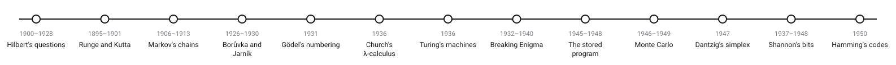
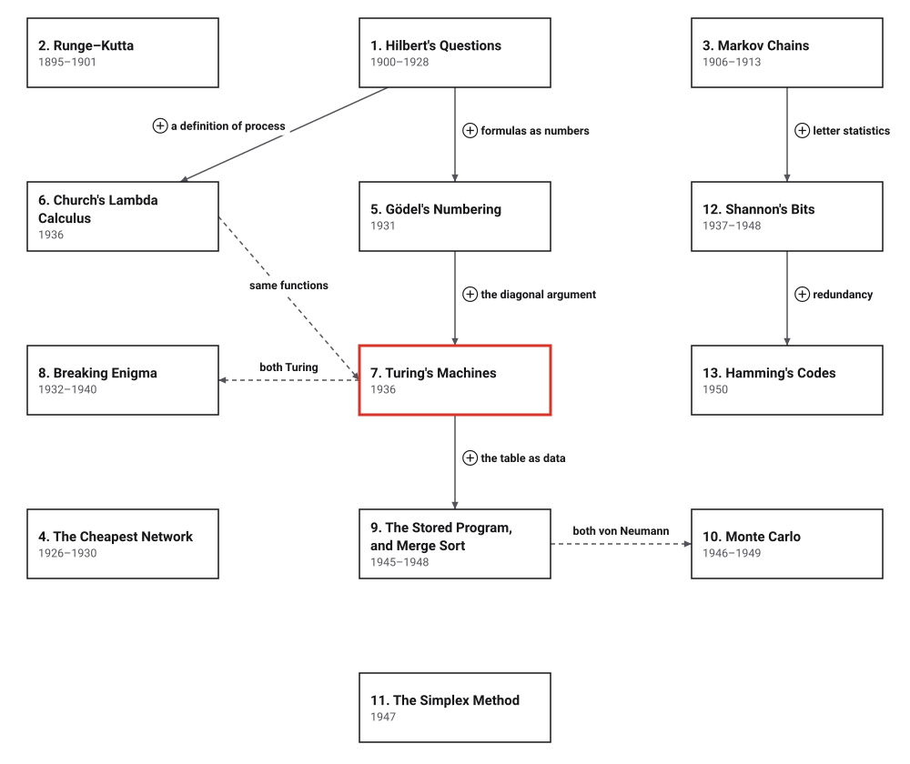

# Era 4 — What Can Be Computed

*1895 to 1950* · [Book contents](../README.md) · [Interactive edition](index.html) · [Reference catalog](reference-catalog.md) · [Programs](../../code/era-04-what-can-be-computed/README.md)

> **Field note from the visiting historian.** In the third era, procedures were put into tables and machines. In this one, mathematicians ask what a procedure is, prove that some questions have none, and build the first computers that keep their programs in memory.

## When

<picture>
  <source media="(prefers-color-scheme: dark)" srcset="assets/era-timeline-dark.svg">
  
</picture>

## How the ideas combined

<picture>
  <source media="(prefers-color-scheme: dark)" srcset="assets/era-map-dark.svg">
  
</picture>

*An arrow means the later development reuses the earlier idea; it is not a claim that one inventor learned from the other. Dashed lines join developments by the same person, or (Church and Turing) two definitions that turned out to describe the same functions. Boxes without arrows build on earlier eras: Runge–Kutta on Euler's steps, Borůvka on counting structure like Euler's bridges, Shannon also on Boole's algebra, and the simplex method on elimination.*

## The topics

| # | Topic | When | What hurt | Read |
|---|---|---|---|---|
| 1 | **Hilbert's Questions** | Paris 1900; Hilbert and Ackermann 1928; Matiyasevich 1970 | "A process ... by a finite number of operations" had no definition | [page](01-hilberts-questions/README.md) · [interactive](01-hilberts-questions/hilberts-questions.html) · [program](../../code/era-04-what-can-be-computed/01-hilberts-questions/README.md) |
| 2 | **Runge–Kutta** | Runge 1895; Heun 1900; Kutta 1901 | Euler's steps need to be tiny to be accurate | [page](02-runge-kutta/README.md) · [interactive](02-runge-kutta/runge-kutta.html) · [program](../../code/era-04-what-can-be-computed/02-runge-kutta/README.md) |
| 3 | **Markov Chains** | Markov 1906; *Eugene Onegin* 1913 | Probability theory assumed independent trials | [page](03-markov-chains/README.md) · [interactive](03-markov-chains/markov-chains.html) · [program](../../code/era-04-what-can-be-computed/03-markov-chains/README.md) |
| 4 | **The Cheapest Network** | Borůvka 1926; Jarník 1930 | Connecting towns with the least wire | [page](04-cheapest-network/README.md) · [interactive](04-cheapest-network/cheapest-network.html) · [program](../../code/era-04-what-can-be-computed/04-cheapest-network/README.md) |
| 5 | **Gödel's Numbering** | Königsberg 1930; printed 1931 | Hilbert wanted every statement settled by a proof | [page](05-godel-numbering/README.md) · [interactive](05-godel-numbering/godel-numbering.html) · [program](../../code/era-04-what-can-be-computed/05-godel-numbering/README.md) |
| 6 | **Church's Lambda Calculus** | 1932–1936 | No definition of "effectively calculable" | planned · [references](reference-catalog.md#6-churchs-lambda-calculus) |
| 7 | **Turing's Machines** | 1936 (printed 1937) | The decision problem needed a model of a person computing | planned · [references](reference-catalog.md#7-turings-machines) |
| 8 | **Breaking Enigma** | Rejewski 1932; bomba 1938; Bombe 1940 | A cipher with too many settings to try | planned · [references](reference-catalog.md#8-breaking-enigma) |
| 9 | **The Stored Program, and Merge Sort** | EDVAC report and merging program 1945; Baby 1948 | Machines rewired for every problem; sorting on card machines | planned · [references](reference-catalog.md#9-the-stored-program-and-merge-sort) |
| 10 | **Monte Carlo** | Ulam 1946; ENIAC 1948; Metropolis and Ulam 1949 | Too many interacting chances to calculate | planned · [references](reference-catalog.md#10-monte-carlo-and-numbers-that-only-look-random) |
| 11 | **The Simplex Method** | Dantzig 1947 | Plans with astronomically many options | planned · [references](reference-catalog.md#11-the-simplex-method) |
| 12 | **Shannon's Bits** | Thesis 1937; *Mathematical Theory of Communication* 1948 | Circuits by trial and error; no measure of information | planned · [references](reference-catalog.md#12-shannon-switches-bits-and-entropy) |
| 13 | **Hamming's Codes** | 1947; published 1950 | A detected error meant starting again | planned · [references](reference-catalog.md#13-hammings-codes) |

The interactive edition is a single HTML file per topic: download it and open it in a browser, or use the published copy linked from the [book contents](../README.md).
