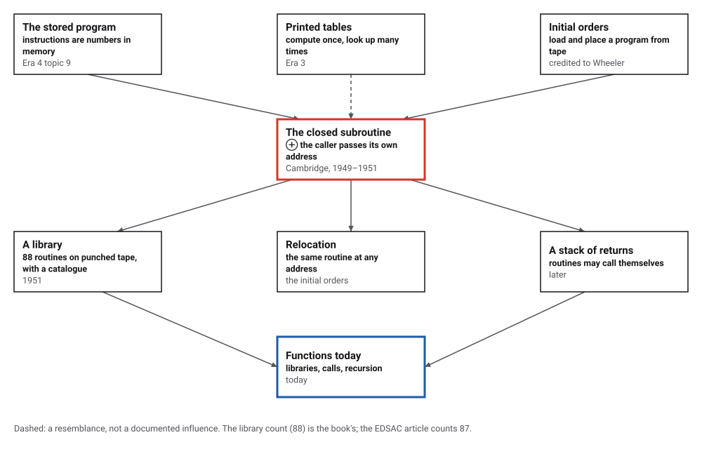
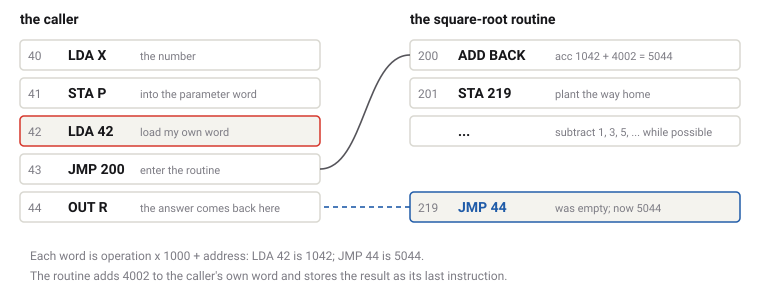
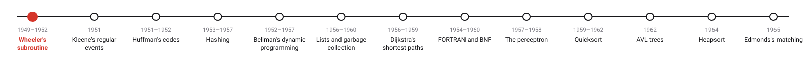
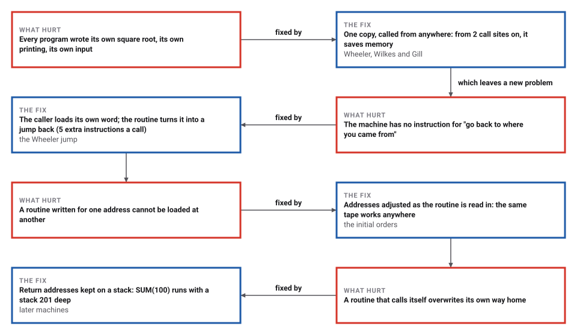

# The Subroutine

*Era 5 · topic 1 · 1949–1952* · [Era 5 index](../README.md) · [Regular Expressions →](../02-regular-expressions/README.md) · [Interactive edition](the-subroutine.html) · [Program](../../../code/era-05-the-programmers-craft/01-the-subroutine/)

> **Field note from the visiting historian.** The caller loads its own instruction, 1042, and jumps. The routine adds 4002 and stores the result, 5044, in its last word: a jump back to 44. I watched one square root come home this way. Every function call on this planet still leaves a note of where to return.

| | |
|---|---|
| **When** | 1949–1951; paper 1952 |
| **Where** | University of Cambridge, the EDSAC |
| **What hurt** | Every program rewrote the same routines |
| **The fix** | One copy; the caller passes its own address |
| **Cost** | 5 extra instructions a call; saves memory from 2 calls |

## How ideas combined

A new algorithm is usually an older idea combined with a new one. The stored-program computer (Era 4) kept instructions in memory as numbers. The Cambridge group added a way for any program to borrow a routine and come back: since the call is itself a number in memory, the caller can hand that number to the routine, and the routine can turn it into the jump home.

<picture>
  <source media="(prefers-color-scheme: dark)" srcset="assets/family-dark.svg">
  
</picture>
*Red: the closed subroutine. Blue: functions as programmers use them today.*

## Step through a call, and watch the way home being written

Two callers, at addresses 40 and 70, use the same four-instruction routine at 200. Press Step to run one instruction at a time. Watch word 205, the routine's last word: it starts empty, and the routine fills it with a jump back to whichever caller called it.

<picture>
  <source media="(prefers-color-scheme: dark)" srcset="assets/call-dark.svg">
  
</picture>
*In the interactive edition you can step through calls from two different places.*

## Era 5, the programmer's craft

<picture>
  <source media="(prefers-color-scheme: dark)" srcset="assets/era-timeline-dark.svg">
  
</picture>

## Each fix leaves a new pain

<picture>
  <source media="(prefers-color-scheme: dark)" srcset="assets/chain-dark.svg">
  
</picture>
*Read it as a snake: each new problem sits directly under the fix that exposed it.*

## A jump that knows its way back

**The machine.** The program uses a small accumulator machine of its own, not the EDSAC's order code. Each instruction is one word, operation × 1000 + address: LDA 42 (load word 42) is 1042, JMP 44 (jump to 44) is 5044. Because instructions are numbers, arithmetic on them is allowed, and the Wheeler jump depends on that.

**The call, as the program traced it.** The caller's word at 42 is LDA 42: it loads *itself*, the number 1042. Then JMP 200 enters the square-root routine. The routine's first instruction adds 4002, giving 5044, which is the instruction JMP 44; its second stores that in word 219, its own last word. When the routine finishes, it runs into word 219 and jumps to 44, the word after the call. The square root of 30 came back as 5, after 73 instructions in all.

<details>
<summary>The first six and the last three instructions of the traced call</summary>

| Address: instruction → accumulator afterwards |
|---|
| 40: LDA 46 -> acc 30 |
| 41: STA 900 -> acc 30 |
| 42: LDA 42 -> acc 1042 |
| 43: JMP 200 -> acc 1042 |
| 200: ADD 913 -> acc 5044 |
| 201: STA 219 -> acc 5044 |
| … 210: JNG 219 -> acc -6 |
| 219: JMP 44 -> acc -6 |
| 44: OUT 902 -> acc -6 |

</details>

> **Key idea.** Write a routine once and let anyone call it. The routine cannot know in advance who will call it, so the caller must tell it where to return; the Wheeler jump writes that address into the routine itself.

> **What it cannot do.** A routine that calls itself stores its new return address in the same word, 315, wiping out the old one. The program's SUM routine, written that way, was stopped after 1,000,000 instructions without finishing: the exit word held JMP 309, a place inside the routine itself, so it kept returning to itself.

## Memory saved, time spent, places to load

The square-root routine is 22 words; without its return machinery the same code is 17 words. A call takes 6 words. The program built both versions for 1 to 8 call sites and ran them on the same numbers:

| Call sites | Closed subroutine (words) | Code written out at each site (words) |
|---|---|---|
| 1 | 31 | 26 |
| **2** | **39** | **51** |
| 3 | 47 | 76 |
| 4 | 55 | 101 |
| 5 | 63 | 126 |
| 6 | 71 | 151 |
| 7 | 79 | 176 |
| 8 | 87 | 201 |

From 2 call sites on, one shared copy uses less memory, and the gap grows with every call. The price is time: each call costs 5 extra instructions (load the caller's own word, jump, build and store the return, jump back). On machines with 512 words of memory, memory was the scarcer of the two.

| Layout | Square root at | Multiply at | Power at | Word 7 of multiply (LDA of its counter) |
|---|---|---|---|---|
| layout 1 | 200 | 300 | 400 | 1315 |
| layout 2 | 610 | 120 | 777 | 1135 |

**Relocation.** A small library (square root 22 words, multiply 16, power 24, which itself calls multiply) was loaded at two different sets of addresses. The loader adjusts every address inside each routine as it places it, so the same instruction becomes a different number, yet both layouts printed the same table of squares (1, 4, 9, 16, 25, 36, 49, 64, 81, 100, 121, 144), the square root of each, and 2¹⁰ = 1024. The square-root routine was also checked against Java for every number from 1 to 2000.

**Recursion with a stack.** With return addresses and saved values pushed onto a stack, the same SUM routine works: SUM(k) = k(k+1)/2 for every k from 0 to 100, and SUM(100) = 5050 took 1,009 instructions and a stack 201 deep.

## Cambridge, 1949 to 1952

The EDSAC "ran its first programs on 6 May 1949, when it calculated a table of square numbers and a list of prime numbers"; it had 512 words of mercury delay-line memory, and "There was no unconditional jump instruction" (Wikipedia, EDSAC). David Wheeler "invented the subroutine (or mark place and return) 'jump,' then called the 'Wheeler jump'"; his dissertation "Automatic Computing with the EDSAC" was accepted in 1951 (IEEE Computer Society).

*The Preparation of Programs for an Electronic Digital Computer* (Wilkes, Wheeler and Gill, 1951), "the first book on computer programming", described a library of subroutines on punched tape with a catalogue; one article counts 88 routines, the EDSAC article 87. Wheeler's paper "The use of sub-routines in programmes" was read at the ACM national meeting in Pittsburgh in 1952. The mechanism of the jump "is not capable of expressing recursion" (Wikipedia, Wheeler Jump).

Wheeler is "often quoted" as saying "All problems in computer science can be solved by another level of indirection"; no original source was found, so the catalog marks it as conjecture.

## Every call you make

Every function call in a modern program does what the Wheeler jump did, with one change: the return address goes onto a stack instead of into the routine, so a function may call itself, and many calls may be in progress at once. Libraries of tested routines, shared by programmers who never meet, began as a drawer of punched tapes in Cambridge.

> **Full circle.** The EDSAC's first program printed a table of squares. This topic's program prints one too (1, 4, 9, 16, 25, 36, …), but by calling a multiply routine that another routine also calls, loaded wherever there was room.

## Before you read on

<details>
<summary><b>1.</b> The caller is at address 57. What number does LDA 57 load, and what does the routine turn it into?</summary>

LDA 57 is 1 × 1000 + 57 = 1057. Adding 4002 gives 5059, which is JMP 59: two words after the call.
</details>

<details>
<summary><b>2.</b> Why does the caller load its <em>own</em> word, rather than the number 57?</summary>

Because the machine has no instruction that loads a constant: the only way to get the caller's address into the accumulator is to load a word that contains it, and the caller's own instruction does.
</details>

<details>
<summary><b>3.</b> Three places call a 20-word routine with a 6-word call sequence. Closed or open?</summary>

Closed: 20 + 3 × 6 = 38 words. Written out at each place, it takes at least 3 × 20 = 60. The more callers, the bigger the saving.
</details>

<details>
<summary><b>4.</b> Why does recursion fail with the Wheeler jump?</summary>

The return address lives in one fixed word of the routine. The inner call overwrites it, so the outer call's way home is lost.
</details>

<details>
<summary><b>5.</b> What does a stack add?</summary>

A fresh place for each call's return address (and its saved values), used last-in first-out: the most recent call returns first.
</details>


## Where the evidence lives

| | Object | Where to see it | Licence |
|---|---|---|---|
| — | **The Preparation of Programs for an Electronic Digital Computer (1951)**. Wilkes, Wheeler and Gill: the first book on programming, built around the EDSAC's library of subroutines. | [Wikipedia](https://en.wikipedia.org/wiki/The_Preparation_of_Programs_for_an_Electronic_Digital_Computer) | Drawn placeholder. |
| — | **The EDSAC reconstruction**. A working replica at The National Museum of Computing, Bletchley Park, filmed as it was built. | [TNMOC film record](https://www.tnmoc.org/edsac-videos) | Drawn placeholder. |

## Every link was opened before it was listed

| Level | Link | Why |
|---|---|---|
| Start | [EDSAC Project Videos](https://www.tnmoc.org/edsac-videos) — The National Museum of Computing, films begun by David Allen (2012–2020) | The reconstruction of the machine on which the subroutine was born, filmed as it was built; "EDSAC Veterans" (2016) records a visit to it |
| Start | [David J. Wheeler](https://history.computer.org/pioneers/wheeler.html) — IEEE Computer Society, Computer Pioneers | The subroutine, the jump and the initial orders, credited to Wheeler |
| Start | [EDSAC](https://en.wikipedia.org/wiki/EDSAC) — Wikipedia | The machine, its first programs of 6 May 1949, and its subroutine library |
| Start | [Wheeler Jump](https://en.wikipedia.org/wiki/Wheeler_Jump) — Wikipedia | How a routine returned without a return instruction, and why it could not recurse |
| Deeper | [The EDSAC Simulator](https://www.dcs.warwick.ac.uk/~edsac/Home.html) — Martin Campbell-Kelly, University of Warwick | "A faithful software evocation of the EDSAC computer as it existed in 1949-51", with original programs and subroutines |
| Deeper | [EDSAC to be recreated](https://www.cam.ac.uk/news/edsac-to-be-recreated) — University of Cambridge (13 January 2011) | The replica project at The National Museum of Computing |
| Deeper | [EDSAC](https://tnmoc.org/edsac) — The National Museum of Computing | The replica at Bletchley Park; "There were only 18 operation codes" |
| Scholar | [Review of *The Preparation of Programs for an Electronic Digital Computer*](https://www.ams.org/journals/bull/1952-58-02/S0002-9904-1952-09610-5) — John Todd, *Bulletin of the AMS* 58 (1952), 276–278 | A contemporary review of the book that published the subroutine library |

More, with certainty labels and the gaps we could not fill: [Era 5 reference catalog](https://github.com/vij658/AlgorithmEvolutionAtlas/blob/main/book/era-05-the-programmers-craft/reference-catalog.md).

## The program behind every number here

[Subroutines.java](https://github.com/vij658/AlgorithmEvolutionAtlas/blob/main/code/era-05-the-programmers-craft/01-the-subroutine/Subroutines.java) makes **2,408 checks**: the traced call and its planted return, closed against open routines at 1 to 8 call sites, a library loaded at two layouts, the square root of every number up to 2000, and recursion with and without a stack. Run it with `java Subroutines.java` (JDK 17 or newer). The heart of it:

```java
/**
 * Place a routine at an origin. Each line is "label: OP operand", "label: DAT value" or "OP" alone. An operand is a
 * number, "*" (this word's own address), a label of this routine, a name from the shared table, or name+k / name-k.
 * Labels are local to the routine, so the same text can be loaded anywhere: that is relocation.
 */
static Map<String, Integer> load(Machine m, int origin, String src, Map<String, Integer> shared) {
    String[] lines = src.strip().split("\n");
    Map<String, Integer> local = new HashMap<>();
    for (int i = 0; i < lines.length; i++) {
        String ln = lines[i].strip();
        if (ln.contains(":")) local.put(ln.substring(0, ln.indexOf(':')).strip(), origin + i);
    }
    for (int i = 0; i < lines.length; i++) {
        String ln = lines[i].strip();
        if (ln.contains(":")) ln = ln.substring(ln.indexOf(':') + 1).strip();
        String[] t = ln.split("\\s+");
        int here = origin + i, value = t.length > 1 ? resolve(t[1], here, local, shared) : 0;
        if (t[0].equals("DAT")) m.mem[here] = value;
        else m.mem[here] = Arrays.asList(OPS).indexOf(t[0]) * 1000 + value;
        if (!t[0].equals("DAT") && Arrays.asList(OPS).indexOf(t[0]) < 0) throw new IllegalArgumentException(ln);
    }
    return local;
}
```

