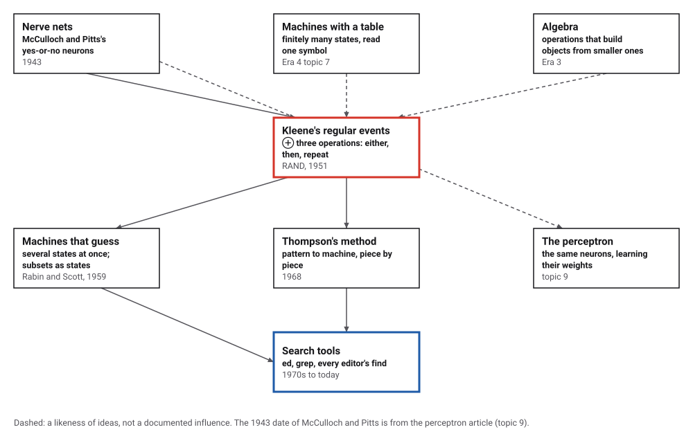
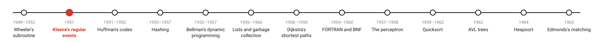
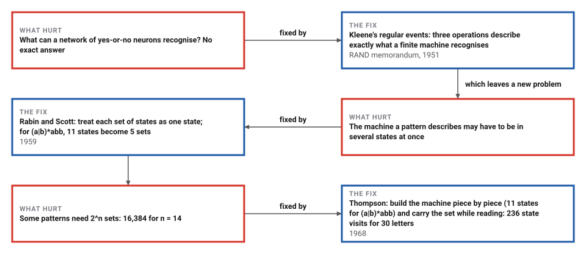
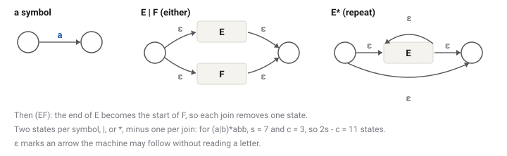

# Regular Expressions

*Era 5 · topic 2 · 1951* · [Era 5 index](../README.md) · [← The Subroutine](../01-the-subroutine/README.md) · [Huffman's Codes →](../03-huffman-codes/README.md) · [Interactive edition](regular-expressions.html) · [Program](../../../code/era-05-the-programmers-craft/02-regular-expressions/)

> **Field note from the visiting historian.** A line of eleven characters, (0|1(01*0)*1)*, picks out exactly the binary numbers divisible by three. I checked it on all 131,070 strings up to 16 digits. The machine inside it has 3 states, one for each remainder. The species now types such lines to search everything it writes.

| | |
|---|---|
| **When** | Kleene 1951; Rabin and Scott 1959; Thompson 1968 |
| **Where** | RAND, Santa Monica; IBM; Bell Labs |
| **What hurt** | No exact description of what a finite machine recognises |
| **The fix** | Either, then, repeat; a pattern becomes a machine |
| **Cost** | Letters × states, reading the set of states as you go |

## How ideas combined

A new algorithm is usually an older idea combined with a new one. McCulloch and Pitts had drawn networks of neurons that fire or do not. Kleene asked what patterns such a network can recognise, and answered with a small algebra: three ways of building patterns from smaller ones. Each box names the idea that was added.

<picture>
  <source media="(prefers-color-scheme: dark)" srcset="assets/family-dark.svg">
  
</picture>
*Red: Kleene's regular events. Blue: text search today.*

## Type a pattern and watch the machine read

Type a pattern using letters, | (either), * (repeat) and brackets, and a text. The page builds Thompson's machine and reads the text one letter at a time, keeping the set of states the machine could be in. Each box shows the size of that set; blue means the accepting state is in it. The last example is the pattern that makes backtracking matchers struggle: the state sets stay small.

| Set of states | States in it | After a | After b | Accepts? |
|---|---|---|---|---|
| D0 | {0, 1, 5, 6, 9} | D1 | D2 |  |
| D1 | {1, 2, 5, 6, 8, 9, 10} | D1 | D3 |  |
| D2 | {1, 5, 6, 7, 8, 9} | D1 | D2 |  |
| D3 | {1, 3, 5, 6, 7, 8, 9} | D1 | D4 |  |
| **D4** | **{1, 4, 5, 6, 7, 8, 9}** | **D1** | **D2** | **yes** |
*In the interactive edition you can type any pattern and text. Here, the machine for (a|b)*abb as the program built it: reading babaabb goes D0, D2, D1, D3, D1, D1, D3, D4, and D4 accepts.*

## Era 5, the programmer's craft

<picture>
  <source media="(prefers-color-scheme: dark)" srcset="assets/era-timeline-dark.svg">
  
</picture>

## Each fix leaves a new pain

<picture>
  <source media="(prefers-color-scheme: dark)" srcset="assets/chain-dark.svg">
  
</picture>
*Read it as a snake: each new problem sits directly under the fix that exposed it.*

## Three operations, and a machine for each

**Kleene's operations.** Start from single letters. If E and F are patterns, so are E|F (either), EF (E then F) and E* (zero or more copies of E, one after another). Kleene's own repeat took two patterns, E*F, "zero or more consecutive occurrences of E preceded by one of F"; today's one-argument star is a simplification. He called the patterns "regular events" and added in a footnote: "We would welcome any suggestions as to a more descriptive term."

<picture>
  <source media="(prefers-color-scheme: dark)" srcset="assets/pieces-dark.svg">
  
</picture>
*Thompson's construction builds the machine from these pieces, one for each part of the pattern.*

**A pattern that does arithmetic.** (0|1(01*0)*1)* matches exactly the binary numerals divisible by 3. The program checked it on all 131,070 strings of 1 to 16 digits (43,698 accepted). It starts 0, 11, 110, 1001, 1100, 1111, 10010, 10101. Its Thompson machine has 16 states; the subset machine has 7, and the smallest machine that does the job has 3: one for each remainder, 0, 1 and 2.

**Machines that guess, and machines that do not.** Thompson's machine can be in several states at once. Rabin and Scott (1959) turned each *set* of states into one state of an ordinary machine. For (a|b)*abb the 11 states become 5 sets:

| Set | States in it | After a | After b | Accepts? |
|---|---|---|---|---|
| D0 | {0, 1, 5, 6, 9} | D1 | D2 |  |
| D1 | {1, 2, 5, 6, 8, 9, 10} | D1 | D3 |  |
| D2 | {1, 5, 6, 7, 8, 9} | D1 | D2 |  |
| D3 | {1, 3, 5, 6, 7, 8, 9} | D1 | D4 |  |
| **D4** | **{1, 4, 5, 6, 7, 8, 9}** | **D1** | **D2** | **yes** |

Merging sets that behave alike leaves 4 states, the smallest machine for this pattern.

> **Key idea.** A pattern is a recipe for a machine. Build the machine from the pattern piece by piece, then read the text once, keeping track of every state the machine could be in. The work is the length of the text times the size of the machine, never more.

## Three matchers that agree, and two that cost very different amounts

**Agreement.** 2,000 random patterns, each tried on 100 random strings: the state-set method, the subset machine and Java's own regular-expression library agreed on all 200,000 cases (30,065 matches). Thompson's state count 2s − c held for 5000 random patterns.

| n | Thompson states | Subset states | Smallest machine (2^n) |
|---|---|---|---|
| 1 | 9 | 3 | 2 |
| 2 | 14 | 5 | 4 |
| 3 | 19 | 9 | 8 |
| 4 | 24 | 17 | 16 |
| 6 | 34 | 65 | 64 |
| 8 | 44 | 257 | 256 |
| 10 | 54 | 1,025 | 1,024 |
| 12 | 64 | 4,097 | 4,096 |
| 14 | 74 | 16,385 | 16,384 |

**The price of not guessing.** For "the n-th letter from the end is a", (a|b)*a(a|b)…(a|b), Thompson's machine grows by 5 states for each extra letter, but any machine that reads without guessing must remember the last n letters: exactly 2ⁿ states. So the subset construction is fast to run but can be enormous to build.

| Length of text (all a) | Backtracking matcher (steps) | State-set method (state visits) |
|---|---|---|
| 5 | 133 | 36 |
| 10 | 1,536 | 76 |
| 15 | 17,095 | 116 |
| 20 | 189,647 | 156 |
| 25 | 2,103,278 | 196 |
| **30** | **23,325,771** | **236** |

**Backtracking.** Many matchers try one way to read the pattern, back up when it fails, and try another. For (a|aa)*b on a string of a's with no b, they try every way of splitting the a's into a and aa before giving up, and those ways grow like the Fibonacci numbers. Keeping the set of states instead visits a handful of states per letter.

## A RAND memorandum about neurons

RAND lists RM-704, *Representation of Events in Nerve Nets and Finite Automata*, by S. C. Kleene, dated 15 December 1951, 102 pages. In section 7.1: "Our class of regular events will be defined inductively, starting with the definite events, and using three operations". Wikipedia: "Regular expressions originated in 1951, when mathematician Stephen Cole Kleene described regular languages using his mathematical notation called regular events"; Kleene "introduced it as an alternative to McCulloch & Pitts's 'prehensible'".

Rabin and Scott, "Finite Automata and Their Decision Problems" (*IBM Journal*, April 1959): "Finite automata are considered in this paper as instruments for classifying finite tapes"; their section 5 introduces "the notion of a nondeterministic automaton". Thompson's "Regular expression search algorithm" appeared in *Communications of the ACM* in June 1968; he built Kleene's notation into the QED editor, compiling patterns to IBM 7094 code, then into Unix's ed, whose command g/re/p gave grep its name.

## From neurons to the search box

A question about how brains recognise patterns produced the notation programmers now type every day to find text. Kernighan recalls that Thompson wrote grep overnight for a colleague who wanted to search the Federalist Papers, about a megabyte of text, too much to edit in ed. The same machines check the format of an e-mail address, and split a program into words before a compiler reads it (topic 8).

> **Full circle.** Kleene's three operations on one line, (0|1(01*0)*1)*, contain a machine that divides by three: 3 states, one for each possible remainder.

## Before you read on

<details>
<summary><b>1.</b> Write a pattern for the strings of a's and b's that end in abb.</summary>

(a|b)*abb
</details>

<details>
<summary><b>2.</b> Does (a|b)*abb match abbabb? And abba?</summary>

abbabb ends in abb: yes. abba ends in bba: no.
</details>

<details>
<summary><b>3.</b> How many states does Thompson's machine have for ab*?</summary>

Symbols a, b and * give s = 3; one join gives c = 1; 2 × 3 − 1 = 5 states.
</details>

<details>
<summary><b>4.</b> Why does a machine for 'the 3rd letter from the end is a' need 8 states?</summary>

It must remember the last three letters (2³ = 8 possibilities), because any of them may turn out to be the 3rd from the end.
</details>

<details>
<summary><b>5.</b> A pattern has 20 states and the text a million letters. At most how much work does the state-set method do?</summary>

At most 20 states per letter: 20 million state visits, however the pattern is written.
</details>


## Where the evidence lives

| | Object | Where to see it | Licence |
|---|---|---|---|
| — | **Representation of Events in Nerve Nets and Finite Automata (1951)**. Kleene's RAND research memorandum RM-704, 102 pages, with the three operations in section 7. | [RAND](https://www.rand.org/pubs/research_memoranda/RM704.html) | Drawn placeholder. |

## Every link was opened before it was listed

| Level | Link | Why |
|---|---|---|
| Start | [Regular expression](https://en.wikipedia.org/wiki/Regular_expression) — Wikipedia | From Kleene's regular events to QED, ed and grep |
| Start | [Brian Kernighan Remembers the Origins of 'grep'](https://thenewstack.io/brian-kernighan-remembers-the-origins-of-grep/) — David Cassel, The New Stack (2018) | How grep was written in a night, in Kernighan's words |
| Deeper | [Powerset construction](https://en.wikipedia.org/wiki/Powerset_construction) — Wikipedia | Turning a machine that guesses into one that does not, and the 2^n price |
| Deeper | [Thompson's construction](https://en.wikipedia.org/wiki/Thompson%27s_construction) — Wikipedia | Pattern to machine in linear size, piece by piece |
| Scholar | [Representation of Events in Nerve Nets and Finite Automata](https://www.rand.org/pubs/research_memoranda/RM704.html) — S. C. Kleene, RAND RM-704 (15 December 1951) | The memorandum that defines the regular events |
| Scholar | [Representation of Events in Nerve Nets and Finite Automata (PDF)](https://apps.dtic.mil/sti/pdfs/ADA596138.pdf) — Kleene 1951, scan via the Defense Technical Information Center | Section 7: the three operations and the footnote on the name |
| Scholar | [Finite Automata and Their Decision Problems](https://www.cs.miami.edu/~burt/learning/csc427.222/docs/rabin-scott.pdf) — M. O. Rabin and D. Scott, *IBM Journal* (April 1959), 114–125, on a University of Miami course page | Nondeterministic automata and the subset construction |

More, with certainty labels and the gaps we could not fill: [Era 5 reference catalog](https://github.com/vij658/AlgorithmEvolutionAtlas/blob/main/book/era-05-the-programmers-craft/reference-catalog.md).

## The program behind every number here

[RegularExpressions.java](https://github.com/vij658/AlgorithmEvolutionAtlas/blob/main/code/era-05-the-programmers-craft/02-regular-expressions/RegularExpressions.java) makes **336,098 checks**: Thompson's state count on 5000 random patterns, the multiples-of-three pattern on 131,070 strings, 200,000 matches against Java's library, the subset and smallest machines, and the 2^n blow-up. Run it with `java RegularExpressions.java` (JDK 17 or newer). The heart of it:

```java
static Frag build(Node n) {
    switch (n.kind) {
        case 'c': {
            State s = st(), e = st();
            s.label = n.sym;
            s.out1 = e;
            return new Frag(s, e);
        }
        case '.': {
            Frag a = build(n.l), b = build(n.r);
            // join: the end of a takes over the start of b (no arrow ever enters a piece's start)
            a.end().label = b.start().label;
            a.end().out1 = b.start().out1;
            a.end().out2 = b.start().out2;
            b.start().dead = true;
            made--;
            State end = b.end() == b.start() ? a.end() : b.end();
            return new Frag(a.start(), end);
        }
        case '|': {
            Frag a = build(n.l), b = build(n.r);
            State s = st(), e = st();
            s.out1 = a.start();
            s.out2 = b.start();
            a.end().out1 = e;
            b.end().out1 = e;
            return new Frag(s, e);
        }
        default: {
            Frag a = build(n.l);
            State s = st(), e = st();
            s.out1 = a.start();
            s.out2 = e;
            a.end().out1 = a.start();
            a.end().out2 = e;
            return new Frag(s, e);
        }
    }
}

    boolean matches(String text) {
        BitSet cur = startSet();
        for (int i = 0; i < text.length(); i++) {
            work += cur.cardinality();
            cur = step(cur, text.charAt(i));
        }
        return cur.get(accept.id);
    }
```

