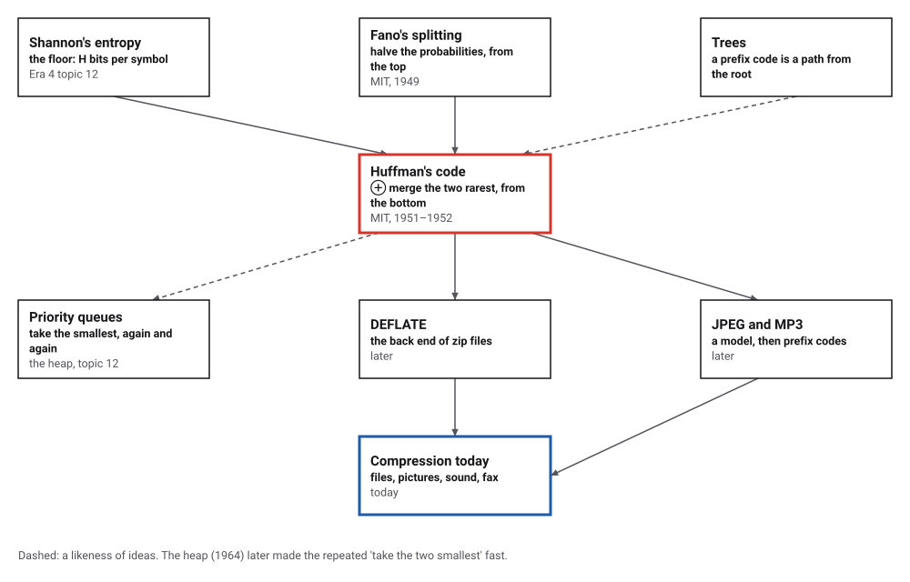
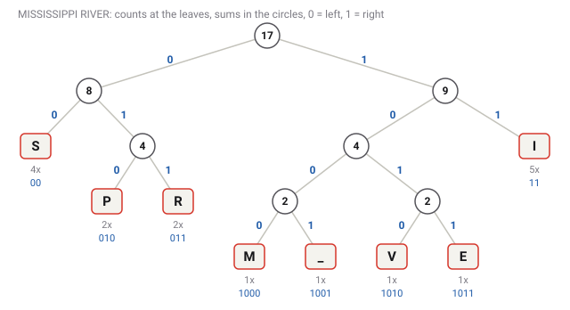
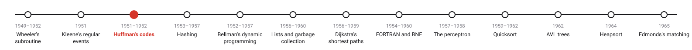
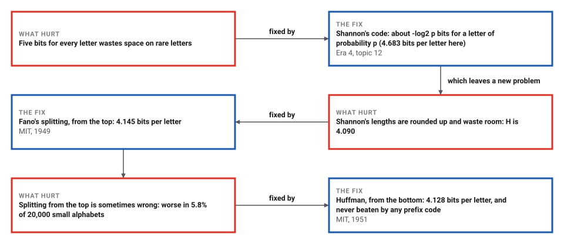

# Huffman's Codes

*Era 5 · topic 3 · 1951–1952* · [Era 5 index](../README.md) · [← Regular Expressions](../02-regular-expressions/README.md) · [Hashing →](../04-hashing/README.md) · [Interactive edition](huffman-codes.html) · [Program](../../../code/era-05-the-programmers-craft/03-huffman-codes/)

> **Field note from the visiting historian.** Seventeen characters, MISSISSIPPI RIVER: 46 bits instead of 51. On this book's field notes the code needs 4.128 bits a letter, 0.038 above the floor Shannon proved. A student who wanted to avoid an exam found the best code there is, of its kind.

| | |
|---|---|
| **When** | Term paper 1951; paper 1952 |
| **Where** | MIT, Robert Fano's course |
| **What hurt** | Codes near the entropy, none provably best |
| **The fix** | Merge the two rarest, repeat; read codes off the tree |
| **Result** | 4.128 bits a letter; entropy 4.090 |

## How ideas combined

A new algorithm is usually an older idea combined with a new one. Shannon (Era 4) had shown that no code can beat the entropy, and Fano had a good way to approach it: split the symbols into two halves of nearly equal probability, and split again. Huffman built the tree the other way up, starting from the two rarest symbols. Each box names the idea that was added.

<picture>
  <source media="(prefers-color-scheme: dark)" srcset="assets/family-dark.svg">
  
</picture>
*Red: Huffman's code. Blue: compression today.*

## Type a phrase and grow its tree

Type any phrase. The page counts its letters, then repeatedly joins the two smallest counts into a new node (ties go to the older node, as in the program), and reads each letter's codeword off the path from the top: 0 for left, 1 for right. Compare its length with equal-length codes, and with the entropy, the floor that no code can go below.

<picture>
  <source media="(prefers-color-scheme: dark)" srcset="assets/tree-phrase-dark.svg">
  
</picture>
*In the interactive edition you can type your own phrase.*

## Era 5, the programmer's craft

<picture>
  <source media="(prefers-color-scheme: dark)" srcset="assets/era-timeline-dark.svg">
  
</picture>

## Each fix leaves a new pain

<picture>
  <source media="(prefers-color-scheme: dark)" srcset="assets/chain-dark.svg">
  
</picture>
*Read it as a snake: each new problem sits directly under the fix that exposed it.*

## Start from the rarest

**Why the bottom?** The tree in the figure above is the one the program built for MISSISSIPPI RIVER; each circle holds the count of everything below it. In a best code the two rarest symbols have the longest codewords, and they can be made to differ only in the last bit. So join them into one imaginary symbol whose count is their sum, and solve the smaller problem the same way. Each join adds one bit to every symbol beneath it.

| Merge | Joined | New count |
|---|---|---|
| 1 | M (1) + _ (1) | 2 |
| 2 | V (1) + E (1) | 2 |
| 3 | P (2) + R (2) | 4 |
| 4 | M_ (2) + VE (2) | 4 |
| 5 | S (4) + PR (4) | 8 |
| 6 | M_VE (4) + I (5) | 9 |
| 7 | SPR (8) + M_VEI (9) | 17 |

For MISSISSIPPI RIVER (17 characters, _ is the space) the codewords are I = 11, S = 00, P = 010, R = 011, M = 1000, _ = 1001, V = 1010, E = 1011. The phrase becomes 1000110000110000110100101110010111110101011011: 46 bits, against 51 with three bits for each character (it has 8 different ones). No codeword is the beginning of another, so the bits can be cut back into letters without any separators.

> **Key idea.** Do not decide the first bit first. Decide the last bit of the two rarest symbols, merge them, and repeat: the problem shrinks by one symbol at every step, and each step is safe.

## Four codes for the same text

The program coded the letters and spaces of this book's own field notes (Eras 1 to 3, 17,744 characters, the same text Era 4's Shannon program measured):

| Code | Bits for the whole text | Bits per letter |
|---|---|---|
| five bits for every letter | 88,720 | 5.000 |
| Shannon's code (Era 4) | 83,090 | 4.683 |
| Fano's splitting | 73,551 | 4.145 |
| **Huffman's code** | **73,241** | **4.128** |
| entropy (the floor) |  | 4.090 |

Huffman's code is 0.038 bits per letter above the entropy. Its codewords run from 111 for the space to 11001011100 for J. The 73,241 bits were decoded again, letter for letter, by walking the tree from the top.

**Best of all prefix codes.** For 20,000 random alphabets of 2 to 8 symbols, the program searched every possible set of codeword lengths: Huffman's total matched the best every time. Fano's splitting was worse in 1,158 of them (5.8%). The smallest such case has counts 13, 13, 12, 16, 34: Fano's code 10 110 111 01 00 needs 201 bits, Huffman's 101 110 100 111 0 needs 196.

**The worst shape.** With Fibonacci counts (1, 1, 2, 3, 5, … 6765) for 20 symbols, every merge joins the newest node with the next count, and the rarest symbols get 19-bit codewords, the longest any 20-symbol code can need.

## A term paper instead of an exam

"In 1951, David A. Huffman and his MIT information theory classmates were given the choice of a term paper or a final exam. The professor, Robert M. Fano, assigned a term paper on the problem of finding the most efficient binary code." Huffman, "unable to prove any codes were the most efficient, was about to give up" when he found the method (Wikipedia). A classroom project in the MAA's *Convergence* adds: "What Professor Fano did not tell his students was the fact that it was an open problem and that he was working on the problem himself."

The paper, "A Method for the Construction of Minimum-Redundancy Codes", appeared in the *Proceedings of the IRE* 40(9): 1098–1101 (1952). Huffman (1925–1999) later worked at UC Santa Cruz, was a pioneer of mathematical origami, and received the IEEE Richard W. Hamming Medal in 1999.

## Inside every zip file

Huffman codes are the last stage of DEFLATE, the method inside zip files, and prefix codes follow the modelling stage of JPEG pictures and MP3 sound. When Huffman died in 1999, his university said his codes "are used in nearly every application that involves the compression and transmission of digital data", naming fax machines, modems, computer networks and high-definition television.

> **Full circle.** Era 4's Shannon program coded this book's field notes in 83,090 bits. Huffman's procedure, on the same letters, needs 73,241, and no code that gives each letter its own fixed codeword can do better.

## Before you read on

<details>
<summary><b>1.</b> Counts A 5, B 2, C 1, D 1. Which two are merged first, and then?</summary>

C and D (1 + 1 = 2); then B and CD (2 + 2 = 4); then A and BCD (5 + 4 = 9).
</details>

<details>
<summary><b>2.</b> What are the codeword lengths in that example, and the total?</summary>

A 1 bit, B 2 bits, C and D 3 bits: 5 + 4 + 3 + 3 = 15 bits, against 18 with 2 bits each.
</details>

<details>
<summary><b>3.</b> Why must no codeword be the start of another?</summary>

Otherwise a stream of bits could be cut into letters in two ways, and the reader could not tell which was meant.
</details>

<details>
<summary><b>4.</b> Can Huffman's code ever beat the entropy?</summary>

No. The entropy is a floor for any code; Huffman's code is the best prefix code, at most one bit per symbol above it.
</details>

<details>
<summary><b>5.</b> Why does each merge take only the two smallest?</summary>

The two rarest symbols belong at the deepest level; joining anything else first could push a common symbol deeper than it needs to be.
</details>


## Where the evidence lives

| | Object | Where to see it | Licence |
|---|---|---|---|
| — | **A Method for the Construction of Minimum-Redundancy Codes (1952)**. Huffman's paper in the Proceedings of the IRE, from his MIT term paper. | [Wikipedia (the paper itself was not opened)](https://en.wikipedia.org/wiki/Huffman_coding) | Drawn placeholder. |

## Every link was opened before it was listed

| Level | Link | Why |
|---|---|---|
| Start | [Huffman coding](https://en.wikipedia.org/wiki/Huffman_coding) — Wikipedia | The term paper, the bottom-up tree and why it is optimal |
| Start | [Discovery of Huffman Codes](https://old.maa.org/node/646519) — MAA *Convergence*, classroom project | Fano's open problem and the student who solved it, with sources for a class |
| Deeper | [David A. Huffman](https://ethw.org/David_A._Huffman) — Engineering and Technology History Wiki | His career and awards |
| Deeper | [David A. Huffman](https://en.wikipedia.org/wiki/David_A._Huffman) — Wikipedia | Life, later work and mathematical origami |
| Deeper | [UCSC press release, 8 October 1999](https://www.cise.ufl.edu/~manuel/huffman/press.release.html) — University of California, Santa Cruz (copy at the University of Florida) | The announcement of his death, and where his codes were used |

More, with certainty labels and the gaps we could not fill: [Era 5 reference catalog](https://github.com/vij658/AlgorithmEvolutionAtlas/blob/main/book/era-05-the-programmers-craft/reference-catalog.md).

## The program behind every number here

[HuffmanCodes.java](https://github.com/vij658/AlgorithmEvolutionAtlas/blob/main/code/era-05-the-programmers-craft/03-huffman-codes/HuffmanCodes.java) makes **40,007 checks**: the phrase and its tree, four codes on 17,744 characters with a full decode, Huffman against every prefix code for 20,000 random alphabets, and the Fibonacci worst case. Run it with `java HuffmanCodes.java` (JDK 17 or newer). The heart of it:

```java
static Node huffman(long[] w, String[] names) {
    PriorityQueue<Node> q = new PriorityQueue<>((a, b) -> a.w != b.w ? Long.compare(a.w, b.w) : Integer.compare(a.order, b.order));
    int order = 0;
    for (int i = 0; i < w.length; i++) if (w[i] > 0) q.add(new Node(w[i], i, order++, null, null));
    merges = new ArrayList<>();
    Map<Node, String> label = new HashMap<>();
    for (Node n : q) label.put(n, names == null ? "" : names[n.sym]);
    if (q.size() == 1) return new Node(q.peek().w, -1, order, q.poll(), null);
    while (q.size() > 1) {
        Node a = q.poll(), b = q.poll(), c = new Node(a.w + b.w, -1, order++, a, b);
        if (names != null) {
            String la = label.get(a), lb = label.get(b);
            label.put(c, la + lb);
            merges.add(String.format("%s(%d) + %s(%d) = %s(%d)", la, a.w, lb, b.w, la + lb, c.w));
        }
        q.add(c);
    }
    return q.poll();
}
```

