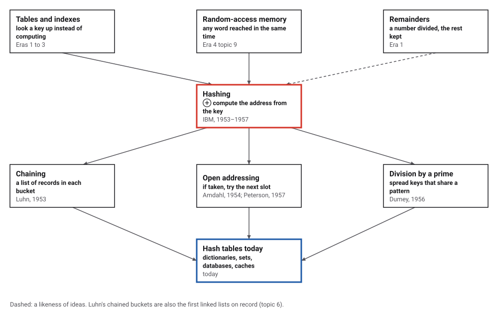
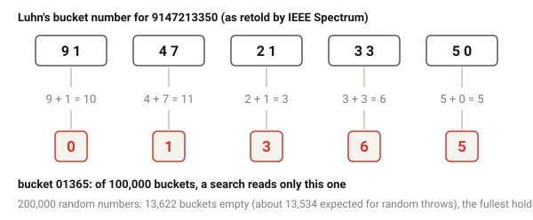
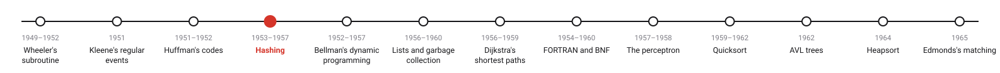
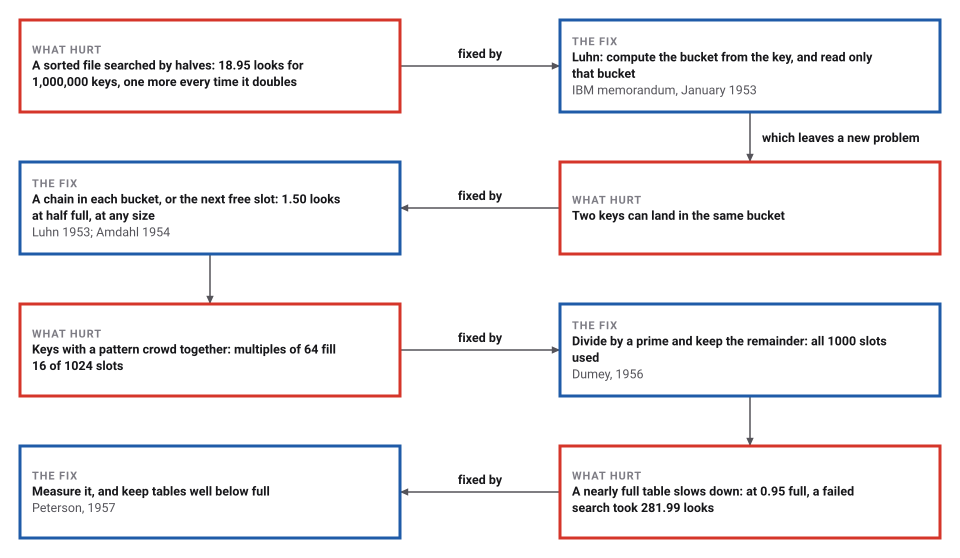

# Hashing

*Era 5 · topic 4 · 1953–1957* · [Era 5 index](../README.md) · [← Huffman's Codes](../03-huffman-codes/README.md) · [Dynamic Programming →](../05-dynamic-programming/README.md) · [Interactive edition](hashing.html) · [Program](../../../code/era-05-the-programmers-craft/04-hashing/)

> **Field note from the visiting historian.** Peterson filled a store of 10,000 records with random keys in 1957 and counted how many buckets a search had to read. I repeated his experiment 200 times: at 90% full, 1.142 buckets on average; he printed 1.134. With a million keys, binary search takes 18.95 looks; a half-full hash table takes 1.50.

| | |
|---|---|
| **When** | Luhn 1953; Amdahl 1954; Dumey 1956; Peterson 1957 |
| **Where** | IBM |
| **What hurt** | Finding a record took longer as the file grew |
| **The fix** | Compute the address from the key |
| **Cost** | About 1.50 looks at half full, at any size |

## How ideas combined

A new algorithm is usually an older idea combined with a new one. Tables and indexes had always let people look things up instead of working them out, and the new machines could reach any word of memory in the same short time. Hashing joined the two: work the address out from the key itself, and go straight there. Each box names the idea that was added.

<picture>
  <source media="(prefers-color-scheme: dark)" srcset="assets/family-dark.svg">
  
</picture>
*Red: hashing. Blue: hash tables today.*

## Store keys, make them collide, find them again

A table of 13 slots. A key's home slot is its remainder after dividing by 13 (Dumey's prime remainder). Store keys and watch two of them collide; then switch between Luhn's chains and Amdahl's next-free-slot method, and use Find to see which slots a search has to look at (yellow) before it hits (blue).

<picture>
  <source media="(prefers-color-scheme: dark)" srcset="assets/luhn-dark.svg">
  
</picture>
*In the interactive edition you can store and find keys in a small table, by either method.*

## Era 5, the programmer's craft

<picture>
  <source media="(prefers-color-scheme: dark)" srcset="assets/era-timeline-dark.svg">
  
</picture>

## Each fix leaves a new pain

<picture>
  <source media="(prefers-color-scheme: dark)" srcset="assets/chain-dark.svg">
  
</picture>
*Read it as a snake: each new problem sits directly under the fix that exposed it.*

## Compute where it lives

**Luhn's bucket number.** As IEEE Spectrum retells his 1953 memorandum: take a phone number such as 9147213350, add its digits in pairs (91 47 21 33 50), keep the last digit of each sum, and the digits together, 01365, name a bucket. To find the number again, compute the same five digits and read that one bucket. The program threw 200,000 random numbers into the 100,000 buckets: 13,622 stayed empty (pure chance would leave about 13,534) and the fullest held 10.

**When two keys collide.** Luhn's buckets each hold a short list (chaining). Amdahl, writing an assembler for the IBM 701, used one table: if a key's slot is taken, try the next, and the next (open addressing with linear probing). Peterson published it in 1957: "If that is already occupied, the second listed position would be used. If that also is full, the third would be tried, etc., until an empty position is found."

**Patterns in the keys.** Dumey (1956) treated the key as a number and kept the remainder after dividing "by a number slightly less than the number of addressable locations", preferably a prime. The program's 1,000 keys that are multiples of 64 land in only 16 of 1,024 slots when divided by 1,024, but spread over all 1000 when divided by the prime 1,021. Phone-like keys ending in 00: their last three digits give 10 slots; the remainder after 1,009 gives 1000.

> **Key idea.** Don't search for the record: compute its address from its key. Collisions are inevitable, but if the table is kept from getting too full, they cost a few extra looks, however large the file.

## Probes, and Peterson's tables repeated

| Load | Chaining: found / not found | Linear probing: found / not found | Linear probing, formula |
|---|---|---|---|
| 0.50 | 1.25 / 0.50 | 1.49 / 2.46 | 1.50 / 2.50 |
| 0.70 | 1.35 / 0.70 | 2.22 / 6.14 | 2.17 / 6.06 |
| 0.80 | 1.40 / 0.80 | 2.96 / 12.63 | 3.00 / 13.00 |
| **0.90** | **1.45 / 0.90** | **5.55 / 50.00** | **5.50 / 50.50** |
| 0.95 | 1.48 / 0.95 | 11.13 / 281.99 | 10.50 / 200.50 |

A table of 100,003 slots filled with random keys. Chaining follows 1 + a/2 looks for a key that is there and a for one that is not; linear probing follows (1 + 1/(1−a))/2 and (1 + 1/(1−a)²)/2, which explode as the table fills. At 0.95 a single table strays far from the formula, because a few very long runs of filled slots dominate.

| Store full | Our average (buckets read) | Peterson 1957, Table 5A |
|---|---|---|
| 40% | 1.000 | 1.000 |
| 60% | 1.002 | 1.002 |
| 80% | 1.036 | 1.033 |
| 90% | 1.142 | 1.134 |
| 95% | 1.365 | 1.334 |
| 100% | 4.020 | 4.041 |

Peterson's own experiment repeated: 10,000 records in 500 buckets of 20, overflow into the next bucket with room, averaged over 200 random fillings. Our averages match his figures to within 0.03 up to 95% full; at 100% his single runs ranged from about 3.3 to 4.7. With buckets of one record (500 slots): 10% full 1.055 (his 1.053); 70% full 2.128 (his 2.260); 100% full 14.189 (his 16.914).

| Keys | Hashing, half-full table (looks) | Binary search (looks) |
|---|---|---|
| 1,000 | 1.50 | 8.99 |
| 10,000 | 1.50 | 12.36 |
| 100,000 | 1.49 | 15.69 |
| **1,000,000** | **1.50** | **18.95** |

## Memoranda at IBM

Knuth's history: "H. P. Luhn, who wrote an internal IBM memorandum in January 1953 that suggested the use of chaining"; at the same time Gene M. Amdahl, Elaine M. Boehme, N. Rochester and Arthur L. Samuel "were building an assembly program for the IBM 701", and "Amdahl originated the idea of open addressing with linear probing." "Hash coding was first described in the open literature by Arnold I. Dumey, Computers and Automation 5,12 (December 1956), 6-9." A. P. Ershov "independently discovered linear open addressing in 1957".

The name came later: "The first published appearance of the word seems to have been in H. Hellerman's book" (1967), though "it had already become common jargon"; an earlier use is in "an unpublished memorandum written by W. W. Peterson in 1961". Luhn (1896–1964) joined IBM in 1941 and is also remembered for the Luhn checksum and the KWIC index.

## A look-up in one step

Every programming language now has a hash table built in (a dictionary, a map, a set), and databases and caches lean on them. The choice Luhn and Amdahl faced in 1953–1954, a chain in each slot or the next free slot, is still argued over by people who tune them.

> **Full circle.** With a million keys, binary search needs 18.95 looks on average; a half-full hash table needs 1.50, the same as with a thousand keys.

## Before you read on

<details>
<summary><b>1.</b> Luhn's method for the number 5550123456?</summary>

Pairs 55 50 12 34 56; sums 10 5 3 7 11; last digits 0 5 3 7 1: bucket 05371.
</details>

<details>
<summary><b>2.</b> With 13 slots and division by 13, where do 26, 39 and 52 go?</summary>

All to slot 0: they collide, because they are all multiples of 13.
</details>

<details>
<summary><b>3.</b> Why is dividing by 1024 a bad idea for keys that are multiples of 64?</summary>

The remainder is then always a multiple of 64: only 16 of the 1,024 slots can ever be used.
</details>

<details>
<summary><b>4.</b> A linear-probing table is 90% full. About how many looks does a search for a missing key take?</summary>

About (1 + 1/0.1²)/2 = 50.5: it must walk to the end of a long run of filled slots.
</details>

<details>
<summary><b>5.</b> What does a hash table give up compared with a sorted list?</summary>

Order: it cannot list the keys in order or find the next larger key without looking at them all.
</details>


## Where the evidence lives

| | Object | Where to see it | Licence |
|---|---|---|---|
| — | **Addressing for Random-Access Storage (1957)**. Peterson's paper in the IBM Journal, with the tables this page repeats. | [PDF](https://www.Gwern.net/doc/cs/algorithm/1957-peterson.pdf) | Drawn placeholder. |
| — | **Computers and Automation, December 1956**. The issue with Dumey's "Indexing for Rapid Random Access Memory Systems". | [Scan at bitsavers](https://bitsavers.mirrorservice.org/magazines/Computers_And_Automation/195612.pdf) | Drawn placeholder. |

## Every link was opened before it was listed

| Level | Link | Why |
|---|---|---|
| Start | [Hans Peter Luhn and the Birth of the Hashing Algorithm](https://spectrum.ieee.org/tech-history/silicon-revolution/hans-peter-luhn-and-the-birth-of-the-hashing-algorithm) — Hallam Stevens, IEEE Spectrum (2018) | Luhn's buckets, told with his phone-number example |
| Start | [Linear probing](https://en.wikipedia.org/wiki/Linear_probing) — Wikipedia | Amdahl's next-free-slot method, its history and its cost |
| Start | [Hans Peter Luhn](https://en.wikipedia.org/wiki/Hans_Peter_Luhn) — Wikipedia | The engineer behind hashing, the Luhn checksum and KWIC indexes |
| Deeper | [History of hashing, *The Art of Computer Programming* §6.4](https://www.Gwern.net/doc/cs/algorithm/information/compression/1998-knuth-taocp-v3-sortingandsearching-hashinghistory.pdf) — Donald E. Knuth (excerpt, 1998 edition) | Who did what between 1953 and 1967, from interviews and memoranda |
| Scholar | [Indexing for Rapid Random Access Memory Systems](https://bitsavers.mirrorservice.org/magazines/Computers_And_Automation/195612.pdf) — Arnold I. Dumey, *Computers and Automation* 5(12): 6–9 (December 1956), scan at bitsavers | The first published description: divide by a prime, keep the remainder |
| Scholar | [Addressing for Random-Access Storage](https://www.Gwern.net/doc/cs/algorithm/1957-peterson.pdf) — W. W. Peterson, *IBM Journal* (April 1957), 130–146 | Open addressing measured: the tables this topic's program repeats |

More, with certainty labels and the gaps we could not fill: [Era 5 reference catalog](https://github.com/vij658/AlgorithmEvolutionAtlas/blob/main/book/era-05-the-programmers-craft/reference-catalog.md).

## The program behind every number here

[Hashing.java](https://github.com/vij658/AlgorithmEvolutionAtlas/blob/main/code/era-05-the-programmers-craft/04-hashing/Hashing.java) makes **25 checks**: Luhn's buckets for 200,000 numbers, chaining and linear probing against their formulas, Peterson's 1957 tables repeated, remainders by powers of two and by primes, and hashing against binary search up to a million keys. Run it with `java Hashing.java` (JDK 17 or newer). The heart of it:

```java
// ---- 3. Peterson's buckets -------------------------------------------------------------------------------------------
/** Fill nb buckets of capacity c with n random keys; overflow goes to the next bucket with room (circularly).
 *  Return the average number of buckets read to find a record. */
static double peterson(int nb, int c, int n) {
    int[] fill = new int[nb];
    long buckets = 0;
    for (int r = 0; r < n; r++) {
        int b = rnd(nb), read = 1;
        while (fill[b] == c) { b = (b + 1) % nb; read++; }
        fill[b]++;
        buckets += read;   // a later search follows the same path: the record is found after the same buckets
    }
    return (double) buckets / n;
}
```

