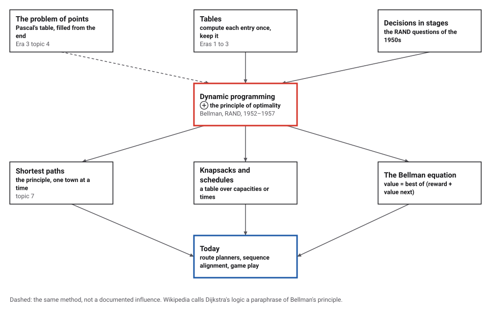
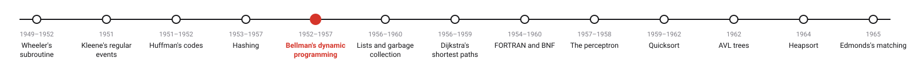
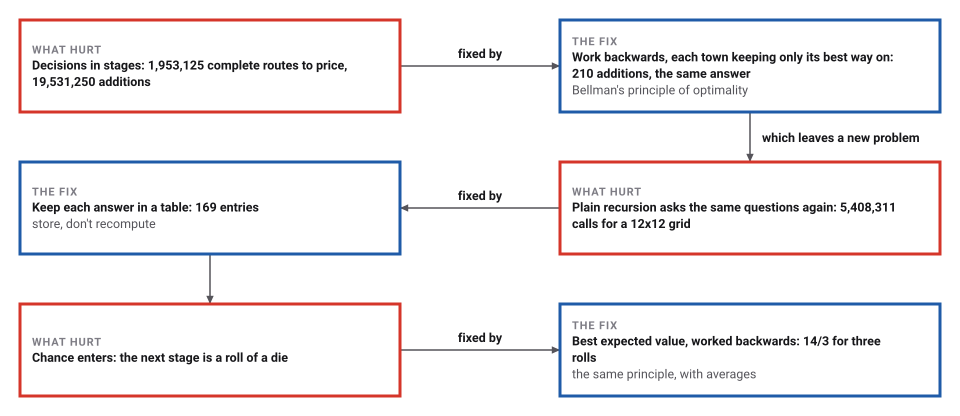
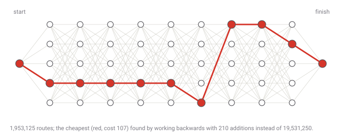

# Dynamic Programming

*Era 5 · topic 5 · 1952–1957* · [Era 5 index](../README.md) · [← Hashing](../04-hashing/README.md) · [Linked Lists and Garbage Collection →](../06-linked-lists/README.md) · [Interactive edition](dynamic-programming.html) · [Program](../../../code/era-05-the-programmers-craft/05-dynamic-programming/)

> **Field note from the visiting historian.** I priced all 1,953,125 routes of a ten-stage journey: 19,531,250 additions. Working backwards took 210. The answer was the same, 107. The method's inventor said he chose its name so that no official could object to it; the dates in his story do not quite agree.

| | |
|---|---|
| **When** | 1952 papers; 1957 book |
| **Where** | RAND Corporation, Santa Monica |
| **What hurt** | Plans in stages multiply beyond listing |
| **The fix** | The principle of optimality: work backwards, store each answer |
| **Saving** | 210 additions instead of 19,531,250 |

## How ideas combined

A new algorithm is usually an older idea combined with a new one. Pascal had already valued an unfinished game by filling a table from the last round backwards (Era 3). Bellman, set to study "multistage decision processes" at RAND, turned that into a principle for every plan made in stages: whatever the first decision, the rest must be best for the situation it leaves. Each box names the idea that was added.

<picture>
  <source media="(prefers-color-scheme: dark)" srcset="assets/family-dark.svg">
  
</picture>
*Red: dynamic programming. Blue: where it works today.*

## Roll, or stop? Ask the table

You may roll a die up to n times and you keep the last roll. When should you stop? Work backwards: with one roll left the game is worth 3.5 on average, so with two left you should keep a first roll of 4 or more, and so on. Play against the table, or let the page play 10,000 games by its rule.

| Rolls allowed | Value of the game | Keep the first roll if it shows |
|---|---|---|
| 1 | 3.5000 | (must keep) |
| 2 | 4.2500 | 4 or more |
| 3 | 4.6667 | 5 or more |
| 4 | 4.9444 | 5 or more |
| 5 | 5.1296 | 5 or more |
| 6 | 5.2747 | 6 or more |
*In the interactive edition you can play the dice game against the table.*

## Era 5, the programmer's craft

<picture>
  <source media="(prefers-color-scheme: dark)" srcset="assets/era-timeline-dark.svg">
  
</picture>

## Each fix leaves a new pain

<picture>
  <source media="(prefers-color-scheme: dark)" srcset="assets/chain-dark.svg">
  
</picture>
*Read it as a snake: each new problem sits directly under the fix that exposed it.*

## Start at the end

**A journey in stages.** A start, 9 stages of 5 towns, a finish, and a cost on every road between neighbouring stages. Trying every route means pricing 1,953,125 routes, 19,531,250 additions. Working backwards, each town of the last stage knows its cost to the finish; each town of the stage before takes the cheapest of (road + that town's cost); and so on to the start: 210 additions, and the same cheapest cost, 107. The route can be read off by following each town's best choice forwards: towns 3 → 3 → 3 → 3 → 3 → 4 → 0 → 0 → 1 → 0.

<picture>
  <source media="(prefers-color-scheme: dark)" srcset="assets/stages-dark.svg">
  
</picture>

**Overlapping questions.** How many routes run from one corner of a grid to the other, moving right or down? Plain recursion asks "how many from here?" for the same corners over and over; a table asks each corner once:

| Grid | Routes | Calls by plain recursion | Entries in the table |
|---|---|---|---|
| 4×4 | 70 | 139 | 25 |
| 8×8 | 12,870 | 25,739 | 81 |
| **12×12** | **2,704,156** | **5,408,311** | **169** |

> **Key idea.** An optimal plan is made of optimal pieces. So solve the smallest pieces first, keep their answers, and build every larger answer from stored ones; nothing is solved twice.

## Exact values, and a knapsack

| Rolls allowed | Value of the game (exact) | Decimal | Keep the first roll if it shows |
|---|---|---|---|
| 1 | 7/2 | 3.5000 | (must keep) |
| 2 | 17/4 | 4.2500 | 4 or more |
| **3** | **14/3** | **4.6667** | **5 or more** |
| 4 | 89/18 | 4.9444 | 5 or more |
| 5 | 277/54 | 5.1296 | 5 or more |
| 6 | 1709/324 | 5.2747 | 6 or more |

Worked backwards as exact fractions. A million three-roll games played by the rule averaged 4.6656, against the exact 14/3 = 4.6667.

**The knapsack.** For 300 random sets of 18 items, a table indexed by capacity (each item considered once, every capacity updated) agreed every time with a search through all 262,144 choices. The table took 422,799 steps in all; the search looked at 78,642,900 subsets. In the first set the sack held 85 units and the best value was 319.

## A name chosen at RAND

"Bellman left Stanford in 1952 and took up the position of Research Mathematician at RAND"; "Bellman's first publication on dynamic programming appeared in 1952", and RAND published his first book on it in 1953 (MacTutor). RAND lists his memorandum RM-813, "On a problem in dynamic programming" (1952). The book *Dynamic Programming* followed in 1957.

Bellman's own story of the name, from his autobiography (1984): "I spent the Fall quarter (of 1950) at RAND. My first task was to find a name for multistage decision processes"; the Secretary of Defense, Wilson, "had a pathological fear and hatred of the word, research"; "it's impossible to use the word, dynamic, in a pejorative sense"; "It was something not even a Congressman could object to." The story does not fit the calendar: Wilson became Secretary of Defense in 1953, after Bellman's first paper using the term, and Kushner recalled Bellman saying he "was trying to upstage Dantzig's linear programming by adding dynamic". The catalog marks the story as disputed.

On the principle of optimality, asked whether it was rigorous: "Of course not. It's not even precise. A good principle should guide the intuition."

## Pascal's table, a principle at last

Pascal valued an interrupted game by filling a table backwards from the last round (Era 3, topic 4). Bellman's principle says why that works for any process in stages, with or without chance. Dijkstra's shortest paths (topic 7) are described as a paraphrase of it, and the Bellman equation, which restates an optimization problem in recursive form, is the centre of the subject.

> **Full circle.** 1,953,125 routes, 210 additions. The table does not make the problem smaller; it makes sure each piece is solved only once.

## Before you read on

<details>
<summary><b>1.</b> With two rolls allowed, why keep a first roll of 4 but not of 3?</summary>

Rolling again is worth 3.5 on average: 4 beats it, 3 does not.
</details>

<details>
<summary><b>2.</b> Check the value of the two-roll game.</summary>

Keep 4, 5 or 6 (worth 4, 5, 6); otherwise roll again (worth 3.5 each for faces 1, 2, 3): (3 × 3.5 + 4 + 5 + 6)/6 = 25.5/6 = 4.25 = 17/4.
</details>

<details>
<summary><b>3.</b> How many routes cross a 3×3 grid, moving right or down?</summary>

Choose which 3 of the 6 moves go right: C(6,3) = 20. The table has 4 × 4 = 16 entries.
</details>

<details>
<summary><b>4.</b> Why does working backwards need fewer additions than pricing every route?</summary>

Every route shares its tail with many others; working backwards prices each tail once and reuses it.
</details>

<details>
<summary><b>5.</b> When does dynamic programming not help?</summary>

When the sub-problems do not repeat, or when there are so many different situations that the table itself is too large.
</details>


## Where the evidence lives

| | Object | Where to see it | Licence |
|---|---|---|---|
| — | **Richard Bellman on the Birth of Dynamic Programming (2002)**. Stuart Dreyfus's introduction to excerpts from Bellman's autobiography, in Operations Research. | [PDF on a course page](https://web.cs.miami.edu/home/odelia/teaching/csc317_fall19/syllabus/dy_birth.pdf) | Drawn placeholder. |

## Every link was opened before it was listed

| Level | Link | Why |
|---|---|---|
| Start | [Dynamic programming](https://en.wikipedia.org/wiki/Dynamic_programming) — Wikipedia | The method, the Bellman equation and the disputed story of the name |
| Start | [Why Is It Called "Dynamic Programming"?](https://conversableeconomist.com/2022/08/24/why-is-it-called-dynamic-programming/) — Timothy Taylor, Conversable Economist (2022) | Bellman's own account, quoted at length |
| Deeper | [Richard Ernest Bellman](https://mathshistory.st-andrews.ac.uk/Biographies/Bellman/) — MacTutor | His career at RAND and after |
| Deeper | [Richard Bellman on the Birth of Dynamic Programming](https://web.cs.miami.edu/home/odelia/teaching/csc317_fall19/syllabus/dy_birth.pdf) — Stuart Dreyfus, *Operations Research* 50(1) (2002), on a University of Miami course page | Excerpts from *Eye of the Hurricane*, introduced by a colleague |
| Scholar | [On a problem in dynamic programming](https://www.rand.org/pubs/research_memoranda/RM813.html) — R. E. Bellman, RAND RM-813 (1952) | One of the first RAND memoranda with the name (catalogue record) |
| Scholar | [Dynamic programming and a new formalism in the calculus of variations](https://pmc.ncbi.nlm.nih.gov/articles/PMC527981) — R. Bellman, *PNAS* 40(4): 231–235 (1954) | An early journal paper, with a free scan |

More, with certainty labels and the gaps we could not fill: [Era 5 reference catalog](https://github.com/vij658/AlgorithmEvolutionAtlas/blob/main/book/era-05-the-programmers-craft/reference-catalog.md).

## The program behind every number here

[DynamicProgramming.java](https://github.com/vij658/AlgorithmEvolutionAtlas/blob/main/code/era-05-the-programmers-craft/05-dynamic-programming/DynamicProgramming.java) makes **310 checks**: the cheapest of 1,953,125 routes both ways, path counts by recursion and by table, the exact values of the dice game with a simulation, and the knapsack table against every subset for 300 random sets. Run it with `java DynamicProgramming.java` (JDK 17 or newer). The heart of it:

```java
static long pathsNaive(int r, int c) {
    calls++;
    if (r == 0 || c == 0) return 1;
    return pathsNaive(r - 1, c) + pathsNaive(r, c - 1);
}
```

