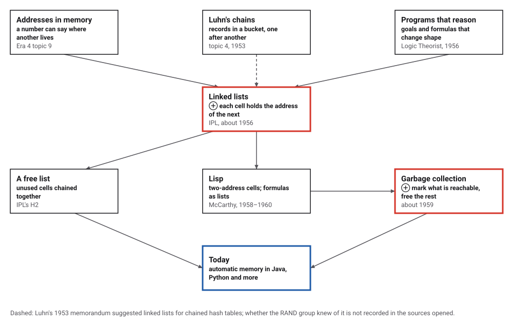
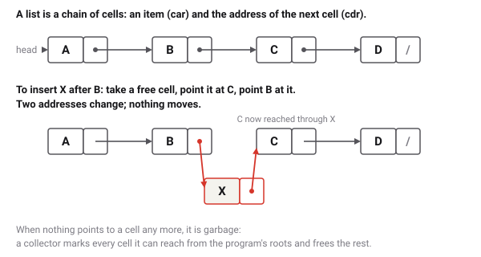
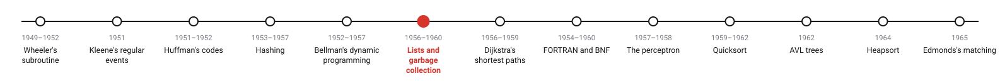
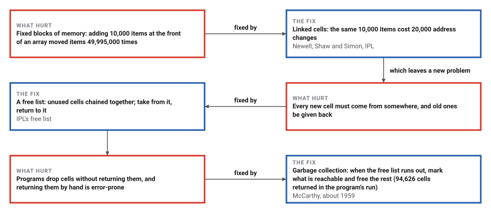

# Linked Lists and Garbage Collection

*Era 5 · topic 6 · 1956–1960* · [Era 5 index](../README.md) · [← Dynamic Programming](../05-dynamic-programming/README.md) · [Dijkstra's Shortest Paths →](../07-shortest-paths/README.md) · [Interactive edition](linked-lists.html) · [Program](../../../code/era-05-the-programmers-craft/06-linked-lists/)

> **Field note from the visiting historian.** Four derivatives of a formula, computed 200 times in a memory of 250 cells: 94,800 cells used, each one many times over. The collector ran 599 times and never freed a cell still in use. McCarthy, they say, did not dare print the word garbage.

| | |
|---|---|
| **When** | IPL about 1956; garbage collection about 1959; Lisp 1960 |
| **Where** | RAND and Carnegie Tech; MIT |
| **What hurt** | Fixed memory could not grow, shrink or be spliced |
| **The fix** | Cells with the address of the next; mark and sweep |
| **Cost** | Following addresses one by one; pauses to collect |

## How ideas combined

A new algorithm is usually an older idea combined with a new one. Memory addresses are numbers, so one word can say where another lives. The RAND group put that to work for programs whose data kept changing shape: every item in a small cell with the address of the next. McCarthy then let the machine itself take back the cells nobody could reach. Each box names the idea that was added.

<picture>
  <source media="(prefers-color-scheme: dark)" srcset="assets/family-dark.svg">
  
</picture>
*Red: linked lists and garbage collection. Blue: automatic memory today.*

## Make garbage, then collect it

Sixteen cells, each with an item and the number of the next cell (→nil ends a list). Two lists, A and B, start from the program's two roots. Pop A or drop B and some cells become garbage: still in memory, but unreachable. Collect: the page marks every cell it can reach from A and B, then sweeps the rest onto the free list. Keep pushing and the collector runs by itself when the free list is empty.

<picture>
  <source media="(prefers-color-scheme: dark)" srcset="assets/cells-dark.svg">
  
</picture>
*In the interactive edition you can push, pop, drop and collect in a 16-cell memory.*

## Era 5, the programmer's craft

<picture>
  <source media="(prefers-color-scheme: dark)" srcset="assets/era-timeline-dark.svg">
  
</picture>

## Each fix leaves a new pain

<picture>
  <source media="(prefers-color-scheme: dark)" srcset="assets/chain-dark.svg">
  
</picture>
*Read it as a snake: each new problem sits directly under the fix that exposed it.*

## Cells, a free list, and a collector

**Cells.** In the program each cell has two address fields, as in Lisp: the car (the item, or another list) and the cdr (the rest of the list). Adding 10,000 items one at a time to the front of a list took 10,000 cells from the free list and wrote 20,000 addresses; doing the same with an array moved items along 49,995,000 times. Reversing (A B C D E F G H) needs no new cells at all: turn its 8 arrows round and it reads (H G F E D C B A).

**Formulas as lists.** Because a car can hold another list, cells make trees, and a formula is a tree. The program stores f = x^4 + 5x as (PLUS (TIMES X (TIMES X (TIMES X X))) (TIMES 5 X)), and differentiates it by building new cells: the first derivative, simplified as it is made, is (PLUS (PLUS (TIMES X (TIMES X X)) (TIMES X (PLUS (TIMES X X) (TIMES X (TIMES 2 X))))) 5); the fourth is 24. Each one was checked by evaluating it at x = −3 to 3. The four derivatives took 474 cells, and most of them were thrown away along the way.

**Mark and sweep.** The same work was repeated 200 times in a memory of only 250 cells. The program took 94,800 cells in all, 379 times the size of the memory: the free list ran out 599 times, and each time the collector marked every cell reachable from the program's roots and swept 94,626 unreachable cells back onto the free list in all. Every round gave the same answers, and at the end, with no roots left, all 250 cells were free. The smallest memory in which the work can be done at all is 213 cells, about the most that are ever in use at once.

> **Key idea.** Let data point to data. A list grows, shrinks and is spliced by changing addresses, not by moving items; and since the machine can follow the addresses too, it can find out for itself which cells are still in use.

## What the program counted

| Task | Linked cells | Array |
|---|---|---|
| add 10,000 items at the front | 20,000 addresses written | 49,995,000 items moved |
| reverse (A B C D E F G H) | 8 arrows turned, no new cells | (move every item) |

| Garbage collection run | Value |
|---|---|
| memory | 250 cells |
| cells taken in all | 94,800 |
| times the free list ran out | 599 |
| cells returned by mark and sweep | 94,626 |
| smallest memory that works | 213 cells |

## RAND, Carnegie Tech and MIT

IPL was "created by Allen Newell, Cliff Shaw, and Herbert A. Simon at RAND Corporation and the Carnegie Institute of Technology about 1956"; it ran the Logic Theorist (1956) and the General Problem Solver (1957), "introduced the concepts of symbol processing and list processing", and kept unused cells on a free list ("H2 is the free-list"). "Many of these features were generalized, rationalized, and incorporated into Lisp." Newell and Shaw's "Programming the Logic Theory Machine" (1957) has the "now-classic diagram" of cells joined by arrows; Newell and Simon received the 1975 Turing Award.

McCarthy: "Around 1959, he invented so-called 'garbage collection' methods"; Lisp "soon became the programming language of choice for AI applications after its publication in 1960". His 1960 paper: "When a free register is wanted, and there is none left on the free-storage list, a reclamation cycle starts", with his later remark: "We already called this process 'garbage collection', but I guess that I chickened out of using it in the paper" (quoted in Cambridge lecture slides).

## The collector inside this book's programs

Every program in this book is written in Java, which collects its own garbage: the topic's program simulates a Lisp memory inside a language that does the same thing for real underneath it. Luhn's chained buckets (topic 4) were linked lists before the name existed, and AVL trees (topic 11) are built from cells with two links, like Lisp's.

> **Full circle.** 94,800 cells used in a memory of 250: each cell was used about 379 times, returned by a collector the program never had to call.

## Before you read on

<details>
<summary><b>1.</b> How many addresses change to remove the second cell of a list?</summary>

One: the first cell's next-address now points to the third cell.
</details>

<details>
<summary><b>2.</b> Why is finding the 1,000th item slow in a linked list?</summary>

There is no arithmetic for it: you must follow 999 addresses from the head. An array finds it in one step.
</details>

<details>
<summary><b>3.</b> After 'drop list B', why are B's cells not free yet?</summary>

Nothing has returned them; they are garbage, unreachable but not yet on the free list, until a collection runs.
</details>

<details>
<summary><b>4.</b> Can a collector free a cell the program will still use?</summary>

Not if it knows every root: anything the program can still reach is reachable from a root, and is marked.
</details>

<details>
<summary><b>5.</b> Why must the program in this topic register its intermediate results as roots?</summary>

A cell referred to only from a local variable would look unreachable, and a collection in the middle of the work would free it.
</details>


## Where the evidence lives

| | Object | Where to see it | Licence |
|---|---|---|---|
| — | **Recursive Functions of Symbolic Expressions (1960)**. McCarthy's Lisp paper in Communications of the ACM 3(4), with the free-storage list and its reclamation cycle. | [Lecture slides quoting it](https://www.cl.cam.ac.uk/teaching/0708/ConceptsPL/LISP.pdf) | Drawn placeholder. |

## Every link was opened before it was listed

| Level | Link | Why |
|---|---|---|
| Start | [Linked list](https://wikipedia.com/wiki/LinkedList) — Wikipedia | The data structure and its history at RAND and MIT |
| Start | [Garbage collection (computer science)](https://en.wikipedia.org/wiki/Garbage_collection_(computer_science) — Wikipedia | Reclaiming unreachable memory, from McCarthy to today |
| Deeper | [Information Processing Language](https://en.wikipedia.org/wiki/Information_Processing_Language) — Wikipedia | The first list-processing language and its free list |
| Deeper | [John McCarthy](https://en.wikipedia.org/wiki/John_McCarthy_(computer_scientist) — Wikipedia | Lisp, garbage collection and the name "artificial intelligence" |
| Deeper | [LISP](https://www.cl.cam.ac.uk/teaching/0708/ConceptsPL/LISP.pdf) — University of Cambridge, Concepts in Programming Languages (2007–08) | Lecture slides on McCarthy's paper, with his remark about the name |

More, with certainty labels and the gaps we could not fill: [Era 5 reference catalog](https://github.com/vij658/AlgorithmEvolutionAtlas/blob/main/book/era-05-the-programmers-craft/reference-catalog.md).

## The program behind every number here

[ListsAndGarbage.java](https://github.com/vij658/AlgorithmEvolutionAtlas/blob/main/code/era-05-the-programmers-craft/06-linked-lists/ListsAndGarbage.java) makes **17,179 checks**: lists against arrays, an in-place reversal, four symbolic derivatives each checked at seven points, and 200 rounds of the same work in a 250-cell memory kept alive by mark and sweep. Run it with `java ListsAndGarbage.java` (JDK 17 or newer). The heart of it:

```java
static int cons(int a, int d) {
    if (free == 0) {
        push(a);
        push(d);              // the two arguments must survive the collection
        gc();
        pop(2);
        if (free == 0) throw new IllegalStateException("memory full");
    }
    int c = free;
    free = cdr[c];
    freeCount--;
    car[c] = a;
    cdr[c] = d;
    allocated++;
    return c;
}

/** Mark everything reachable from the roots, then sweep the unmarked cells onto the free list. */
static void gc() {
    collections++;
    Arrays.fill(mark, false);
    Deque<Integer> todo = new ArrayDeque<>();
    for (int i = 0; i < nroots; i++) if (roots[i] > 0) todo.push(roots[i]);
    while (!todo.isEmpty()) {
        int c = todo.pop();
        if (mark[c]) continue;
        mark[c] = true;
        if (car[c] > 0) todo.push(car[c]);
        if (cdr[c] > 0) todo.push(cdr[c]);
    }
    for (int c = 1; c < car.length; c++)
        if (!mark[c]) {
            boolean wasFree = isFree(c);
            if (!wasFree) { car[c] = 0; cdr[c] = free; free = c; freeCount++; reclaimed++; }
        }
}
```

