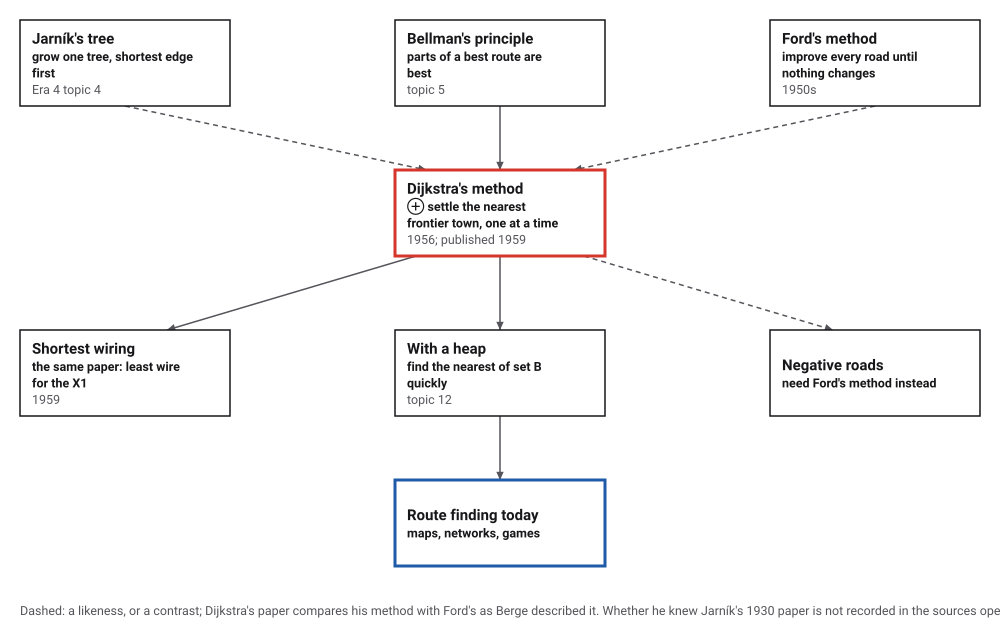
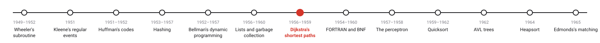
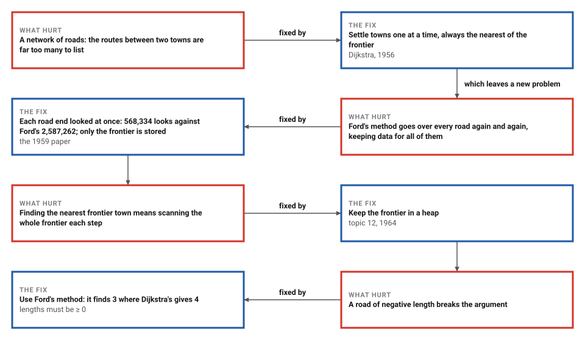
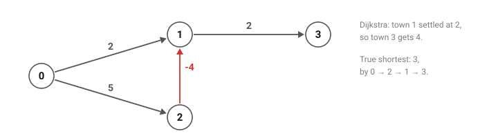

# Dijkstra's Shortest Paths

*Era 5 · topic 7 · 1956–1959* · [Era 5 index](../README.md) · [← Linked Lists and Garbage Collection](../06-linked-lists/README.md) · [The Compiler, and a Grammar for Languages →](../08-the-compiler/README.md) · [Interactive edition](shortest-paths.html) · [Program](../../../code/era-05-the-programmers-craft/07-shortest-paths/)

> **Field note from the visiting historian.** From town 18 to town 32 of an invented map: 1362 units, through 10 towns. Each town was settled exactly once, nearest first, and the argument that this is safe fits in one sentence. Its author waited three years to publish it, for want of a journal that cared.

| | |
|---|---|
| **When** | 1956; published 1959 |
| **Where** | Mathematical Centre, Amsterdam |
| **What hurt** | Too many routes; methods that stored every road |
| **The fix** | Settle the nearest frontier town, one at a time |
| **Cost** | Each road looked at twice; 4.6 times fewer looks than Ford's here |

## How ideas combined

A new algorithm is usually an older idea combined with a new one. The shortest route to a town passes through towns whose shortest routes are its own beginnings (the principle of topic 5). Dijkstra added an order: settle the towns one at a time, nearest first, so that each is settled once and for all. Each box names the idea that was added.

<picture>
  <source media="(prefers-color-scheme: dark)" srcset="assets/family-dark.svg">
  
</picture>
*Red: Dijkstra's method. Blue: route finding today.*

## Grow the settled set, one town at a time

An invented map of 12 towns (road lengths beside the roads). Red towns are in set A, settled; blue towns are in set B, reached by some road with the best distance so far; white towns are in C. Each step moves the nearest town of B into A and looks along its roads. Click any town to start from it.

| After step | Set A (town = distance) | Set B (town = distance so far) |
|---|---|---|
| 1 | 18=0 | 1=220 14=143 22=320 55=312 |
| 2 | 14=143 18=0 | 1=220 4=361 22=320 55=312 |
| 3 | 1=220 14=143 18=0 | 4=361 11=456 22=320 35=399 55=312 |
| 4 | 1=220 14=143 18=0 55=312 | 4=335 11=456 22=320 23=447 26=442 35=399 |
*In the interactive edition you can step through the method on a small map. Here, the first four steps on the program's 64-town map, from town 18.*

## Era 5, the programmer's craft

<picture>
  <source media="(prefers-color-scheme: dark)" srcset="assets/era-timeline-dark.svg">
  
</picture>

## Each fix leaves a new pain

<picture>
  <source media="(prefers-color-scheme: dark)" srcset="assets/chain-dark.svg">
  
</picture>
*Read it as a snake: each new problem sits directly under the fix that exposed it.*

## Three sets of towns

**The paper's words.** Dijkstra divides the nodes into set A, "the nodes for which the path of minimum length from P is known"; set B, "the nodes from which the next node to be added to set A will be selected"; and set C, "the remaining nodes". At each step "the node with minimum distance from P is transferred from set B to set A", and the roads out of it update its neighbours.

**Why the nearest is safe.** Any other route to that town must leave set A somewhere, through a town of B that is already at least as far, and roads cannot have negative length; so nothing found later can be shorter.

**On the program's map.** 64 invented towns, each joined to its 4 nearest neighbours (152 roads; the ARMAC demonstration used 64 Dutch cities). From town 18 to town 32 the shortest route is 18 → 55 → 23 → 44 → 45 → 36 → 34 → 5 → 13 → 32, length 1362, through 10 towns. The method moved all 64 towns into A and looked along 304 road ends, each road from both of its ends once.

<picture>
  <source media="(prefers-color-scheme: dark)" srcset="assets/negative-dark.svg">
  
</picture>
*With one-way roads 0→1 (2), 0→2 (5), 2→1 (−4), 1→3 (2), town 1 is settled at 2 before the road from town 2 is seen.*

> **Key idea.** Settle the nearest unsettled place: its distance can never improve. Each place is settled once, and each road is looked at once from each end.

## Against Ford's method, and what must be stored

On 2,000 random maps of 20 to 99 towns (road lengths 1 to 100), Dijkstra's method and Ford's method (improve every road, pass after pass, until nothing changes) gave the same distance to every town. Dijkstra's looked at 568,334 road ends; Ford's at 2,587,262, 4.6 times as many. Dijkstra's method also scanned set B once per town to find its nearest member, as the 1959 version did; a heap (topic 12) makes that fast.

| Towns | Roads | Largest size of set B |
|---|---|---|
| 64 | 156 | 15 |
| 256 | 623 | 25 |
| 1024 | 2492 | 66 |

The paper's other boast: against Ford's method, "we need not store the data for all branches simultaneously but only those for the branches in sets I and II, and this number is always less than n". Set B stays far smaller than the number of roads.

**The paper's first problem**, the shortest network joining all the towns, by growing one tree from a town: on the 64 towns joined every way, length 5576; Kruskal's method, shortest roads first unless they close a loop, gives 5576 with 63 roads, the same.

## Twenty minutes on a café terrace

For the official inauguration of the ARMAC in 1956, Dijkstra wanted a problem a nontechnical audience could follow: "Given a network of roads connecting cities, what is the shortest route between two designated cities?" (ACM Turing Award page). In a 2001 interview he recalled the question "What's the shortest way to travel from Rotterdam to Groningen", worked out on a "café terrace" in Amsterdam with "my young fiancée" in about twenty minutes, "without pencil and paper"; "it was published in 1959, three years later". Wikipedia gives the reason for the wait: "Because of the absence of journals dedicated to automatic computing, he did not publish the result until 1959."

The paper, "A note on two problems in connexion with graphs" (*Numerische Mathematik* 1: 269–271, 1959), poses two problems: "Construct the tree of minimum total length between the n nodes", for the wiring of the X1 computer, and "Find the path of minimum total length between two given nodes P and Q". The 64-city demonstration map is reported by Vice (2015) and *Chalkdust* (2018), not in Dijkstra's own words.

## Two problems, three pages

The method, usually with its frontier kept in a heap (topic 12), is still the first one taught for finding routes. The paper's other problem, the shortest wiring, is Jarník's tree of 1930 (Era 4, topic 4) found again: the program grows it from one town and gets exactly the length Kruskal's method gives.

> **Full circle.** Designed for an audience of non-mathematicians at a computer's opening, without pencil or paper: from town 18 to town 32, 1362 units, found by settling 64 towns in order of distance.

## Before you read on

<details>
<summary><b>1.</b> In the program's first step, set B holds towns 1, 14, 22, 55 at 220, 143, 320, 312. Which moves into A next?</summary>

Town 14, at 143: the nearest in B.
</details>

<details>
<summary><b>2.</b> Why can't a town in A ever get a shorter distance later?</summary>

Every other route to it leaves A through a town of B that is already at least as far, and the remaining roads only add length.
</details>

<details>
<summary><b>3.</b> How many times is each road looked at?</summary>

Once from each end, when that end's town is moved into A.
</details>

<details>
<summary><b>4.</b> Why does a negative road break the method?</summary>

A town settled early could be reached more cheaply later through the negative road, but settled towns are never revisited.
</details>

<details>
<summary><b>5.</b> What does a heap change?</summary>

Finding the nearest town of B takes about log n steps instead of a scan of all of B.
</details>


## Where the evidence lives

| | Object | Where to see it | Licence |
|---|---|---|---|
| — | **A note on two problems in connexion with graphs (1959)**. Dijkstra's three-page paper in Numerische Mathematik: the shortest wiring, and the shortest path. | [CWI repository](https://ir.cwi.nl/pub/9256) | Drawn placeholder. |

## Every link was opened before it was listed

| Level | Link | Why |
|---|---|---|
| Start | [An Interview With Edsger W. Dijkstra](https://cacm.acm.org/?p=31927) — Philip L. Frana (2001), *Communications of the ACM* | The café, the twenty minutes, and why it waited three years |
| Start | [The Simple, Elegant Algorithm That Makes Google Maps Possible](https://www.vice.com/en/article/4x3pp9/the-simple-elegant-algorithm-that-makes-google-maps-possible) — Michael Byrne, Vice (2015) | The ARMAC demonstration and the 64 cities |
| Start | [Routes: Edsger Dijkstra](https://chalkdustmagazine.com/biographies/routes-edsger-dijkstra/) — Emma Bell, *Chalkdust* (2018) | A short biography for students |
| Deeper | [Edsger W. Dijkstra](https://amturing.acm.org/award_winners/dijkstra_1053701) — ACM Turing Award | The ARMAC program, the X1 wiring problem and his later work |
| Deeper | [Edsger W. Dijkstra](https://en.wikipedia.org/wiki/Edsger_W._Dijkstra) — Wikipedia | Life and work, from the Mathematical Centre to Austin |
| Scholar | [A note on two problems in connexion with graphs](https://isidore.co/misc/Physics%20papers%20and%20books/Zotero/storage/RQ5SZPTE/Dijkstra%20-%201959%20-%20A%20note%20on%20two%20problems%20in%20connexion%20with%20graphs.pdf) — E. W. Dijkstra, *Numerische Mathematik* 1: 269–271 (1959), scan | The three-page paper: the tree, the path, and the sets A, B, C |
| Scholar | [A note on two problems in connexion with graphs](https://ir.cwi.nl/pub/9256) — CWI repository record, with the full text | The paper at the institute where Dijkstra worked |

More, with certainty labels and the gaps we could not fill: [Era 5 reference catalog](https://github.com/vij658/AlgorithmEvolutionAtlas/blob/main/book/era-05-the-programmers-craft/reference-catalog.md).

## The program behind every number here

[ShortestPaths.java](https://github.com/vij658/AlgorithmEvolutionAtlas/blob/main/code/era-05-the-programmers-craft/07-shortest-paths/ShortestPaths.java) makes **4,008 checks**: the 64-town map against Ford's method, 2,000 random maps, the size of set B, a negative road, and the shortest network by two methods. Run it with `java ShortestPaths.java` (JDK 17 or newer). The heart of it:

```java
/** Dijkstra's method as in 1959: scan set B for its nearest town (no priority queue). */
static int[] dijkstra(List<List<Road>> g, int p, int[] prev) {
    int n = g.size();
    int[] dist = new int[n];
    Arrays.fill(dist, INF);
    char[] set = new char[n];
    Arrays.fill(set, 'C');
    dist[p] = 0;
    set[p] = 'B';
    if (prev != null) Arrays.fill(prev, -1);
    maxB = 1;
    int step = 0;
    while (true) {
        int u = -1;
        for (int i = 0; i < n; i++) if (set[i] == 'B' && (u < 0 || dist[i] < dist[u])) u = i;
        if (u < 0) break;
        set[u] = 'A';
        selections++;
        for (Road r : g.get(u)) {
            looks++;
            if (set[r.to()] == 'A') continue;
            if (dist[u] + r.len() < dist[r.to()]) {
                dist[r.to()] = dist[u] + r.len();
                if (prev != null) prev[r.to()] = u;
                set[r.to()] = 'B';
            }
        }
        int b = 0;
        for (char c : set) if (c == 'B') b++;
        maxB = Math.max(maxB, b);
        if (snapshots != null && step < 4) {
            StringBuilder a = new StringBuilder(), bb = new StringBuilder();
            for (int i = 0; i < n; i++) {
                if (set[i] == 'A') a.append(a.length() > 0 ? " " : "").append(i).append('=').append(dist[i]);
                if (set[i] == 'B') bb.append(bb.length() > 0 ? " " : "").append(i).append('=').append(dist[i]);
            }
            snapshots.add(String.format("after step %d: A {%s} B {%s}", step + 1, a, bb));
        }
        step++;
    }
    return dist;
}
```

