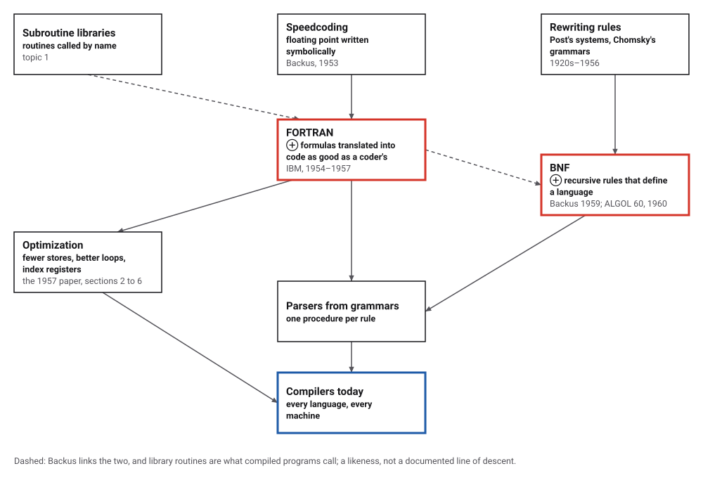
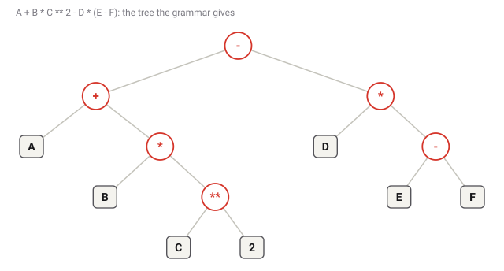
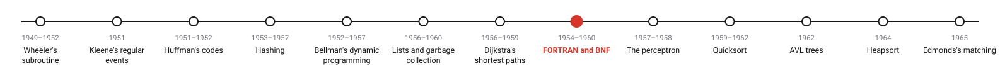
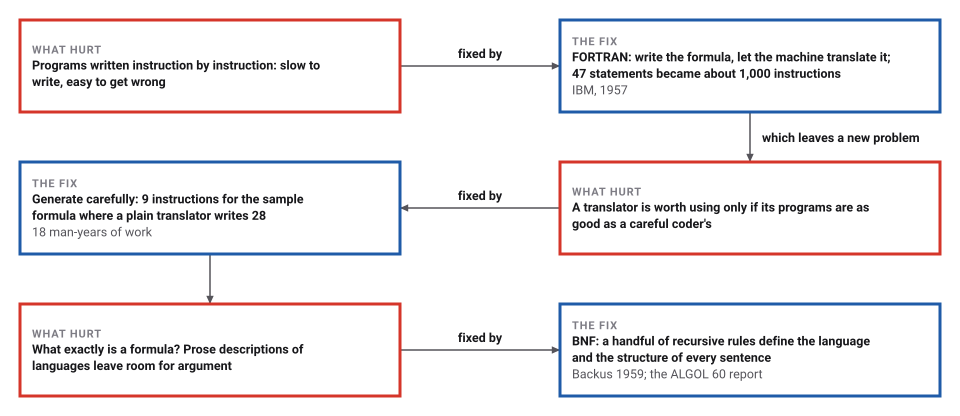

# The Compiler, and a Grammar for Languages

*Era 5 · topic 8 · 1954–1960* · [Era 5 index](../README.md) · [← Dijkstra's Shortest Paths](../07-shortest-paths/README.md) · [Rosenblatt's Perceptron →](../09-perceptron/README.md) · [Interactive edition](the-compiler.html) · [Program](../../../code/era-05-the-programmers-craft/08-the-compiler/)

> **Field note from the visiting historian.** Forty-seven statements in four hours; about a thousand instructions in six minutes. The team's condition was that the machine's code be as good as a careful coder's. My little translator writes 9 instructions where a naive one writes 28, for the same formula and the same answer, 61.

| | |
|---|---|
| **When** | FORTRAN 1954–1957; BNF 1959–1960 |
| **Where** | IBM, New York; Paris; the ALGOL committee |
| **What hurt** | Programs written instruction by instruction |
| **The fix** | Formulas translated into efficient code; rules that define a language |
| **Cost** | 18 man-years for the first FORTRAN compiler |

## How ideas combined

A new algorithm is usually an older idea combined with a new one. Backus's Speedcoding had already let programmers write floating-point operations symbolically. FORTRAN added a translator that read whole formulas and loops and wrote machine code nearly as good as a careful programmer's. Two years later Backus gave languages an exact definition. Each box names the idea that was added.

<picture>
  <source media="(prefers-color-scheme: dark)" srcset="assets/family-dark.svg">
  
</picture>
*Red: FORTRAN and BNF. Blue: compilers today.*

## Type a formula and compile it two ways

Type a formula. The page parses it with the grammar below (one procedure per rule), shows the structure it finds, and compiles it for a machine with one accumulator: LDA (load), ADD, SUB, MPY (multiply), STO (store). The plain translator stores every intermediate result; the careful one uses a letter directly when it can. Change the letters' values and both programs are run.

<picture>
  <source media="(prefers-color-scheme: dark)" srcset="assets/syntax-dark.svg">
  
</picture>
*In the interactive edition you can type any formula and see both programs.*

## Era 5, the programmer's craft

<picture>
  <source media="(prefers-color-scheme: dark)" srcset="assets/era-timeline-dark.svg">
  
</picture>

## Each fix leaves a new pain

<picture>
  <source media="(prefers-color-scheme: dark)" srcset="assets/chain-dark.svg">
  
</picture>
*Read it as a snake: each new problem sits directly under the fix that exposed it.*

## From a grammar to instructions

**The grammar.** The ALGOL 60 report defines arithmetic expressions with rules such as `<term> ::= <factor> | <term> <multiplying operator> <factor>`: a term is a factor, or a term followed by a multiplication sign and a factor. The program uses four such rules (expression, term, factor, primary), and each becomes one procedure of the parser, calling the others as the rule mentions them. Because the rule for expression puts the earlier operation deeper in the tree, A − B − C means (A − B) − C.

**The structure.** For A + B * C ** 2 - D * (E - F) the parser finds ((A + (B * (C ** 2))) - (D * (E - F))): powers first, then products, then sums and differences, left to right. The FORTRAN paper describes the same idea: "there is implicit in every arithmetic formula an order of computation", and the translator assigns level numbers so that "the operations are carried out in the order of increasing level number".

| Plain translator | Careful translator |
|---|---|
| LDA A | LDA E |
| STO T1 | SUB F |
| LDA B | MPY D |
| STO T2 | STO T1 |
| LDA C | LDA C |
| STO T3 | MPY C |
| MPY T3 | MPY B |
| STO T4 | ADD A |
| LDA T2 | SUB T1 |
| MPY T4 |  |
| STO T5 |  |
| LDA T1 |  |
| ADD T5 |  |
| STO T6 |  |
| LDA D |  |
| STO T7 |  |
| LDA E |  |
| STO T8 |  |
| LDA F |  |
| STO T9 |  |
| LDA T8 |  |
| SUB T9 |  |
| STO T10 |  |
| LDA T7 |  |
| MPY T10 |  |
| STO T11 |  |
| LDA T6 |  |
| SUB T11 |  |

**Two translators.** The plain one stores every intermediate result in a temporary word and loads it back: 28 instructions. The careful one computes D × (E − F) first and stores it once, then builds B × C² + A directly: 9 instructions. With A=3 B=4 C=5 D=6 E=9 F=2, both give 61.

> **Key idea.** Define the language by rules, read each formula into the tree the rules give it, and walk the tree to write instructions. Then spend the effort where the FORTRAN team spent it: on making those instructions as few and as fast as a person would.

## Twenty thousand random formulas

The program built 20,000 random formulas from the grammar's own rules (for example (F * (B) - B * E * 1 + 8) + E * 3 ** 2 * A + 5 ** 3 * 8 ** 3), printed each with the fewest brackets, parsed it again and got the same structure, compiled it both ways and ran it 100,000 times in all with random values: every result matched direct evaluation.

| Translator | Instructions for all the formulas |
|---|---|
| plain | 493,935 |
| **careful** | **181,640** |

The careful translator wrote 63% fewer instructions. FORTRAN went much further, with sections that moved work out of loops and planned the use of index registers so that "the time spent in loading and storing index registers will be nearly minimum".

**Left to right.** A - B - C with A=10 B=4 C=3: the grammar's structure ((A - B) - C) gives 3; read the other way, A - (B - C) would give 9. A rule decides it, not a convention left to the reader.

## Forty-seven statements in four hours

"The FORTRAN project was begun in the summer of 1954"; "Two and one-half years and 18 man years have elapsed since the beginning of the project." The aim: to "produce as good programs as human coders (but without the errors)", and "It was expected that such a system would reduce the coding and debugging task to less than one-fifth of the job it had been." A user "programmed the job in four hours, using 47 FORTRAN statements. These were compiled by the 704 in six minutes, producing about 1000 instructions"; he "estimated that it might have taken three days to code this job by hand" (Backus et al. 1957, p. 189). The paper was read at the Western Joint Computer Conference in Los Angeles in February 1957; the first compiler was delivered in April 1957.

Backus presented a notation for syntax at the UNESCO conference in Paris in 1959; the ALGOL 60 report, edited by Peter Naur, used it: "Sequences of characters enclosed in the bracket <> represent metalinguistic variables"; "The marks ::= and | (the latter with the meaning of **or**) are metalinguistic connectives." Knuth (1964) argued for reading BNF as Backus–Naur form. Backus received the Turing Award in 1977.

## Every program in this book

Every program in this book is compiled before it runs: `java File.java` translates the Java source, defined by a grammar written in a descendant of BNF, into instructions for a virtual machine. Regular expressions (topic 2) cut the text into words; a grammar gives the words their structure; the compiler writes the code.

> **Full circle.** The sample formula needs 28 instructions written naively and 9 written carefully. The FORTRAN team spent most of 18 man-years on the difference.

## Before you read on

<details>
<summary><b>1.</b> What structure does the grammar give A * B + C * D?</summary>

((A * B) + (C * D)): two terms joined by +.
</details>

<details>
<summary><b>2.</b> And 2 ** 3 ** 2 in this grammar?</summary>

((2 ** 3) ** 2) = 64, because the factor rule is left-recursive like the others. Many languages choose the other way.
</details>

<details>
<summary><b>3.</b> Why does the careful translator never store a single letter?</summary>

A letter is already in memory: the instruction can use it directly, as in ADD A.
</details>

<details>
<summary><b>4.</b> Why can it swap A + (B × C) but not A − (B × C)?</summary>

Addition gives the same result in either order; subtraction does not.
</details>

<details>
<summary><b>5.</b> What does BNF add that a prose description does not?</summary>

Exactness: a string either can or cannot be produced by the rules, and the rules also say how it is put together.
</details>


## Where the evidence lives

| | Object | Where to see it | Licence |
|---|---|---|---|
| — | **The FORTRAN Automatic Coding System (1957)**. The first formal paper on the completed FORTRAN compiler, by Backus and twelve colleagues. | [PDF on a course page](https://people.cs.umass.edu/~emery/classes/cmpsci691st/readings/PL/FORTRAN-102663113.05.01.acc.pdf) | Drawn placeholder. |
| — | **Revised Report on the Algorithmic Language Algol 60**. A whole language defined in BNF, edited by Peter Naur. | [Transcription](https://masswerk.at/algol60/report.htm) | Drawn placeholder. |

## Every link was opened before it was listed

| Level | Link | Why |
|---|---|---|
| Start | [FORTRAN-1 is formally published](https://www.computinghistory.org.uk/det/5492/FORTRAN-1-is-formally-published/) — Centre for Computing History | The dates: manual, paper, first compiler |
| Start | [Backus–Naur form](https://en.wikipedia.org/wiki/Backus%E2%80%93Naur_form) — Wikipedia | Rules that define a language, from Backus 1959 to today |
| Deeper | [John Backus](https://amturing.acm.org/award_recipient/backus_0703524) — ACM Turing Award | Speedcoding, FORTRAN, BNF and his later work |
| Deeper | [The FORTRAN automatic coding system](https://www.computerhistory.org/collections/catalog/102663113) — Computer History Museum catalogue | The 1957 paper's record and author list |
| Scholar | [The FORTRAN Automatic Coding System](https://people.cs.umass.edu/~emery/classes/cmpsci691st/readings/PL/FORTRAN-102663113.05.01.acc.pdf) — J. W. Backus et al., *Proceedings of the Western Joint Computer Conference* (February 1957), on a University of Massachusetts course page | The compiler described by its makers, with the 47-statement case history |
| Scholar | [Revised Report on the Algorithmic Language Algol 60](https://masswerk.at/algol60/report.htm) — Edited by Peter Naur; transcription at masswerk.at | The grammar of a whole language written in BNF |

More, with certainty labels and the gaps we could not fill: [Era 5 reference catalog](https://github.com/vij658/AlgorithmEvolutionAtlas/blob/main/book/era-05-the-programmers-craft/reference-catalog.md).

## The program behind every number here

[Compiler.java](https://github.com/vij658/AlgorithmEvolutionAtlas/blob/main/code/era-05-the-programmers-craft/08-the-compiler/Compiler.java) makes **140,003 checks**: the sample formula's structure and code, 20,000 random formulas parsed, printed, re-parsed, compiled two ways and run 100,000 times, and left-to-right subtraction. Run it with `java Compiler.java` (JDK 17 or newer). The heart of it:

```java
// <expression> ::= <term> | <expression> <adding operator> <term>   (the left recursion becomes a loop)
static Node expression() {
    Node n = term();
    while (peek().equals("+") || peek().equals("-")) { String op = tokens.get(pos++); n = bin(op, n, term()); }
    return n;
}

/** The careful generator: use a simple operand directly; for + and * the order may be swapped. */
static void goodGen(Node n) {
    if (n.isLeaf()) { code.add("LDA " + n.leaf()); return; }
    if (n.op().equals("**")) {
        int k = Integer.parseInt(n.r().leaf());
        String base;
        if (n.l().isLeaf()) { base = n.l().leaf(); code.add("LDA " + base); }
        else { goodGen(n.l()); base = newTemp(); if (k > 1) code.add("STO " + base); }
        for (int i = 1; i < k; i++) code.add("MPY " + base);
        return;
    }
    String op = opcode(n.op());
    if (n.r().isLeaf()) { goodGen(n.l()); code.add(op + " " + n.r().leaf()); return; }
    if (!n.op().equals("-") && n.l().isLeaf()) { goodGen(n.r()); code.add(op + " " + n.l().leaf()); return; }
    goodGen(n.r());
    String t = newTemp();
    code.add("STO " + t);
    goodGen(n.l());
    code.add(op + " " + t);
}
```

