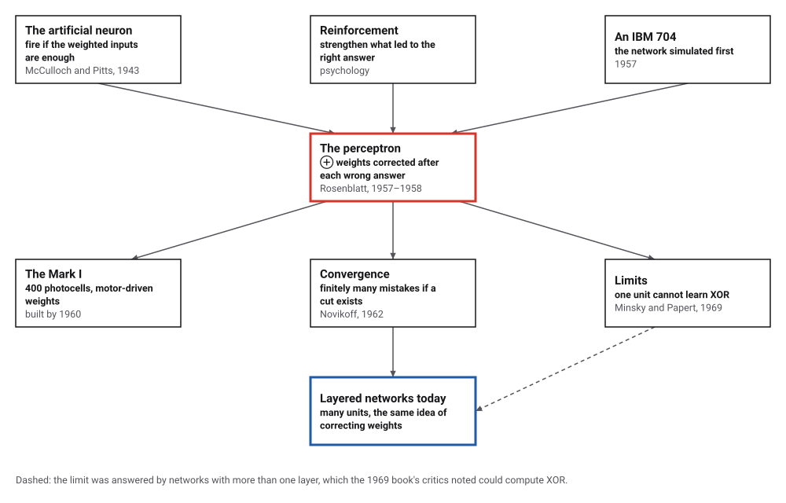
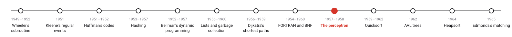
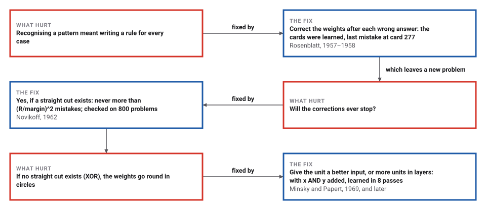
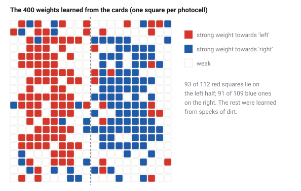

# Rosenblatt's Perceptron

*Era 5 · topic 9 · 1957–1958* · [Era 5 index](../README.md) · [← The Compiler, and a Grammar for Languages](../08-the-compiler/README.md) · [Hoare's Quicksort →](../10-quicksort/README.md) · [Interactive edition](perceptron.html) · [Program](../../../code/era-05-the-programmers-craft/09-perceptron/)

> **Field note from the visiting historian.** Cards marked on the left or the right: the machine's last mistake came at card 277, and it then judged 99.17% of new cards correctly. Its weights, drawn as a picture, show what it learned. The newspapers of 1958 promised far more than it could do; a Cornell headline later called it sixty years too soon.

| | |
|---|---|
| **When** | Simulated 1957; demonstrated July 1958 |
| **Where** | Cornell Aeronautical Laboratory, Buffalo |
| **What hurt** | A hand-written rule for every pattern |
| **The fix** | Correct the weights after each wrong answer |
| **Limit** | Only patterns a straight cut can separate |

## How ideas combined

A new algorithm is usually an older idea combined with a new one. McCulloch and Pitts had described a neuron that fires when its weighted inputs are enough. Rosenblatt, a psychologist, let the weights change: after every wrong answer, each weight moves a little towards the answer that would have been right. Each box names the idea that was added.

<picture>
  <source media="(prefers-color-scheme: dark)" srcset="assets/family-dark.svg">
  
</picture>
*Red: the perceptron. Blue: layered networks today.*

## Watch a line learn where to fall

A perceptron with two inputs draws a straight line: yes on one side, no on the other. Each pass shows it every point; for each wrong answer it adds the point to its weights (or subtracts it, for a false yes), which pulls the line towards answering that point correctly. Try the random set, add your own points, then try the XOR corners.

| Two-input function | Learned by one perceptron? |
|---|---|
| FALSE | yes |
| AND | yes |
| x-AND-NOT-y | yes |
| x | yes |
| y-AND-NOT-x | yes |
| y | yes |
| OR | yes |
| NOR | yes |
| NOT-y | yes |
| x-OR-NOT-y | yes |
| NOT-x | yes |
| y-OR-NOT-x | yes |
| NAND | yes |
| TRUE | yes |
| XOR | no (never, in 1,000 passes) |
| XNOR | no (never, in 1,000 passes) |
*In the interactive edition you can add points and train a two-input perceptron.*

## Era 5, the programmer's craft

<picture>
  <source media="(prefers-color-scheme: dark)" srcset="assets/era-timeline-dark.svg">
  
</picture>

## Each fix leaves a new pain

<picture>
  <source media="(prefers-color-scheme: dark)" srcset="assets/chain-dark.svg">
  
</picture>
*Read it as a snake: each new problem sits directly under the fix that exposed it.*

## Add the input, or subtract it

**The unit.** Multiply each input by its weight, add them up with a bias, and answer yes if the total is positive. **The rule.** If the answer is wrong, add the input to the weights (for a missed yes) or subtract it (for a false yes), and change the bias by one; if it is right, do nothing. The modern statement is a simplification: Rosenblatt's 1958 paper describes several systems of reinforcement.

**The cards.** Like the 1958 demonstration, cards marked on the left or the right; here 20 × 20 cells, the Mark I's 400 photocells, with a 3 × 3 mark anywhere in one half and 8 specks of dirt. The weights it learned: The perceptron's last mistake came at card 277 (24 mistakes in all); then it was right 200 times in a row, and on 10,000 new cards it was right 9,917 times (99.17%).

<picture>
  <source media="(prefers-color-scheme: dark)" srcset="assets/weights-dark.svg">
  
</picture>

> **Key idea.** Don't write the rule: correct the machine every time it is wrong. If a straight cut can separate the two kinds of example, the corrections stop after a limited number of mistakes.

## The mistake bound, and what one unit cannot learn

**The bound.** 800 random problems: 400 points in a cube, a random cut through the centre, no point closer to it than 0.05. The perceptron always finished, and its mistakes never exceeded (R / 0.05)², R being the largest distance of a point from the centre.

| Dimensions | Mistakes on average | Bound on average |
|---|---|---|
| 2 | 8 | 752 |
| 5 | 50 | 1494 |
| 10 | 110 | 2526 |
| 50 | 301 | 9254 |

**Two inputs, sixteen functions.** Of the 16 yes/no functions of two inputs, 14 were learned: FALSE, AND, x-AND-NOT-y, x, y-AND-NOT-x, y, OR, NOR, NOT-y, x-OR-NOT-y, NOT-x, y-OR-NOT-x, NAND, TRUE. Never learned in 1,000 passes: XOR and XNOR, the two for which no straight line separates the yes corners from the no corners.

**XOR.** After 3 passes through the four examples, the weights were back at a setting they had held before, still wrong on 4 of them: they would cycle for ever. Given x AND y as a third input, the perceptron learned XOR in 8 passes, with weights 1, 1, -3 and bias 0: (1,1) gives 1 + 1 − 3 = −1, no.

## A Navy press conference

At the Cornell Aeronautical Laboratory, Rosenblatt "simulated the perceptron on an IBM 704" (1957); the Office of Naval Research and the Rome Air Development Center funded the Mark I, with "An array of 400 photocells arranged in a 20x20 grid" and weights in potentiometers whose updates "were performed by electric motors" (Wikipedia). "In July 1958, the U.S. Office of Naval Research unveiled a remarkable invention"; "After 50 trials, the computer taught itself to distinguish cards marked on the left from cards marked on the right" (Cornell Chronicle).

The *New York Times* headline: "NEW NAVY DEVICE LEARNS BY DOING: Psychologist Shows Embryo of Computer Designed to Read and Grow Wiser"; it called the perceptron "the embryo of an electronic computer that [the Navy] expects will be able to walk, talk, see", and the claims caused controversy. The paper, in *Psychological Review* (1958), begins: "If we are eventually to understand the capability of higher organisms for perceptual recognition, generalization, recall, and thinking, we must first have answers to three fundamental questions." Minsky and Papert's book (1969) showed that such networks could not learn XOR, and interest fell for about a decade. Rosenblatt died in 1971, on his 43rd birthday.

## Sixty years too soon

The Cornell Chronicle's headline in 2019 called it the perceptron that "paved the way for AI – 60 years too soon", and quoted a Cornell professor: "in hindsight, his algorithm is still fundamental to how we're training deep networks today." Today's networks stack many layers of such units and correct all their weights at once; the XOR that defeated one unit is easy for two layers.

> **Full circle.** The machine was never told what "left" means. After 24 corrections its weights, drawn as a picture, show the answer: mostly red on the left half, mostly blue on the right.

## Before you read on

<details>
<summary><b>1.</b> Weights 0, 0, bias 0; the example (1, 1) should be yes. What happens?</summary>

The total is 0, not positive: a wrong no. Add the input: weights 1, 1, bias 1.
</details>

<details>
<summary><b>2.</b> Why does a right answer change nothing?</summary>

The rule only corrects mistakes; a right answer gives no reason to move the line.
</details>

<details>
<summary><b>3.</b> Can a single perceptron learn AND? OR? XOR?</summary>

AND and OR, yes: a straight line separates their yes corners. XOR, no.
</details>

<details>
<summary><b>4.</b> Why did adding x AND y as an input fix XOR?</summary>

In three dimensions the four corners can be cut by a flat plane: the new input lifts the (1,1) corner away from the others.
</details>

<details>
<summary><b>5.</b> What does the mistake bound depend on?</summary>

On how far the points spread (R) compared with the gap around the cut (the margin), not on how many points there are.
</details>


## Where the evidence lives

| | Object | Where to see it | Licence |
|---|---|---|---|
| — | **The Mark I Perceptron**. The machine with 400 photocells and motor-driven weights, now in the Smithsonian Institution. | [Cornell Chronicle](https://news.cornell.edu/node/313946) | Drawn placeholder. |
| — | **The Perceptron (1958)**. Rosenblatt's paper in Psychological Review 65(6): 386–408. | [PDF on a course page](https://homepages.math.uic.edu/~lreyzin/papers/rosenblatt58.pdf) | Drawn placeholder. |

## Every link was opened before it was listed

| Level | Link | Why |
|---|---|---|
| Start | [Professor's perceptron paved the way for AI – 60 years too soon](https://news.cornell.edu/node/313946) — Melanie Lefkowitz, Cornell Chronicle (2019) | The 1958 demonstration, the cards, and the headlines |
| Start | [Perceptron](https://en.wikipedia.org/wiki/Perceptron) — Wikipedia | The learning rule, the Mark I, the convergence theorem and XOR |
| Deeper | [Frank Rosenblatt](https://en.wikipedia.org/wiki/Frank_Rosenblatt) — Wikipedia | His life, the Mark I and *Principles of Neurodynamics* |
| Scholar | [The Perceptron: A Probabilistic Model for Information Storage and Organization in the Brain](https://homepages.math.uic.edu/~lreyzin/papers/rosenblatt58.pdf) — F. Rosenblatt, *Psychological Review* 65(6): 386–408 (1958), on a University of Illinois Chicago page | The paper: three questions about perception and a machine to answer them |

More, with certainty labels and the gaps we could not fill: [Era 5 reference catalog](https://github.com/vij658/AlgorithmEvolutionAtlas/blob/main/book/era-05-the-programmers-craft/reference-catalog.md).

## The program behind every number here

[Perceptron.java](https://github.com/vij658/AlgorithmEvolutionAtlas/blob/main/code/era-05-the-programmers-craft/09-perceptron/Perceptron.java) makes **2,082 checks**: cards learned and tested on 10,000 new ones, the mistake bound on 800 random problems, all 16 two-input functions, and XOR with and without a helping input. Run it with `java Perceptron.java` (JDK 17 or newer). The heart of it:

```java
    /** Show one example; learn if wrong; return true if it was right. */
    boolean learn(double[] x, boolean yes) {
        if (answer(x) == yes) return true;
        double d = yes ? 1 : -1;
        for (int i = 0; i < x.length; i++) w[i] += d * x[i];
        b += d;
        mistakes++;
        return false;
    }
```

