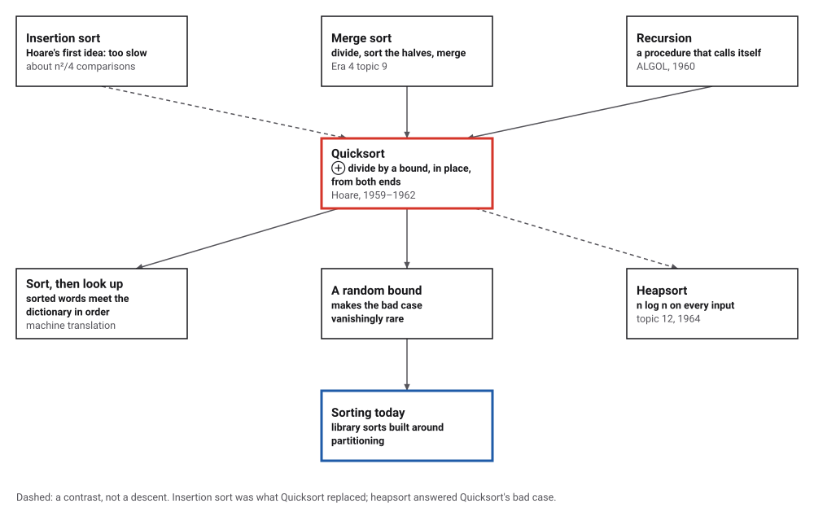
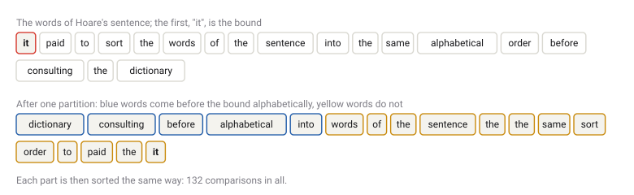
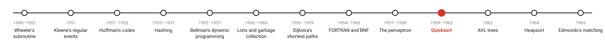
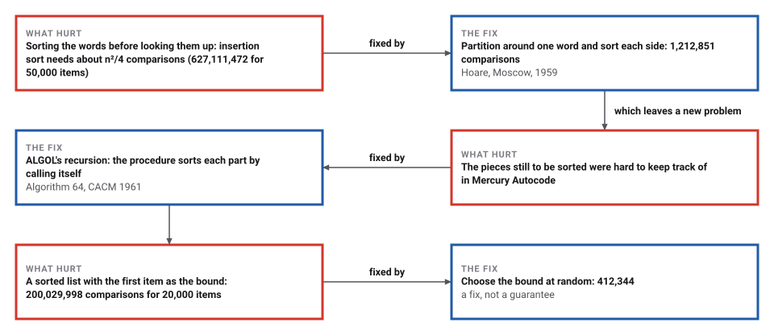

# Hoare's Quicksort

*Era 5 · topic 10 · 1959–1962* · [Era 5 index](../README.md) · [← Rosenblatt's Perceptron](../09-perceptron/README.md) · [AVL Trees →](../11-avl-trees/README.md) · [Interactive edition](quicksort.html) · [Program](../../../code/era-05-the-programmers-craft/10-quicksort/)

> **Field note from the visiting historian.** I sorted the sentence in which Hoare explained why he needed a sort: 132 comparisons. On a million random items his method needed 31,244,635; on 50,000, insertion sort needed 627,111,472. He called it the second thing he thought of. He died in March 2026, sixty-seven years after Moscow.

| | |
|---|---|
| **When** | Moscow 1959; CACM 1961; paper 1962 |
| **Where** | Moscow State University; Elliott Brothers |
| **What hurt** | Insertion sort's n² comparisons; merging needs a copy |
| **The fix** | Partition around a bound, in place; recurse |
| **Cost** | About 1.57 n log₂ n here; n²/2 in the bad case |

## How ideas combined

A new algorithm is usually an older idea combined with a new one. Merge sort (Era 4) divided a list into halves, sorted them, and merged, but merging needs a second list as large as the first. Hoare divided differently: around one item, the bound, swapping items between the two ends of the list itself. Recursion, from ALGOL, made the rest a few lines. Each box names the idea that was added.

<picture>
  <source media="(prefers-color-scheme: dark)" srcset="assets/family-dark.svg">
  
</picture>
*Red: Quicksort. Blue: sorting today.*

## Watch the two fingers

Thirty-two bars. Step through Hoare's partition: the bound is red; the left finger (blue) moves right until it finds a bar not shorter than the bound, the right finger (yellow) moves left until it finds one not taller; the two are swapped, and so on until the fingers meet. Then each part is sorted the same way. Try a sorted input with each kind of bound, and compare the comparisons.

<picture>
  <source media="(prefers-color-scheme: dark)" srcset="assets/words-dark.svg">
  
</picture>
*In the interactive edition you can step through the partition on 32 bars.*

## Era 5, the programmer's craft

<picture>
  <source media="(prefers-color-scheme: dark)" srcset="assets/era-timeline-dark.svg">
  
</picture>

## Each fix leaves a new pain

<picture>
  <source media="(prefers-color-scheme: dark)" srcset="assets/chain-dark.svg">
  
</picture>
*Read it as a snake: each new problem sits directly under the fix that exposed it.*

## Partition, then do it again

**Hoare's own sentence.** He recalled that "it paid to sort the words of the sentence into the same alphabetical order before consulting the dictionary". The program sorts that very sentence. The first word, "it", is the bound; after one partition the words [dictionary consulting before alphabetical into] come before it, and [words of the sentence the the same sort order to paid the it] do not. Each part is sorted the same way: 132 comparisons in all, ending alphabetical before consulting dictionary into it of order paid same sentence sort the the the the to words.

**Why it is fast.** A partition looks at each item about once. If the bound splits the list roughly in half each time, there are about log₂ n levels of halving, so the work is about n log n comparisons. If every bound is the smallest item, each partition peels off one item and the work is about n²/2.

| Items | Orderings (all tried) | Average comparisons |
|---|---|---|
| 3 | 6 | 2.6667 |
| 4 | 24 | 4.8333 |
| 5 | 120 | 7.4000 |
| 6 | 720 | 10.3000 |
| 7 | 5,040 | 13.4857 |
| 8 | 40,320 | 16.9214 |
| 9 | 362,880 | 20.5794 |

Sorting every ordering of up to 9 items, with each item compared with the bound once per partition: each average equals 2(n+1)(1 + 1/2 + … + 1/n) − 4n exactly, which grows like 2n ln n ≈ 1.39 n log₂ n.

> **Key idea.** Split the list in place around one item, so that everything on the left is no larger than everything on the right; then the two parts can be sorted separately, and nothing ever has to be merged.

## Large lists, bad lists

| Items (random order) | Comparisons | × n log₂ n | Lower bound log₂ n! (× n log₂ n) |
|---|---|---|---|
| 1,000 | 15,255 | 1.53 | 0.86 |
| 10,000 | 205,361 | 1.55 | 0.89 |
| 100,000 | 2,535,082 | 1.53 | 0.91 |
| 1,000,000 | 31,244,635 | 1.57 | 0.93 |

The two-finger partition keeps the bound inside one of the parts and compares the items where the fingers meet twice, so it needs somewhat more than the 1.39 n log₂ n of the exact count above. No method that compares items can sort every list with fewer than log₂ n! comparisons.

| Items | Insertion sort (Hoare's first idea) | Quicksort |
|---|---|---|
| 1,000 | 254,227 | 16,353 |
| 10,000 | 25,254,112 | 209,960 |
| **50,000** | **627,111,472** | **1,212,851** |

**The bad case.** An already sorted list of 20,000 items, with the first item as the bound: 200,029,998 comparisons, more than n²/2 = 200,000,000. With the bound chosen at random, the same list takes 412,344 (1.44 n log₂ n).

## Moscow, a dictionary, and a sixpence

"The quicksort algorithm was developed in 1959 by Tony Hoare while he was a visiting student at Moscow State University", on a machine translation project for the National Physical Laboratory; his first idea, insertion sort, was too slow; he wrote the partition in Mercury Autocode but "had trouble dealing with the list of unsorted segments"; "Later, Hoare learned about ALGOL and its ability to do recursion". Back in England, asked to write Shellsort, he said he knew a faster algorithm, and "his boss bet a sixpence that he did not" (Wikipedia). The algorithms appeared as "Algorithm 63: partition and Algorithm 64: Quicksort" in *Communications of the ACM* in July 1961, and the analysis in *The Computer Journal* 5(1): 10–15 (1962).

Hoare, interviewed in 2006: "I thought of Quicksort as the second thing. It didn't occur to me that this was anything very difficult"; "I think Quicksort is the only really interesting algorithm that I ever developed." He died on 5 March 2026, at the age of 92 (Wolfson College, Oxford; Computer History Museum).

## The second thing he thought of

Hoare called Quicksort the second thing he thought of, after insertion sort, and the only really interesting algorithm he ever developed. The bad case he analysed is why a careful implementation chooses its bound at random or with care, and why heapsort (topic 12) was welcome two years later.

> **Full circle.** The sentence Hoare used to explain why he needed a sort, sorted by his own method: 132 comparisons.

## Before you read on

<details>
<summary><b>1.</b> Partition 5 3 8 1 9 2 around the bound 5 with two fingers. What happens first?</summary>

The left finger stops at 5 itself (not smaller), the right finger at 2 (not larger): swap them, giving 2 3 8 1 9 5, and continue.
</details>

<details>
<summary><b>2.</b> Why does a bound that splits the list in half give about n log₂ n comparisons?</summary>

Each level of splitting looks at all n items once, and halving reaches single items after about log₂ n levels.
</details>

<details>
<summary><b>3.</b> What does a sorted list do to Quicksort with the first item as the bound?</summary>

Every partition splits off just the bound itself; there are n levels, and the work is about n²/2.
</details>

<details>
<summary><b>4.</b> Why does a random bound help?</summary>

No particular input is bad any more; a bad run needs bad luck at many levels, which is vanishingly rare.
</details>

<details>
<summary><b>5.</b> What does Quicksort need that merge sort does not, and the other way round?</summary>

Quicksort needs no second list, but it has a bad case; merge sort is n log n always, but needs room for a copy.
</details>


## Where the evidence lives

| | Object | Where to see it | Licence |
|---|---|---|---|
| — | **Quicksort (1962)**. Hoare's paper in The Computer Journal 5(1): 10–15, with the analysis. | [Oxford record](https://www.cs.ox.ac.uk/publications/publication8195-abstract.html) | Drawn placeholder. |
| — | **Oral history of Sir Antony Hoare (2006)**. Interviewed by Jonathan P. Bowen for the Computer History Museum. | [CHM catalogue](https://www.computerhistory.org/collections/catalog/102658017) | Drawn placeholder. |

## Every link was opened before it was listed

| Level | Link | Why |
|---|---|---|
| Start | [Quicksort](https://en.wikipedia.org/wiki/Quicksort) — Wikipedia | Moscow, Mercury Autocode, the sixpence, and the analysis |
| Start | [In Memoriam: Sir Antony Hoare (1934–2026)](https://computerhistory.org/blog/in-memoriam-sir-antony-hoare-1934-2026/) — Dag Spicer, Computer History Museum (2026) | His life and work, from Quicksort to the null reference |
| Deeper | [An Interview With C.A.R. Hoare](https://cacm.acm.org/?p=20664) — Jonathan P. Bowen (2006), edited for *Communications of the ACM* | Quicksort in Hoare's own words |
| Deeper | [Tony Hoare](https://www.cs.ox.ac.uk/people/tony.hoare) — University of Oxford, Department of Computer Science | Career outline |
| Deeper | [Wolfson Emeritus Fellow Professor Sir Tony Hoare dies](https://www.wolfson.ox.ac.uk/news/wolfson-emeritus-fellow-professor-sir-tony-hoare-dies/) — Wolfson College, Oxford (16 March 2026) | The college's notice |
| Scholar | [Quicksort](https://www.cs.ox.ac.uk/publications/publication8195-abstract.html) — C. A. R. Hoare, *The Computer Journal* 5(1): 10–15 (1962), Oxford publication record | The paper with the analysis |
| Scholar | [Oral history of Sir Antony Hoare](https://www.computerhistory.org/collections/catalog/102658017) — Interview by Jonathan P. Bowen, 8 September 2006, Computer History Museum | The recorded interview behind the CACM excerpt |

More, with certainty labels and the gaps we could not fill: [Era 5 reference catalog](https://github.com/vij658/AlgorithmEvolutionAtlas/blob/main/book/era-05-the-programmers-craft/reference-catalog.md).

## The program behind every number here

[Quicksort.java](https://github.com/vij658/AlgorithmEvolutionAtlas/blob/main/code/era-05-the-programmers-craft/10-quicksort/Quicksort.java) makes **4,800,817 checks**: Hoare's sentence sorted, every ordering of up to 9 items against the exact formula, random lists up to a million items, insertion sort, and the sorted-input worst case with both kinds of bound. Run it with `java Quicksort.java` (JDK 17 or newer). The heart of it:

```java
/** Hoare's partition with two fingers; returns j such that a[lo..j] <= a[j+1..hi]. */
static <T extends Comparable<T>> int partition(T[] a, int lo, int hi) {
    if (randomBound) swap(a, lo, lo + rnd(hi - lo + 1));
    T bound = a[lo];
    int i = lo - 1, j = hi + 1;
    while (true) {
        do i++; while (less(a[i], bound));
        do j--; while (less(bound, a[j]));
        if (i >= j) return j;
        swap(a, i, j);
    }
}
```

